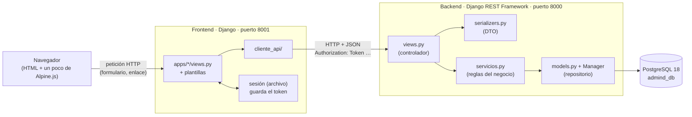

# Visión general de la arquitectura

**La idea central en tres frases:**

1. Hay **dos proyectos Django separados**: el backend es una API que habla JSON y es el único que toca PostgreSQL; el frontend arma las páginas HTML y le pide todo a la API.
2. Todo dato de un conjunto se filtra **automáticamente** por el "conjunto activo" de la sesión; nadie puede pedir datos de otro conjunto ni por error.
3. Las pantallas son **HTML generado en el servidor** (plantillas de Django). JavaScript solo aparece donde de verdad hace falta, y ahí se usa **Alpine.js**.

## El diagrama

## La analogía del restaurante

| En el restaurante | En AdMind | Dónde |
|---|---|---|
| El **comedor**, donde el cliente ve la carta | Las pantallas | `Frontend/…/apps/` y `templates/` |
| El **mesero**, que lleva pedidos y trae platos | `cliente_api/` | `Frontend/…/cliente_api/` |
| La **ventanilla** de la cocina, que revisa que el pedido venga completo | Vistas y serializers de la API | `Backend/…/apps/<app>/views.py`, `serializers.py` |
| El **chef**, que sabe las recetas y decide si se puede preparar | Los servicios | `Backend/…/apps/<app>/servicios.py` |
| El **despensero**, el único que entra a la despensa | Los modelos y su Manager | `models.py` + `apps/comun/aislamiento/managers.py` |
| La **despensa** | PostgreSQL | base `admind_db` |

Tres reglas salen de aquí, y son casi toda la arquitectura:

1. **El mesero nunca entra a la despensa.** El frontend tiene `DATABASES = {}`: literalmente no puede tocar la base.
2. **El de la ventanilla no cocina.** La vista de la API valida la entrada, revisa permisos y traduce el resultado a HTTP. Las reglas del negocio están en `servicios.py`, que **no sabe nada de HTTP**.
3. **El despensero siempre usa la lista del conjunto correcto.** Toda consulta sale filtrada por el conjunto activo sin que nadie lo escriba ([aislamiento](../03_Reglas/aislamiento.md)).

> [!IMPORTANT] Lo que pide el profesor
> El flujo **controlador → servicio → repositorio** (su plantilla de ASP.NET). Los nombres y la ubicación de las carpetas le dan igual. En Django la equivalencia es: `views.py` = Controllers, `serializers.py` = Dtos, `servicios.py` = Services, Manager/`models.py` = Repositories, `apps/comun/` = Utilities. En la sustentación lo que se evalúa es **la dirección de las llamadas**: la vista no hace consultas al ORM por su cuenta y el servicio no devuelve respuestas HTTP.

## ¿Por qué dos servidores y no uno?

Porque el objetivo del proyecto es que **back y front estén separados y se comuniquen por una API**. Mañana otra interfaz (una app móvil, por ejemplo) podría usar la misma API sin tocar el backend. El precio es que el front tiene que "traducir" cada pantalla en llamadas HTTP, y eso es exactamente lo que hace `cliente_api/`.

## Ver también

- [mapa_codigo](mapa_codigo.md) — qué hay en cada carpeta
- [backend](backend.md) y [frontend](frontend.md) — cada servidor por dentro
- [capas](../03_Reglas/capas.md) — qué va en cada capa
- [aislamiento](../03_Reglas/aislamiento.md) — el filtro por conjunto activo
