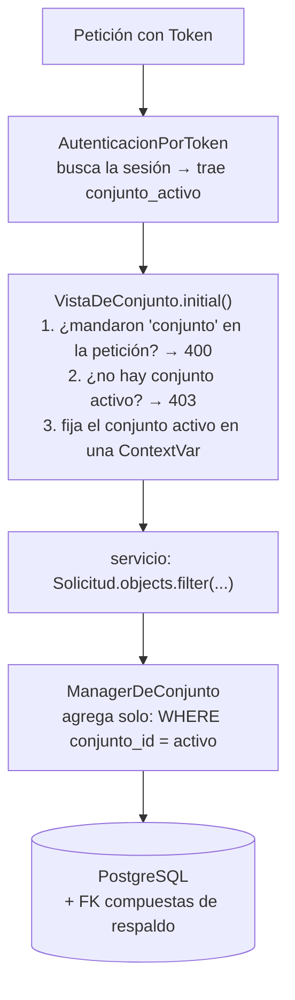

# Aislamiento entre conjuntos (blindaje de datos)

> [!WARNING] Decisiones posteriores al texto del maestro
> - Lo que el maestro llama *middleware* es `VistaDeConjunto`, una vista base de DRF (2026-09-15).
> - La lista cerrada de tablas globales vigente es la de `tests/esquema/test_tablas_globales.py`: además de las de abajo incluye `conjuntos_conjunto`, `cuentas_tokendesesion` y las dos tablas de `PermissionsMixin`, y admite `conjunto_id` nulo en `permisos_asignacion`.
>
> Detalle en [construccion](../06_Decisiones/construccion.md).

## Diseño (maestro §5.4)

**El problema sin jerga.** Una sola base guarda a todos los conjuntos. Las reservas de "Torres del Río" y las del "Mirador" están en la misma tabla, distinguidas por una columna. **Lo único que los separa es que cada consulta se acuerde de filtrar** — y ese "acordarse" es lo que falla en un proyecto de dos personas con prisa. Cuando falla, la aplicación no se rompe: funciona perfectamente y le muestra a un residente de Torres del Río el listado de morosos del Mirador. Eso es tratamiento no autorizado bajo la Ley 1581.

**En la base de datos:**

- `conjunto_id NOT NULL` en toda tabla, sin valores por defecto, con **una lista cerrada de excepciones**: `Persona`, `Usuario` y los catálogos de roles y permisos
- **Llaves foráneas compuestas.** Si `reservas` referencia `areas`, la FK es `(area_id, conjunto_id)` contra una clave única `(id, conjunto_id)`. La base **rechaza físicamente** la fila cruzada
- Toda clave única incluye `conjunto_id` — la torre "1" de A y la de B deben coexistir
- Índices encabezados por `conjunto_id`
- Privilegios del usuario de aplicación: sin `UPDATE` ni `DELETE` sobre auditoría, sin DDL en producción, ninguna FK con `ON DELETE CASCADE`

**En los accesos:**

- El conjunto activo **sale de la sesión**, resuelto en middleware como contexto de solo lectura. **Ningún controlador acepta `conjunto_id` como parámetro**: si aparece en la URL o el cuerpo, se rechaza
- Un repositorio base inyecta `WHERE conjunto_id = :ctx` en toda consulta. Nada de SQL crudo fuera de ahí
- `findById(id, ctx.conjuntoId)`, nunca `findById(id)` a secas. Cuando no aparece se responde **404, no 403** — un 403 confirma que el recurso existe, y esa confirmación ya es información filtrada
- **Identificadores expuestos como UUID**
- Archivos: ruta con el conjunto adentro y nombre aleatorio (`conjunto/{uuid}/documentos/{uuid}.pdf`), almacenamiento no público, descarga por endpoint validado
- Mensajes de error sin datos de la fila que falló: `"No encontrado"`, nunca `"La reserva pertenece al conjunto Mirador"`

**Dos pruebas en la Definition of Done:**

1. **Prueba del intruso.** Usuario de A pide recurso de B por identificador → 404. La misma petición con `conjunto_id` de B en la URL → rechazada. Un listado con datos de A y B devuelve solo los de A
2. **Prueba de tablas globales.** Un recorrido por el esquema **falla** si alguna tabla fuera de la lista cerrada carece de `conjunto_id`

**Row Level Security se evaluó y se descartó.** Es la única defensa que protege contra un error que nadie revisó, pero exige que la conexión lleve una variable de sesión bien puesta en todas partes. Sostener eso cuesta más que las FK compuestas, que ya hacen imposible el dato cruzado en el punto donde nace.

## Cómo está construido (2026-09-30)

Es la pieza más importante del backend. Resuelve: *"un administrador del conjunto A nunca puede ver ni tocar datos del conjunto B"*.

| Archivo | Qué hace |
|---|---|
| `aislamiento/contexto.py` | Guarda el conjunto activo en una **ContextVar** (una variable "por petición": cada petición ve la suya). `usar_conjunto(id)` la fija a mano en pruebas y scripts |
| `aislamiento/vistas.py` → `VistaDeConjunto` | Clase base de **toda** vista con datos de un conjunto. Lee el conjunto de la sesión del token, **nunca** de la petición |
| `aislamiento/managers.py` → `ManagerDeConjunto` | Reemplaza `Modelo.objects`: toda consulta sale ya filtrada. Sin conjunto activo, falla a propósito |
| `aislamiento/migraciones.py` → `fk_compuesta()` | Segunda línea de defensa en la base: una fila no puede apuntar a otra de otro conjunto |
| `modelos_base/modelos.py` → `ModeloDeConjunto` | Clase base de todo modelo de conjunto: id UUID, `conjunto`, el Manager filtrado y un `save()` que rechaza escribir en otro conjunto |

> [!TIP] Por qué no es un "middleware"
> El maestro habla de middleware, pero los middleware de Django corren **antes** de que DRF lea el token. Por eso el trabajo lo hace `VistaDeConjunto`, que corre justo después de autenticar.

La prueba estrella es `tests/aislamiento/test_intruso.py`: recorre **todas** las rutas de la API con un usuario de otro conjunto y verifica que no ve nada. Si mañana alguien agrega una vista que no hereda de `VistaDeConjunto`, esa prueba falla.

## Límites conocidos (2026-09-27)

No son errores, pero hay que tenerlos presentes:

- `bulk_create()` y `update()` se saltan `save()`, así que no validan que la fila sea del conjunto activo. La FK compuesta sigue impidiendo apuntar a otro conjunto, pero no protege el `conjunto_id` de la propia fila
- `Asignacion` no hereda de `ModeloDeConjunto` (su conjunto puede ser nulo): sus consultas no se filtran solas por el conjunto activo
- `ManagerDeConjunto` falla sin conjunto activo. En una petición lo fija `VistaDeConjunto`; el admin de Django, el `shell` o un script necesitan `usar_conjunto()`
- Una vista con datos de un conjunto que no herede de `VistaDeConjunto` falla con error 500 (no hay conjunto activo), y la prueba transversal de rutas la marca como no registrada
- `reserva.area` y demás relaciones hacia adelante no pasan por el filtro (Django usa su manager interno); la FK compuesta garantiza que son del mismo conjunto

## Ver también

- [invariantes](invariantes.md) — cómo se aplica al escribir código nuevo
- [restricciones_bd](../02_Arquitectura/restricciones_bd.md) — las FK compuestas, tabla por tabla
- [personas](../05_Modulos/personas.md) — la tabla global que perfora el aislamiento a propósito
- [pruebas_y_ejecucion](../02_Arquitectura/pruebas_y_ejecucion.md) — la prueba del intruso y la de tablas globales
- [cerradas](../06_Decisiones/cerradas.md) — decisiones 1, 14 y 25
- [riesgos](../06_Decisiones/riesgos.md) — R6 y R12
- `Backend/Admind_Backend/apps/comun/README.md` y `tests/aislamiento/README.md`
