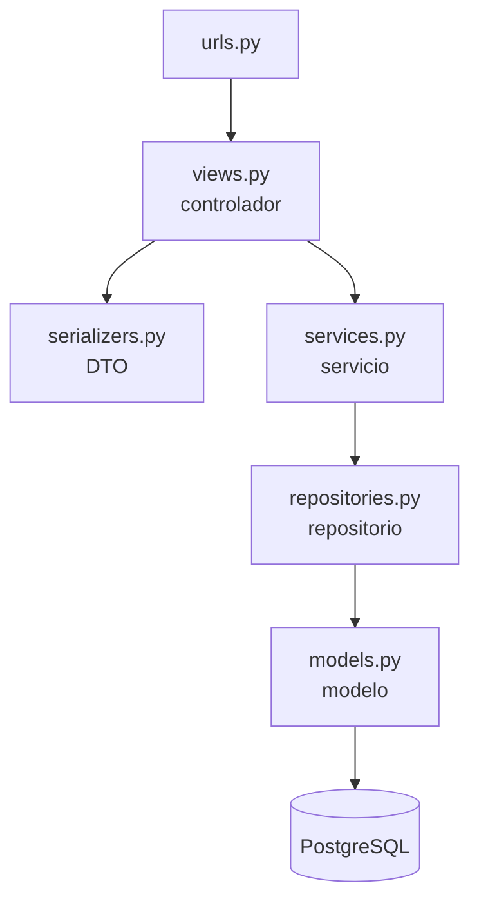

# Capas: qué va en cada archivo

> [!NOTE] Nombres de archivo
> Este texto es del 2026-09-15, antes de que existiera el código. En el código real la capa de servicio es `servicios.py` (no `services.py`) y no hay `repositories.py`: el repositorio es el `ManagerDeConjunto` de cada modelo. Las reglas de dirección valen igual. La anatomía real de una app está en [backend](../02_Arquitectura/backend.md).

## La regla de dirección: las flechas solo bajan

Cada capa conoce **solo a la de abajo**. En la práctica:

- Si en `views.py` aparece `Area.objects`, la vista se está saltando dos capas.
- Si en `services.py` aparece `request` o `Response`, el servicio sabe de HTTP y ya no se puede usar desde otra entrada.
- Si en `repositories.py` aparece un `if` que decide si una operación está permitida, esa regla se escondió donde nadie la va a buscar.

## Por qué así — la respuesta para el jurado

- **Las reglas se prueban sin HTTP.** Un servicio se prueba llamando una función de Python: sin servidor, sin JSON, sin sesión. Las reglas del núcleo (bloqueo, estados, aislamiento) son justamente lo que más hay que probar.
- **Hay un solo lugar donde se filtra por conjunto.** Si las consultas quedan regadas por las vistas, cada vista tiene que acordarse de filtrar, y "acordarse" es lo que falla en un equipo de dos con prisa (maestro §5.4). Con repositorios, lo que hay que revisar es un archivo por app.
- **Una regla sirve a varias entradas.** La importación masiva (HU-36) crea personas desde un Excel, no desde una petición HTTP. Si la regla vive en el servicio, la importación la reutiliza; si vive en la vista, se copia, y un día las dos copias dicen cosas distintas.

## Qué código de respuesta usar

| Situación | Código | Quién lo produce |
|---|---|---|
| Lectura correcta | `200` | La vista |
| Se creó algo | `201` | La vista |
| El JSON no tiene la forma correcta | `400` | El serializer, con `is_valid(raise_exception=True)` |
| La operación no existe para ese recurso (prioridad sobre un Evento, maestro §5.7) | `400` | La vista o el serializer |
| Quien pide no tiene el permiso de la operación | `403` | La clase de permiso |
| El recurso no existe **o es de otro conjunto** | `404`, **nunca** `403` | La vista, a partir de lo que diga el servicio |
| El estado actual no permite la operación (rechazar algo que ya está reservado) | `409` (**Propuesta**) | La vista, a partir de lo que diga el servicio |

**El 404 para lo que es de otro conjunto no es un detalle:** un 403 le confirma al intruso que el recurso existe, y esa confirmación ya es información filtrada (maestro §5.4). Por lo mismo, los mensajes de error no llevan datos de la fila: `"No encontrado"`, nunca `"La reserva pertenece al conjunto Mirador"`.

## ¿Dónde va cada cosa?

Esta es la pregunta que más se repite al construir. Hazte estas preguntas **en orden** y quédate con la primera que responda que sí:

1. **¿Lo prohíbe la ley (maestro §4)?** → No va en ninguna parte. No se programa como permiso denegado: **la operación no existe**.
2. **¿Es sobre quién puede intentar la operación?** → Permiso declarado en la vista.
3. **¿Se puede comprobar mirando solo los datos que llegaron en la petición?** → Serializer.
4. **¿Necesita consultar la base o el estado actual del sistema?** → Servicio.
5. **¿Es buscar o guardar datos?** → Repositorio.
6. **¿Tiene que ser imposible aunque alguien se salte el código?** → Además, restricción en la base (en el modelo o en una migración).
7. **¿Es cómo se ve o cómo se dice?** → Plantilla, componente o CSS con variables, en el frontend.

Con ejemplos reales de AdMind:

| Lo que vas a escribir | Dónde va | Por qué |
|---|---|---|
| "Solo el administrador puede aprobar una reserva" | Permiso `reserva.aprobar` declarado en la vista; el catálogo vive en `apps/permisos/` | Es sobre quién puede intentarlo (maestro §5.3) |
| "La categoría de rechazo es obligatoria y de lista cerrada" | Serializer, y un `CHECK` en la base | Se ve en la petición y tiene que ser imposible saltárselo |
| "Con la categoría `OTRO`, el texto libre es obligatorio" | `validate()` del serializer | Depende solo de lo que llegó |
| "Solo se puede rechazar una solicitud `APARTADA`" | Servicio | Depende del estado guardado |
| "Solo reserva quien tiene un vínculo vigente con `reside = true`" | Servicio de `reservas`, que le pregunta al servicio de `unidades` | Depende de datos de otra app (maestro §5.5) |
| "No hay dos solicitudes bloqueantes sobre la misma franja" | Índice único parcial en la base **y** transacción en el servicio | Tiene que ser imposible aunque dos lleguen en el mismo milisegundo (maestro §5.1, R7) |
| "Filtrar por conjunto" | Repositorio, apoyado en `apps/comun/aislamiento/` | Un solo lugar (maestro §5.4) |
| "El número de documento se guarda sin puntos" | `save()` del modelo y `CHECK` en la base | Ya está así en `Persona` |
| "Registrar quién rechazó y cuándo" | Servicio, llamando a `apps/auditoria/` | Toda escritura deja registro |
| "Avisarle al residente que lo rechazaron" | Servicio, llamando a `apps/notificaciones/` cuando se confirma la transacción | A quién le llega lo resuelve `unidades`; por dónde, `notificaciones` |
| "Sábado 26 de diciembre de 2026" | Plantilla del frontend | Es presentación (maestro §5.1) |
| La palabra "Rechazada" en su pastilla | Plantilla, con `am-pastilla--error` | Un estado se muestra como pastilla (maestro §6.1) |
| La cuenta regresiva de 3 minutos | `static/js/` con Alpine | Solo muestra; el vencimiento lo decide la API |
| "Que el administrador pueda multar" | En ninguna parte | Operación inexistente (maestro §4.2) |
| "Borrar un vínculo de unidad" | En ninguna parte: se cierra `vigencia_hasta` | No hay borrado físico (maestro §5.11) |

## Cómo se hablan las apps entre sí

- **Decidido:** `comun` y `auditoria` no importan ninguna app de negocio; todas las demás las usan a ellas (`apps/README.md`).
- **Decidido:** las FK a otra app se escriben con texto (`"personas.Persona"`), no importando la clase.
- **Propuesta:** cuando una app necesita **una regla** de otra, llama a su servicio en vez de repetir la consulta. `reservas` no revisa por su cuenta si hay un vínculo vigente con `reside = true`: le pregunta a `unidades.services`. Leer datos relacionados por una FK está bien; decidir por otra app, no.
- **Señal de alarma:** si dos apps se importan mutuamente, o una pieza pertenece a `comun`, o una de las dos dependencias está al revés.

## Ver también

- [vision_general](../02_Arquitectura/vision_general.md) — el flujo controlador → servicio → repositorio que pide el profesor
- [invariantes](invariantes.md) — cómo se aplica en este código
- [backend](../02_Arquitectura/backend.md) — la anatomía real de una app
- [reglas_frontend](reglas_frontend.md) — lo mismo, del lado del front
- [legal](../01_Contexto/legal.md) — la pregunta 1: lo que la ley prohíbe
