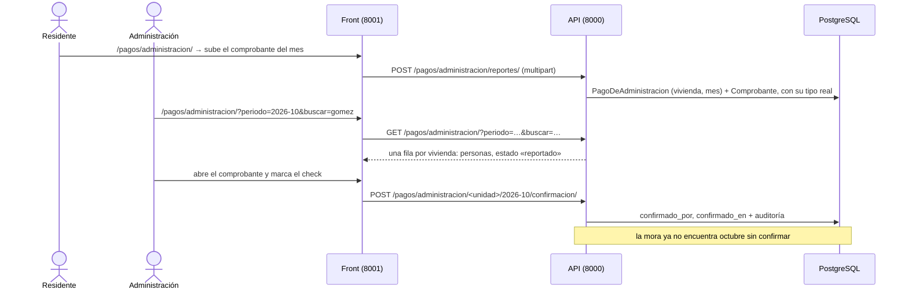

# Pagos: la administración por vivienda y mes

> [!NOTE] Construido el 2026-10-10, ya con commit y con sus migraciones aplicadas
> - Lo ejecutó el agente con [Plan_Pago_De_Administracion](../07_Planes/hechos/Plan_Pago_De_Administracion.md). Commits `f4c8ae6` (Backend) y `49c3e80` (Frontend); `pagos/0001`, `pagos/0002` y `reglas/0007` aplicadas en `admind_db` (verificado el 2026-10-11). Falta la prueba manual y avisarle a Camilo.
> - Esto es **HU-35**. HU-16, el pago del alquiler de una reserva, es otra cosa y vive en [reservas](reservas.md).
> - **Lo legal de la mora sigue sin verificar** ([abiertas](../06_Decisiones/abiertas.md) 12.10 b): Alejo eligió conectarla (D3 b) y se construyó con salvaguardas.

## Qué hace y qué no

**El sistema no verifica el dinero ni lo mueve.** No hay pasarela, ni monto, ni saldo, ni intereses ni multas ([legal](../01_Contexto/legal.md) §4.2). Registra dos hechos: que una persona de la vivienda **reportó** un pago con su comprobante, y que una persona de la administración lo **confirmó**. El aviso «AdMind no verifica el dinero: el pago lo confirma una persona de la administración» va en las dos pantallas y se escribe una sola vez, en `apps/pagos/views.py` del front.

| Quién | Qué hace | Permiso |
|---|---|---|
| Administración | Ve la tabla del mes, busca, abre comprobantes y **pone o quita el check** | `pago.ver` y `pago.confirmar` |
| Secretaría | Ve la tabla, busca y abre comprobantes; **no marca** | `pago.ver` |
| Residente (propietario o arrendatario, resida o no) | Ve los últimos 6 meses de su vivienda y **sube el comprobante** de un mes | `pago.reportar` |
| Vigilancia | Nada: el ítem «Pagos» no sale | — |

`pago.ver` exige segundo factor (muestra quién vive dónde y sus comprobantes). Subir un comprobante **no confirma** nada: lo confirma Administración cuando lo verifica, y puede marcar sin comprobante (el pago pudo llegar por otro canal).

## Cómo está construido

| Qué | Dónde | Cómo |
|---|---|---|
| El pago de un mes | `PagoDeAdministracion` | Una fila por vivienda y mes (único en la base); `periodo` siempre el día 1 (`CHECK`). Guarda quién reportó, quién confirmó y cuándo; **el estado no se guarda**: `sin_reporte`, `reportado` o `confirmado` se calcula de esos hechos |
| El archivo | `Comprobante`, dentro de la base | PDF, JPG o PNG de hasta 5 MB; **la firma del archivo decide el tipo**, no la extensión; SHA-256. La validación es la de `apps/comun/archivos/comprobantes.py`, la misma de HU-16. Subir otro no borra el anterior: el vigente es el más reciente |
| La tabla | `GET /pagos/administracion/?periodo=AAAA-MM&buscar=` | Parte de las viviendas y les pega el pago si existe. El buscador filtra **en el servidor**, sin tildes ni mayúsculas: por vivienda, por nombre de quien tiene vínculo vigente, o por documento (5 o más dígitos, por prefijo). **Ninguna fila trae el documento** |
| El check | `POST …/<unidad>/<AAAA-MM>/confirmacion/` `{confirmado}` | Con `select_for_update`; idempotente. Audita `pago.confirmar` o `pago.desmarcar` solo si algo cambió; quitar el check deja en la auditoría quién lo había puesto |
| Reportar | `POST …/reportes/` (multipart) | Solo una vivienda propia con vínculo vigente (si no, 404). Ventana: de 11 meses atrás al mes siguiente (400 bajo `periodo`). Con el mes confirmado, 409 |
| Mis pagos | `GET …/mios/` | Los últimos 6 meses de cada vivienda propia, con quién reportó y quién confirmó |
| Descargar | `GET …/comprobantes/<id>/` | `pago.ver`, o `pago.reportar` **y** vínculo vigente con la vivienda de ese pago. Otro, 404. `inline`, tipo guardado y `nosniff` |

## La mora (F5)

La respuesta a «¿está en mora?» la da `apps/pagos/mora.py`; `apps/reglas/mora.py` conserva su firma y delega con un `import` tardío (dependencia circular: `pagos` lee reglas y `reglas` pregunta por pagos). Los evaluadores de reservas y de ingresos no cambiaron.

- **La regla `DIA_LIMITE_DE_PAGO`** es alfa, con `{"dia": 1 a 28}`; ningún evaluador la evalúa, la lee `pagos`. Sin ella definida, **ninguna vivienda está en mora**.
- **Qué meses cuentan (D9 a):** desde el mes en que el conjunto definió por primera vez el día límite hasta el mes en curso si hoy pasó del día límite, o hasta el mes anterior si no. El día 10 con límite 10 no hay mora; el 11 sí.
- **Una vivienda está en mora** si le falta el check en alguno de esos meses. Quien debe tres meses y paga solo el último sigue en mora.
- **Lo que la mora toca:** únicamente la regla *paz y salvo*, que Administración enciende o no desde el tablero y cuya descripción advierte que se aplique solo si el reglamento lo permite; y solo reservas e ingresos a zonas comunes. No hay ninguna operación de sanción.

> [!WARNING] Definir el día límite a mitad de mes
> Con D9 a, el mes de la primera definición ya cuenta. Si Administración define el día límite un 20 y activa *paz y salvo*, toda vivienda sin su mes confirmado queda en mora de inmediato. Conviene confirmar los pagos del mes antes de encender *paz y salvo*.

## Lo que no hace

- Monto de la cuota, saldos, intereses y cartera ([maestro](../Admin_Master.md) §11.5).
- Avisos por el canal de notificaciones (al reportar, al confirmar o antes del día límite).
- Un documento de paz y salvo descargable, marcar varios checks de una vez e importar pagos.
- Depurar comprobantes al cumplirse un plazo de retención (Ley 1581): el plazo no está definido.
- Excluir de *paz y salvo* las áreas que sean bienes esenciales: las áreas no tienen clasificación desde el 2026-10-05.

## Ver también

- [motor_reglas](motor_reglas.md) — paz y salvo, día límite de pago y la mora
- [reservas](reservas.md) — el pago declarado de una reserva (HU-16), que es otra cosa
- [unidades](unidades.md) — vínculos vigentes: a quién corresponde cada hecho
- [ingresos](ingresos.md) — la mora también impide ingresar a una zona
- [legal](../01_Contexto/legal.md) y [abiertas](../06_Decisiones/abiertas.md) 12.10 b — lo legal de la mora, sin verificar
- [backend](../02_Arquitectura/backend.md) — la validación del comprobante por su firma
- [Plan_Pago_De_Administracion](../07_Planes/hechos/Plan_Pago_De_Administracion.md) — el plan con que se construyó
- [historias](../08_Estado/historias.md) — HU-35
- `Backend/Admind_Backend/apps/pagos/README.md`
