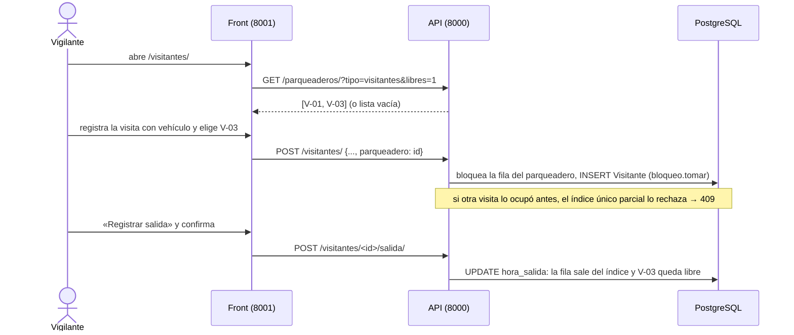

# Parqueaderos

> [!NOTE] HU-28 construida el 2026-10-10 (con commit y migrada); HU-34 construida el 2026-10-25 en la rama `feat/parqueaderos-asignacion`, sin commit ni `migrate`
> - **Está construido** el catálogo de parqueaderos y la ocupación de uno de visitantes por una visita ([Plan_Parqueadero_De_Visitantes](../07_Planes/hechos/Plan_Parqueadero_De_Visitantes.md)), y desde el 25/10 la asignación de los de residentes a una vivienda ([Plan_Parqueaderos_De_Residentes](../07_Planes/activos/Plan_Parqueaderos_De_Residentes.md)): asignar, reasignar, liberar, historial, tope por tipo de vehículo y «Mi parqueadero». Para los de visitantes la asignación no existe ni existirá.
> - Los parqueaderos son **puestos con código** que crea Administración (D2 a); el vigilante elige uno de los libres al registrar una visita con vehículo (D4 a). La ocupación **no es una tabla**: es el parqueadero de la visita mientras no tenga salida.
> - Alejo decidió D3 a (permiso nuevo `parqueadero.gestionar`), D5 a (cualquier visita con vehículo puede ocupar uno), D6 a y D7 a (lo de más de N horas y la Ley 1581 en portería, fuera) y D8 a (`migrate` lo corre él).

## Diseño (maestro §5.6)

**Un parqueadero se asigna a un apartamento.** Sin regímenes jurídicos, sin origen documental, sin advertencias legales. El sistema registra un hecho administrativo, no constituye un derecho.

```
Parqueadero                    AsignacionParqueadero
  conjunto_id                    parqueadero_id
  codigo                         unidad_id
  tipo ∈ {residentes,            vigencia_desde
          visitantes}            vigencia_hasta   (nullable)
  accesible : bool               registrado_por
  notas
```

Un parqueadero de residentes tiene **una asignación vigente a la vez**. Cerrarla es poner `vigencia_hasta`, nunca borrar: el historial responde "¿desde cuándo parquea ahí?" dos años después.

**Parqueaderos de visitantes.** No se asignan a una unidad. Su ocupación es **temporal y pertenece a la visita**, y termina al registrar la salida. `AsignacionParqueadero` no los admite: el tipo no aparece en el selector, **no es un permiso denegado sino una operación inexistente**.

**Límite duro:** no se puede quitar el parqueadero a un residente moroso ni como sanción. El sistema no tiene ninguna operación de restricción de uso, así que no hay dónde escogerlo.

## Cómo está construido (2026-10-10)



| Qué | Dónde | Cómo |
|---|---|---|
| El catálogo | `apps/parqueaderos/` | `Parqueadero`: `codigo` (único por conjunto, en mayúsculas), `tipo`, `accesible`, `notas`, `activo`. `GET` y `POST /parqueaderos/`, `POST /parqueaderos/<id>/desactivar/` (baja lógica; ocupado, 409) |
| Quién | `parqueadero.gestionar` (nuevo, Administración) crea y retira; `parqueadero.ver`, `parqueadero.gestionar` o `visitante.registrar` listan | `?tipo=` y `?libres=1`. Cada puesto dice si está `ocupado`, no por quién |
| La ocupación | `Visitante.parqueadero` (FK nula) y el índice único parcial `visitante_parqueadero_ocupado_unico` | Único por `(conjunto, parqueadero)` mientras `hora_salida IS NULL`. Se escribe y la base acepta a una sola; no se pregunta antes |
| La salida | `visitantes/servicios.registrar_salida` | `hora_salida` y quién la registró; el puesto queda libre al instante. Dos veces, 409 |
| El orden de los bloqueos | `registrar_ingreso` y `desactivar` | Toman la fila del parqueadero con `select_for_update`: no se retira un puesto justo cuando una visita entra |
| La auditoría | `parqueadero.crear`, `parqueadero.desactivar`, `visitante.registrar`, `visitante.salida` | El registro de la visita guarda unidad, si traía vehículo y el parqueadero; no el nombre ni la cédula |

### La asignación de residentes (HU-34, 2026-10-25)

| Qué | Dónde | Cómo |
|---|---|---|
| La asignación | `AsignacionParqueadero` (`parqueaderos/0002`) | `parqueadero`, `unidad`, `vigencia_desde`, `vigencia_hasta` (nula mientras vale), quién la registró y quién la cerró. Cerrarla es poner `vigencia_hasta`, nunca borrar |
| Una sola vigente por puesto | Índice único parcial `asignacion_parqueadero_vigente_unica` | La base lo hace cumplir: dos peticiones a la vez no se lo saltan |
| El vehículo | `Parqueadero.vehiculo` ∈ carro, moto, bicicleta (por defecto carro) | Con él se cuenta el tope |
| El tope por vivienda | Regla alfa `PARQUEADEROS_POR_VIVIENDA` (`reglas/0008`), `{carro, moto, bicicleta}` desde 0 | Cada conjunto fija el suyo. Sin la regla, sin tope. Solo limita asignaciones nuevas. Ningún evaluador de reservas la toca |
| Asignar y reasignar | `POST /parqueaderos/<id>/asignacion/ {unidad}` | `servicios.asignar`: bloquea el puesto y luego la vivienda (sin el segundo bloqueo, diez a la vez se saltaban el tope). Si el puesto ya era de otra vivienda, cierra esa hoy y crea la nueva (200 con `reasignada`); si estaba libre, 201. Mismo destino, 409; tope, 409 |
| Liberar | `POST /parqueaderos/<id>/liberacion/` | Cierra la vigente hoy. Ya libre, 409 |
| Historial | `GET /parqueaderos/<id>/asignaciones/` | Del más reciente al más viejo, con quién registró y quién cerró |
| «Mi parqueadero» | `GET /parqueaderos/mios/` | Sin permiso: cada persona ve los puestos vigentes de sus vínculos vigentes, como la bandeja de notificaciones |
| Quién | `parqueadero.asignar` (Administración, ya existía) escribe; `parqueadero.ver` o `parqueadero.asignar` ven el historial | El catálogo de permisos no cambió |
| El retiro | `desactivar` | Un puesto con asignación vigente no se retira (409): primero se libera |
| La auditoría | `parqueadero.asignar`, `parqueadero.reasignar`, `parqueadero.liberar` | Con la vivienda anterior y la nueva |

**Lo que no existe.** Un parqueadero de visitantes no se encuentra para estas operaciones (404, no 403). Y ninguna ruta, función ni pantalla quita un puesto por mora ni como sanción: solo se reasigna o se libera, y ninguna de las dos mira la mora (`apps/parqueaderos/tests.py` recorre las rutas y el servicio). El front: `/parqueaderos/` con «Asignar/Reasignar», «Historial» y «Liberar» en las filas de residentes, y `/parqueaderos/mios/` para el residente.

**Pruebas.** `apps/parqueaderos/tests.py`, `apps/visitantes/test_visitantes.py` (los cinco criterios de HU-28 y la salida), `tests/concurrencia/test_parqueadero_de_visitantes.py` (diez registros sobre un mismo puesto: uno lo obtiene y las otras nueve no) y las tres rutas registradas en la prueba del intruso.

## Ver también

- [legal](../01_Contexto/legal.md) — un parqueadero de visitantes no se destina a una unidad (4.2)
- [unidades](unidades.md) — la unidad a la que se asigna uno de residentes (HU-34)
- [motor_reglas](motor_reglas.md) — la regla del tope por vivienda
- [ingresos](ingresos.md) — el otro registro que hace Vigilancia
- [backend](../02_Arquitectura/backend.md) — el mecanismo de bloqueo compartido
- [restricciones_bd](../02_Arquitectura/restricciones_bd.md) — el índice que deja a una sola visita con el puesto
- [Plan_Parqueadero_De_Visitantes](../07_Planes/hechos/Plan_Parqueadero_De_Visitantes.md) — el plan con que se construyó
- [historias](../08_Estado/historias.md) — HU-27, HU-28 y HU-34
- `Backend/Admind_Backend/apps/parqueaderos/README.md` y `apps/visitantes/README.md`
