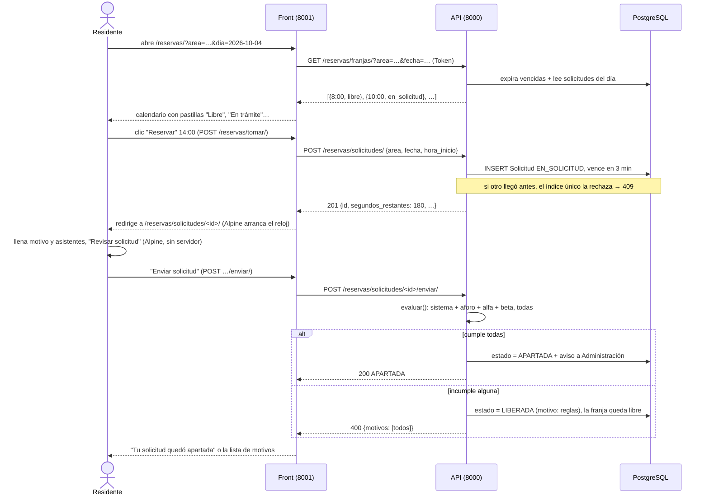
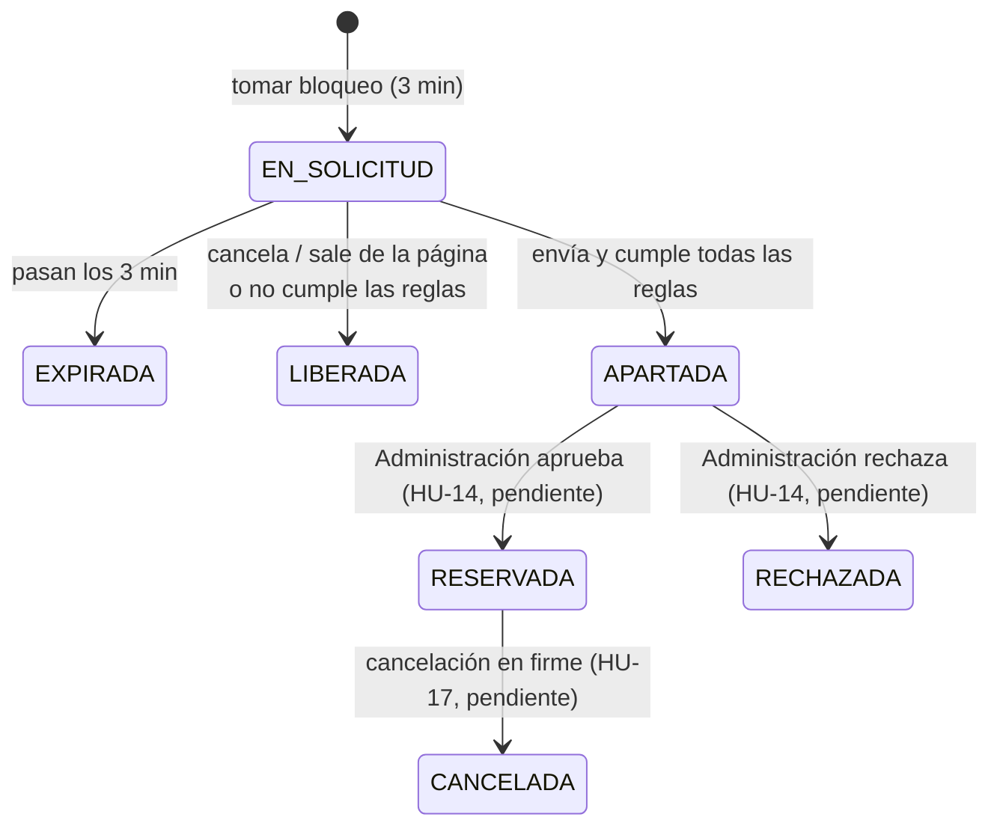

# Reservas

> [!WARNING] Decisiones posteriores al texto del maestro (2026-09-27)
> - Hay un séptimo estado, no bloqueante: `LIBERADA`, con `motivo_liberacion` `voluntaria` o `reglas` (D2 a). Soltar el bloqueo a tiempo o incumplir las reglas no gasta oportunidad de R9.
> - *Un solo bloqueo activo* es **por conjunto**, no en todo el sistema (D3 a): índice único parcial `(conjunto, persona)`.
> - Aprobar y rechazar (HU-14) todavía no existe: una solicitud llega a `APARTADA` y ahí se queda.
> - **2026-10-06:** este flujo pasa a ser el de las zonas *con reserva*; las zonas *con ingreso* no lo usan y siguen sin construir ([ingresos](ingresos.md)). Las reglas que evalúa **ya cambiaron de nivel** en el código: sistema, aforo del área, del conjunto y del área ([motor_reglas](motor_reglas.md)).
>
> Detalle en [construccion](../06_Decisiones/construccion.md).

## Diseño (maestro §5.1)

**Principio: el orden de llegada decide quién puede pedir; una persona decide quién obtiene.** El sistema no sortea, no pondera y no valida dinero. Hace tres cosas: garantizar que solo una persona a la vez tramite una franja, dejar por escrito lo acordado, y registrar cada paso con hora y actor.

**Dónde vive el estado.** En la **solicitud**, no en la franja. La franja es una coordenada `(area, fecha, hora_inicio, hora_fin)` cuya disponibilidad se consulta. El calendario no se materializa en la base.

```
Bloqueantes:     EN_SOLICITUD · APARTADA · RESERVADA
No bloqueantes:  RECHAZADA · CANCELADA · EXPIRADA
```

|Estado|Quién lo produce|Significa|
|---|---|---|
|`EN_SOLICITUD`|Residente, al oprimir "Reservar"|Tiene 3 minutos exclusivos para llenar y enviar|
|`APARTADA`|Residente, al enviar|En manos del administrador. Aún no es reserva|
|`RESERVADA`|Administrador, al aprobar|Reserva en firme, con condiciones escritas|
|`RECHAZADA`|Administrador|Negada con categoría de motivo. Libera la franja|
|`CANCELADA`|Residente o administrador|Deshace una reserva en firme. Libera la franja|
|`EXPIRADA`|Sistema|Vencieron los 3 minutos sin envío. Libera la franja|

**El bloqueo de 3 minutos.** Es el tiempo para **terminar de diligenciar y enviar**, no el tiempo de la reserva ni el del administrador. Es **constante del sistema, no regla beta**: si cada conjunto la ajusta, deja de haber una sola explicación posible. Cuenta regresiva visible. Un residente solo puede tener **un bloqueo activo** en todo el sistema. Salir del formulario libera de inmediato.

**Confirmación antes de enviar — se confirma el contenido, no la intención.** Un _"¿Está seguro?"_ se acepta por reflejo. Lo que funciona es devolverle a la persona el dato que va a comprometer:

> Vas a solicitar el **Salón Comunal** para el **sábado 26 de diciembre de 2026**, de **2:00 p.m. a 6:00 p.m.**, para 40 asistentes.

**El día de la semana en letras es el punto entero.** El error más común no es equivocarse de área ni de hora: es equivocarse de fecha por una casilla del calendario. La persona piensa "el sábado" y oprime el 25. Repetir la fecha en números no atrapa ese error; escribir "viernes 25" sí.

Se usa en tres sitios: solicitud de reserva, agendamiento de cita y aceptación de alternativa tras cambio de horario. Un componente, tres usos. Ocurre dentro de los 3 minutos y no los extiende.

**La aprobación deja contrato.** El campo _condiciones del alquiler_ es **obligatorio y no puede ir vacío**. Queda congelado al aprobar; si se modifica, se guarda como nueva versión con fecha y autor. Se precarga desde plantilla por área. Contenido mínimo: valor, depósito y condición de devolución, horario, aforo, responsable, política de cancelación, estado de entrega del área.

**El dinero lo valida una persona.** El sistema guarda `pago_declarado_por`, `fecha_declaracion` y el comprobante si se subió. Esa frase va en la interfaz, no solo en la documentación.

**El rechazo del administrador.** El texto libre es opcional; la **categoría** no: `NO_DISPONIBLE` · `CONDICIONES_NO_CUMPLIDAS` · `DOCUMENTACION_INCOMPLETA` · `INCUMPLE_REGLAMENTO` · `OTRO` (obliga a texto libre).

**La campana.** Suscripción a una **franja concreta**, no a un área ni a un día. Se notifica a todos los suscritos al mismo tiempo; la suscripción se consume al notificar. **La estampida es intencional**: produce una carrera por el bloqueo, y esa carrera es el mecanismo que el diseño ya tiene resuelto.

**Dos oportunidades por franja (R9).** Si el residente deja vencer el bloqueo, puede volver a tomar esa franja **una sola vez**, avisado de que es la última. No hay tercera. El contador es por par `(residente, franja)` y **solo cuenta el vencimiento**: liberar a propósito no gasta oportunidad.

**Concurrencia (R7).** Restricción de unicidad parcial en base de datos —una sola solicitud bloqueante por franja— más transacción sobre el mecanismo compartido de R1. La **expiración se evalúa al siguiente acceso**: es idempotente y no depende de ningún proceso corriendo.

Pruebas obligatorias: N solicitudes simultáneas producen exactamente un bloqueo; un bloqueo vencido no bloquea; uno liberado manualmente no expira dos veces; la apertura de la ventana de anticipación con N residentes en el mismo segundo no duplica reservas.

## Cómo está construido: un residente reserva el salón social (2026-09-30)

Este es el mejor ejercicio para entender AdMind: seguir **una** acción por todas las capas.



### Paso 1 — Ver las franjas

- **Front** `apps/reservas/views.py` → `calendario()` → `pantalla_del_calendario()`: arma el mes con el módulo `calendar` de Python y, si hay área y día elegidos, llama `cliente_api.reservas.franjas()`.
- **API** `FranjasView.get()`: `exigir_permiso(request, "reserva.solicitar", "reserva.ver_todas")` → valida con `ConsultarFranjasSerializer` → `servicios.franjas(persona, area, fecha)`.
- **Servicio** `franjas()`: primero `expirar_vencidas()`; luego calcula los bloques del horario del área y, para cada uno, dice `libre`, `en_solicitud`, `apartada`, `reservada`, `pasada`, `propia` o `no_disponible`. **Nunca dice quién la tiene.**
- **Front** traduce cada estado a una pastilla con texto (`PASTILLA_POR_ESTADO`): nunca solo con color, por accesibilidad.

### Paso 2 — Tomar el bloqueo

- **Front** `tomar()` (un `POST` del botón "Reservar") → `cliente_api.reservas.tomar()`.
- **API** `SolicitudesView.post()` → `servicios.tomar_bloqueo()`, que revisa: ¿la persona reside en alguna unidad?, ¿el área está activa y sin mantenimiento?, ¿la franja existe y no ha empezado? Después **intenta el INSERT** con `bloqueo.tomar()`.
- **PostgreSQL** decide: si ya hay una solicitud bloqueante en esa franja, el índice `solicitud_franja_bloqueante_unica` la rechaza → `FranjaOcupada` → **409**. Si la persona ya tiene otro bloqueo, `solicitud_un_bloqueo_por_persona` → `YaTienesUnBloqueo` → 409 con el id de la otra solicitud.
- Si todo va bien: `Solicitud` en `EN_SOLICITUD` con `bloqueo_vence_en = ahora + 3 minutos` → **201**. El front redirige a la pantalla de la solicitud.

### Paso 3 — Llenar y confirmar (aquí entra Alpine)

- La plantilla `reservas/solicitud.html` sale del servidor con los segundos restantes ya calculados: `x-data="solicitudDeReserva(180, '…/liberar/')"`.
- Alpine baja el reloj cada segundo (`x-text="reloj"`), apaga el botón al llegar a 0:00 (`:disabled="vencido"`) y muestra el aviso de vencido (`x-show="vencido"`).
- "Revisar solicitud" (`@click="revisar($el.form)"`) oculta el formulario y muestra el **panel de confirmación** (HU-12) con el día de la semana en letras, el horario y los avisos que no bloquean (por ejemplo, "Empieza en menos de 24 horas"). No se llama al servidor ni se reinicia el reloj.
- Si la persona cierra la pestaña o navega a otro lado sin enviar, `pagehide` → `sendBeacon` a `/liberar/` y la franja queda libre al instante para otro (estado `LIBERADA`, motivo "voluntaria").

### Paso 4 — Enviar

- **Front** `enviar()`: valida primero con `SolicitudForm` (Django forms); si está bien, `cliente_api.reservas.enviar()`.
- **API** `EnviarSolicitudView.post()` → `servicios.enviar()`: comprueba que siga en trámite y que no haya vencido (si venció → `BloqueoVencido` → 409 "Se venció el tiempo"). Luego `evaluar(solicitud)` con **todas** las reglas.
- **Cumple todas** → `APARTADA`, se guarda la evaluación y se notifica a Administración por el canal de notificaciones.
- **Incumple alguna** → `LIBERADA` con motivo "reglas", la franja queda libre y la API responde **400 con todos los motivos**. El front los muestra en lista.

Lo que sigue, **aprobar o rechazar** la solicitud apartada (pasar a `RESERVADA` o `RECHAZADA`), es la HU-14 y todavía no existe.

### Los estados de una solicitud



`LIBERADA` y `EXPIRADA` se distinguen a propósito: según el maestro (R9), solo **dejar vencer** el bloqueo gasta una "oportunidad" sobre la franja; soltarlo a tiempo no.

## Ver también

- [riesgos](../06_Decisiones/riesgos.md) — R1, R7, R9
- [motor_reglas](motor_reglas.md) — la evaluación al enviar
- [backend](../02_Arquitectura/backend.md) — el mecanismo compartido de bloqueo
