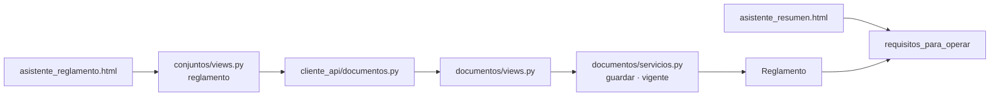

# AdMind — Plan guiado del asistente de creación de conjuntos

> [!IMPORTANT]
> **Alejo:** llena la columna *Respuesta* de la sección 3. Para empezar o retomar, en un chat nuevo: `Ejecuta el plan Documentacion/Admind_Documentacion/07_Planes/activos/Plan_Asistente_De_Creacion.md`. El agente te pregunta primero si lo quieres guiado o si lo construye él.

## El asistente completo y sus tres planes

| Paso | Qué pide | Quién lo construye |
|---|---|---|
| 1. Datos básicos | Nombre, dirección y color | Ya existe |
| 2. Viviendas | Cómo es el conjunto; genera las viviendas | [Plan_Estructura_De_Viviendas](Plan_Estructura_De_Viviendas.md) |
| 3. Administración | La cuenta de quien administra | Ya existe |
| 4. Áreas | Cada área con su horario, su franja y su aforo obligatorio | [Plan_Motor_De_Reglas](Plan_Motor_De_Reglas.md), F1. Las áreas típicas, este plan (F3) |
| 5. Reglas | El tablero: reglas del conjunto y de cada área | [Plan_Motor_De_Reglas](Plan_Motor_De_Reglas.md), F2 a F4 |
| 6. Reglamento | El PDF del reglamento | Este plan, F1 y F2 |
| 7. Resumen | Los requisitos y dejar operativo | Este plan, F1 a F3 |

**Orden.** Primero el plan de viviendas. Después, las fases F1 y F2 de este plan, que no dependen del motor: con ellas un conjunto ya puede quedar operativo. Luego el plan del motor de reglas. Al final, la F3 de este plan, que ajusta el asistente al motor nuevo. Si Alejo prefiere hacer el motor antes de F1 y F2, también funciona: lo único fijo es que **viviendas va antes de F1** y **el motor va antes de F3**.

## 1. Seguimiento

<!-- Lo mantiene el agente que ejecuta, guíe o construya. Quien escribe el plan lo deja en cero, con una fila por fase. -->

**Dónde voy:** sin empezar.

| Fase | Deja funcionando | Estado | Modo | Explicada de vuelta | Verificación | Commit | Fecha |
|---|---|---|---|---|---|---|---|
| F0 | Punto de partida confirmado, con el paso de viviendas ya construido | pendiente | — | — | | — | |
| F1 | La API guarda y entrega el reglamento, y un conjunto completo queda operativo | pendiente | | | | | |
| F2 | El asistente tiene siete pasos, con el del reglamento y un resumen que ya no espera ningún módulo | pendiente | | | | | |
| F3 | (Después del plan del motor) El asistente exige las reglas del conjunto y ofrece áreas típicas | pendiente | | | | | |

<!-- Estado: pendiente · en curso · hecha. Modo: guiada · construida (la hizo el agente). Explicada de vuelta: sí · saltada · — si fue construida. Verificación: qué se corrió y cómo salió. -->

### Desviaciones

<!-- Una línea por caso: fecha · bloque · qué difería del plan · qué se hizo. -->

Ninguna.

### Conceptos por repasar

<!-- Lo que costó, lo que se saltó y los bloques `tuyo` que terminaron con el código dado. Con las fases construidas por el agente, es la lista de estudio para la sustentación. -->

Ninguno.

## 2. Instrucciones para el agente

> [!IMPORTANT]
> **Primero pregunta.** Antes de tocar nada, pregúntale a Alejo si este plan se trabaja **guiado** (explicas por bloques y él aplica) o si lo **construyes** tú. No entres en modo guiado sin su respuesta.

### 2.1 Qué leer antes de empezar

1. [ejecutar_plan_guiado](../../09_Protocolos/ejecutar_plan_guiado.md): cómo se trabaja este plan en modo guiado y qué cambia si Alejo pide que lo construyas.
2. Este plan completo.
3. Notas:
   - [conjuntos](../../05_Modulos/conjuntos.md): la foto del conjunto, que es el modelo de subir y entregar un archivo.
   - [invariantes](../../03_Reglas/invariantes.md) y [capas](../../03_Reglas/capas.md): `ModeloDeConjunto`, la prueba del intruso y en qué archivo va cada regla.
   - [reglas_frontend](../../03_Reglas/reglas_frontend.md): qué hace `cliente_api/`.
   - [pruebas_y_ejecucion](../../02_Arquitectura/pruebas_y_ejecucion.md) y [git](../../03_Reglas/git.md).
   - Solo para F3: [motor_reglas](../../05_Modulos/motor_reglas.md), sección *Definición vigente*.
4. README de las carpetas que se tocan: `Backend/Admind_Backend/apps/conjuntos/README.md`, `apps/documentos/README.md`, `tests/aislamiento/README.md`, y en el front `cliente_api/README.md` y `tests/README.md`.

### 2.2 Reglas propias de este plan

- **F1 no empieza sin el plan de viviendas hecho** (la ruta `asistente-viviendas` existe y `requisitos_para_operar` trae `viviendas`). **F3 no empieza sin el plan del motor hecho** (`Area` tiene `aforo_maximo` y existe `apps/reglas/sistema.py`). Si falta, se para y se le avisa a Alejo.
- **Este plan no toca el motor de reglas.** Nada de `apps/reglas/` ni de `apps/areas/` en el Backend. Del front de áreas, solo B3.3.
- **No se toca** `Conjunto`, `Persona`, `Usuario` ni `config/settings_pruebas.py`. `config/settings.py` y `config/urls.py` se tocan una vez, en B1.1 y B1.3, para registrar `apps.documentos`. El catálogo de permisos solo se toca si D1 es **b**.
- **Una migración:** `documentos/0001_initial`. Sin paquetes nuevos.
- **No hay borrado.** Subir un reglamento nuevo agrega una fila; el anterior se conserva.
- **Los números de los pasos se respetan como estén.** Los tres planes los cambian. El reglamento va justo antes del Resumen: toma el número que tenga el Resumen y el Resumen sube uno. Este plan escribe 6 y 7, que es lo que queda si el plan de viviendas puso su paso de segundo.
- **Avisos a Camilo** (los da Alejo; recuérdaselo al cerrar la fase): en F1, que hay una app nueva registrada en `config/` y un requisito que ya se puede cumplir; en F2, que el asistente tiene siete pasos; en F3, que cambió lo que el asistente exige de las reglas.
- Ninguna fase empieza con su decisión de la sección 3 vacía: F1 necesita D2 y D5; F2, D1; F3, D3 y D4.

## 3. Decisiones que toma Alejo

Ya decididas por Alejo el 2026-10-06, en el chat de planeación: el plan cubre todo el asistente; el reglamento entra como un paso para subir el PDF; para quedar operativo se exigen al menos un área activa y las reglas del conjunto, además de lo que ya se pedía; y las reglas nuevas se guardan en la tabla `Regla` que ya existe, que es la opción **a** de la D1 de [Plan_Motor_De_Reglas](Plan_Motor_De_Reglas.md).

| ID | Decisión | Opciones | Recomendada | Respuesta |
|---|---|---|---|---|
| D1 | Quién deja operativo el conjunto. Hoy `conjunto.activar` es permiso de plataforma: solo el Superusuario | a) sigue así; a Administración el Resumen le dice que todo está cumplido y que lo activa el Superusuario b) también Administración, que cambia el catálogo de permisos | a | |
| D2 | Dónde vive el reglamento | a) en `apps/documentos`, el lugar reservado para HU-33; registra una app en `config/` b) en `apps/conjuntos`, junto a la foto; menos archivos, y se muda cuando llegue HU-33 | a | |
| D3 | Qué cuenta como «reglas del conjunto definidas». Tu respuesta fue «haber guardado el paso de reglas», pero el plan del motor hace de ese paso un tablero donde cada regla se define por separado: no hay un botón de guardar el paso | a) que esté definida la anticipación máxima, la única que todo conjunto necesita b) que esté definida cualquier regla del conjunto c) que estén definidas las dos anticipaciones | a | |
| D4 | Áreas típicas en el paso de áreas: un clic llena el formulario de Salón comunal, BBQ o Cancha con valores de partida, que se pueden cambiar | a) sí b) no, el formulario empieza vacío | a | |
| D5 | Peso máximo del PDF del reglamento | a) 10 MB b) 20 MB | a | |

Si D2 es **b**, F1 cambia de archivos pero no de forma: el modelo y el servicio van en `apps/conjuntos/` y las rutas bajo `/conjuntos/actual/reglamento/`. Si D4 es **b**, se salta B3.3.

> [!WARNING] Una respuesta de Alejo que choca con el plan del motor
> En este chat Alejo respondió que *días que no abre*, con motivo y periodos, quedaba **para después**. [Plan_Motor_De_Reglas](Plan_Motor_De_Reglas.md) sí lo construye (B2.3, B4.4 y la fase F5). Este plan no depende de eso, pero los dos no pueden ser ciertos: lo resuelve Alejo antes de ejecutar el plan del motor.

## 4. Decisiones menores que el plan ya fija

| ID | Decisión |
|---|---|
| P1 | El reglamento es un PDF, reconocido por su firma (`%PDF-`) y no por su nombre. Se guarda en la base con `BinaryField`, como la foto del conjunto y las fotos de los anuncios |
| P2 | Subir otro reglamento no borra el anterior: se agrega una fila y el vigente es el más reciente |
| P3 | Las consultas que no necesitan el archivo lo dejan fuera con `defer("contenido")` |
| P4 | Permisos del reglamento, todos ya en el catálogo: subirlo, `documento.subir`; ver sus datos, `documento.ver` o `documento.subir`; descargarlo, `documento.descargar` o `documento.subir`. Que el residente lo descargue es del resto de HU-33 |
| P5 | Requisitos para quedar operativo: datos básicos, administración, viviendas, áreas, reglas y reglamento. El del reglamento pasa al final de la lista; los demás conservan su orden, su clave y su texto. En F1 `reglas_beta` sigue como está (al menos una regla vigente); en F3 pasa a ser `reglas_del_conjunto` |
| P6 | Las áreas típicas son solo de reserva (Salón comunal, BBQ y Cancha). Gimnasio y piscina son áreas con ingreso y llegan con ese plan |
| P7 | Las áreas típicas no usan JavaScript: cada una es un enlace al mismo paso con `?plantilla=…`, y la vista le pasa esos valores al formulario como `initial` |
| P8 | En pantalla sigue diciendo «Áreas». Qué palabra queda, zona o área, está abierto en [abiertas](../../06_Decisiones/abiertas.md) 12.10 d |

## 5. Punto de partida verificado

Comprobado en el código el 2026-10-06, con el Backend en `2d11dbe` y el Frontend en `a3792d7`, antes de los otros dos planes.

| Dónde | Qué hay |
|---|---|
| `Backend/Admind_Backend/apps/conjuntos/servicios.py` | `requisitos_para_operar(conjunto)` con `datos_basicos`, `administracion`, `areas`, `reglamento` (`Requisito("reglamento", "Reglamento cargado", False, disponible=False)`: nunca se cumple) y `reglas_beta`. `activar(conjunto)` lanza `ConjuntoIncompleto`. `guardar_logo` es el modelo de validar un archivo |
| `…/apps/conjuntos/views.py` | `LogoDelConjuntoView.put` lee un byte más del límite e `ImagenDelLogoView` responde el archivo. `ActivarConjuntoView` exige `conjunto.activar`, que solo tiene el Superusuario |
| `…/apps/documentos/` | Solo `README.md`. No está en `INSTALLED_APPS` ni en `config/urls.py` |
| `…/apps/permisos/catalogo.py` | `documento.subir`, `documento.ver` y `documento.descargar` existen. Administración tiene los tres; Residente, `documento.ver` |
| `…/apps/reservas/servicios.py` | No revisa `conjunto.operativo` (plan D7 a del 27/09) |
| `…/tests/aislamiento/test_intruso.py` | `logo_del_conjunto` es el modelo de una acción `PUT` sin identificador en la ruta |
| `Frontend/Admind_Front-End/apps/conjuntos/` | `LogoForm` y la vista `logo` son el modelo de subir y de entregar un archivo. `asistente_resumen.html` pinta la lista de requisitos que manda la API y dice que el reglamento «se configura en un módulo que todavía no existe» |
| `…/cliente_api/conjuntos.py`, `http.py` | `subir_logo` manda `archivos=`; `imagen_del_logo` usa `pedir_archivo` |
| `…/apps/areas/` | `AreaForm` y el paso de áreas (`conjuntos.views.areas`), que usa `AreaForm(request.POST or None)` |

Lo que este plan resuelve y hoy falta:

- El reglamento es requisito y no hay dónde cargarlo: **ningún conjunto puede terminar el asistente**.
- El asistente no tiene paso para el reglamento, y su resumen lo dice.
- Con el motor nuevo, «al menos una regla vigente» deja de decir si el conjunto definió sus reglas.

**Diferencias entre las notas y el código:**

- `apps/conjuntos/README.md` del Backend dice que áreas y reglas cuentan como no cumplidas y que ningún conjunto puede quedar operativo «todavía». Lo primero ya no es cierto y lo segundo deja de serlo en F1. Se corrige al cerrar.
- Hay dos planes más abiertos el mismo día que tocan el asistente. Este los ordena; no los repite.

## 6. Mapa de la funcionalidad

1. **Paso 6, Reglamento.** El administrador elige un PDF. El front lo recibe y lo reenvía con `PUT /documentos/reglamento/`. En la API, la vista exige `documento.subir` y el servicio comprueba que no esté vacío, que no pase del tope y que empiece por `%PDF-`; guarda una fila nueva de `Reglamento` y deja el registro en la auditoría.
2. «Ver el reglamento» pide el archivo al front, que lo trae de `GET /documentos/reglamento/archivo/` con el token de la sesión y lo entrega él mismo.
3. **Paso 7, Resumen.** `GET /conjuntos/actual/` trae los seis requisitos. El del reglamento ahora se cumple cuando existe uno.
4. Con todos cumplidos, `POST /conjuntos/actual/activar/` deja `operativo = True`. Hoy eso no puede pasar.
5. **Después del motor (F3):** el requisito de reglas deja de ser «alguna regla vigente» y pasa a mirar las reglas del conjunto, y el paso de áreas ofrece áreas típicas.



## F0 · Confirmar el punto de partida

- [ ] **B0.1** · Comprobar que el plan de viviendas está hecho (sección 2.2). `git pull` en los dos repositorios. Correr las dos suites y `makemigrations --check --dry-run` ([pruebas_y_ejecucion](../../02_Arquitectura/pruebas_y_ejecucion.md)). Anota en *Verificación* cuántas pruebas pasan y cuáles fallan: es la línea base. Anota también si el plan del motor ya se ejecutó: cambia qué plantilla tiene el paso de reglas (B2.4).

## F1 · Backend: el reglamento, y un conjunto que por fin queda operativo

**Deja funcionando:** `PUT` y `GET /documentos/reglamento/` y `GET /documentos/reglamento/archivo/`. El requisito del reglamento se puede cumplir y `POST /conjuntos/actual/activar/` deja operativo un conjunto completo. Siete pruebas nuevas y tres entradas del intruso.

**Concepto de la fase:** un archivo que sube un usuario no se cree por su nombre: se reconoce por sus primeros bytes. Es lo mismo que ya hace la foto del conjunto.

| Ruta | Nombre | Permiso | Respuestas |
|---|---|---|---|
| `GET /documentos/reglamento/` | `reglamento` | `documento.ver` o `documento.subir` | 200 con `{"cargado": false}` o `{"cargado": true, "nombre", "peso", "subido_en", "subido_por"}` |
| `PUT /documentos/reglamento/` | `reglamento` | `documento.subir` | 200 con los datos del nuevo · 400 con el error en `archivo` |
| `GET /documentos/reglamento/archivo/` | `reglamento-archivo` | `documento.descargar` o `documento.subir` | 200 con el PDF · 404 si no hay |

- [ ] **B1.1** · explicado · `Backend/Admind_Backend/apps/documentos/` (`__init__.py`, `apps.py`, `models.py`, `migrations/`) y `config/settings.py`
  - **Qué:** la app deja de ser solo un README: su configuración (copiada de `apps/areas/apps.py`, con `DocumentosConfig` y `apps.documentos`), su modelo y su línea en `INSTALLED_APPS`.
  - **Concepto:** el contenido va en la misma fila que sus datos, pero quien solo pregunta si existe no tiene por qué traer un PDF de 10 MB: para eso está `defer`.
  - **Forma:**

    ```python
    from django.db import models

    from apps.comun.modelos_base.modelos import ModeloDeConjunto


    class Reglamento(ModeloDeConjunto):
        """El reglamento de propiedad horizontal del conjunto, en PDF (HU-33; lo mínimo que exige HU-03).

        Subir uno nuevo no borra el anterior: el vigente es el más reciente.
        """

        contenido = models.BinaryField()
        nombre = models.CharField(max_length=120)
        peso = models.PositiveIntegerField()  # en bytes
        huella = models.CharField(max_length=64)  # SHA-256 del contenido
        subido_por = models.ForeignKey("personas.Persona", on_delete=models.PROTECT, related_name="reglamentos_subidos")
        subido_en = models.DateTimeField(auto_now_add=True)

        class Meta(ModeloDeConjunto.Meta):
            indexes = [models.Index(fields=["conjunto", "subido_en"], name="reglamento_por_fecha")]

        def __str__(self):
            return self.nombre
    ```

    `makemigrations documentos` y `migrate`.
  - **Comprobación:** `makemigrations --check --dry-run` limpio, y la prueba de la lista cerrada de tablas globales (`tests/esquema/`) sigue en verde: la tabla nueva tiene conjunto.
- [ ] **B1.2** · explicado · `Backend/Admind_Backend/apps/documentos/servicios.py`
  - **Qué:** guardar y leer el reglamento.
  - **Concepto:** tres comprobaciones en orden, cada una con su mensaje para quien lo subió. La firma de un PDF son sus cinco primeros bytes.
  - **Forma:**

    ```python
    """El reglamento del conjunto activo (HU-33, lo mínimo). No sabe nada de HTTP."""
    import hashlib

    from django.db import transaction

    from apps.auditoria import servicios as auditoria
    from apps.documentos.models import Reglamento

    TAMANO_MAXIMO = 10 * 1024 * 1024  # bytes
    FIRMA_DE_PDF = b"%PDF-"


    class ReglamentoInvalido(Exception):
        """El archivo no sirve como reglamento. Trae el mensaje para quien lo subió."""

        def __init__(self, mensaje):
            super().__init__(mensaje)
            self.mensaje = mensaje


    def vigente(con_contenido=False):
        """El reglamento más reciente del conjunto activo, o None. Sin el contenido, salvo que se pida."""
        reglamentos = Reglamento.objects.select_related("subido_por").order_by("-subido_en")
        return (reglamentos if con_contenido else reglamentos.defer("contenido")).first()


    def guardar(actor, nombre, contenido):
        """Agrega el reglamento nuevo. El anterior se conserva."""
        if not contenido:
            raise ReglamentoInvalido("El archivo está vacío.")
        if len(contenido) > TAMANO_MAXIMO:
            raise ReglamentoInvalido(f"El reglamento no puede pesar más de {TAMANO_MAXIMO // (1024 * 1024)} MB.")
        if not contenido.startswith(FIRMA_DE_PDF):
            raise ReglamentoInvalido("El archivo no es un PDF.")
        datos = {"nombre": nombre[:120], "peso": len(contenido), "huella": hashlib.sha256(contenido).hexdigest()}
        with transaction.atomic():
            reglamento = Reglamento.objects.create(contenido=contenido, subido_por=actor, **datos)
            auditoria.registrar(actor, "reglamento.subir", "Reglamento", reglamento.id, despues=datos)
        return reglamento
    ```

    Si D5 es **b**, `TAMANO_MAXIMO` son 20 MB.
  - **Comprobación:** B1.4.
- [ ] **B1.3** · tuyo (modelo: `LogoDelConjuntoView` e `ImagenDelLogoView`, en `apps/conjuntos/views.py`) · `serializers.py`, `views.py` y `urls.py` de `apps/documentos/`, y `config/urls.py`
  - **Qué:** `ReglamentoView` (`get` y `put`) y `ArchivoDelReglamentoView` (`get`), sus dos rutas y `path("documentos/", include("apps.documentos.urls"))`.
  - **Qué cambia respecto al modelo:** las dos heredan `VistaDeConjunto`, porque trabajan sobre el conjunto activo. El `put` lee `TAMANO_MAXIMO + 1` bytes del campo `archivo`, llama a `guardar(request.user.persona, archivo.name, contenido)` y convierte `ReglamentoInvalido` en 400 bajo `archivo`. La del archivo responde `HttpResponse(bytes(reglamento.contenido), content_type="application/pdf")` con la cabecera `Content-Disposition: inline; filename="reglamento.pdf"`, o 404 si no hay. Los permisos, los de la tabla de arriba.
  - **Comprobación:** B1.4.
- [ ] **B1.4** · explicado · `Backend/Admind_Backend/apps/documentos/tests.py` (archivo nuevo)
  - **Qué:** la prueba de subir y descargar. Las fixtures `torres` y `admin` y los ayudantes `crear_usuario` y `cliente_para` se copian de `apps/areas/tests.py`.
  - **Concepto:** un archivo de prueba no necesita ser un PDF de verdad: basta con que empiece por la firma. `SimpleUploadedFile` es el archivo que manda un formulario.
  - **Forma:**

    ```python
    PDF = b"%PDF-1.7 reglamento de prueba"


    def subir(cliente, contenido=PDF, nombre="reglamento.pdf"):
        archivo = SimpleUploadedFile(nombre, contenido, content_type="application/pdf")
        return cliente.put("/documentos/reglamento/", {"archivo": archivo}, format="multipart")


    def test_el_reglamento_se_sube_se_ve_y_se_descarga(admin, torres):
        assert admin.get("/documentos/reglamento/").json() == {"cargado": False}

        respuesta = subir(admin)

        assert respuesta.status_code == 200
        assert (respuesta.json()["cargado"], respuesta.json()["nombre"], respuesta.json()["peso"]) == (
            True, "reglamento.pdf", len(PDF)
        )
        descarga = admin.get("/documentos/reglamento/archivo/")
        assert (descarga.status_code, descarga["Content-Type"], descarga.content) == (200, "application/pdf", PDF)
    ```
  - **Comprobación:** pasa.
- [ ] **B1.5** · tuyo (modelo: B1.4) · `apps/documentos/tests.py`
  - **Qué:** cuatro pruebas: un texto renombrado a `.pdf` responde 400 en `archivo` y no guarda nada; un archivo que pasa del tope, también; subir un segundo reglamento deja dos filas y el vigente es el nuevo; y un residente (`documento.ver`) ve los datos pero no sube ni descarga (403).
  - **Qué cambia respecto al modelo:** el contenido que se sube, quién lo hace y lo que se afirma.
  - **Comprobación:** pasan las cuatro.
- [ ] **B1.6** · explicado · `Backend/Admind_Backend/tests/aislamiento/test_intruso.py`
  - **Qué:** registrar las dos rutas nuevas.
  - **Concepto:** el archivo no lleva identificador en la ruta: es «el reglamento del conjunto activo». El intruso, que está en un conjunto sin reglamento, recibe 404 aunque el otro conjunto sí tenga uno.
  - **Forma:** un ayudante `reglamento_de(otro_conjunto)` que crea un `Reglamento` dentro de `usar_conjunto`, con el autor que da `usuario_de`. `LISTADOS["reglamento"]` devuelve la ruta y la huella de ese reglamento; `ACCIONES["reglamento"]`, `"put"`, la ruta y un `intacto` que comprueba que el otro conjunto sigue con un solo reglamento; `DETALLES["reglamento-archivo"]` crea el reglamento ajeno y devuelve la ruta.
  - **Comprobación:** `./.venv/Scripts/python.exe -m pytest tests/aislamiento -q`. `test_toda_ruta_de_la_api_esta_cubierta` no puede nombrar ninguna de las dos rutas.
- [ ] **B1.7** · explicado · `Backend/Admind_Backend/apps/conjuntos/servicios.py` y `apps/conjuntos/tests.py`
  - **Qué:** el requisito del reglamento se puede cumplir, y dos pruebas: una que hasta hoy no se podía escribir.
  - **Concepto:** `requisitos_para_operar` es una lista. `activar()` y el resumen del front la recorren sin saber qué hay en ella, así que cambiar un requisito es cambiar una fila.
  - **Forma:** importar `Reglamento` de `apps.documentos.models`, como ya se importan `Area` y `Regla`. La fila pasa a:

    ```python
            Requisito("reglamento", "Reglamento cargado", Reglamento.objects.exists()),
    ```

    y va al final, después de las reglas. El docstring deja de decir que el reglamento no tiene módulo y que ningún conjunto puede quedar operativo. Pruebas nuevas, con el modelo de `test_conjunto_incompleto_no_queda_operativo`: sin reglamento, `faltantes` trae «Reglamento cargado»; y el Superusuario activa un conjunto que tiene dirección, una vivienda, un administrador, un área activa, una regla vigente y un reglamento (creados con el ORM dentro de `usar_conjunto`), recibe 200 y `operativo` queda en `True`. La regla de esa prueba es un `CUPO_POR_UNIDAD` sobre el área, que es válida antes y después del plan del motor.
  - **Comprobación:** `./.venv/Scripts/python.exe -m pytest apps/conjuntos apps/documentos -q`.

**Cierre de F1**

- **Verificación:** la suite completa del Backend y `makemigrations --check --dry-run`: la línea base de F0 más siete pruebas y tres entradas del intruso.
- **Explicar de vuelta:** «Cuéntame qué revisa el servidor antes de aceptar un reglamento, y por qué hasta hoy ningún conjunto podía quedar operativo».
- **Pregunta de jurado:** ¿por qué subir un reglamento nuevo no reemplaza el anterior, si solo se usa el más reciente?
- **Commit sugerido:** `feat(documentos): subir el reglamento y dejar operativo el conjunto [HU-03]`

## F2 · Frontend: el paso del reglamento y el resumen

**Deja funcionando:** el asistente tiene siete pasos. El sexto sube el reglamento y lo deja ver; el séptimo muestra los requisitos sin avisos de módulos que faltan y permite dejar operativo el conjunto. Cinco pruebas nuevas.

**Concepto de la fase:** el navegador no habla con la API ni para subir ni para bajar un archivo. El servidor del front lo recibe, lo reenvía con el token de la sesión y, de vuelta, entrega el PDF él mismo.

- [ ] **B2.1** · tuyo (modelo: `subir_logo` e `imagen_del_logo`, en `cliente_api/conjuntos.py`) · `Frontend/Admind_Front-End/cliente_api/documentos.py` (archivo nuevo)
  - **Qué:** `reglamento(request)`, `subir_reglamento(request, archivo)` y `archivo_del_reglamento(request)`.
  - **Qué cambia respecto al modelo:** las rutas: `documentos/reglamento/` con `GET` y con `PUT`, y `documentos/reglamento/archivo/` con `pedir_archivo`. El campo del archivo también se llama `archivo`.
  - **Comprobación:** se usa en B2.2.
- [ ] **B2.2** · explicado · `forms.py`, `views.py` y `urls.py` de `Frontend/Admind_Front-End/apps/conjuntos/`
  - **Qué:** el formulario, la vista del paso y la que entrega el PDF. Importar `cliente_api.documentos` como `api_documentos`.
  - **Concepto:** es el mismo recorrido de la foto del conjunto: el formulario evita mandar un archivo que la API va a rechazar, y una vista propia entrega el archivo sin que el navegador vea la API.
  - **Forma:** `ReglamentoForm` con un `FileField` «Reglamento, en PDF» y un `clean_archivo` que rechaza lo que pase de `TAMANO_MAXIMO_REGLAMENTO` (el mismo tope de la API, con el mismo comentario que `TAMANO_MAXIMO_LOGO`) y lo que no termine en `.pdf`. Las vistas:

    ```python
    @require_http_methods(["GET", "POST"])
    def reglamento(request):
        """Paso 6: el reglamento del conjunto, en PDF. Sin él no queda operativo (HU-03, HU-33)."""
        formulario = ReglamentoForm(request.POST or None, request.FILES or None)
        if request.method == "POST" and formulario.is_valid():
            try:
                api_documentos.subir_reglamento(request, formulario.cleaned_data["archivo"])
            except ApiNoDisponible:
                formulario.add_error(None, MENSAJE_API_NO_DISPONIBLE)
            except ErrorDeApi as error:
                errores_de_la_api_al_formulario(formulario, error)
            else:
                return redirect(f"{reverse('conjuntos:asistente-reglamento')}?subido=1")
        try:
            actual, error = api_documentos.reglamento(request), None
        except ApiNoDisponible:
            actual, error = None, MENSAJE_API_NO_DISPONIBLE
        except ErrorDeApi as api_error:
            actual, error = None, api_error.mensaje
        contexto = {
            "formulario": formulario,
            "reglamento": actual,
            "error": error,
            "subido": request.GET.get("subido") == "1",
            "paso": 6,
        }
        return render(request, "conjuntos/asistente_reglamento.html", contexto)


    @require_GET
    def reglamento_archivo(request):
        """El PDF. Lo pide este servidor con el token de la sesión: el navegador no habla con la API."""
        try:
            contenido, tipo = api_documentos.archivo_del_reglamento(request)
        except (ApiNoDisponible, ErrorDeApi):
            raise Http404
        if tipo != "application/pdf":
            raise Http404
        respuesta = HttpResponse(contenido, content_type="application/pdf")
        respuesta["Content-Disposition"] = 'inline; filename="reglamento.pdf"'
        return respuesta
    ```

    Rutas: `asistente/reglamento/` (`asistente-reglamento`) y `reglamento/archivo/` (`reglamento-archivo`).
  - **Comprobación:** B2.5.
- [ ] **B2.3** · tuyo (modelo: `asistente_areas.html` y el formulario de la foto en `identidad.html`) · `apps/conjuntos/templates/conjuntos/asistente_reglamento.html` (archivo nuevo)
  - **Qué:** la pantalla del paso.
  - **Qué cambia respecto al modelo:** el formulario lleva `enctype="multipart/form-data"` y un campo de archivo con `accept="application/pdf"`. Si hay reglamento: una tarjeta con su nombre, su peso, quién lo subió y cuándo, un enlace «Ver el reglamento» a `conjuntos:reglamento-archivo`, el botón «Reemplazar» y una línea que aclara que el anterior se conserva. Si no hay: «Todavía no hay reglamento. El conjunto lo necesita para quedar operativo». Si llegó `subido`: `<p class="aviso-exito" role="status">El reglamento quedó cargado.</p>`. Enlaces: Volver a `conjuntos:asistente-reglas` y Continuar a `conjuntos:asistente-resumen`.
  - **Comprobación:** B2.5.
- [ ] **B2.4** · explicado · `_pasos.html`, `asistente_resumen.html`, la vista `resumen` y la plantilla del paso de reglas
  - **Qué:** siete pasos, y un resumen que ya no dice que falta un módulo.
  - **Concepto:** el resumen no sabe qué requisitos existen: pinta la lista que le manda la API. Por eso cumplir el del reglamento no tocó esta plantilla; lo único que se quita es un aviso escrito a mano.
  - **Forma:** en `_pasos.html`, un bloque `6. Reglamento` con `paso == 6` y la ruta `conjuntos:asistente-reglamento`; el Resumen pasa a `7. Resumen` con `paso == 7`, y el comentario dice siete pasos. La vista `resumen` lleva `"paso": 7`. En `asistente_resumen.html`: se quita el párrafo «El reglamento se configura en un módulo que todavía no existe…»; «Volver» apunta a `conjuntos:asistente-reglamento`; y si todos los requisitos están cumplidos, el conjunto no está operativo y la persona no puede activarlo, una línea: «Todo está cumplido. Lo deja operativo el Superusuario de la plataforma». En la plantilla del paso de reglas, el enlace que lleva al resumen pasa a llevar a `conjuntos:asistente-reglamento`: hoy es «Ir al resumen» en `apps/reglas/templates/reglas/nueva.html`; si el plan del motor ya se ejecutó, está en `lista.html`. En `tests/test_areas.py`, la prueba que nombra los pasos espera `7. Resumen` y su nombre dice siete.

    Si D1 es **b**, además: `conjunto.activar` entra a los permisos de Administración en `apps/permisos/catalogo.py` del Backend, `test_administracion_no_activa_conjuntos` se invierte y la línea del Superusuario no se escribe. Es un cambio al catálogo: se le avisa a Camilo.
  - **Comprobación:** B2.5 y la suite del Frontend.
- [ ] **B2.5** · explicado · `Frontend/Admind_Front-End/tests/test_asistente_reglamento.py` (archivo nuevo)
  - **Qué:** la prueba de subir.
  - **Concepto:** en el front se prueba la traducción: que el archivo llegue a `cliente_api` y a dónde vuelve la pantalla. Si el PDF es válido lo decide la API, y eso ya se probó en F1.
  - **Forma:**

    ```python
    """Paso «Reglamento» del asistente (HU-03, HU-33). La API se simula."""
    from unittest import mock

    from django.core.files.uploadedfile import SimpleUploadedFile

    from tests.ayudantes import cliente_con_sesion

    ADMINISTRACION = ["documento.subir", "documento.ver", "documento.descargar", "conjunto.editar"]
    SIN_REGLAMENTO = {"cargado": False}


    def test_subir_el_reglamento_lo_manda_a_la_api_y_vuelve_al_paso():
        cliente = cliente_con_sesion(permisos=ADMINISTRACION)
        archivo = SimpleUploadedFile("reglamento.pdf", b"%PDF-1.7 prueba", content_type="application/pdf")
        with (
            mock.patch("cliente_api.documentos.reglamento", return_value=SIN_REGLAMENTO),
            mock.patch("cliente_api.documentos.subir_reglamento") as subir,
        ):
            respuesta = cliente.post("/conjuntos/asistente/reglamento/", {"archivo": archivo})

        assert subir.call_args.args[1].name == "reglamento.pdf"
        assert respuesta["Location"] == "/conjuntos/asistente/reglamento/?subido=1"
    ```
  - **Comprobación:** pasa.
- [ ] **B2.6** · tuyo (modelo: B2.5 y `tests/test_identidad.py`) · `tests/test_asistente_reglamento.py`
  - **Qué:** cuatro pruebas: un archivo que no termina en `.pdf` muestra el error y no llama a la API; con reglamento cargado se ven su nombre y el enlace para verlo; `/conjuntos/reglamento/archivo/` entrega el PDF con su tipo, y responde 404 si la API falla; y el resumen, sin `conjunto.activar` y con todo cumplido, muestra la línea del Superusuario en vez del botón.
  - **Qué cambia respecto al modelo:** lo simulado y lo que se afirma.
  - **Comprobación:** la suite del Frontend en verde.

**Cierre de F2**

- **Verificación:** las dos suites completas y los pasos 1 a 6 del guion de prueba manual.
- **Explicar de vuelta:** «Cuéntame el camino de un PDF desde que lo elijo en el navegador hasta que queda en la base, y el camino de vuelta cuando lo abro».
- **Pregunta de jurado:** ¿qué pasaría si el navegador le pidiera el reglamento directamente a la API? ¿Qué tendría que tener el navegador para poder hacerlo?
- **Commit sugerido:** `feat(conjuntos): paso del reglamento y resumen del asistente [HU-03]`

## F3 · El asistente con el motor nuevo

**Deja funcionando:** el asistente exige las reglas del conjunto en vez de «alguna regla», y el paso de áreas ofrece áreas típicas. Tres pruebas nuevas. **Solo después de [Plan_Motor_De_Reglas](Plan_Motor_De_Reglas.md).**

**Concepto de la fase:** con el motor por niveles, «hay alguna regla» ya no dice lo mismo: el límite de reservas de un área es una regla y no dice nada del conjunto. El requisito tiene que mirar el nivel.

- [ ] **B3.1** · explicado · `Backend/Admind_Backend/apps/conjuntos/servicios.py`
  - **Qué:** el requisito de reglas cambia de clave, de texto y de consulta.
  - **Concepto:** una regla del conjunto es una fila de `Regla` sin área. Preguntar «¿definieron la anticipación máxima?» es buscar esa fila entre las vigentes.
  - **Forma:** la fila `reglas_beta` pasa a ser, con D3 en **a**:

    ```python
            Requisito(
                "reglas_del_conjunto",
                "Reglas del conjunto definidas",
                Regla.objects.vigentes().filter(area__isnull=True, tipo=TipoDeRegla.ANTICIPACION_MAXIMA).exists(),
            ),
    ```

    Con **b** se quita el filtro por `tipo`. Con **c** se piden las dos: el requisito se cumple si la consulta, filtrada por los dos tipos de anticipación, cuenta dos. Importar `TipoDeRegla` de `apps.reglas.catalogo`.
  - **Comprobación:** B3.2.
- [ ] **B3.2** · tuyo (modelo: la prueba del conjunto que queda operativo, de B1.7) · `apps/conjuntos/tests.py` y `apps/reglas/tests.py`
  - **Qué:** dos pruebas y un ajuste. Nuevas: un conjunto con un límite de reservas en un área, pero sin reglas del conjunto, no queda operativo y `faltantes` trae «Reglas del conjunto definidas»; y al definir la anticipación máxima por la API (`POST /reglas/` sin `area`), el requisito pasa a cumplido. Ajuste: la prueba de B1.7 que activa el conjunto crea además la anticipación máxima del conjunto, y `test_sin_reglas_el_conjunto_no_puede_quedar_operativo` usa la clave `reglas_del_conjunto`.
  - **Qué cambia respecto al modelo:** qué reglas existen antes de activar y qué se afirma de `faltantes`.
  - **Comprobación:** `./.venv/Scripts/python.exe -m pytest apps/conjuntos apps/reglas -q`.
- [ ] **B3.3** · explicado · `apps/areas/forms.py`, el paso de áreas (`apps/conjuntos/views.py`) y `asistente_areas.html` *(se salta si D4 es b)*
  - **Qué:** tres áreas típicas que llenan el formulario.
  - **Concepto:** `initial` son los valores con que un formulario de Django aparece la primera vez. No son datos guardados: el administrador los revisa y los cambia antes de enviar.
  - **Forma:**

    ```python
    # Valores de partida de las áreas más comunes. No son reglas de nadie: se cambian antes de guardar.
    PLANTILLAS_DE_AREA = {
        "salon": {"nombre": "Salón comunal", "hora_apertura": "08:00", "hora_cierre": "22:00",
                  "duracion_franja_minutos": 240, "aforo_maximo": 50},
        "bbq": {"nombre": "BBQ", "hora_apertura": "10:00", "hora_cierre": "22:00",
                "duracion_franja_minutos": 240, "aforo_maximo": 15},
        "cancha": {"nombre": "Cancha múltiple", "hora_apertura": "06:00", "hora_cierre": "22:00",
                   "duracion_franja_minutos": 120, "aforo_maximo": 20},
    }
    ```

    En el paso de áreas: `AreaForm(request.POST or None, initial=PLANTILLAS_DE_AREA.get(request.GET.get("plantilla")))`. En `asistente_areas.html`, antes del formulario: «Empieza con un área típica» y tres enlaces `am-btn am-btn--secundario` a `?plantilla=salon`, `bbq` y `cancha`; el `<details>` del formulario queda abierto si llegó una plantilla.
  - **Comprobación:** una prueba nueva en `tests/test_areas.py`: `/conjuntos/asistente/areas/?plantilla=bbq` trae «BBQ» y el aforo 15 ya escritos en el formulario.
- [ ] **B3.4** · explicado · el recorrido del asistente, de punta a punta
  - **Qué:** comprobar que los tres planes dejaron los siete pasos encadenados.
  - **Concepto:** tres planes tocaron los mismos enlaces. Ninguna prueba recorre el asistente entero: se revisa una vez, a mano.
  - **Forma:** en cada paso, «Volver» lleva al anterior y «Continuar» al siguiente: datos, viviendas, administración, áreas, reglas, reglamento y resumen. El tablero de reglas, abierto desde el asistente, muestra las pestañas con «5. Reglas» marcada y su salida va al reglamento. El estado vacío de la pantalla Reglas ya no dice que sin una regla el conjunto no queda operativo: dice que faltan las reglas del conjunto.
  - **Comprobación:** el guion de prueba manual completo.

**Cierre de F3**

- **Verificación:** las dos suites completas, `makemigrations --check --dry-run` y el guion de prueba manual entero.
- **Explicar de vuelta:** «Cuéntame los seis requisitos, de qué tabla sale cada uno y por qué el de reglas cambió con el motor nuevo».
- **Pregunta de jurado:** un conjunto queda operativo y después alguien retira la anticipación máxima. ¿Sigue operativo? ¿Debería?
- **Commit sugerido:** `feat(conjuntos): el asistente exige las reglas del conjunto [HU-03]`

## Cierre del plan

1. Las dos suites completas y `makemigrations --check --dry-run`.
2. Informe final en el chat: qué se hizo por fase, commits, desviaciones y conceptos por repasar.
3. Actualizar el contexto con [actualizar_contexto](../../09_Protocolos/actualizar_contexto.md):
   - [conjuntos](../../05_Modulos/conjuntos.md): los siete pasos y los seis requisitos. [alcance](../../01_Contexto/alcance.md) 3.1: el aviso de arriba suma las reglas del conjunto.
   - READMEs del Backend: `apps/conjuntos` y `apps/documentos`.
   - [mapa_codigo](../../02_Arquitectura/mapa_codigo.md) (la app `documentos` deja de ser solo README), [frontend](../../02_Arquitectura/frontend.md) y [pruebas_y_ejecucion](../../02_Arquitectura/pruebas_y_ejecucion.md).
   - [historias](../../08_Estado/historias.md): HU-03 deja de estar bloqueada; HU-33 queda cubierta solo en el reglamento. [bitacora](../../08_Estado/bitacora.md), [estado_actual](../../08_Estado/estado_actual.md) y [pendientes](../../08_Estado/pendientes.md).
   - Las respuestas D1 a D5 pasan a [construccion](../../06_Decisiones/construccion.md), y [abiertas](../../06_Decisiones/abiertas.md) 12.10 e queda cerrada.
4. Mover este archivo a `07_Planes/hechos/` y cambiar su fila en [planes](../planes.md).

## Lo que el agente no puede hacer

- Los commits, si el plan se trabajó guiado, y el `push`.
- Los avisos a Camilo de la sección 2.2.
- Notion: HU-03 cambia de criterios y HU-33 queda cubierta en parte.
- PR `desarrollo → pruebas` revisado y la prueba manual de quien no programó.

## Guion de prueba manual

Con los dos servidores arriba, una cuenta de Administración y una de Superusuario.

1. Abrir el asistente de un conjunto: las pestañas son siete y la sexta es Reglamento.
2. En **Reglamento**, sin archivo cargado: el texto dice que hace falta para quedar operativo.
3. Subir un archivo que no sea PDF: lo rechaza con su mensaje. Subir un PDF: aparecen su nombre, su peso y quién lo subió.
4. «Ver el reglamento» abre el PDF. Subir otro: el nombre cambia y la línea aclara que el anterior se conserva.
5. En **Resumen**, como Administración: el requisito del reglamento aparece como Cumplido y ya no hay aviso de módulo en construcción. Con todo cumplido, la línea dice que lo activa el Superusuario.
6. Como Superusuario, elegir ese conjunto, abrir el Resumen y oprimir «Dejar operativo»: la pastilla pasa a Operativo.
7. *(Después de F3.)* En un conjunto nuevo con un área y su límite de reservas, pero sin reglas del conjunto: el Resumen muestra «Reglas del conjunto definidas» como Pendiente. Definir la anticipación máxima en el paso de Reglas: pasa a Cumplido.
8. *(Después de F3.)* En **Áreas**, elegir el área típica **BBQ**: el formulario llega lleno y se puede cambiar antes de guardar.
9. *(Después de F3.)* Recorrer los siete pasos con «Continuar» y devolverse con «Volver»: ninguno se salta.

## Fuera de este plan

- **El motor de reglas** y el tablero: [Plan_Motor_De_Reglas](Plan_Motor_De_Reglas.md). **El paso de viviendas:** [Plan_Estructura_De_Viviendas](Plan_Estructura_De_Viviendas.md).
- **El ingreso a zonas** ([ingresos](../../05_Modulos/ingresos.md)), que construye Camilo: el modo de uso del área, la permanencia y los acompañantes. Las áreas típicas de gimnasio y piscina llegan con él.
- **Exigir que el conjunto esté operativo para reservar.** Hoy no se revisa (plan D7 a del 27/09). Ahora que un conjunto puede quedar operativo, es una decisión que vale la pena tomar.
- **Qué pasa si un conjunto operativo deja de cumplir un requisito.** Hoy `operativo` no se vuelve a revisar.
- **El resto de HU-33:** otros documentos, las actas y que el residente descargue el reglamento.
- **El vínculo `habitante`** y la segunda parte de HU-39 (las palabras del conjunto en las pantallas y el retiro de viviendas).
