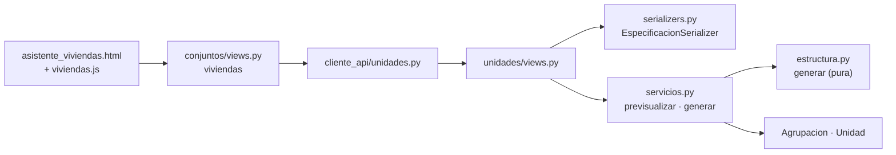

# AdMind — Plan guiado de la estructura de viviendas (HU-39), primera parte

> [!IMPORTANT]
> **Alejo:** llena la columna *Respuesta* de la sección 3. Para empezar o retomar, en un chat nuevo: `Ejecuta el plan Documentacion/Admind_Documentacion/07_Planes/activos/Plan_Estructura_De_Viviendas.md`. El agente te pregunta primero si lo quieres guiado o si lo construye él.

## 1. Seguimiento

<!-- Lo mantiene el agente que ejecuta, guíe o construya. Quien escribe el plan lo deja en cero, con una fila por fase. -->

**Dónde voy:** sin empezar.

| Fase | Deja funcionando | Estado | Modo | Explicada de vuelta | Verificación | Commit | Fecha |
|---|---|---|---|---|---|---|---|
| F0 | Punto de partida confirmado | pendiente | — | — | | — | |
| F1 | La base guarda agrupaciones y viviendas con tipo, agrupación, número y piso | pendiente | | | | | |
| F2 | El generador convierte una descripción en viviendas con nombre, sin tocar la base | pendiente | | | | | |
| F3 | La API previsualiza y crea la estructura, y un conjunto sin viviendas no queda operativo | pendiente | | | | | |
| F4 | El asistente tiene el paso «Viviendas»: describir, ver cómo queda y crear | pendiente | | | | | |

<!-- Estado: pendiente · en curso · hecha. Modo: guiada · construida (la hizo el agente). Explicada de vuelta: sí · saltada · — si fue construida. Verificación: qué se corrió y cómo salió. -->

### Desviaciones

<!-- Una línea por caso: fecha · bloque · qué difería del plan · qué se hizo. -->

Ninguna.

### Conceptos por repasar

<!-- Lo que costó, lo que se saltó y los bloques `tuyo` que terminaron con el código dado. Con las fases construidas por el agente, es la lista de estudio para la sustentación. -->

Ninguno.

## 2. Instrucciones para el agente

> [!IMPORTANT]
> **Primero pregunta.** Antes de tocar nada, pregúntale a Alejo si este plan se trabaja **guiado** (explicas por bloques y él aplica) o si lo **construyes** tú. No entres en modo guiado sin su respuesta.

### 2.1 Qué leer antes de empezar

1. [ejecutar_plan_guiado](../../09_Protocolos/ejecutar_plan_guiado.md): cómo se trabaja este plan en modo guiado y qué cambia si Alejo pide que lo construyas.
2. Este plan completo.
3. Notas:
   - [historias](../../08_Estado/historias.md), sección *HU-39*: los nueve criterios y cuáles cubre esta primera parte.
   - [unidades](../../05_Modulos/unidades.md): qué es una unidad y un vínculo. Este plan no toca los vínculos.
   - [invariantes](../../03_Reglas/invariantes.md): `ModeloDeConjunto`, FK compuesta, prueba del intruso y el aviso sobre `bulk_create`.
   - [capas](../../03_Reglas/capas.md): en qué archivo va cada regla. Sirve para explicar por qué el generador es una función aparte.
   - [eliminacion](../../03_Reglas/eliminacion.md): no hay borrado ni bajas masivas. Es la razón de la vista previa.
   - [reglas_frontend](../../03_Reglas/reglas_frontend.md): qué hace `cliente_api/`, qué no decide `static/js/` y dónde va el acento.
   - [pruebas_y_ejecucion](../../02_Arquitectura/pruebas_y_ejecucion.md) y [git](../../03_Reglas/git.md).
4. README de las carpetas que se tocan: `Backend/Admind_Backend/apps/unidades/README.md`, `Backend/Admind_Backend/apps/conjuntos/README.md`, `Backend/Admind_Backend/tests/aislamiento/README.md`, `Frontend/Admind_Front-End/cliente_api/README.md`, `Frontend/Admind_Front-End/static/js/README.md` y `Frontend/Admind_Front-End/tests/README.md`.

### 2.2 Reglas propias de este plan

- **No se toca** `Conjunto`, `Persona`, `Usuario`, el catálogo de permisos ni `config/settings_pruebas.py`. Si parece que hace falta, es una desviación y se pregunta.
- **Una sola migración:** `unidades/0002_estructura`. Sin paquetes nuevos. Si para entonces ya existe otra migración en `unidades` (la del vínculo `habitante`, decidido el 2026-10-06), Django la numera `0003`: cambia el número y nada más.
- **El contrato de `GET /unidades/` y `POST /unidades/` no cambia.** Solo cambia el orden en que llega el listado (B3.4). Registrar una vivienda a mano sigue funcionando igual.
- **Los vínculos no se tocan.** El vínculo `habitante` (la familia de la vivienda) se decidió el 2026-10-06 y es de otro plan: aquí no se agrega nada sobre quién vive en una vivienda.
- **Nada borra ni desactiva.** Este plan no trae retiro de viviendas: es de la segunda parte.
- **Avisos a Camilo** (los da Alejo; recuérdaselo al cerrar la fase): en F1, que hay una migración nueva en `unidades` y tiene que correr `migrate`; en F3, que hay tres rutas nuevas bajo `/unidades/` y un requisito nuevo en el resumen del asistente; en F4, que el asistente pasa de 5 a 6 pasos y cambian los números de los demás.
- Ninguna fase empieza con su decisión de la sección 3 vacía: F1 necesita D3; F2, D1; F3, D4; F4, D2 y D5.

## 3. Decisiones que toma Alejo

Ya decididas por Alejo el 2026-10-06, en el chat de definición ([construccion](../../06_Decisiones/construccion.md)): es una historia nueva; en el código son `Agrupacion` y `Unidad`; hay conjuntos mixtos; tener viviendas es requisito para quedar operativo; una vivienda se retira una por una y con confirmación; el conjunto se puede ampliar después.

| ID | Decisión | Opciones | Recomendada | Respuesta |
|---|---|---|---|---|
| D1 | Cómo se arma el nombre de una vivienda | a) «Torre 1 – Apto 101», «Manzana A – Casa 4»; sin agrupación, «Casa 12» b) «Torre 1 – 101», como el ejemplo que hay hoy en pantalla c) «Torre 1 – Apartamento 101» | a | |
| D2 | Dónde va el paso «Viviendas» en el asistente | a) segundo, después de Datos básicos; los demás se renumeran b) quinto, justo antes del Resumen; solo cambia el número del Resumen | a | |
| D3 | Dónde vive la palabra de la agrupación, ahora que hay mixtos | a) en cada agrupación (`Agrupacion.etiqueta` y `tipo_vivienda`); `Conjunto` no se toca en este plan b) en `Conjunto`, con un par de campos por tipo de vivienda; no admite un conjunto con torres y bloques a la vez | a | |
| D4 | Qué deja en la auditoría una generación | a) un registro por generación, con el resumen: tipo, cuántas viviendas y en qué agrupaciones b) un registro por vivienda, como hoy al crearlas a mano (240 registros para 240 viviendas) | a | |
| D5 | Los íconos de torre y casa y las tarjetas de opción | a) un SVG propio dentro de una plantilla de `apps/conjuntos/` y estilos de pantalla en `static/css/estructura.css`; no entran al inventario de componentes b) sin íconos por ahora | a | |

Si D2 es **b**, B4.3 se reduce: el paso nuevo lleva `"paso": 5`, el Resumen pasa a 6 y lo demás conserva su número. Si D3 es **b**, se para: cambia F1 y Alejo vuelve al chat de planeación.

## 4. Decisiones menores que el plan ya fija

| ID | Decisión |
|---|---|
| P1 | El generador vive en un archivo nuevo, `apps/unidades/estructura.py`, con funciones puras: reciben la descripción y devuelven las viviendas. No importan modelos ni tocan la base. Guardar es del servicio |
| P2 | La vista previa y la creación usan **la misma función**. Así lo que se ve es lo que se crea |
| P3 | El generador se corre **por tandas**: una descripción por cada grupo de viviendas del mismo tipo. Un conjunto de apartamentos es una tanda; un mixto, dos; una ampliación es otra tanda más adelante. No hay modo especial para mixtos ni para ampliar |
| P4 | Cuatro patrones de numeración: `piso_consecutivo` (101, 102… 1004; solo apartamentos), `consecutivo` (1, 2, 3… y reinicia en cada agrupación), `corrido` (sigue de una agrupación a la siguiente, desde `desde`) y `lista` (los números que escriba el administrador, los mismos para cada agrupación de la tanda) |
| P5 | Los nombres se limpian con `limpiar()`: sin espacios sobrantes y con la primera letra en mayúscula. Se comparan con `clave()`: sin tildes ni mayúsculas. Es la misma idea de `normalizar_documento` en `apps/personas/models.py` |
| P6 | `Agrupacion.clave` guarda etiqueta y nombre ya pasados por `clave()`, y la base impide repetirla en el conjunto. «Torre 1» y «Manzana 1» conviven; dos «Torre 1» no |
| P7 | `Agrupacion.orden` es el orden de creación. Con él «Torre 2» va antes que «Torre 10» |
| P8 | `Unidad.nombre` sigue siendo el nombre completo ya armado, y sube de 40 a 100 caracteres. Visitantes, anuncios y reservas lo muestran tal cual y no cambian |
| P9 | Las unidades registradas a mano quedan sin agrupación, sin número y como `apartamento`. Elegir tipo y agrupación al registrar a mano es de la segunda parte |
| P10 | Repetir una generación no duplica: las viviendas cuyo nombre ya existe se omiten y se informa cuántas. Si la agrupación ya existe, se reutiliza; si existe con otro tipo de vivienda, `409` |
| P11 | Todo se crea en una transacción con `bulk_create`. Como `bulk_create` se salta `save()`, el conjunto se fija a mano, igual que en `apps/notificaciones/canal.py` |
| P12 | Si dos personas generan lo mismo a la vez, la restricción única de la base rechaza a la segunda: `409` y no queda nada a medias |
| P13 | Topes por tanda: 60 agrupaciones, 60 pisos, 40 apartamentos por piso, 500 viviendas por agrupación y 2 000 viviendas en total. Los revisa el serializer |
| P14 | Permiso: `vinculo.gestionar`, el mismo que hoy exige crear una unidad. Lo tiene Administración. No se crea ninguno |
| P15 | El requisito nuevo para quedar operativo es `viviendas`, «Al menos una vivienda registrada», y se cumple con `Unidad.objects.exists()` |
| P16 | `GET /unidades/` pasa a ordenar por agrupación, piso y número. Antes ordenaba por texto, y «Apto 1001» salía antes que «Apto 101» |
| P17 | En el front la descripción viaja como JSON en un campo oculto. La vista no la revisa: se la pasa a la API, que valida y calcula. El formulario de «Crear» lleva la descripción que se previsualizó, no la que haya en pantalla |
| P18 | Este paso necesita JavaScript (Alpine). Sin él se muestra un aviso y las viviendas se registran una por una, como hoy. Alpine solo arma la descripción y la frase; no decide nombres ni cuáles existen |
| P19 | Los errores de rango de la API (un tope pasado, un dato que falta) se muestran con su mensaje general arriba del formulario. El formulario ya limita los rangos y apaga el botón mientras falte algo |
| P20 | La opción elegida se marca con neutros, como en `opciones-alcance`: el acento solo va en sus cuatro sitios. La lista de patrones reutiliza las clases `opciones-alcance` |
| P21 | La pantalla no dibuja un ícono por vivienda: va uno por agrupación, en lo que ya existe y en la vista previa, y en las tres opciones de la primera pregunta |

## 5. Punto de partida verificado

Comprobado en el código el 2026-10-06. Ramas `desarrollo`, árbol limpio en los dos repositorios. Backend en `2d11dbe` y Frontend en `a3792d7`.

| Dónde | Qué hay |
|---|---|
| `Backend/Admind_Backend/apps/unidades/models.py` | `Unidad(ModeloDeConjunto)` con `nombre` (40) y `creado_en`, y `UNIQUE (conjunto, nombre)` = `unidad_nombre_unico_en_conjunto`. `TipoVinculo`, `VinculoQuerySet` y `VinculoUnidad` |
| `…/apps/unidades/servicios.py` | `unidades_del_conjunto()` (ordena por `nombre`), `crear_unidad(actor, nombre)` con su registro `unidad.crear`, `NombreRepetido`, y todo lo de vínculos. Ya importa `auditoria`, `conjunto_activo_id`, `IntegrityError`, `transaction`, `Count` y `Q` |
| `…/apps/unidades/serializers.py`, `views.py`, `urls.py` | `UnidadSerializer`, `CrearUnidadSerializer`; `UnidadesView` (`GET` y `POST`, con `vinculo.gestionar`), `DetalleDeUnidadView`, vínculos. Nombres de ruta: `unidades`, `unidad-detalle`, `unidad-vinculos`, `vinculo-cerrar` |
| `…/apps/unidades/tests.py` | Fixtures `torres`, `apto_402`, `admin`, `vecinos`; ayudantes `con_cuenta` y `cliente_para`. Modelo para B1.5: `test_la_base_no_deja_que_un_vinculo_apunte_a_una_unidad_de_otro_conjunto` |
| `…/apps/unidades/migrations/` | Solo `0001_initial.py`, que ya usa `fk_compuesta` |
| `…/apps/comun/aislamiento/migraciones.py` | `fk_compuesta(tabla, columna, tabla_referida)` |
| `…/apps/comun/modelos_base/modelos.py` | `ModeloDeConjunto`: `save()` fija el conjunto activo; `bulk_create` no pasa por ahí |
| `…/apps/notificaciones/canal.py` | El único `bulk_create` de hoy, con `conjunto_id=conjunto_activo_id()` puesto a mano |
| `…/apps/auditoria/servicios.py` | `registrar(actor, accion, entidad, entidad_id=None, *, antes=None, despues=None, …)`. `entidad_id` admite nulo |
| `…/apps/conjuntos/servicios.py` | `requisitos_para_operar(conjunto)` con cinco `Requisito`: `datos_basicos`, `administracion`, `areas`, `reglamento` (sin módulo, nunca se cumple) y `reglas_beta` |
| `…/apps/permisos/catalogo.py` | `vinculo.gestionar` existe y lo tiene Administración |
| `…/tests/aislamiento/test_intruso.py` | Diccionarios `DETALLES`, `LISTADOS`, `ACCIONES` y `RUTAS_SIN_CONJUNTO`; ayudantes `unidad_de` y `listado_de_unidades` |
| `Frontend/Admind_Front-End/apps/conjuntos/views.py` | Pasos `nuevo` y `datos` (`"paso": 1`), `administracion` (2), `areas` (3) y `resumen` (5). El paso 4 está en `apps/reglas/views.py` (`"paso": 4`, dos veces) |
| `…/apps/conjuntos/templates/conjuntos/` | `_pasos.html` con cinco pestañas escritas a mano; `asistente_areas.html` es el modelo de un paso; `_selector_acento.html` es el modelo de opciones de radio con Alpine |
| `…/cliente_api/unidades.py` y `http.py` | `listar`, `crear`, `obtener`… con `pedir(request, metodo, ruta, datos)`, que manda JSON. `ErrorDeApi.mensaje` trae `non_field_errors` o `detail` |
| `…/static/js/`, `static/css/estructura.css` | `identidad.js` es el modelo de un componente de Alpine (`alpine:init` y `Alpine.data`). Los estilos de pantalla van en `estructura.css`, una regla por línea y solo con variables |
| `…/tests/` | `ayudantes.cliente_con_sesion(permisos=…)`. `test_areas.py` (línea 124) y `test_reglas.py` (línea 133) nombran los pasos por su número |

Lo que este plan resuelve y hoy falta:

- Una vivienda es solo un nombre de texto libre y se registra una por una.
- El asistente no tiene paso de viviendas y un conjunto puede intentar activarse sin ninguna.
- No hay forma de decir que una vivienda es una casa ni a qué torre pertenece.

**Diferencias entre las notas y el código:**

- `Backend/Admind_Backend/apps/unidades/README.md` dice que «no hay pantalla ni API para crear unidades ni vínculos». Sí las hay desde HU-08. Se corrige al cerrar el plan.
- [glosario](../../01_Contexto/glosario.md) decía «Unidad = apartamento». Corregido el 2026-10-06.
- [pruebas_y_ejecucion](../../02_Arquitectura/pruebas_y_ejecucion.md) es del 05/10 y cuenta 362 pruebas en el Backend, con una que falla (`test_toda_ruta_de_la_api_esta_cubierta`, por las rutas `usuario-perfil` y `usuario-eliminar`). Hoy `pytest --collect-only` recoge 368 en el Backend y 188 en el Frontend. Cuántas pasan lo confirma F0.

## 6. Mapa de la funcionalidad

Todo es nuevo salvo lo marcado *(ya existe)*.

1. El administrador entra al paso «Viviendas» del asistente (`/conjuntos/asistente/viviendas/`, puerto 8001). La vista pide a la API lo que el conjunto ya tiene: `GET /unidades/agrupaciones/`.
2. Responde las preguntas: qué viviendas tiene (apartamentos, casas o las dos), cómo se agrupan y con qué palabra, cómo se identifican las agrupaciones, cuántas viviendas hay y cómo se numeran. Alpine (`static/js/viviendas.js`) arma con eso la **descripción** y una frase que la resume: «6 torres de 10 pisos con 4 apartamentos por piso: 240 apartamentos».
3. «Ver cómo queda» envía la descripción al front. `views.viviendas` se la pasa a `cliente_api.unidades.previsualizar_estructura`, que hace `POST /unidades/estructura/previsualizar/` a la API (puerto 8000).
4. En la API, `PrevisualizarEstructuraView` exige `vinculo.gestionar` y valida con `EspecificacionSerializer`. El servicio `previsualizar_estructura` llama al generador, `estructura.generar`, que devuelve las viviendas con su nombre, y consulta cuáles ya existen. No guarda nada.
5. La pantalla muestra la vista previa: una fila por agrupación, con la primera y la última vivienda y cuántas son nuevas.
6. «Crear 240 viviendas» envía la misma descripción. `POST /unidades/estructura/` llama a `generar_estructura`: en una transacción crea las agrupaciones que falten y las viviendas nuevas con `bulk_create`, y deja un registro en la auditoría.
7. El front vuelve al paso, que ahora muestra lo creado. Si el conjunto es mixto, el formulario arranca en las casas para la segunda tanda.
8. En el Resumen, el requisito «Al menos una vivienda registrada» aparece cumplido. `requisitos_para_operar` *(ya existe)* lo comprueba al activar.
9. Las viviendas creadas son filas de `Unidad` *(ya existe)*: aparecen en Apartamentos, en el anuncio a una vivienda, en visitantes y en reservas sin cambiar nada de eso.



## F0 · Confirmar el punto de partida

- [ ] **B0.1** · Correr las dos suites y `makemigrations --check --dry-run` ([pruebas_y_ejecucion](../../02_Arquitectura/pruebas_y_ejecucion.md)). Se espera: 368 pruebas en el Backend y 188 en el Frontend, sin migraciones pendientes y `git status` limpio en los dos. Anota en *Verificación* cuántas pasan y cuáles fallan: son la línea base. Si los commits o los conteos no coinciden con el frontmatter, se para y se le avisa a Alejo.

## F1 · Backend: agrupaciones y viviendas con estructura

**Deja funcionando:** la tabla `unidades_agrupacion` y cuatro columnas nuevas en `unidades_unidad`, con sus restricciones. Dos pruebas nuevas en verde (370 en total).

**Concepto de la fase:** un conjunto tiene dos niveles, agrupación y vivienda, y el primero es opcional. La base hace cumplir tres cosas sin depender del código: que no haya dos agrupaciones iguales, que el tipo de vivienda sea uno de dos y que una vivienda no apunte a una agrupación de otro conjunto.

- [ ] **B1.1** · explicado · `Backend/Admind_Backend/apps/unidades/models.py`
  - **Qué:** dos clases nuevas, antes de `Unidad`.
  - **Concepto:** `clave` es una columna calculada por el servicio para comparar sin tildes ni mayúsculas. La restricción única va sobre ella, no sobre lo que escribió el administrador.
  - **Forma:**

    ```python
    class TipoDeVivienda(models.TextChoices):
        APARTAMENTO = "apartamento", "Apartamento"
        CASA = "casa", "Casa"


    class Agrupacion(ModeloDeConjunto):
        """Lo que junta viviendas dentro del conjunto: una torre, un bloque, una manzana (HU-39).

        La palabra la pone el conjunto (`etiqueta`). `clave` es la etiqueta y el nombre sin tildes ni
        mayúsculas: con ella la base impide dos «Torre 1» aunque se escriban distinto.
        """

        etiqueta = models.CharField(max_length=30)
        nombre = models.CharField(max_length=40)
        clave = models.CharField(max_length=80)
        tipo_vivienda = models.CharField(max_length=12, choices=TipoDeVivienda.choices)
        # El orden de creación: «Torre 2» va antes que «Torre 10», cosa que el orden alfabético no da.
        orden = models.PositiveIntegerField()
        creado_en = models.DateTimeField(auto_now_add=True)

        class Meta(ModeloDeConjunto.Meta):
            constraints = [
                *ModeloDeConjunto.Meta.constraints,
                models.UniqueConstraint(fields=["conjunto", "clave"], name="agrupacion_clave_unica_en_conjunto"),
                models.CheckConstraint(
                    condition=Q(tipo_vivienda__in=TipoDeVivienda.values), name="agrupacion_tipo_vivienda_valido"
                ),
            ]
            indexes = [models.Index(fields=["conjunto", "orden"], name="agrupacion_por_orden")]

        def __str__(self):
            return f"{self.etiqueta} {self.nombre}"
    ```
  - **Comprobación:** el archivo importa sin error (`manage.py check`).
- [ ] **B1.2** · explicado · mismo archivo, clase `Unidad`
  - **Qué:** `nombre` sube a 100 caracteres; cuatro campos nuevos; un `CHECK` y un índice. El docstring pasa a decir que es apartamento o casa.
  - **Concepto:** la FK a la agrupación admite nulo porque no todo conjunto agrupa. `PROTECT` porque no hay borrado físico ([eliminacion](../../03_Reglas/eliminacion.md)).
  - **Forma:**

    ```python
        nombre = models.CharField(max_length=100)
        # Los cuatro vienen del generador (HU-39). Una unidad registrada a mano solo tiene nombre.
        tipo = models.CharField(max_length=12, choices=TipoDeVivienda.choices, default=TipoDeVivienda.APARTAMENTO)
        agrupacion = models.ForeignKey(
            Agrupacion, on_delete=models.PROTECT, null=True, blank=True, related_name="unidades"
        )
        numero = models.CharField(max_length=12, blank=True)
        piso = models.PositiveSmallIntegerField(null=True, blank=True)
    ```

    En `Meta`: agregar a `constraints` `models.CheckConstraint(condition=Q(tipo__in=TipoDeVivienda.values), name="unidad_tipo_valido")`, y `indexes = [models.Index(fields=["conjunto", "agrupacion"], name="unidad_por_agrupacion")]`.
  - **Comprobación:** `manage.py check` sin errores.
- [ ] **B1.3** · explicado · `Backend/Admind_Backend/apps/unidades/migrations/0002_estructura.py`
  - **Qué:** generar la migración con `./.venv/Scripts/python.exe manage.py makemigrations unidades -n estructura` y agregarle a mano la FK compuesta, como última operación. Después, `migrate`.
  - **Concepto:** Django crea una FK simple sobre `agrupacion_id`. La compuesta `(agrupacion_id, conjunto_id)` la agrega `fk_compuesta`, y es la que impide en PostgreSQL apuntar a una agrupación de otro conjunto. Con `agrupacion_id` nulo la restricción no aplica, igual que en `anuncios_anuncio.unidad_id`.
  - **Forma:** el `import` de `fk_compuesta` arriba, como en `0001_initial.py`, y al final de `operations`:

    ```python
        fk_compuesta('unidades_unidad', 'agrupacion_id', 'unidades_agrupacion'),
    ```
  - **Comprobación:** `makemigrations --check --dry-run` responde que no hay cambios, y `migrate` aplica `unidades.0002_estructura`.
- [ ] **B1.4** · explicado · `Backend/Admind_Backend/apps/unidades/tests.py`
  - **Qué:** una prueba de que la base rechaza dos agrupaciones con la misma clave. Importar `Agrupacion` y `TipoDeVivienda`.
  - **Concepto:** `pytest.raises(IntegrityError)` con `transaction.atomic()`, el mismo patrón de `test_no_hay_dos_vinculos_vigentes_iguales_sobre_la_misma_unidad`.
  - **Forma:**

    ```python
    def test_no_hay_dos_agrupaciones_con_la_misma_clave(torres):
        Agrupacion.objects.create(
            etiqueta="Torre", nombre="1", clave="torre 1", tipo_vivienda=TipoDeVivienda.APARTAMENTO, orden=1
        )
        with pytest.raises(IntegrityError), transaction.atomic():
            Agrupacion.objects.create(
                etiqueta="TORRE", nombre="1", clave="torre 1", tipo_vivienda=TipoDeVivienda.APARTAMENTO, orden=2
            )
    ```
  - **Comprobación:** pasa.
- [ ] **B1.5** · tuyo (modelo: `test_la_base_no_deja_que_un_vinculo_apunte_a_una_unidad_de_otro_conjunto`, en el mismo archivo) · `tests.py`
  - **Qué:** `test_la_base_no_deja_que_una_unidad_apunte_a_una_agrupacion_de_otro_conjunto`.
  - **Qué cambia respecto al modelo:** la fila ajena es una `Agrupacion` creada dentro de otro conjunto, y la que falla es una `Unidad` del conjunto activo con esa agrupación.
  - **Comprobación:** pasa. Si se quita la línea de `fk_compuesta` de la migración, falla: esa es la prueba de que la restricción existe.

**Cierre de F1**

- **Verificación:** `./.venv/Scripts/python.exe -m pytest apps/unidades tests -q` y `makemigrations --check --dry-run`. Después la suite completa: la línea base de F0 más 2.
- **Explicar de vuelta:** «Cuéntame qué guarda una agrupación, qué guarda ahora una vivienda y qué tres cosas hace cumplir la base aunque el código se equivoque».
- **Pregunta de jurado:** ¿por qué `clave` es una columna guardada y no se compara con minúsculas al momento de consultar?
- **Commit sugerido:** `feat(unidades): agregar agrupaciones y estructura de la vivienda [HU-39]`

## F2 · Backend: el generador

**Deja funcionando:** `estructura.generar(descripcion)` devuelve las viviendas de una tanda con su nombre, número y piso. Once pruebas nuevas que no usan la base (381 en total).

**Concepto de la fase:** una **función pura** recibe datos y devuelve datos; no lee ni escribe en ningún lado. Por eso se prueba sin base, sin servidor y sin sesión, y por eso la vista previa y la creación pueden compartirla.

- [ ] **B2.1** · explicado · `Backend/Admind_Backend/apps/unidades/estructura.py` (archivo nuevo)
  - **Qué:** la cabecera del archivo, los patrones y las dos funciones de texto.
  - **Concepto:** normalizar para guardar (`limpiar`) no es lo mismo que normalizar para comparar (`clave`). La primera respeta las tildes del administrador; la segunda las quita.
  - **Forma:**

    ```python
    """Generador de la estructura de viviendas (HU-39). Funciones puras: no tocan la base ni saben de HTTP.

    Reciben lo que el administrador describió («6 torres de 10 pisos con 4 apartamentos por piso»)
    y devuelven las viviendas que eso produce, con el nombre ya armado. Guardarlas es del servicio.
    """
    import unicodedata
    from dataclasses import dataclass

    from django.db import models

    ABREVIATURAS = {"apartamento": "Apto", "casa": "Casa"}


    class Patron(models.TextChoices):
        PISO_CONSECUTIVO = "piso_consecutivo", "Piso y consecutivo"
        CONSECUTIVO = "consecutivo", "Consecutivo en cada agrupación"
        CORRIDO = "corrido", "Consecutivo corrido"
        LISTA = "lista", "Lista propia"


    def limpiar(texto):
        """Sin espacios sobrantes y con la primera letra en mayúscula: «  torre » queda «Torre»."""
        texto = " ".join(texto.split())
        return texto[:1].upper() + texto[1:]


    def clave(texto):
        """Para comparar: sin tildes ni mayúsculas. «Torre Ágata» y «torre agata» son la misma."""
        sin_tildes = unicodedata.normalize("NFKD", texto).encode("ascii", "ignore").decode()
        return " ".join(sin_tildes.lower().split())
    ```

    Si D1 no es **a**, `ABREVIATURAS` cambia: con **b** no se usa y con **c** lleva las palabras completas.
  - **Comprobación:** se prueba en B2.4.
- [ ] **B2.2** · explicado · mismo archivo
  - **Qué:** las dos formas de numerar.
  - **Concepto:** cada función devuelve pares `(número, piso)`. El número es texto porque «PH» y «1A» también son números de vivienda.
  - **Forma:**

    ```python
    def numeros_por_piso(pisos, por_piso, primer_piso=1):
        """101, 102 … 1004: el piso y, en dos cifras, el consecutivo dentro del piso."""
        return [
            (f"{piso}{consecutivo:02d}", piso)
            for piso in range(primer_piso, primer_piso + pisos)
            for consecutivo in range(1, por_piso + 1)
        ]


    def numeros_consecutivos(cantidad, desde=1):
        return [(str(numero), None) for numero in range(desde, desde + cantidad)]
    ```
  - **Comprobación:** se prueba en B2.4 y B2.5.
- [ ] **B2.3** · explicado · mismo archivo
  - **Qué:** lo que devuelve el generador y el generador.
  - **Concepto:** `dataclass(frozen=True)` es un objeto que solo lleva datos y no se puede modificar. El patrón `corrido` necesita recordar por dónde va la numeración entre una agrupación y la siguiente: es la variable `siguiente`.
  - **Forma:**

    ```python
    @dataclass(frozen=True)
    class ViviendaPropuesta:
        numero: str
        piso: int | None
        nombre: str  # «Torre 1 – Apto 101»


    @dataclass(frozen=True)
    class AgrupacionPropuesta:
        etiqueta: str  # «Torre», o vacío si las viviendas no se agrupan
        nombre: str  # «1», «Esmeralda», «C»
        viviendas: tuple

        @property
        def nombre_completo(self):
            return f"{self.etiqueta} {self.nombre}".strip()


    def nombre_de_vivienda(tipo_vivienda, agrupacion, numero):
        """«Torre 1 – Apto 101»; sin agrupación, «Casa 12»."""
        propio = f"{ABREVIATURAS[tipo_vivienda]} {numero}"
        return f"{agrupacion} – {propio}" if agrupacion else propio


    def generar(descripcion):
        """De la descripción de una tanda a sus viviendas. `descripcion` es el diccionario ya validado."""
        tipo = descripcion["tipo_vivienda"]
        etiqueta = limpiar(descripcion.get("etiqueta", ""))
        patron = descripcion["patron"]
        siguiente = descripcion.get("desde", 1)
        propuestas = []
        for pedida in descripcion["agrupaciones"]:
            nombre = limpiar(pedida.get("nombre", ""))
            completo = f"{etiqueta} {nombre}".strip()
            if patron == Patron.PISO_CONSECUTIVO:
                numeros = numeros_por_piso(pedida["pisos"], pedida["por_piso"], descripcion.get("primer_piso", 1))
            elif patron == Patron.CONSECUTIVO:
                numeros = numeros_consecutivos(pedida["cantidad"])
            elif patron == Patron.CORRIDO:
                numeros = numeros_consecutivos(pedida["cantidad"], siguiente)
                siguiente += pedida["cantidad"]
            else:
                numeros = [(limpiar(numero), None) for numero in descripcion["numeros"]]
            viviendas = tuple(
                ViviendaPropuesta(numero, piso, nombre_de_vivienda(tipo, completo, numero)) for numero, piso in numeros
            )
            propuestas.append(AgrupacionPropuesta(etiqueta, nombre, viviendas))
        return propuestas
    ```

    El guion de «Torre 1 – Apto 101» es el mismo de los nombres que ya existen («Torre 3 – 402»): raya corta con un espacio a cada lado.
  - **Comprobación:** se prueba en B2.4.
- [ ] **B2.4** · explicado · `Backend/Admind_Backend/apps/unidades/test_estructura.py` (archivo nuevo)
  - **Qué:** las pruebas del texto y la del caso central. El archivo **no** lleva `pytestmark = pytest.mark.django_db`.
  - **Concepto:** `parametrize` corre la misma prueba con varios datos. Estas pruebas no piden base: si alguna la pidiera, el generador dejó de ser puro.
  - **Forma:**

    ```python
    """Pruebas del generador de la estructura de viviendas (HU-39). No usan la base: son funciones puras."""
    import pytest

    from apps.unidades.estructura import clave, generar, limpiar

    SEIS_TORRES = {
        "tipo_vivienda": "apartamento",
        "etiqueta": "torre",
        "patron": "piso_consecutivo",
        "agrupaciones": [{"nombre": str(numero), "pisos": 10, "por_piso": 4} for numero in range(1, 7)],
    }


    @pytest.mark.parametrize(
        ("texto", "esperado"), [("  torre ", "Torre"), ("Súper   manzana", "Súper manzana"), ("", "")]
    )
    def test_limpiar_quita_espacios_y_pone_la_primera_mayuscula(texto, esperado):
        assert limpiar(texto) == esperado


    @pytest.mark.parametrize(("uno", "otro"), [("Torre Ágata", "torre agata"), ("TORRE  1", "torre 1")])
    def test_la_clave_no_distingue_tildes_ni_mayusculas(uno, otro):
        assert clave(uno) == clave(otro)


    def test_seis_torres_de_diez_pisos_con_cuatro_por_piso_son_240_apartamentos():
        torres = generar(SEIS_TORRES)

        assert [torre.nombre_completo for torre in torres] == [f"Torre {numero}" for numero in range(1, 7)]
        assert sum(len(torre.viviendas) for torre in torres) == 240
        assert torres[0].viviendas[0].nombre == "Torre 1 – Apto 101"
        assert torres[5].viviendas[-1].nombre == "Torre 6 – Apto 1004"
        assert torres[0].viviendas[4].piso == 2
    ```
  - **Comprobación:** `./.venv/Scripts/python.exe -m pytest apps/unidades/test_estructura.py -q` da 6 en verde.
- [ ] **B2.5** · tuyo (modelo: la prueba de las seis torres, B2.4) · mismo archivo
  - **Qué:** cinco pruebas, una por caso: casas por manzana con `consecutivo` (dos manzanas de 10 y 15: la segunda vuelve a empezar en 1); las mismas con `corrido` (la segunda va de 11 a 25); `lista` con «1», «2» y «PH»; casas sin agrupación (`etiqueta` vacía y una sola agrupación de nombre vacío: «Casa 1» a «Casa 120»); y `primer_piso` en 2 (la primera vivienda es «201»).
  - **Qué cambia respecto al modelo:** la descripción de entrada. Cada prueba afirma la primera vivienda, la última y el total.
  - **Comprobación:** 11 en verde en el archivo.

**Cierre de F2**

- **Verificación:** `./.venv/Scripts/python.exe -m pytest apps/unidades/test_estructura.py -q`, y la suite completa: la línea base más 13.
- **Explicar de vuelta:** «Cuéntame qué entra y qué sale de `generar`, y cómo arma el nombre de la vivienda 302 de la torre 4».
- **Pregunta de jurado:** ¿por qué el generador no guarda las viviendas él mismo? ¿Qué se ganó separándolo del servicio?
- **Commit sugerido:** `feat(unidades): generador de la estructura de viviendas [HU-39]`

## F3 · Backend: servicio, API y requisito para operar

**Deja funcionando:** `POST /unidades/estructura/previsualizar/`, `POST /unidades/estructura/` y `GET /unidades/agrupaciones/`. El listado de unidades sale en orden natural y un conjunto sin viviendas no pasa la activación. Doce pruebas nuevas (393 en total).

**Concepto de la fase:** el servicio junta el cálculo puro con la base: pregunta qué existe, decide qué falta y lo guarda **todo o nada**. La vista solo valida, exige el permiso y traduce el resultado a HTTP.

**Contrato.** Las dos rutas `POST` reciben la misma descripción y responden el mismo resumen:

```json
{
  "tipo_vivienda": "apartamento",
  "etiqueta": "Torre",
  "patron": "piso_consecutivo",
  "primer_piso": 1,
  "agrupaciones": [{"nombre": "1", "pisos": 10, "por_piso": 4}, {"nombre": "2", "pisos": 12, "por_piso": 4}]
}
```

Con `consecutivo` y `corrido`, cada agrupación lleva `cantidad` en vez de `pisos` y `por_piso`; `corrido` admite `desde`. Con `lista`, la descripción lleva `numeros`. Sin agrupaciones: `etiqueta` vacía y una sola agrupación con `nombre` vacío.

```json
{
  "tipo_vivienda": "apartamento", "total": 88, "nuevas": 88, "repetidas": 0,
  "agrupaciones": [
    {"nombre": "Torre 1", "existe": false, "viviendas": 40, "nuevas": 40,
     "primera": "Torre 1 – Apto 101", "ultima": "Torre 1 – Apto 1004"}
  ]
}
```

| Ruta | Nombre | Respuestas |
|---|---|---|
| `POST /unidades/estructura/previsualizar/` | `estructura-previsualizar` | 200 con el resumen · 400 si la descripción no sirve · 409 si una agrupación existe con otro tipo |
| `POST /unidades/estructura/` | `estructura-generar` | 201 con el resumen si creó algo, 200 si todo existía · 400 · 409 |
| `GET /unidades/agrupaciones/` | `agrupaciones` | 200 con `{"agrupaciones": [{id, nombre_completo, tipo_vivienda, viviendas}], "sin_agrupar", "total"}` |

Las tres exigen `vinculo.gestionar` y heredan `VistaDeConjunto`.

- [ ] **B3.1** · explicado · `Backend/Admind_Backend/apps/unidades/serializers.py`
  - **Qué:** dos serializers de entrada y dos de salida. Importar `TipoDeVivienda`, `estructura` y sus `Patron` y `clave`.
  - **Concepto:** lo que se comprueba mirando solo la petición va en el serializer ([capas](../../03_Reglas/capas.md)). Los rangos van en cada campo; lo que cruza campos, en `validate()`. El mensaje de `validate()` llega al front como `non_field_errors`.
  - **Forma:**

    ```python
    MAXIMO_DE_AGRUPACIONES = 60
    MAXIMO_DE_VIVIENDAS = 2000


    class AgrupacionPedidaSerializer(serializers.Serializer):
        nombre = serializers.CharField(max_length=40, allow_blank=True, default="")
        pisos = serializers.IntegerField(min_value=1, max_value=60, required=False)
        por_piso = serializers.IntegerField(min_value=1, max_value=40, required=False)
        cantidad = serializers.IntegerField(min_value=1, max_value=500, required=False)


    class EspecificacionSerializer(serializers.Serializer):
        """Una tanda: qué viviendas, cómo se agrupan y cómo se numeran (HU-39)."""

        tipo_vivienda = serializers.ChoiceField(choices=TipoDeVivienda.choices)
        etiqueta = serializers.CharField(max_length=30, allow_blank=True, default="")
        patron = serializers.ChoiceField(choices=Patron.choices)
        primer_piso = serializers.IntegerField(min_value=1, max_value=20, default=1)
        desde = serializers.IntegerField(min_value=1, max_value=9999, default=1)
        numeros = serializers.ListField(child=serializers.CharField(max_length=12), max_length=500, required=False)
        agrupaciones = AgrupacionPedidaSerializer(many=True, allow_empty=False)

        def validate(self, datos):
            patron, pedidas = datos["patron"], datos["agrupaciones"]
            if len(pedidas) > MAXIMO_DE_AGRUPACIONES:
                raise serializers.ValidationError(f"Se registran hasta {MAXIMO_DE_AGRUPACIONES} agrupaciones a la vez.")
            nombres = [clave(pedida["nombre"]) for pedida in pedidas]
            if datos["etiqueta"].strip():
                if "" in nombres or len(set(nombres)) != len(nombres):
                    raise serializers.ValidationError("Cada agrupación necesita un nombre distinto.")
            elif len(pedidas) != 1 or nombres[0]:
                raise serializers.ValidationError("Sin agrupaciones, las viviendas van en un solo grupo sin nombre.")
            if patron == Patron.PISO_CONSECUTIVO:
                if datos["tipo_vivienda"] != TipoDeVivienda.APARTAMENTO:
                    raise serializers.ValidationError("La numeración por pisos es para apartamentos.")
                completo = all("pisos" in pedida and "por_piso" in pedida for pedida in pedidas)
            elif patron == Patron.LISTA:
                numeros = [clave(numero) for numero in datos.get("numeros", [])]
                completo = bool(numeros) and "" not in numeros and len(set(numeros)) == len(numeros)
            else:
                completo = all("cantidad" in pedida for pedida in pedidas)
            if not completo:
                raise serializers.ValidationError("Faltan datos para numerar las viviendas con ese patrón.")
            total = sum(len(propuesta.viviendas) for propuesta in estructura.generar(datos))
            if total > MAXIMO_DE_VIVIENDAS:
                raise serializers.ValidationError(
                    f"Son {total} viviendas. Se registran hasta {MAXIMO_DE_VIVIENDAS} a la vez."
                )
            return datos
    ```

    De salida: `AgrupacionSerializer` (`id`, `nombre_completo` como `SerializerMethodField` que devuelve `str(agrupacion)`, igual que `get_persona` en `VinculoSerializer`, `tipo_vivienda`, `viviendas`) y `ResumenDeAgrupacionesSerializer` (`agrupaciones` con `many=True`, `sin_agrupar`, `total`). El resumen de la estructura ya es un diccionario: no necesita serializer.
  - **Comprobación:** se prueba por la API en B3.7 y B3.8.
- [ ] **B3.2** · explicado · `Backend/Admind_Backend/apps/unidades/servicios.py`
  - **Qué:** una excepción, dos funciones de apoyo y la vista previa. Importar `estructura` y `Agrupacion`.
  - **Concepto:** la vista previa hace dos consultas, no una por vivienda: las agrupaciones por su clave y las viviendas por su nombre. Lo que ya existe se resta en memoria.
  - **Forma:**

    ```python
    class AgrupacionDeOtroTipo(Exception):
        """Ya hay una agrupación con ese nombre y guarda otro tipo de vivienda."""

        def __init__(self, nombre):
            super().__init__(nombre)
            self.nombre = nombre


    def existentes_para(propuestas):
        """Lo que ya está guardado de lo que se propone: agrupaciones por su clave y nombres de vivienda."""
        claves = [estructura.clave(p.nombre_completo) for p in propuestas if p.nombre_completo]
        agrupaciones = {agrupacion.clave: agrupacion for agrupacion in Agrupacion.objects.filter(clave__in=claves)}
        nombres = [vivienda.nombre for propuesta in propuestas for vivienda in propuesta.viviendas]
        repetidas = set(Unidad.objects.filter(nombre__in=nombres).values_list("nombre", flat=True))
        return agrupaciones, repetidas


    def resumen_de_estructura(tipo_vivienda, propuestas, agrupaciones, repetidas):
        filas = []
        for propuesta in propuestas:
            existente = agrupaciones.get(estructura.clave(propuesta.nombre_completo))
            if existente and existente.tipo_vivienda != tipo_vivienda:
                raise AgrupacionDeOtroTipo(propuesta.nombre_completo)
            nuevas = [vivienda for vivienda in propuesta.viviendas if vivienda.nombre not in repetidas]
            filas.append({
                "nombre": propuesta.nombre_completo,
                "existe": existente is not None,
                "viviendas": len(propuesta.viviendas),
                "nuevas": len(nuevas),
                "primera": propuesta.viviendas[0].nombre,
                "ultima": propuesta.viviendas[-1].nombre,
            })
        total = sum(fila["viviendas"] for fila in filas)
        nuevas = sum(fila["nuevas"] for fila in filas)
        return {
            "tipo_vivienda": tipo_vivienda,
            "total": total,
            "nuevas": nuevas,
            "repetidas": total - nuevas,
            "agrupaciones": filas,
        }


    def previsualizar_estructura(descripcion):
        """Lo que se crearía, sin guardar nada. Es el mismo cálculo de `generar_estructura`."""
        propuestas = estructura.generar(descripcion)
        return resumen_de_estructura(descripcion["tipo_vivienda"], propuestas, *existentes_para(propuestas))
    ```
  - **Comprobación:** B3.7.
- [ ] **B3.3** · explicado · mismo archivo
  - **Qué:** la creación. Importar `Max`.
  - **Concepto:** `transaction.atomic()` hace que todo se guarde o nada. `bulk_create` manda las viviendas en una sola instrucción, pero se salta `save()`, que es donde `ModeloDeConjunto` pone el conjunto: por eso `conjunto_id` va a mano. Si otra persona creó lo mismo entre la consulta y la escritura, la restricción única lanza `IntegrityError` y la transacción se deshace.
  - **Forma:**

    ```python
    class EstructuraCambiada(Exception):
        """Alguien registró esas mismas viviendas mientras se generaban."""


    def generar_estructura(actor, descripcion):
        """Crea las agrupaciones y las viviendas que faltan, todas o ninguna. Las que ya existen se omiten."""
        tipo = descripcion["tipo_vivienda"]
        propuestas = estructura.generar(descripcion)
        # bulk_create se salta save(), así que el conjunto se fija aquí: siempre el activo.
        conjunto_id = conjunto_activo_id()
        try:
            with transaction.atomic():
                agrupaciones, repetidas = existentes_para(propuestas)
                resumen = resumen_de_estructura(tipo, propuestas, agrupaciones, repetidas)
                orden = Agrupacion.objects.aggregate(ultimo=Max("orden"))["ultimo"] or 0
                nuevas = []
                for propuesta in propuestas:
                    agrupacion = None
                    if propuesta.nombre_completo:
                        clave = estructura.clave(propuesta.nombre_completo)
                        agrupacion = agrupaciones.get(clave)
                        if agrupacion is None:
                            orden += 1
                            agrupacion = Agrupacion.objects.create(
                                etiqueta=propuesta.etiqueta,
                                nombre=propuesta.nombre,
                                clave=clave,
                                tipo_vivienda=tipo,
                                orden=orden,
                            )
                    nuevas += [
                        Unidad(
                            conjunto_id=conjunto_id,
                            nombre=vivienda.nombre,
                            tipo=tipo,
                            agrupacion=agrupacion,
                            numero=vivienda.numero,
                            piso=vivienda.piso,
                        )
                        for vivienda in propuesta.viviendas
                        if vivienda.nombre not in repetidas
                    ]
                Unidad.objects.bulk_create(nuevas)
                if nuevas:
                    auditoria.registrar(
                        actor,
                        "unidad.generar",
                        "Unidad",
                        despues={
                            "tipo_vivienda": tipo,
                            "nuevas": resumen["nuevas"],
                            "repetidas": resumen["repetidas"],
                            "agrupaciones": [fila["nombre"] for fila in resumen["agrupaciones"]],
                        },
                    )
        except IntegrityError as error:
            raise EstructuraCambiada() from error
        return resumen
    ```

    Si D4 es **b**, el registro único se cambia por uno por vivienda, y como `bulk_create` no devuelve nada que auditar una por una, las viviendas se crean con `Unidad.objects.create` dentro del ciclo.
  - **Comprobación:** B3.7.
- [ ] **B3.4** · explicado · mismo archivo
  - **Qué:** `resumen_de_agrupaciones()` nueva, y el orden de `unidades_del_conjunto()`. Importar `F` y `Length` (`django.db.models.functions`).
  - **Concepto:** ordenar texto pone «1001» antes que «101». Ordenar primero por el largo del número y después por el número da el orden natural sin convertir nada.
  - **Forma:**

    ```python
    def resumen_de_agrupaciones():
        """Las agrupaciones del conjunto activo con sus viviendas, y cuántas viviendas no tienen agrupación."""
        return {
            "agrupaciones": Agrupacion.objects.annotate(viviendas=Count("unidades")).order_by("orden"),
            "sin_agrupar": Unidad.objects.filter(agrupacion__isnull=True).count(),
            "total": Unidad.objects.count(),
        }
    ```

    En `unidades_del_conjunto()`, `.order_by("nombre")` pasa a `.order_by(F("agrupacion__orden").asc(nulls_last=True), "piso", Length("numero"), "numero", "nombre")`.
  - **Comprobación:** B3.8, y las pruebas que ya existían de `GET /unidades/` siguen en verde.
- [ ] **B3.5** · explicado · `Backend/Admind_Backend/apps/unidades/views.py` y `urls.py`
  - **Qué:** la vista de la vista previa y su ruta, antes de `<uuid:unidad_id>/`.
  - **Concepto:** la vista no consulta la base ni calcula: valida, exige el permiso y convierte la excepción del servicio en un código HTTP.
  - **Forma:**

    ```python
    class PrevisualizarEstructuraView(VistaDeConjunto):
        """Lo que se crearía con esa descripción. No guarda nada (HU-39)."""

        def post(self, request):
            exigir_permiso(request, "vinculo.gestionar")
            datos = EspecificacionSerializer(data=request.data)
            datos.is_valid(raise_exception=True)
            try:
                return Response(servicios.previsualizar_estructura(datos.validated_data))
            except servicios.AgrupacionDeOtroTipo as error:
                return Response(
                    {"detail": f"«{error.nombre}» ya existe y es de otro tipo de vivienda."},
                    status=status.HTTP_409_CONFLICT,
                )
    ```

    Ruta: `path("estructura/previsualizar/", PrevisualizarEstructuraView.as_view(), name="estructura-previsualizar")`.
  - **Comprobación:** B3.7.
- [ ] **B3.6** · tuyo (modelo: B3.5) · mismos archivos
  - **Qué:** `GenerarEstructuraView` (`POST`, ruta `estructura/`, nombre `estructura-generar`) y `AgrupacionesView` (`GET`, ruta `agrupaciones/`, nombre `agrupaciones`).
  - **Qué cambia respecto al modelo:** la primera llama a `generar_estructura(request.user.persona, …)`, responde 201 si `resumen["nuevas"]` es mayor que cero y 200 si no, y además convierte `EstructuraCambiada` en 409 con «Alguien acaba de registrar esas viviendas. Mira otra vez cómo queda.». La segunda no recibe nada y serializa `resumen_de_agrupaciones()` con `ResumenDeAgrupacionesSerializer`.
  - **Comprobación:** B3.7 y B3.8.
- [ ] **B3.7** · explicado · `Backend/Admind_Backend/apps/unidades/tests.py`
  - **Qué:** dos pruebas de la API con la fixture `admin`.
  - **Concepto:** la primera afirma una ausencia: que previsualizar no escribió. La segunda cuenta filas y revisa que quedó **un** registro de auditoría.
  - **Forma:**

    ```python
    DOS_TORRES = {
        "tipo_vivienda": "apartamento",
        "etiqueta": "Torre",
        "patron": "piso_consecutivo",
        "agrupaciones": [{"nombre": "1", "pisos": 10, "por_piso": 4}, {"nombre": "2", "pisos": 12, "por_piso": 4}],
    }


    def test_previsualizar_dice_lo_que_se_crearia_y_no_guarda_nada(admin, torres):
        respuesta = admin.post("/unidades/estructura/previsualizar/", DOS_TORRES, format="json")

        assert respuesta.status_code == 200
        assert respuesta.json()["nuevas"] == 88
        assert respuesta.json()["agrupaciones"][1]["ultima"] == "Torre 2 – Apto 1204"
        assert not Unidad.objects.exists() and not Agrupacion.objects.exists()


    def test_generar_crea_agrupaciones_y_viviendas_y_deja_un_registro(admin, torres):
        respuesta = admin.post("/unidades/estructura/", DOS_TORRES, format="json")

        assert respuesta.status_code == 201
        assert Agrupacion.objects.count() == 2
        assert Unidad.objects.filter(agrupacion__nombre="2").count() == 48
        vivienda = Unidad.objects.get(nombre="Torre 1 – Apto 302")
        assert (vivienda.tipo, vivienda.numero, vivienda.piso) == ("apartamento", "302", 3)
        assert [registro.accion for registro in Registro.objects.all()] == ["unidad.generar"]
    ```
  - **Comprobación:** pasan las dos.
- [ ] **B3.8** · tuyo (modelo: B3.7) · mismo archivo
  - **Qué:** seis pruebas: generar dos veces lo mismo no duplica y la segunda responde 200 con `nuevas` en 0; un conjunto mixto (dos torres y después dos manzanas de casas) deja cuatro agrupaciones, dos de cada tipo; sin `vinculo.gestionar` las tres rutas responden 403; más de 2 000 viviendas responde 400; «Torre 1» de casas cuando ya existe de apartamentos responde 409; y `GET /unidades/` trae «Torre 2» antes que «Torre 10» y «Apto 902» antes que «Apto 1001».
  - **Qué cambia respecto al modelo:** la descripción y lo que se afirma. Para el 403, el modelo es `test_sin_vinculo_gestionar_no_se_crean_unidades_ni_vinculos`.
  - **Comprobación:** pasan las seis.
- [ ] **B3.9** · explicado · `Backend/Admind_Backend/tests/aislamiento/test_intruso.py`
  - **Qué:** registrar las tres rutas. Importar `Agrupacion`.
  - **Concepto:** toda ruta nueva entra a la prueba del intruso ([invariantes](../../03_Reglas/invariantes.md)). Un listado no puede traer el identificador de otro conjunto, y una acción que reciba `conjunto` en el cuerpo responde 400 sin tocar nada.
  - **Forma:**

    ```python
    def listado_de_agrupaciones(otro_conjunto):
        with usar_conjunto(otro_conjunto.id):
            agrupacion = Agrupacion.objects.create(
                etiqueta="Torre", nombre="9", clave="torre 9", tipo_vivienda="apartamento", orden=1
            )
        return reverse("agrupaciones"), str(agrupacion.pk)


    def estructura_en(nombre_de_ruta):
        def accion(otro_conjunto):
            with usar_conjunto(otro_conjunto.id):
                antes = Unidad.objects.count()

            def intacto():
                with usar_conjunto(otro_conjunto.id):
                    return Unidad.objects.count() == antes

            return "post", reverse(nombre_de_ruta), intacto

        return accion
    ```

    En `LISTADOS`: `"agrupaciones": listado_de_agrupaciones`. En `ACCIONES`: `"estructura-previsualizar": estructura_en("estructura-previsualizar")` y `"estructura-generar": estructura_en("estructura-generar")`.
  - **Comprobación:** `./.venv/Scripts/python.exe -m pytest tests/aislamiento -q`. Si `test_toda_ruta_de_la_api_esta_cubierta` ya fallaba en F0, su mensaje no puede nombrar ninguna de las tres rutas nuevas.
- [ ] **B3.10** · explicado · `Backend/Admind_Backend/apps/conjuntos/servicios.py` y `apps/conjuntos/tests.py`
  - **Qué:** el requisito nuevo, después de `administracion`, y su prueba. Importar `Unidad` de `apps.unidades.models`, como ya se importan `Area` y `Regla`.
  - **Concepto:** `requisitos_para_operar` es una lista: agregar un requisito es agregar una fila, y `activar()` y el Resumen del front lo recogen sin tocarlos.
  - **Forma:**

    ```python
            Requisito("viviendas", "Al menos una vivienda registrada", Unidad.objects.exists()),
    ```

    El docstring de la función suma una frase: las viviendas se cumplen con al menos una (HU-39). La prueba, con el modelo de `test_conjunto_incompleto_no_queda_operativo`: sin viviendas, `faltantes` trae «Al menos una vivienda registrada».
  - **Comprobación:** `./.venv/Scripts/python.exe -m pytest apps/conjuntos -q`.

**Cierre de F3**

- **Verificación:** la suite completa del Backend, la línea base más 25, y `makemigrations --check --dry-run`.
- **Explicar de vuelta:** «Cuéntame qué pasa desde que llega un `POST /unidades/estructura/` con dos torres hasta que la respuesta sale: quién valida, quién calcula, quién guarda y qué queda en la auditoría».
- **Pregunta de jurado:** si dos administradores generan las mismas torres en el mismo segundo, ¿qué impide que queden duplicadas, y qué ve el segundo?
- **Commit sugerido:** `feat(unidades): previsualizar y generar la estructura por la API [HU-39]`

## F4 · Frontend: el paso «Viviendas» del asistente

**Deja funcionando:** `/conjuntos/asistente/viviendas/` describe el conjunto, muestra cómo queda y crea las viviendas. El asistente tiene seis pasos. Cuatro pruebas nuevas (192 en total).

**Concepto de la fase:** el navegador nunca habla con la API. Alpine arma la descripción y el servidor del front la reenvía; la vista previa es HTML que pinta el servidor con lo que respondió la API. Lo que se crea es lo que se previsualizó.

- [ ] **B4.1** · explicado · `Frontend/Admind_Front-End/cliente_api/unidades.py`
  - **Qué:** tres funciones, una por ruta nueva.
  - **Concepto:** `cliente_api` es el único lugar del front que conoce las rutas de la API ([reglas_frontend](../../03_Reglas/reglas_frontend.md)).
  - **Forma:**

    ```python
    def agrupaciones(request):
        """GET /unidades/agrupaciones/ → {agrupaciones: [{id, nombre_completo, tipo_vivienda, viviendas}], sin_agrupar, total}."""
        return pedir(request, "GET", "unidades/agrupaciones/")


    def previsualizar_estructura(request, descripcion):
        """POST /unidades/estructura/previsualizar/ → lo que se crearía. No guarda nada."""
        return pedir(request, "POST", "unidades/estructura/previsualizar/", descripcion)


    def generar_estructura(request, descripcion):
        """POST /unidades/estructura/ → crea las viviendas descritas. Las que ya existen se omiten."""
        return pedir(request, "POST", "unidades/estructura/", descripcion)
    ```
  - **Comprobación:** se usa en B4.2.
- [ ] **B4.2** · explicado · `Frontend/Admind_Front-End/apps/conjuntos/views.py` y `urls.py`
  - **Qué:** la vista del paso y su ruta, `asistente/viviendas/`, con nombre `asistente-viviendas`. Importar `json` y `cliente_api.unidades` como `api_unidades`.
  - **Concepto:** la vista distingue dos acciones del mismo formulario, `previsualizar` y `crear`. Después de crear redirige, para que recargar la página no vuelva a enviar.
  - **Forma:**

    ```python
    def leer_json(texto):
        """El diccionario que viaja en un campo oculto, o None si no es un objeto JSON."""
        try:
            dato = json.loads(texto)
        except (TypeError, ValueError):
            return None
        return dato if isinstance(dato, dict) else None


    @require_http_methods(["GET", "POST"])
    def viviendas(request):
        """Paso 2: describir cómo es el conjunto y crear sus viviendas de una vez (HU-39).

        El navegador arma la descripción y la manda en un campo oculto. Aquí no se revisa: la valida
        la API, que también calcula la vista previa. Lo que se crea es lo que se previsualizó.
        """
        descripcion = vista_previa = error = None
        # En un conjunto mixto, después de crear los apartamentos el formulario arranca en las casas.
        sigue = "casa" if request.GET.get("sigue") == "casa" else ""
        estado = {"tipo": "casa"} if sigue else None
        if request.method == "POST":
            descripcion = leer_json(request.POST.get("especificacion", ""))
            estado = leer_json(request.POST.get("estado", ""))
            sigue = "casa" if request.POST.get("sigue") == "casa" else ""
            if descripcion is None:
                error = "No se pudo leer la descripción del conjunto. Vuelve a llenarla."
            else:
                try:
                    if request.POST.get("accion") == "crear":
                        creado = api_unidades.generar_estructura(request, descripcion)
                        destino = f"{reverse('conjuntos:asistente-viviendas')}?creadas={creado['nuevas']}"
                        return redirect(destino + ("&sigue=casa" if sigue else ""))
                    vista_previa = api_unidades.previsualizar_estructura(request, descripcion)
                except ApiNoDisponible:
                    error = MENSAJE_API_NO_DISPONIBLE
                except ErrorDeApi as api_error:
                    error = api_error.mensaje
        try:
            existentes = api_unidades.agrupaciones(request)
        except ApiNoDisponible:
            existentes, error = None, error or MENSAJE_API_NO_DISPONIBLE
        except ErrorDeApi as api_error:
            existentes, error = None, error or api_error.mensaje
        creadas = request.GET.get("creadas", "")
        contexto = {
            "paso": 2,
            "existentes": existentes,
            "error": error,
            "vista_previa": vista_previa,
            "descripcion_json": json.dumps(descripcion) if vista_previa else "",
            "estado": estado,
            "sigue": sigue,
            "creadas": int(creadas) if creadas.isdigit() else None,
        }
        return render(request, "conjuntos/asistente_viviendas.html", contexto)
    ```
  - **Comprobación:** B4.8.
- [ ] **B4.3** · explicado · `_pasos.html`, las vistas que llevan `"paso"` y las dos pruebas que nombran pasos
  - **Qué:** el asistente pasa a seis pasos, con «2. Viviendas» después de «1. Datos básicos».
  - **Concepto:** el número del paso está repetido en la plantilla y en cada vista. Cambiarlo es mecánico, y las pruebas que nombran los pasos avisan si quedó uno sin cambiar.
  - **Forma:** en `apps/conjuntos/templates/conjuntos/_pasos.html`, un bloque igual a los demás con `paso == 2`, la ruta `conjuntos:asistente-viviendas` y el texto `2. Viviendas`; los siguientes pasan a `3. Administración`, `4. Áreas`, `5. Reglas` y `6. Resumen`, cada uno con su `paso ==` nuevo, y el comentario de arriba dice seis pasos. En `apps/conjuntos/views.py`: `administracion` lleva `"paso": 3`, `areas` 4 y `resumen` 6, con sus docstrings; `nuevo` y `datos` redirigen a `conjuntos:asistente-viviendas` (la redirección de `administracion` a sí misma no cambia). En `apps/reglas/views.py`: los dos `"paso": 4` pasan a 5. En `asistente_administracion.html`: «Volver» apunta a `conjuntos:asistente-viviendas`. En `urls.py`, el comentario «Paso 4» pasa a «Paso 5». En `tests/test_areas.py` (línea 124) se esperan `4. Áreas`, `5. Reglas` y `6. Resumen`, y el nombre de la prueba dice seis pasos; en `tests/test_reglas.py` (línea 133), `5. Reglas`.
  - **Comprobación:** la suite del Frontend sigue en 188 en verde.
- [ ] **B4.4** · explicado · `Frontend/Admind_Front-End/apps/conjuntos/templates/conjuntos/_icono_vivienda.html` (archivo nuevo)
  - **Qué:** el ícono de torre o de casa, según `tipo`.
  - **Concepto:** un SVG en línea toma el color del texto con `currentColor`, así que no lleva ningún hex. `aria-hidden` porque es decorativo: el texto va al lado.
  - **Forma:**

    ```html
    
    Ícono de torre (apartamentos) o de casa (HU-39). Parámetro: tipo. Es decorativo: el texto va al lado.
    
    <svg class="icono-vivienda" viewBox="0 0 24 24" width="24" height="24" fill="none" stroke="currentColor"
         stroke-width="1.5" stroke-linecap="round" stroke-linejoin="round" aria-hidden="true">
      
        <path d="M3 11.5 12 4l9 7.5"/><path d="M5.5 10v10h13V10"/><path d="M10 20v-5.5h4V20"/>
      
        <path d="M6 21V3h12v18"/><path d="M3 21h18"/>
        <path d="M9.5 7h1M13.5 7h1M9.5 11h1M13.5 11h1M9.5 15h1M13.5 15h1"/>
      
    </svg>
    ```
  - **Comprobación:** se ve en B4.6.
- [ ] **B4.5** · explicado · `Frontend/Admind_Front-End/static/js/viviendas.js` (archivo nuevo)
  - **Qué:** el componente de Alpine que guarda las respuestas y arma la descripción.
  - **Concepto:** un *getter* (`get total()`) se recalcula solo cuando cambia algo de lo que lee. La descripción, la frase y si el botón está activo son getters: no hay que acordarse de actualizarlos. Nada aquí decide nombres ni qué existe.
  - **Forma:**

    ```js
    /* Paso «Viviendas» del asistente (HU-39). Se carga antes que Alpine, los dos con defer.

       Nada de esto decide: el navegador solo arma la descripción del conjunto y la frase que la
       resume. Qué viviendas salen de ella, cómo se llaman y cuáles ya existen lo calcula la API. */

    // Las palabras más comunes. El conjunto puede escribir otra.
    const ETIQUETAS = {
      apartamento: ["Torre", "Bloque", "Edificio", "Interior", "Etapa"],
      casa: ["Manzana", "Bloque", "Etapa", "Sector"],
    };
    const LETRAS = "ABCDEFGHIJKLMNOPQRSTUVWXYZ";
    // El mismo tope de la API.
    const MAXIMO_DE_AGRUPACIONES = 60;
    const CAMPOS_DEL_ESTADO = ["tipo", "mixto", "agrupa", "etiqueta", "otra", "modo", "cuantas", "nombres",
      "iguales", "pisos", "porPiso", "primerPiso", "cantidad", "filas", "patron", "desde", "lista"];

    function enLineas(texto) {
      return texto.split("\n").map((linea) => linea.trim()).filter(Boolean);
    }

    document.addEventListener("alpine:init", () => {
      Alpine.data("asistenteDeViviendas", () => ({
        tipo: "",
        mixto: false,
        agrupa: true,
        etiqueta: "",
        otra: "",
        modo: "numeros",
        cuantas: 1,
        nombres: "",
        iguales: true,
        pisos: 5,
        porPiso: 4,
        primerPiso: 1,
        cantidad: 10,
        filas: [],
        patron: "",
        desde: 1,
        lista: "",

        // Después de la vista previa el servidor devuelve las respuestas tal como se enviaron.
        init() {
          const guardado = JSON.parse(document.getElementById("estado-inicial").textContent);
          if (guardado) Object.assign(this, guardado);
          if (this.tipo && !this.patron) this.elegirTipo(this.tipo, this.mixto);
          this.alinear();
        },

        elegirTipo(tipo, mixto) {
          this.tipo = tipo;
          this.mixto = mixto;
          this.agrupa = true;
          this.etiqueta = "";
          this.patron = tipo === "apartamento" ? "piso_consecutivo" : "consecutivo";
        },

        plural(palabra) {
          if (/[aeiouáéíóú]$/i.test(palabra)) return palabra + "s";
          if (/z$/i.test(palabra)) return palabra.slice(0, -1) + "ces";
          if (/ón$/i.test(palabra)) return palabra.slice(0, -2) + "ones";
          return palabra + "es";
        },

        get palabra() {
          return this.tipo === "casa" ? "casa" : "apartamento";
        },
        get etiquetas() {
          return ETIQUETAS[this.tipo] || [];
        },
        get palabraDeAgrupacion() {
          if (!this.agrupa) return "";
          return this.etiqueta === "otra" ? this.otra.trim() : this.etiqueta;
        },
        get nombresDeAgrupaciones() {
          if (!this.agrupa) return [""];
          if (this.modo === "nombres") return enLineas(this.nombres).slice(0, MAXIMO_DE_AGRUPACIONES);
          const tope = this.modo === "letras" ? LETRAS.length : MAXIMO_DE_AGRUPACIONES;
          const cuantas = Math.max(0, Math.min(Number(this.cuantas) || 0, tope));
          return Array.from({ length: cuantas }, (_, i) => (this.modo === "letras" ? LETRAS[i] : String(i + 1)));
        },
        get porPisos() {
          return this.patron === "piso_consecutivo";
        },
        get numerosPropios() {
          return enLineas(this.lista);
        },

        // Una fila por agrupación, para cuando no todas son iguales. Conserva lo ya escrito.
        alinear() {
          const nombres = this.nombresDeAgrupaciones;
          const igual = nombres.length === this.filas.length && nombres.every((nombre, i) => this.filas[i].nombre === nombre);
          if (igual) return;
          this.filas = nombres.map((nombre, i) => ({
            nombre,
            pisos: this.filas[i]?.pisos ?? this.pisos,
            porPiso: this.filas[i]?.porPiso ?? this.porPiso,
            cantidad: this.filas[i]?.cantidad ?? this.cantidad,
          }));
        },
        distintas(si) {
          this.iguales = !si;
          this.filas = [];
          this.alinear();
        },

        // Las agrupaciones como las espera la API. Con «todas iguales» se repiten los mismos números.
        get agrupaciones() {
          return this.nombresDeAgrupaciones.map((nombre, i) => {
            const fila = this.iguales ? this : this.filas[i] || this;
            if (this.patron === "lista") return { nombre };
            if (this.porPisos) return { nombre, pisos: Number(fila.pisos) || 0, por_piso: Number(fila.porPiso) || 0 };
            return { nombre, cantidad: Number(fila.cantidad) || 0 };
          });
        },
        get total() {
          if (this.patron === "lista") return this.numerosPropios.length * this.agrupaciones.length;
          return this.agrupaciones.reduce((suma, a) => suma + (this.porPisos ? a.pisos * a.por_piso : a.cantidad), 0);
        },
        get especificacion() {
          const datos = {
            tipo_vivienda: this.tipo,
            etiqueta: this.palabraDeAgrupacion,
            patron: this.patron,
            agrupaciones: this.agrupaciones,
          };
          if (this.porPisos) datos.primer_piso = Number(this.primerPiso) || 1;
          if (this.patron === "corrido") datos.desde = Number(this.desde) || 1;
          if (this.patron === "lista") datos.numeros = this.numerosPropios;
          return datos;
        },
        get estado() {
          return Object.fromEntries(CAMPOS_DEL_ESTADO.map((campo) => [campo, this[campo]]));
        },
        get listo() {
          const conAgrupacion = !this.agrupa || (this.palabraDeAgrupacion !== "" && this.agrupaciones.length > 0);
          return Boolean(this.tipo && this.patron && conAgrupacion && this.total > 0);
        },
        get frase() {
          if (!this.listo) return "";
          const viviendas = `${this.total} ${this.palabra}${this.total === 1 ? "" : "s"}`;
          if (!this.agrupa) return viviendas;
          const cuantas = this.agrupaciones.length;
          const palabra = cuantas === 1 ? this.palabraDeAgrupacion : this.plural(this.palabraDeAgrupacion);
          const grupos = `${cuantas} ${palabra.toLowerCase()}`;
          if (!this.iguales || this.patron === "lista") return `${grupos}: ${viviendas}`;
          if (this.porPisos) return `${grupos} de ${this.pisos} pisos con ${this.porPiso} ${this.palabra}s por piso: ${viviendas}`;
          return `${grupos} de ${this.cantidad} ${this.palabra}s: ${viviendas}`;
        },
      }));
    });
    ```
  - **Comprobación:** en el navegador, con B4.6. El JavaScript no tiene prueba automática en este proyecto: se recorre con el guion de prueba manual.
- [ ] **B4.6** · explicado · `Frontend/Admind_Front-End/apps/conjuntos/templates/conjuntos/asistente_viviendas.html` (archivo nuevo)
  - **Qué:** la pantalla del paso, con el modelo de `asistente_areas.html`: pestañas, avisos, lo que ya hay, la vista previa, el formulario y los enlaces Volver y Continuar.
  - **Concepto:** los campos que solo usa Alpine no llevan `name` que la vista lea; al servidor viajan cuatro campos ocultos. Los bloques que aparecen después llevan `x-show` y `style="display:none"`, como en `_selector_acento.html`, para que no parpadeen antes de que cargue Alpine.
  - **Forma:** de arriba abajo, dentro de ``:

    1. `` y la alerta de `error`.
    2. Si hay `creadas`: `<p class="aviso-exito" role="status">Se crearon {{ creadas }} viviendas. Ahora describe las casas.</p>`.
    3. Si `existentes.total`: una tarjeta «Lo que ya tiene el conjunto» con `<ul class="estructura">`, un `<li class="estructura__item">` por agrupación con su ícono, `nombre_completo` y cuántas viviendas, y debajo el total y las que no tienen agrupación. Si no hay nada: `<p class="vista__guia">Describe cómo es el conjunto y el sistema crea sus viviendas de una vez. Necesita al menos una para quedar operativo.</p>`.
    4. Si hay `vista_previa`: una tarjeta «Así va a quedar» con una `am-tabla` (Agrupación con su ícono, Primera, Última, Viviendas nuevas); con `fila.nombre` vacío se escribe «Sin agrupación». Si `vista_previa.repetidas`: `<p class="aviso-info">{{ vista_previa.repetidas }} ya existen y no se vuelven a crear.</p>`. Y el formulario de crear:

       ```html
       <form method="post">
         
         <input type="hidden" name="accion" value="crear">
         <input type="hidden" name="especificacion" value="{{ descripcion_json }}">
         <input type="hidden" name="sigue" value="{{ sigue }}">
         <div class="acciones">
           <button class="am-btn am-btn--primario" type="submit">Crear {{ vista_previa.nuevas }} vivienda{{ vista_previa.nuevas|pluralize }}</button>
         </div>
       </form>
       ```

       Si `vista_previa.nuevas` es 0, en vez del formulario: «Todas estas viviendas ya existen. No hay nada que crear.».
    5. El formulario que describe, con Alpine:

       ```html
       <form method="post" class="am-formulario am-tarjeta" novalidate
             x-data="asistenteDeViviendas" @input="alinear()" @change="alinear()">
         
         <input type="hidden" name="accion" value="previsualizar">
         <input type="hidden" name="especificacion" :value="JSON.stringify(especificacion)">
         <input type="hidden" name="estado" :value="JSON.stringify(estado)">
         <input type="hidden" name="sigue" :value="mixto ? 'casa' : ''">

         <fieldset class="opciones-vivienda">
           <legend class="am-campo__etiqueta">¿Qué viviendas tiene el conjunto?</legend>
           <div class="opciones-vivienda__rejilla">
             <label class="opciones-vivienda__opcion">
               <input type="radio" name="que-tiene" :checked="tipo === 'apartamento' && !mixto" @change="elegirTipo('apartamento', false)">
                Apartamentos
             </label>
             <label class="opciones-vivienda__opcion">
               <input type="radio" name="que-tiene" :checked="tipo === 'casa'" @change="elegirTipo('casa', false)">
                Casas
             </label>
             <label class="opciones-vivienda__opcion">
               <input type="radio" name="que-tiene" :checked="mixto" @change="elegirTipo('apartamento', true)">
               
                Apartamentos y casas
             </label>
           </div>
           <p class="am-campo__ayuda" x-show="mixto" style="display:none">Empieza por los apartamentos. Al crearlos, sigues con las casas.</p>
         </fieldset>

         <fieldset class="opciones-vivienda" x-show="tipo" style="display:none">
           <legend class="am-campo__etiqueta">¿Cómo se agrupan?</legend>
           <p class="am-campo__ayuda">Con la palabra que usa el conjunto.</p>
           <div class="opciones-vivienda__rejilla">
             <template x-for="opcion in etiquetas" :key="opcion">
               <label class="opciones-vivienda__opcion">
                 <input type="radio" name="agrupacion" :checked="agrupa && etiqueta === opcion" @change="agrupa = true; etiqueta = opcion">
                 <span x-text="plural(opcion)"></span>
               </label>
             </template>
             <label class="opciones-vivienda__opcion">
               <input type="radio" name="agrupacion" :checked="agrupa && etiqueta === 'otra'" @change="agrupa = true; etiqueta = 'otra'"> Otra palabra
             </label>
             <label class="opciones-vivienda__opcion">
               <input type="radio" name="agrupacion" :checked="!agrupa" @change="agrupa = false; etiqueta = ''; distintas(false)"> No se agrupan
             </label>
           </div>
           <div class="am-campo" x-show="agrupa && etiqueta === 'otra'" style="display:none">
             <label class="am-campo__etiqueta" for="otra-palabra">¿Cómo la llaman? En singular</label>
             <input class="am-campo__control" id="otra-palabra" type="text" maxlength="30" x-model="otra">
           </div>
         </fieldset>
         …
       </form>
       ```

       Los tres grupos que siguen dentro del formulario, con el mismo patrón:
       - **¿Cómo se identifican?** (`x-show="agrupa && palabraDeAgrupacion"`): tres radios con `x-model="modo"` (`numeros`: «Con números: 1, 2, 3»; `letras`: «Con letras: A, B, C»; `nombres`: «Con nombre propio»). Con números o letras, un campo numérico `x-model.number="cuantas"` cuya etiqueta se arma con `plural(palabraDeAgrupacion)`. Con nombres, un `<textarea class="am-campo__control campo-texto-largo" x-model="nombres">`, «Escribe un nombre por línea», y la ayuda «Solo el nombre: Esmeralda, no Bloque Esmeralda».
       - **¿Cómo se numeran?** (`x-show="tipo"`): `<fieldset class="opciones-alcance">` con un `<label class="opciones-alcance__opcion">` por patrón y `x-model="patron"`. «Piso y consecutivo: 101, 102… 201, 202» solo con apartamentos (`x-show="tipo === 'apartamento'"`); «Consecutivo: 1, 2, 3… y vuelve a empezar en cada agrupación»; «Consecutivo corrido: la numeración sigue de una agrupación a la siguiente» solo si agrupa; «Los escribo yo: para lo que no sigue un patrón, como PH o 1A».
       - **¿Cuántas son?** (`x-show="patron"`): con `iguales`, un `<div class="campos-en-fila">` con «Pisos» y «Apartamentos por piso» si `porPisos`, o con «Viviendas» si no (`x-model.number` sobre `pisos`, `porPiso` y `cantidad`, con `min` y `max` iguales a los topes de la API). Con `porPisos`, además «¿Desde qué piso hay apartamentos?» (`primerPiso`), con la ayuda «2 si el primer piso es recepción, locales o parqueadero». Con `corrido`, «¿En qué número empieza?» (`desde`). Con `lista`, un `<textarea x-model="lista">` «Un número por línea». Si agrupa y hay más de una agrupación: `<input type="checkbox" :checked="!iguales" @change="distintas($event.target.checked)"> No todas son iguales`, que muestra una `am-tabla` con `<template x-for="fila in filas" :key="fila.nombre">` y un campo numérico por columna (`x-model.number="fila.pisos"`, `fila.porPiso` o `fila.cantidad`).

       Y al final del formulario:

       ```html
         <p class="frase-estructura" role="status" x-show="listo" x-text="frase" style="display:none"></p>
         <div class="acciones">
           <button class="am-btn am-btn--secundario" type="submit" :disabled="!listo">Ver cómo queda</button>
         </div>
       ```
    6. `<noscript><p class="aviso-info">Este paso necesita JavaScript. Sin él, las viviendas se registran una por una en Apartamentos.</p></noscript>` y los enlaces: «Volver» a `conjuntos:asistente-datos` y «Continuar» a `conjuntos:asistente-administracion`.

    En ``: `{{ estado|json_script:"estado-inicial" }}`, `js/viviendas.js` y `js/vendor/alpine.min.js`, los dos con `defer` y en ese orden. Los bloques `titulo`, `titulo_vista` («Viviendas del conjunto») y `estado_vista` vacío, como en los demás pasos.
  - **Comprobación:** con los dos servidores arriba, la pantalla abre y la frase cambia al responder.
- [ ] **B4.7** · explicado · `Frontend/Admind_Front-End/static/css/estructura.css`
  - **Qué:** los estilos del paso, al final del archivo.
  - **Concepto:** solo variables, ningún hex ni token nuevo. La opción elegida se marca con neutros porque el acento solo va en sus cuatro sitios.
  - **Forma:**

    ```css
    /* Paso «Viviendas» del asistente (HU-39). La opción elegida se marca con neutros: el acento solo va en sus cuatro sitios (maestro §6.1). */
    .opciones-vivienda{border:0;margin:0;padding:0;display:flex;flex-direction:column;gap:var(--e-2)}
    .opciones-vivienda__rejilla{display:grid;grid-template-columns:repeat(auto-fill,minmax(170px,1fr));gap:var(--e-2)}
    .opciones-vivienda__opcion{display:flex;align-items:center;gap:var(--e-2);min-height:var(--toque-minimo);padding:var(--e-3);border:1px solid var(--borde);border-radius:var(--radio-control);cursor:pointer}
    .opciones-vivienda__opcion:has(input:checked){border-color:var(--texto-medio);box-shadow:0 0 0 1px var(--texto-medio)}
    .opciones-vivienda__opcion input{accent-color:var(--texto-fuerte)}
    .icono-vivienda{flex:none;color:var(--texto-medio);vertical-align:middle}
    .campos-en-fila{display:grid;grid-template-columns:repeat(auto-fit,minmax(160px,1fr));gap:var(--e-4)}
    .frase-estructura{margin:0;padding:var(--e-3) var(--e-4);border-radius:var(--radio-control);background:var(--superficie-hundida);color:var(--texto-fuerte);font-weight:var(--peso-texto-medio)}
    .estructura{display:grid;grid-template-columns:repeat(auto-fill,minmax(170px,1fr));gap:var(--e-2);list-style:none;margin:0;padding:0}
    .estructura__item{display:flex;align-items:center;gap:var(--e-2);padding:var(--e-2) var(--e-3);border:1px solid var(--borde);border-radius:var(--radio-control)}
    ```
  - **Comprobación:** en el navegador, las opciones se ven como tarjetas y la elegida queda marcada en gris, no con el color del conjunto.
- [ ] **B4.8** · explicado · `Frontend/Admind_Front-End/tests/test_asistente_viviendas.py` (archivo nuevo)
  - **Qué:** la prueba de la vista previa.
  - **Concepto:** en el front se prueba la traducción, no las reglas: que la descripción llegue a `cliente_api` tal cual y sin `conjunto`, y que lo que respondió la API quede en el HTML.
  - **Forma:**

    ```python
    """Paso «Viviendas» del asistente (HU-39). La API se simula."""
    import json
    from unittest import mock

    from cliente_api.http import ErrorDeApi
    from tests.ayudantes import cliente_con_sesion

    ADMINISTRACION = ["vinculo.gestionar", "conjunto.editar"]
    UNA_TORRE = {
        "tipo_vivienda": "apartamento",
        "etiqueta": "Torre",
        "patron": "piso_consecutivo",
        "primer_piso": 1,
        "agrupaciones": [{"nombre": "1", "pisos": 10, "por_piso": 4}],
    }
    SIN_VIVIENDAS = {"agrupaciones": [], "sin_agrupar": 0, "total": 0}
    PREVIA = {
        "tipo_vivienda": "apartamento", "total": 40, "nuevas": 40, "repetidas": 0,
        "agrupaciones": [{"nombre": "Torre 1", "existe": False, "viviendas": 40, "nuevas": 40,
                          "primera": "Torre 1 – Apto 101", "ultima": "Torre 1 – Apto 1004"}],
    }


    def test_ver_como_queda_muestra_lo_que_calcula_la_api_y_no_crea_nada():
        cliente = cliente_con_sesion(permisos=ADMINISTRACION)
        with (
            mock.patch("cliente_api.unidades.agrupaciones", return_value=SIN_VIVIENDAS),
            mock.patch("cliente_api.unidades.previsualizar_estructura", return_value=PREVIA) as previsualizar,
            mock.patch("cliente_api.unidades.generar_estructura") as generar,
        ):
            datos = {"accion": "previsualizar", "especificacion": json.dumps(UNA_TORRE)}
            html = cliente.post("/conjuntos/asistente/viviendas/", datos).content.decode()

        assert previsualizar.call_args.args[1] == UNA_TORRE
        assert "conjunto" not in previsualizar.call_args.args[1]
        assert "2. Viviendas" in html and "Torre 1 – Apto 1004" in html and "Crear 40 viviendas" in html
        generar.assert_not_called()
    ```
  - **Comprobación:** pasa.
- [ ] **B4.9** · tuyo (modelo: B4.8) · mismo archivo
  - **Qué:** tres pruebas: «crear» llama a `generar_estructura` y redirige a `/conjuntos/asistente/viviendas/?creadas=40`; una descripción ilegible (`especificacion` con texto que no es JSON) muestra el aviso y no llama a la API; y un `ErrorDeApi(409, {"detail": "…"})` de la vista previa muestra ese texto.
  - **Qué cambia respecto al modelo:** la `accion`, lo simulado y lo que se afirma. Para la redirección se mira `respuesta["Location"]`.
  - **Comprobación:** cuatro en verde en el archivo.

**Cierre de F4**

- **Verificación:** la suite del Frontend, 192 en verde, y el guion de prueba manual con los dos servidores.
- **Explicar de vuelta:** «Cuéntame por dónde viaja la descripción desde que se oprime “Ver cómo queda” hasta que aparece la tabla, y por qué el navegador no le pregunta nada a la API».
- **Pregunta de jurado:** el JavaScript calcula un total y una frase. Si alguien lo altera en su navegador, ¿qué impide que se creen viviendas que no debían crearse?
- **Commit sugerido:** `feat(conjuntos): paso de viviendas en el asistente [HU-39]`

## Cierre del plan

1. Las dos suites completas y `makemigrations --check --dry-run`. Se esperan la línea base del Backend más 25 y 192 en el Frontend.
2. Informe final en el chat: qué se hizo por fase, commits, desviaciones y conceptos por repasar.
3. Actualizar el contexto con [actualizar_contexto](../../09_Protocolos/actualizar_contexto.md):
   - `Backend/Admind_Backend/apps/unidades/README.md`: quitar lo que ya no es cierto y describir agrupaciones, generador y las tres rutas. `apps/conjuntos/README.md`: el requisito nuevo.
   - [unidades](../../05_Modulos/unidades.md): sección *Cómo está construido* con el modelo, los patrones y la normalización; el aviso del inicio deja de decir «sin construir» para esta parte.
   - [mapa_codigo](../../02_Arquitectura/mapa_codigo.md), [frontend](../../02_Arquitectura/frontend.md), [restricciones_bd](../../02_Arquitectura/restricciones_bd.md) y [pruebas_y_ejecucion](../../02_Arquitectura/pruebas_y_ejecucion.md).
   - [historias](../../08_Estado/historias.md) (HU-39 y HU-03), [bitacora](../../08_Estado/bitacora.md), [estado_actual](../../08_Estado/estado_actual.md) y [pendientes](../../08_Estado/pendientes.md).
   - Las respuestas D1 a D5 pasan a [construccion](../../06_Decisiones/construccion.md).
4. Mover este archivo a `07_Planes/hechos/` y cambiar su fila en [planes](../planes.md).

## Lo que el agente no puede hacer

- Los commits, si el plan se trabajó guiado, y el `push`.
- Avisarle a Camilo lo de la sección 2.2.
- Crear HU-39 en Notion, con sus criterios, puntos, sprint y prioridad.
- PR `desarrollo → pruebas` revisado y la prueba manual de quien no programó.

## Guion de prueba manual

Con los dos servidores arriba y una cuenta de Administración.

1. Crear un conjunto nuevo. Después de los datos básicos, el asistente lleva a «2. Viviendas» y las pestañas son seis.
2. Elegir **Apartamentos**, **Torres**, con números, 6. Dejar 10 pisos y 4 por piso. La frase dice «6 torres de 10 pisos con 4 apartamentos por piso: 240 apartamentos».
3. «Ver cómo queda»: la tabla tiene seis filas, de «Torre 1 – Apto 101» a «Torre 6 – Apto 1004», y el botón dice «Crear 240 viviendas». Las respuestas del formulario siguen como estaban.
4. Crear. La pantalla avisa que se crearon 240 y muestra las seis torres con su ícono y 40 viviendas cada una.
5. Repetir exactamente lo mismo: la vista previa dice que las 240 ya existen y no ofrece crear.
6. Marcar «No todas son iguales», poner 12 pisos en la torre 2 y ver cómo queda: solo 8 son nuevas, de la «Torre 2 – Apto 1101» en adelante.
7. Elegir **Casas**, **Manzanas**, con letras, 3, consecutivo, 10 casas, y crear. Quedan nueve agrupaciones, con ícono de torre o de casa según el tipo.
8. Elegir **Casas**, **No se agrupan**, «Los escribo yo», con 1, 2 y PH: la vista previa muestra «Casa 1», «Casa 2» y «Casa PH» en «Sin agrupación».
9. En un conjunto nuevo, elegir **Apartamentos y casas**: tras crear los apartamentos, el aviso dice «Ahora describe las casas» y el formulario arranca en Casas.
10. En Apartamentos, las viviendas salen por torre y en orden: «Apto 902» antes que «Apto 1001», «Torre 2» antes que «Torre 10».
11. En el Resumen, «Al menos una vivienda registrada» aparece como Cumplido. En un conjunto sin viviendas, como Pendiente.
12. Publicar un anuncio dirigido a una vivienda y registrar un visitante: las viviendas generadas aparecen en los dos.

## Fuera de este plan

- **Segunda parte de HU-39:** las palabras del conjunto en las pantallas (el menú y los títulos siguen diciendo «Apartamentos»), el listado agrupado, registrar a mano una vivienda dentro de una agrupación y con su tipo, renombrar una agrupación, y retirar viviendas y agrupaciones con confirmación (`activo`).
- **Quién vive en una vivienda:** el vínculo `habitante` está decidido ([construccion](../../06_Decisiones/construccion.md), 2026-10-06) y va en otro plan, antes de las zonas con ingreso. La persona principal y cómo se cumple lo legal con esos datos siguen abiertos en [abiertas](../../06_Decisiones/abiertas.md) 12.9.
- **Cargar los residentes en lote.** Después de generar 240 viviendas, vincular a sus personas sigue siendo una por una. Es HU-36, importación masiva.
- **El reglamento** (HU-33). Mientras no exista, ningún conjunto puede quedar operativo aunque tenga viviendas. Lo construye [Plan_Asistente_De_Creacion](Plan_Asistente_De_Creacion.md), que va después de este plan.
- **Listas distintas por agrupación** con el patrón «Los escribo yo»: hoy la lista es la misma para todas las agrupaciones de la tanda. Si cambian, se corre una tanda por agrupación.
