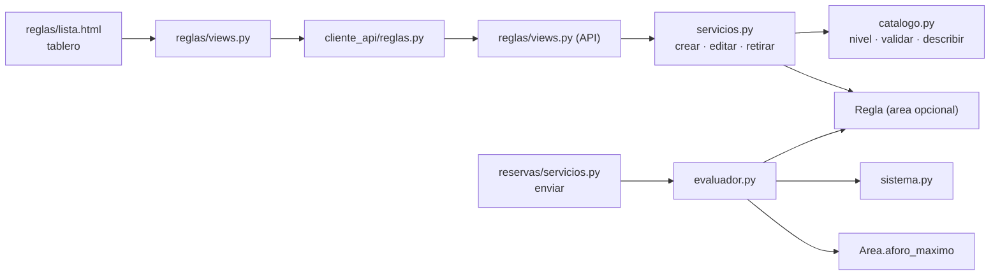

# AdMind — Plan guiado del motor de reglas por niveles

> [!IMPORTANT]
> **Alejo:** llena la columna *Respuesta* de la sección 3. Para empezar o retomar, en un chat nuevo: `Ejecuta el plan Documentacion/Admind_Documentacion/07_Planes/activos/Plan_Motor_De_Reglas.md`. El agente te pregunta primero si lo quieres guiado o si lo construye él.

## 1. Seguimiento

<!-- Lo mantiene el agente que ejecuta, guíe o construya. Quien escribe el plan lo deja en cero, con una fila por fase. -->

**Plan creado:** 2026-10-06. **Dónde voy:** F0 a F5 construidas y verificadas. Falta, de Alejo: B3.6 (`migrate` en `admind_db`), los commits, la prueba manual y los avisos a Camilo. Después se cierra el plan: el contexto ya se actualizó y solo queda mover el archivo a `hechos/`. Modo: lo construyó el agente (Alejo, 2026-10-06). Sin commits: Alejo no los ha pedido.

| Fase | Deja funcionando | Estado | Modo | Explicada de vuelta | Verificación | Commit | Fecha |
|---|---|---|---|---|---|---|---|
| F0 | Punto de partida confirmado | hecha | — | — | Backend `2d11dbe`: 368 recogidas, 367 pasan y 1 falla (`test_toda_ruta_de_la_api_esta_cubierta`, 5 rutas sin registrar, ya venía). Frontend `a3792d7`: 188 pasan. Sin migraciones pendientes, árbol limpio | — | 2026-10-06 |
| F1 | Toda área tiene un aforo máximo obligatorio, de la base a la pantalla | hecha | construida | — | Backend: 369 pasan y la misma falla de F0; `makemigrations --check` sin cambios. Frontend: 189 pasan | sin commit | 2026-10-06 |
| F2 | La API maneja reglas por niveles: del conjunto y del área, una sola por tipo, con su descripción | hecha | construida | — | Backend: 374 pasan y la misma falla de F0 (siguen siendo 5 rutas sin registrar; `reglas-catalogo` quedó registrada); `makemigrations --check` sin cambios. B2.4 no aplica (D3 = a) | sin commit | 2026-10-06 |
| F3 | La base cierra el modelo anterior y hace cumplir los niveles por sí sola | en curso: falta B3.6, que es de Alejo | construida | — | Backend: 376 pasan y la misma falla de F0; `makemigrations --check` sin cambios. La migración de datos `0003` se probó con una prueba temporal sobre la base de pruebas (filas del modelo anterior: cierra todas, pasa el aforo menor con tope 10 000, respeta las ya cerradas) y la prueba se borró. `admind_db` sigue sin migrar | sin commit | 2026-10-06 |
| F4 | La pantalla de reglas es un tablero por niveles, con descripciones y días que no abre | hecha | construida | — | Frontend: 192 pasan (16 casos en `test_reglas.py`). Ninguna referencia a `reglas:nueva`, `nueva-tipo` ni `asistente-reglas-tipo`. El guion manual no lo recorrió una persona: lo cubre un recorrido desechable del front contra la API con la base de pruebas | sin commit | 2026-10-06 |
| F5 | (Solo si D2 es a o b) El sistema responde ante un cierre que cae sobre reservas ya apartadas | hecha (D2 = a) | construida | — | Backend: 377 pasan y la misma falla de F0; `makemigrations --check` sin cambios. Frontend: 193 pasan. Recorrido de punta a punta (front real contra la API con la base de pruebas): 22 de 22 pasos, incluidos los pasos 1 a 7, 10 y 11 del guion | sin commit | 2026-10-06 |

<!-- Estado: pendiente · en curso · hecha · no aplica. Modo: guiada · construida (la hizo el agente). Explicada de vuelta: sí · saltada · — si fue construida. Verificación: qué se corrió y cómo salió. -->

### Desviaciones

<!-- Una línea por caso: fecha · bloque · qué difería del plan · qué se hizo. -->

- 2026-10-06 · antes de F2 · [pendientes](../../08_Estado/pendientes.md) pedía que Alejo resolviera, antes de ejecutar, el choque sobre *días que no abre* (en el chat del asistente dijo que el motivo y los periodos quedaban para después). Esa nota no está en la lista de 2.1 y el agente la leyó al actualizar el contexto, con todo construido · B2.3, B4.4 y F5 quedaron hechos, porque Alejo pidió ejecutar el plan y respondió D2 a. Falta que lo confirme.
- 2026-10-06 · todas las fases · el plan sugiere un commit por fase · no se hizo ninguno: la regla es no hacer commits que Alejo no pida. Los cambios de las cinco fases están juntos en el árbol de trabajo de los dos repositorios.
- 2026-10-06 · B2.4 · solo aplica con D3 = b · no se hizo (D3 = a).
- 2026-10-06 · B3.1 · el plan dice que la migración de datos se comprueba de verdad en `admind_db` · se comprobó antes con una prueba temporal sobre la base de pruebas, que retrocede a `reglas/0002`, crea reglas del modelo anterior y migra hacia adelante. La prueba se borró.
- 2026-10-06 · B3.6 · es de Alejo · sigue pendiente; por eso F3 no está en *hecha*.
- 2026-10-06 · B4.2 · el plan lista qué se quita de `forms.py` · se quitaron además `CampoHora` y el `import` de `date`, que quedaban sin uso.
- 2026-10-06 · B4.5 · `parametros.html` · el título usa ``, para que no salga vacío al editar si el catálogo no responde. En `_fila.html` el enlace «Definir» escribe `&amp;` entre los dos parámetros. En `dia.html` el día de la semana lleva una opción vacía «Elige el día».
- 2026-10-06 · B4.6 y B4.7 · el plan pide 9 pruebas · quedaron 14 (17 casos con los parametrizados), contando la de F5: se conservaron, adaptadas, `test_cada_tipo_muestra_sus_campos` y `test_un_400_de_la_api_cae_en_su_campo`, y se agregaron tres (los días que no abre no se editan por `editar`, una fecha suelta es un periodo de un día, y quitar un día manda los que quedan). `test_sin_regla_configurar_no_hay_acciones` busca `>Cambiar</a>` y no la palabra suelta, porque la barra superior dice «Cambiar de conjunto».
- 2026-10-06 · B5.2 · el texto del aviso · concuerda en número: «1 reserva ya apartada cae en estos días» y «3 reservas ya apartadas caen en estos días».
- 2026-10-06 · cierre de F4 · la verificación pide el guion manual hasta el paso 7 · el agente no puede entrar con usuarios reales ni migrar `admind_db`; lo sustituyó un recorrido del front contra la API con la base de pruebas. No se vio en un navegador: en la lista de días que no abre, el botón «Quitar» queda debajo de cada renglón (así sale del marcado del plan con `lista-simple`).

### Conceptos por repasar

<!-- Lo que costó, lo que se saltó y los bloques `tuyo` que terminaron con el código dado. Con las fases construidas por el agente, es la lista de estudio para la sustentación. -->

Las cinco fases las construyó el agente, incluidos los bloques `tuyo` (B1.6, B2.10, B3.5, B4.7 y B5.3). Para la sustentación, cada una con la consigna y la pregunta de jurado de su cierre:

- **F1 · una regla que no puede faltar es una columna.** En qué tres sitios se revisa el aforo (formulario, serializer y `CHECK`) y qué pasa si se salta el primero. `preserve_default=False` en la migración escrita a mano.
- **F2 · el nivel lo dice el catálogo.** El recorrido de un `POST /reglas/`: serializer, `catalogo.validar`, `NIVEL_POR_TIPO`, la búsqueda de una abierta y el `409`. Por qué una regla del conjunto es la misma tabla sin área, y por qué la FK compuesta no estorba con `area_id` nulo. `400` contra `409`.
- **F2 · el evaluador.** Un diccionario de funciones por tipo; por qué el aforo quedó fuera del diccionario; por qué los tipos retirados siguen en `TipoDeRegla`.
- **F3 · la base como última palabra.** Índice único parcial y `CHECK` que solo mira las abiertas. Por qué hay tres migraciones y en qué orden corren: primero los datos, después la restricción. La condición de carrera que cubre el `except IntegrityError` de `crear`.
- **F3 · migración de datos.** Los modelos históricos de `apps.get_model` no traen el manager que filtra por conjunto.
- **F4 · el tablero.** De dónde sale cada fila: catálogo, reglas abiertas y áreas, cruzados en `cargar_tablero`. Por qué la descripción viene de la API. Qué pasa al agregar un segundo día: una versión nueva con la lista completa.
- **F5 · una regla nueva no cambia decisiones ya tomadas.** Por qué cerrar un día no cancela las reservas de ese día y por qué `reservas_afectadas` se calcula al leer.

## 2. Instrucciones para el agente

> [!IMPORTANT]
> **Primero pregunta.** Antes de tocar nada, pregúntale a Alejo si este plan se trabaja **guiado** (explicas por bloques y él aplica) o si lo **construyes** tú. No entres en modo guiado sin su respuesta.

### 2.1 Qué leer antes de empezar

1. [ejecutar_plan_guiado](../../09_Protocolos/ejecutar_plan_guiado.md): cómo se trabaja este plan en modo guiado y qué cambia si Alejo pide que lo construyas.
2. Este plan completo.
3. Notas:
   - [motor_reglas](../../05_Modulos/motor_reglas.md): la *Definición vigente* es lo que este plan construye; *Qué cambia al construir* es el resumen.
   - [reservas](../../05_Modulos/reservas.md): dónde se llama al evaluador y qué pasa con una solicitud que incumple.
   - [invariantes](../../03_Reglas/invariantes.md): `ModeloDeConjunto`, FK compuesta, prueba del intruso.
   - [capas](../../03_Reglas/capas.md): en qué archivo va cada regla y qué código responde cada caso (400, 404, 409).
   - [eliminacion](../../03_Reglas/eliminacion.md): nada se borra. Es la razón de que los tipos retirados sigan en el catálogo.
   - [restricciones_bd](../../02_Arquitectura/restricciones_bd.md): lo que hace cumplir PostgreSQL. F3 le agrega tres restricciones.
   - [reglas_frontend](../../03_Reglas/reglas_frontend.md): inventario cerrado de componentes y dónde va el acento.
   - [pruebas_y_ejecucion](../../02_Arquitectura/pruebas_y_ejecucion.md) y [git](../../03_Reglas/git.md).
4. README de las carpetas que se tocan: `Backend/Admind_Backend/apps/reglas/README.md`, `Backend/Admind_Backend/apps/areas/README.md`, `Backend/Admind_Backend/tests/aislamiento/README.md`, `Frontend/Admind_Front-End/apps/reglas/README.md`, `Frontend/Admind_Front-End/apps/areas/README.md`, `Frontend/Admind_Front-End/cliente_api/README.md` y `Frontend/Admind_Front-End/tests/README.md`.

### 2.2 Reglas propias de este plan

- **No se toca** `Conjunto`, el catálogo de permisos, `apps/reglas/mora.py`, `apps/conjuntos/servicios.py` (el requisito `reglas_beta` sigue igual, P15), el flujo de `apps/reservas/servicios.py` ni `config/settings_pruebas.py`. De reservas solo cambian sus pruebas. Si parece que hace falta algo más, es una desviación y se pregunta.
- **En `TipoDeRegla` el nombre del miembro es igual a su valor** (`AFORO = "AFORO"`). El código busca en diccionarios con el texto que viene de la base, y eso solo funciona si coinciden.
- **Migraciones de este plan:** `areas/0004_aforo_maximo`, `reglas/0002_area_opcional`, `reglas/0003_cerrar_modelo_anterior` y `reglas/0004_niveles_y_unicidad`. Sin paquetes nuevos. Si para entonces otra sesión agregó migraciones en esas apps, cambia el número y la dependencia, nada más.
- **`migrate` sobre `admind_db` lo corre Alejo, una sola vez, al cerrar F3** (P17). Esa migración cierra todas las reglas vigentes (D4). Antes de F3, las pruebas automáticas bastan.
- **Entre F2 y F4 las pantallas de reglas quedan desfasadas con la API.** No se hace `push` hasta cerrar F4.
- **Convive con [Plan_Estructura_De_Viviendas](Plan_Estructura_De_Viviendas.md)**, que renumera los pasos del asistente. Los dos tocan `Frontend/…/apps/conjuntos/urls.py`, el número de `"paso"` en `apps/reglas/views.py` y las pruebas que nombran pasos. Este plan escribe `4`; si el otro ya se ejecutó, respeta el número que encuentres.
- **Convive con [Plan_Asistente_De_Creacion](Plan_Asistente_De_Creacion.md)**, que agrega el paso «Reglamento» entre Reglas y Resumen. Si sus fases F1 y F2 ya se ejecutaron, la salida del tablero dentro del asistente va a `conjuntos:asistente-reglamento` y no al resumen. Su F3, que va después de este plan, es la que cambia el requisito `reglas_beta`.
- **Avisos a Camilo** (los da Alejo; recuérdaselo al cerrar la fase): en F1, que crear un área ahora exige `aforo_maximo` y hay migración en `areas`; en F3, que `migrate` cierra las reglas que tenía definidas y hay que volver a definirlas; en F4, que la pantalla de reglas cambió y que alfa y beta significan otra cosa.
- Ninguna fase empieza con su decisión de la sección 3 vacía: F1 necesita D1; F2, D3; F3, D4; F5, D2.

## 3. Decisiones que toma Alejo

Ya decididas por Alejo el 2026-10-06, en el chat de definición ([construccion](../../06_Decisiones/construccion.md)): tres niveles (sistema, alfa, beta); cada regla en un solo nivel y una sola vez; anticipación mínima y máxima y paz y salvo son del conjunto; el límite de reservas y los días que no abre son del área; el aforo es obligatorio; cada día que no abre lleva motivo y puede ser un día de la semana, una fecha o un periodo; cada regla lleva una descripción fija.

| ID | Decisión | Opciones | Recomendada | Respuesta |
|---|---|---|---|---|
| D1 | Cómo se guarda el modelo nuevo | a) Se conserva la tabla `Regla`: una regla sin área es del conjunto. El aforo pasa a ser un campo del área, como ya lo son el horario y la franja. Se conserva el versionado de HU-10 b) Todo como campos de `Conjunto` y `Area`, sin tabla de reglas: se pierde el versionado y casi todo HU-10 | a | a (Alejo, 2026-10-06) |
| D2 | Qué hace el sistema si un día que no abre cae sobre reservas ya apartadas o aprobadas ([abiertas](../../06_Decisiones/abiertas.md) 12.10 a) | a) Avisa en el tablero cuántas quedan dentro, con enlace a las solicitudes del área b) No deja guardar el cierre mientras existan: `409` c) Nada por ahora: F5 no se hace | a | a (Alejo, 2026-10-06) |
| D3 | ¿Entran ya las dos reglas alfa que todavía nada usa: acompañantes (la usará el ingreso a zonas) y día límite de pago (la usará pagos)? | a) No: llegan con el plan de cada módulo b) Sí: se guardan y se muestran con la nota «todavía no restringe» | a | a (Alejo, 2026-10-06) |
| D4 | La migración de F3 cierra **todas** las reglas vigentes de hoy (no las borra; quedan en el historial) y pasa el aforo de cada regla a su área. Las reglas se vuelven a definir en la pantalla nueva | a) De acuerdo b) Hay que convertirlas una por una | a | a (Alejo, 2026-10-06) |

Si D1 es **b** o D4 es **b**, se para: cambian F1 a F4 y Alejo vuelve al chat de planeación. Si D3 es **b**, se hace además el bloque B2.4. Si D2 es **c**, F5 queda como *no aplica*.

## 4. Decisiones menores que el plan ya fija

| ID | Decisión |
|---|---|
| P1 | Los textos nuevos usan las palabras que las pantallas tienen hoy: «área», «franja» y «apartamento». Cambiarlas a «zona», «turno» y «vivienda» es un solo barrido de todas las pantallas: segunda parte de HU-39 y [abiertas](../../06_Decisiones/abiertas.md) 12.10 d |
| P2 | Tipos retirados: `AFORO`, `FRANJA_HORARIA` y `DIAS_NO_RESERVABLES`. Siguen en `TipoDeRegla` porque las reglas viejas no se borran y hay que poder leerlas. No se crean ni se editan. Se conserva cómo se describen; se quita cómo se validan y cómo se evalúan |
| P3 | «Días que no abre» es un tipo **nuevo**, `DIAS_QUE_NO_ABRE`, porque sus parámetros tienen otra forma. Así una regla vieja de `DIAS_NO_RESERVABLES` se sigue describiendo con la suya |
| P4 | Un renglón de `DIAS_QUE_NO_ABRE` es `{"dia_semana": 0, "motivo": "…"}` o `{"desde": "AAAA-MM-DD", "hasta": "AAAA-MM-DD", "motivo": "…"}`. Una fecha suelta es un periodo con `desde` igual a `hasta`. Topes: 60 renglones y 120 caracteres de motivo. Un día de la semana no se repite |
| P5 | Una regla **abierta** es la que tiene `vigencia_hasta` vacía. Solo puede haber una abierta por tipo en el conjunto (alfa) o por tipo y área (beta). Definir una segunda responde `409` |
| P6 | *Paz y salvo* no tiene parámetros: activarla es definir la regla y desactivarla es retirarla. Lleva la nota «todavía no restringe: falta el módulo de pagos», porque `unidad_en_mora()` responde siempre que no |
| P7 | «Dentro del horario» no se agrega al evaluador: ya lo garantiza tomar el bloqueo, que rechaza una franja fuera del horario (`FranjaInvalida`) |
| P8 | El aforo se evalúa **siempre**, como resultado de nivel `beta` y sin id de regla, con el mismo texto de hoy. Por eso toda evaluación tiene ahora un resultado más |
| P9 | Las áreas que ya existen reciben aforo `1` en `areas/0004`: un valor a la vista, que obliga a escribir el real. `reglas/0003` lo reemplaza por el de su regla de aforo abierta, si la tenía (el menor, si había varias) |
| P10 | Topes del aforo: de 1 a 10 000, en el serializer. La base solo exige que sea al menos 1 |
| P11 | Los nombres y las descripciones de las reglas viven en un solo sitio, `apps/reglas/catalogo.py`, y llegan al front por una ruta nueva, `GET /reglas/catalogo/`. El front no los repite |
| P12 | Permisos: los que ya existen, `regla.ver`, `regla.configurar` y `area.gestionar`. No se crea ninguno |
| P13 | El front arma la lista de días que no abre: agrega o quita un renglón y manda la lista completa; la API la valida. Quitar el último renglón retira la regla |
| P14 | Para volver al asistente después de guardar, los enlaces y formularios llevan `volver=asistente`. La ruta `asistente-reglas-tipo` desaparece |
| P15 | El requisito `reglas_beta` de `requisitos_para_operar` no se toca: sigue cumpliéndose con al menos una regla vigente. Qué debe exigir el asistente es [abiertas](../../06_Decisiones/abiertas.md) 12.10 e |
| P16 | `vigencia_desde` se conserva al definir una regla. Los mensajes que lee el residente no cambian, salvo el de días que no abre, que ahora trae el motivo |
| P17 | `migrate` sobre `admind_db` lo corre Alejo, al cerrar F3. Si quiere ver F1 en el navegador antes, puede correrlo: las áreas quedan con aforo 1 hasta que las edite |
| P18 | Orden de la evaluación: reglas del sistema, aforo, reglas del conjunto y reglas del área |
| P19 | `apps/reglas/alfa.py` se renombra a `sistema.py` con `git mv`, para que el nombre del archivo no contradiga la definición |

## 5. Punto de partida verificado

Comprobado en el código el 2026-10-06. Ramas `desarrollo`, árbol limpio en los dos repositorios. Backend en `2d11dbe` y Frontend en `a3792d7`.

| Dónde | Qué hay |
|---|---|
| `Backend/Admind_Backend/apps/reglas/catalogo.py` | `TipoDeRegla` con 7 tipos; `PARAMETROS_POR_TIPO`; validadores `entero`, `hora`, `dias_de_la_semana`, `fechas`; `validar(tipo, parametros)`, que lanza `ParametrosInvalidos(errores)`; `DIAS`, `lista_de_dias` y `describir(tipo, p)` |
| `…/apps/reglas/alfa.py` | `Resultado` (dataclass con `clave`, `descripcion`, `cumple`, `motivo`, `regla_id`, `parametros` y `como_dict()`), las funciones `reside`, `no_en_el_pasado`, `area_disponible` y la lista `ALFAS`. Solo lo importa `evaluador.py` |
| `…/apps/reglas/models.py` | `ReglaQuerySet.vigentes(fecha)`; `Regla(ModeloDeConjunto)` con `area` **obligatoria**, `tipo`, `parametros`, `vigencia_desde`, `vigencia_hasta`, `reemplaza`, `creada_por`. Restricciones `regla_tipo_valido` y `regla_vigencia_coherente`. Nada impide dos reglas del mismo tipo en un área |
| `…/apps/reglas/servicios.py` | `reglas_actuales()`, `reglas_vigentes(area, fecha)`, `crear(actor, area_id, tipo, parametros, vigencia_desde)`, `cerrar`, `editar`, `retirar`; excepciones `AreaNoEncontrada` y `ReglaCerrada` |
| `…/apps/reglas/evaluador.py` | `EVALUADOR_POR_TIPO` con una función por tipo y `evaluar(solicitud)` |
| `…/apps/reglas/serializers.py`, `views.py`, `urls.py` | `CrearReglaSerializer` (exige `area`), `EditarReglaSerializer`, `ReglaSerializer`; `ReglasView`, `DetalleDeReglaView`, `RetirarReglaView`. Rutas `reglas`, `regla-detalle`, `regla-retirar` |
| `…/apps/reglas/migrations/` | Solo `0001_initial.py`, con `fk_compuesta('reglas_regla', 'area_id', 'areas_area')` |
| `…/apps/areas/models.py` | `Area` con `hora_apertura`, `hora_cierre`, `duracion_franja_minutos` (mínimo 120, restricción `area_duracion_franja_minima`), `en_mantenimiento` y `activo`. **No tiene aforo.** Migraciones hasta `0003_duracion_franja_minima` |
| `…/apps/areas/serializers.py`, `servicios.py` | `CrearAreaSerializer`, `EditarAreaSerializer`, `AreaSerializer`; `CAMPOS_EDITABLES`, `crear(actor, **datos)`, `editar` |
| `…/apps/reservas/servicios.py` | `enviar()` llama a `evaluar(solicitud)` y copia el resultado en `Solicitud.evaluacion`. `avisos()` usa `reglas_vigentes(solicitud.area, hoy).filter(tipo=ANTICIPACION_MAXIMA)` |
| Pruebas que crean un `Area` real | `apps/areas/tests.py` (constante `SALON` y la prueba de franjas), `apps/reglas/tests.py` (`crear_area`), `apps/reservas/tests.py` (`crear_area`), `tests/aislamiento/test_intruso.py` (`area_comun_de`) y `tests/concurrencia/test_bloqueo_de_franjas.py` |
| Pruebas que crean un `Regla` | `apps/reglas/tests.py`, `apps/reservas/tests.py` (ayudante `regla` y la prueba del último día de anticipación) y `tests/aislamiento/test_intruso.py` (`regla_de`, con `AFORO`) |
| `…/tests/aislamiento/test_intruso.py` | Diccionarios `DETALLES`, `LISTADOS`, `ACCIONES` y `RUTAS_SIN_CONJUNTO` |
| `Frontend/Admind_Front-End/apps/reglas/views.py` | `lista`, `nueva` (elige área y tipo), `nueva_tipo`, `editar`, `retirar`; ayudantes `con_fechas`, `cargar_reglas`, `a_donde_volver` |
| `…/apps/reglas/forms.py` | `TIPOS_DE_REGLA`, `DIAS_DE_LA_SEMANA`, `ElegirTipoForm`, `ParametrosForm` y un formulario por tipo en `FORMULARIO_POR_TIPO`; `iniciales()` |
| `…/apps/reglas/templates/reglas/` | `lista.html`, `nueva.html` y `parametros.html` |
| `…/apps/conjuntos/urls.py` | `asistente-reglas` apunta a `reglas.views.nueva` y `asistente-reglas-tipo` a `nueva_tipo`, las dos con `en_asistente=True` |
| `…/apps/areas/` | `AreaForm`, `EditarAreaForm`; `cargar_areas`, `crear_desde`, `editar` (con la tupla `campos`); `_campos_area.html` y `_tabla_areas.html` |
| `…/cliente_api/reglas.py`, `areas.py` | `listar`, `crear`, `obtener`, `editar`, `retirar` en reglas; `ErrorDeApi` trata igual el 400 y el 409 |
| `…/tests/test_reglas.py`, `test_areas.py` | 9 y 11 pruebas con la API simulada; `test_el_paso_4_del_asistente_usa_la_misma_alta` y `test_el_asistente_tiene_cinco_pasos…` nombran pasos |

Lo que este plan resuelve y hoy falla o falta:

- Dos reglas del mismo tipo en un área conviven, y dos franjas horarias con días distintos se anulan.
- La anticipación y el paz y salvo se repiten área por área, cuando son del conjunto.
- El aforo es opcional: un área sin esa regla acepta cualquier número de asistentes.
- Un día no reservable no dice por qué, y un cierre de un mes obliga a escribir 30 fechas.
- Ninguna regla explica qué hace. «Cupo por apartamento» se confunde con los puestos del aforo.

**Diferencias entre las notas y el código:**

- `Backend/Admind_Backend/apps/reglas/README.md` todavía lista el versionado como pendiente. Se resolvió con D4 a del plan anterior. Se corrige al cerrar este plan.
- [pruebas_y_ejecucion](../../02_Arquitectura/pruebas_y_ejecucion.md) es del 05/10 y cuenta 362 pruebas en el Backend. Hoy `pytest --collect-only` recoge 368 y 188. Cuántas pasan lo confirma F0.
- [estado_actual](../../08_Estado/estado_actual.md) y [reservas](../../05_Modulos/reservas.md) dicen que aprobar y rechazar no existe. El commit `2d11dbe` trae la ruta `solicitud-decision` y los campos `decidida_en` y `decidida_por`. No es de este plan; queda avisado a Alejo.

## 6. Mapa de la funcionalidad

Todo es nuevo salvo lo marcado *(ya existe)*.

1. Administración abre **Reglas** (`/reglas/`, puerto 8001). La vista pide tres cosas a la API: el catálogo (`GET /reglas/catalogo/`), las reglas abiertas (`GET /reglas/` *(ya existe)*) y las áreas (`GET /areas/` *(ya existe)*).
2. Con eso pinta un **tablero**: arriba, las reglas del conjunto; debajo, un bloque por área. Cada fila es una regla posible, con su nombre, su descripción fija y lo que vale hoy, o «Sin definir».
3. «Definir» abre el formulario del tipo. Guardar hace `POST /reglas/`: sin `area` si la regla es del conjunto, con `area` si es de un área.
4. En la API, `ReglasView` exige `regla.configurar`. El servicio `crear` mira el nivel del tipo en el catálogo, valida los parámetros y revisa que no haya otra abierta. Si la hay, `409`.
5. «Cambiar» y «Quitar» son editar y retirar *(ya existen)*: editar cierra la versión y crea otra.
6. «Días que no abre» es una lista. «Agregar» manda la lista con un renglón más; «Quitar», con uno menos.
7. El aforo no está en ese tablero como regla: se escribe al crear o editar el área y es obligatorio.
8. Cuando un residente envía una solicitud, `reservas.servicios.enviar` *(ya existe)* llama a `evaluar`. El evaluador junta las reglas del sistema, el aforo del área, las reglas del conjunto y las del área, y devuelve todos los resultados, cada uno con su nivel.
9. En la base, tres restricciones impiden lo que el servicio ya rechaza: una regla abierta en el nivel equivocado, y dos abiertas del mismo tipo.



## F0 · Confirmar el punto de partida

- [x] **B0.1** · Correr las dos suites y `makemigrations --check --dry-run` ([pruebas_y_ejecucion](../../02_Arquitectura/pruebas_y_ejecucion.md)). Se espera: 368 pruebas en el Backend y 188 en el Frontend, sin migraciones pendientes y `git status` limpio en los dos. Anota en *Verificación* cuántas pasan y cuáles fallan: son la línea base, y ninguna fase puede dejar más fallas que esas. Si los commits o los conteos no coinciden con el frontmatter, se para y se le avisa a Alejo: puede que ya se haya ejecutado otro plan.

## F1 · El aforo es un dato del área

**Deja funcionando:** no se puede crear un área sin aforo, por la API ni por la pantalla; la base rechaza un aforo de cero; el formulario y la tabla de áreas lo muestran.

**Concepto de la fase:** una regla que no puede faltar deja de ser una regla que alguien se acuerda de agregar y pasa a ser una columna obligatoria. Se hace cumplir en tres capas: formulario, serializer y base.

- [x] **B1.1** · explicado · `Backend/Admind_Backend/apps/areas/models.py`
  - **Qué:** un campo nuevo después de `duracion_franja_minutos` y una restricción más en `Meta.constraints`.
  - **Concepto:** `CHECK` en la base. Aunque alguien escriba la fila sin pasar por la API, PostgreSQL no la guarda.
  - **Forma:**

    ```python
    # Cuántas personas caben. Es obligatorio: toda solicitud se compara con él.
    aforo_maximo = models.PositiveSmallIntegerField()
    ```

    ```python
    models.CheckConstraint(condition=Q(aforo_maximo__gte=1), name="area_aforo_maximo_valido"),
    ```
  - **Comprobación:** se ve en B1.2.

- [x] **B1.2** · explicado · `Backend/Admind_Backend/apps/areas/migrations/0004_aforo_maximo.py` (archivo nuevo, escrito a mano)
  - **Qué:** la migración. Se escribe a mano porque `makemigrations` preguntaría en la terminal qué valor poner a las filas que ya existen.
  - **Concepto:** `preserve_default=False`. El `default=1` solo sirve para llenar las áreas que ya existen; después el campo queda sin valor por defecto, como en el modelo (P9).
  - **Forma:**

    ```python
    from django.db import migrations, models


    class Migration(migrations.Migration):

        dependencies = [
            ("areas", "0003_duracion_franja_minima"),
        ]

        operations = [
            # Las áreas que ya existen reciben 1: un valor a la vista, que obliga a escribir el real.
            migrations.AddField(
                model_name="area",
                name="aforo_maximo",
                field=models.PositiveSmallIntegerField(default=1),
                preserve_default=False,
            ),
            migrations.AddConstraint(
                model_name="area",
                constraint=models.CheckConstraint(
                    condition=models.Q(("aforo_maximo__gte", 1)), name="area_aforo_maximo_valido"
                ),
            ),
        ]
    ```
  - **Comprobación:** `./.venv/Scripts/python.exe manage.py makemigrations --check --dry-run` responde `No changes detected`.

- [x] **B1.3** · explicado · `Backend/Admind_Backend/apps/areas/serializers.py` y `servicios.py`
  - **Qué:** `aforo_maximo` en los tres serializers y en `CAMPOS_EDITABLES`.
  - **Concepto:** el serializer responde `400` con el campo antes de que la base tenga que rechazar nada.
  - **Forma:** en `CrearAreaSerializer`, `aforo_maximo = serializers.IntegerField(min_value=1, max_value=10000)`. En `EditarAreaSerializer`, lo mismo con `required=False`. En `AreaSerializer`, `aforo_maximo = serializers.IntegerField()`. En `servicios.py`, `"aforo_maximo"` al final de `CAMPOS_EDITABLES`.
  - **Comprobación:** B1.4.

- [x] **B1.4** · explicado · pruebas del Backend
  - **Qué:** primero, que todo lo que crea un `Area` real le ponga `aforo_maximo=50`: la constante `SALON` y la prueba de franjas de `apps/areas/tests.py`, `crear_area` de `apps/reglas/tests.py` y de `apps/reservas/tests.py`, `area_comun_de` de `tests/aislamiento/test_intruso.py` y el `Area.objects.create` de `tests/concurrencia/test_bloqueo_de_franjas.py`. Va en 50 porque las pruebas de reservas envían 20 asistentes. El `Area` de `tests/aislamiento/models.py` es otro modelo y no se toca. Después, dos pruebas nuevas en `apps/areas/tests.py`.
  - **Concepto:** una prueba por capa. La primera habla con la API; la segunda escribe directo en la base.
  - **Forma:**

    ```python
    def test_el_aforo_es_obligatorio_y_minimo_uno(admin, salon):
        sin_aforo = {campo: valor for campo, valor in SALON.items() if campo != "aforo_maximo"}
        crear_sin = admin.post("/areas/", {**sin_aforo, "nombre": "BBQ"}, format="json")
        crear_cero = admin.post("/areas/", {**SALON, "nombre": "Gimnasio", "aforo_maximo": 0}, format="json")
        editar = admin.patch(f"/areas/{salon['id']}/", {"aforo_maximo": 80}, format="json")

        assert crear_sin.status_code == 400 and "aforo_maximo" in crear_sin.json()
        assert crear_cero.status_code == 400 and "aforo_maximo" in crear_cero.json()
        assert (editar.status_code, editar.json()["aforo_maximo"]) == (200, 80)


    def test_la_base_no_acepta_un_area_con_aforo_cero(torres):
        with usar_conjunto(torres.id), pytest.raises(IntegrityError), transaction.atomic():
            Area.objects.create(
                nombre="BBQ", hora_apertura=time(8), hora_cierre=time(22), duracion_franja_minutos=120, aforo_maximo=0
            )
    ```

    Revisa que el archivo importe `IntegrityError`, `transaction` y `time`.
  - **Comprobación:** `./.venv/Scripts/python.exe -m pytest -q`: las mismas fallas de F0 y ninguna más.

- [x] **B1.5** · explicado · `Frontend/Admind_Front-End/apps/areas/forms.py`, `views.py` y las dos plantillas
  - **Qué:** el campo en `AreaForm`, en `_campos_area.html`, en la tupla `campos` de `views.editar` y en `_tabla_areas.html`.
  - **Concepto:** el front repite el mínimo para avisar rápido, pero quien decide es la API.
  - **Forma:** en `AreaForm`, después de `duracion_franja_minutos`:

    ```python
    aforo_maximo = forms.IntegerField(label="Aforo máximo", min_value=1, max_value=10000)
    ```

    En `_campos_area.html`, después del campo de la franja:

    ```html
    
    ```

    En `views.editar`, `"aforo_maximo"` dentro de la tupla `campos`. En `_tabla_areas.html`, dentro del `<span class="am-tabla__secundario">` del horario: `franjas de {{ area.duracion_franja_minutos }} min · aforo {{ area.aforo_maximo }}`.
  - **Comprobación:** B1.6.

- [x] **B1.6** · tuyo (modelo: `test_la_duracion_minima_de_la_franja_es_de_dos_horas`, en el mismo archivo) · `Frontend/Admind_Front-End/tests/test_areas.py`
  - **Qué:** `"aforo_maximo": 50` en `SALON`, `"aforo_maximo": "50"` en `DATOS`, el campo en lo que espera `test_crear_manda_las_horas_como_texto_y_vuelve_a_la_lista`, y una prueba nueva, `test_el_formulario_exige_el_aforo`.
  - **Qué cambia respecto al modelo:** el campo que falta es `aforo_maximo`, y se prueba vacío y en `0`.
  - **Comprobación:** `./.venv/Scripts/python.exe -m pytest -q` en el Frontend, en verde.

**Cierre de F1**

- **Verificación:** las dos suites y `makemigrations --check --dry-run`.
- **Explicar de vuelta:** «cuéntame en qué tres sitios se revisa el aforo de un área nueva y qué pasa si se salta el primero».
- **Pregunta de jurado:** ¿por qué el aforo dejó de ser una regla configurable y pasó a ser una columna del área?
- **Commits sugeridos:** `feat(areas): aforo máximo obligatorio en cada área [HU-09]` en los dos repositorios. La migración va en el mismo commit que el modelo.

## F2 · Reglas por niveles: catálogo, servicio, evaluador y API

**Deja funcionando:** la API crea reglas del conjunto sin área y reglas de un área con ella, rechaza la segunda del mismo tipo con `409`, ya no crea los tipos retirados, sirve el catálogo con las descripciones y evalúa cada solicitud con el aforo del área y las reglas de los dos niveles.

**Concepto de la fase:** el nivel de una regla no lo escoge quien la crea: lo dice el catálogo. Una regla del conjunto es una fila de la misma tabla, sin área.

- [x] **B2.1** · explicado · `Backend/Admind_Backend/apps/reglas/alfa.py` → `sistema.py`
  - **Qué:** `git mv apps/reglas/alfa.py apps/reglas/sistema.py`. Dentro: la lista `ALFAS` pasa a llamarse `REGLAS_DEL_SISTEMA`, `Resultado` gana el campo `nivel` y `como_dict()` lo incluye. En `evaluador.py` cambian los dos `import`.
  - **Concepto:** el nombre del archivo tiene que decir lo mismo que la definición. Lo que antes era «alfa» hoy es «del sistema».
  - **Forma:** el docstring del módulo y la clase:

    ```python
    """Reglas del sistema: fijas en el código, siempre activas. Nadie las configura ni las apaga.

    Hasta el 2026-10-06 se llamaban alfa. Hoy una regla alfa es la que Administración define para
    todo el conjunto (`catalogo.py`). Las de piscina y de cobro siguen fuera: no hay datos con qué evaluarlas.
    """
    ```

    ```python
    @dataclass(frozen=True)
    class Resultado:
        """Lo que dijo una regla sobre una solicitud. `motivo` va vacío si cumple.

        `nivel` dice de dónde sale: `sistema`, `alfa` (del conjunto) o `beta` (del área). Las del
        sistema y el aforo no tienen id; las demás llevan el de su versión (plan P10).
        """

        clave: str
        descripcion: str
        cumple: bool
        motivo: str = ""
        regla_id: object = None
        parametros: dict = field(default_factory=dict)
        nivel: str = "sistema"
    ```

    En `como_dict()`, una clave más: `"nivel": self.nivel`.
  - **Comprobación:** la suite del Backend sigue como en F1. Es un cambio de nombre: nada se comporta distinto.

- [x] **B2.2** · explicado · `Backend/Admind_Backend/apps/reglas/catalogo.py`
  - **Qué:** los niveles, el tipo nuevo, qué tipos están retirados y la descripción fija de cada regla. Se quitan los validadores que ya nadie usa: `hora`, `dias_de_la_semana` y `fechas`, y el `import` de `time`.
  - **Concepto:** un catálogo cerrado es una tabla en el código. Agregar una regla es agregar una fila en cada diccionario, no escribir un `if` en cinco sitios.
  - **Forma:**

    ```python
    class Nivel(models.TextChoices):
        ALFA = "alfa", "Del conjunto"
        BETA = "beta", "Del área"


    class TipoDeRegla(models.TextChoices):
        ANTICIPACION_MINIMA = "ANTICIPACION_MINIMA", "Anticipación mínima"
        ANTICIPACION_MAXIMA = "ANTICIPACION_MAXIMA", "Anticipación máxima"
        REQUIERE_PAZ_Y_SALVO = "REQUIERE_PAZ_Y_SALVO", "Paz y salvo"
        DIAS_QUE_NO_ABRE = "DIAS_QUE_NO_ABRE", "Días que no abre"
        CUPO_POR_UNIDAD = "CUPO_POR_UNIDAD", "Límite de reservas por apartamento"
        # Retirados el 2026-10-06. Quedan para leer el historial: no se crean ni se editan.
        AFORO = "AFORO", "Aforo"
        FRANJA_HORARIA = "FRANJA_HORARIA", "Franja horaria"
        DIAS_NO_RESERVABLES = "DIAS_NO_RESERVABLES", "Días no reservables"


    # En qué nivel vive cada tipo que se puede definir hoy. Un tipo que no está aquí está retirado.
    NIVEL_POR_TIPO = {
        TipoDeRegla.ANTICIPACION_MINIMA: Nivel.ALFA,
        TipoDeRegla.ANTICIPACION_MAXIMA: Nivel.ALFA,
        TipoDeRegla.REQUIERE_PAZ_Y_SALVO: Nivel.ALFA,
        TipoDeRegla.DIAS_QUE_NO_ABRE: Nivel.BETA,
        TipoDeRegla.CUPO_POR_UNIDAD: Nivel.BETA,
    }
    # Como texto, porque van dentro de una restricción de la base (F3).
    TIPOS_ALFA = [tipo.value for tipo, nivel in NIVEL_POR_TIPO.items() if nivel == Nivel.ALFA]
    TIPOS_BETA = [tipo.value for tipo, nivel in NIVEL_POR_TIPO.items() if nivel == Nivel.BETA]

    # Lo que lee Administración junto a cada regla. La escribe el sistema, no quien configura.
    DESCRIPCION_POR_TIPO = {
        TipoDeRegla.ANTICIPACION_MINIMA: (
            "Cuántas horas antes, como mínimo, se pide una reserva. Con 24, nadie reserva para hoy mismo. "
            "Con 0 no hay mínimo."
        ),
        TipoDeRegla.ANTICIPACION_MAXIMA: (
            "Hasta cuántos días hacia adelante se puede reservar. Con 30, hoy se puede pedir cualquier fecha "
            "de los próximos 30 días y ninguna posterior."
        ),
        TipoDeRegla.REQUIERE_PAZ_Y_SALVO: (
            "Si la activas, un apartamento en mora con la administración no puede reservar hasta ponerse al día."
        ),
        TipoDeRegla.DIAS_QUE_NO_ABRE: (
            "Días de la semana, fechas o periodos en que el área no presta servicio. Cada uno lleva su motivo, "
            "que es lo que lee el residente."
        ),
        TipoDeRegla.CUPO_POR_UNIDAD: (
            "Cuántas reservas de esta área puede tener un mismo apartamento en un periodo. Con 2 cada 30 días, "
            "un apartamento no aparta el salón todos los fines de semana."
        ),
    }
    # Reglas que ya se pueden definir pero todavía no restringen nada. Se quita la nota cuando llegue su módulo.
    NOTA_POR_TIPO = {
        TipoDeRegla.REQUIERE_PAZ_Y_SALVO: "Todavía no restringe: falta el módulo de pagos.",
    }


    def tipos_vigentes():
        """El catálogo que se muestra: una entrada por tipo que se puede definir, primero las del conjunto."""
        return [
            {
                "tipo": tipo.value,
                "nivel": nivel.value,
                "nombre": tipo.label,
                "descripcion": DESCRIPCION_POR_TIPO[tipo],
                "nota": NOTA_POR_TIPO.get(tipo, ""),
            }
            for tipo, nivel in NIVEL_POR_TIPO.items()
        ]
    ```

    El docstring del módulo se reescribe para decir lo mismo: niveles, un tipo en un solo nivel, todos restringen y los retirados quedan para el historial.
  - **Comprobación:** B2.9.

- [x] **B2.3** · explicado · mismo archivo: validar, describir y leer `DIAS_QUE_NO_ABRE`
  - **Qué:** el validador `renglones`, `PARAMETROS_POR_TIPO` con solo los cinco tipos vigentes, una guarda en `validar` para los retirados, la rama nueva de `describir` y la función `motivos_del_dia`, que usará el evaluador.
  - **Concepto:** normalizar al guardar. La lista se guarda ordenada y sin espacios sobrantes, así dos listas iguales se guardan iguales.
  - **Forma:**

    ```python
    MAXIMO_DE_RENGLONES = 60
    LARGO_DEL_MOTIVO = 120
    RENGLON_MAL_ARMADO = "Cada renglón lleva un día de la semana o un periodo, y su motivo."


    def renglones(valor):
        """Los días que no abre: cada renglón es un día de la semana o un periodo, siempre con motivo (P4)."""
        if not isinstance(valor, list) or not valor:
            raise ValueError("Agrega al menos un día que no abre.")
        if len(valor) > MAXIMO_DE_RENGLONES:
            raise ValueError(f"Máximo {MAXIMO_DE_RENGLONES} renglones.")
        dias, periodos = {}, []
        for renglon in valor:
            if not isinstance(renglon, dict):
                raise ValueError(RENGLON_MAL_ARMADO)
            motivo = renglon.get("motivo")
            if not isinstance(motivo, str) or not motivo.strip():
                raise ValueError("Cada día que no abre lleva su motivo.")
            motivo = motivo.strip()
            if len(motivo) > LARGO_DEL_MOTIVO:
                raise ValueError(f"El motivo no puede pasar de {LARGO_DEL_MOTIVO} caracteres.")
            if set(renglon) == {"dia_semana", "motivo"}:
                dia = renglon["dia_semana"]
                if isinstance(dia, bool) or not isinstance(dia, int) or not 0 <= dia <= 6:
                    raise ValueError("El día de la semana va de 0 (lunes) a 6 (domingo).")
                if dia in dias:
                    raise ValueError(f"Los {DIAS[dia]} ya están en la lista.")
                dias[dia] = motivo
            elif set(renglon) == {"desde", "hasta", "motivo"}:
                try:
                    desde, hasta = date.fromisoformat(renglon["desde"]), date.fromisoformat(renglon["hasta"])
                except (TypeError, ValueError):
                    raise ValueError("Las fechas van con el formato AAAA-MM-DD.") from None
                if hasta < desde:
                    raise ValueError("La fecha final no puede ser anterior a la inicial.")
                periodos.append((desde, hasta, motivo))
            else:
                raise ValueError(RENGLON_MAL_ARMADO)
        return [{"dia_semana": dia, "motivo": dias[dia]} for dia in sorted(dias)] + [
            {"desde": desde.isoformat(), "hasta": hasta.isoformat(), "motivo": motivo}
            for desde, hasta, motivo in sorted(periodos)
        ]


    # Qué parámetros lleva cada tipo vigente. Ni uno de más ni uno de menos.
    PARAMETROS_POR_TIPO = {
        # Menos de 0 relajaría la regla del sistema «no se reserva en el pasado».
        TipoDeRegla.ANTICIPACION_MINIMA: {"horas": entero(0)},
        TipoDeRegla.ANTICIPACION_MAXIMA: {"dias": entero(1)},
        TipoDeRegla.REQUIERE_PAZ_Y_SALVO: {},
        TipoDeRegla.DIAS_QUE_NO_ABRE: {"renglones": renglones},
        TipoDeRegla.CUPO_POR_UNIDAD: {"reservas": entero(1), "dias": entero(1)},
    }
    ```

    En `validar`, antes de leer `esperados`:

    ```python
    if tipo not in PARAMETROS_POR_TIPO:
        raise ParametrosInvalidos({"tipo": ["Este tipo de regla ya no se usa."]})
    ```

    y se borran de `validar` las dos comprobaciones de `FRANJA_HORARIA` y `DIAS_NO_RESERVABLES`. Para describir y leer:

    ```python
    def en_letras(fecha):
        # Django escribe «Diciembre»: se pasa a minúscula, como hace `dia_en_letras` en reservas.
        return date_format(fecha, r"j \d\e F \d\e Y").lower()


    def describir_renglon(renglon):
        if "dia_semana" in renglon:
            return f"los {DIAS[renglon['dia_semana']]} ({renglon['motivo']})"
        desde, hasta = date.fromisoformat(renglon["desde"]), date.fromisoformat(renglon["hasta"])
        if desde == hasta:
            return f"el {en_letras(desde)} ({renglon['motivo']})"
        return f"del {en_letras(desde)} al {en_letras(hasta)} ({renglon['motivo']})"


    def motivos_del_dia(fecha, renglones):
        """Los motivos por los que el área no abre ese día. Vacío si abre."""
        return [
            renglon["motivo"]
            for renglon in renglones
            if renglon.get("dia_semana") == fecha.weekday()
            or ("desde" in renglon and renglon["desde"] <= fecha.isoformat() <= renglon["hasta"])
        ]
    ```

    Arriba del archivo, `from django.utils.formats import date_format`. En `describir`, una rama nueva antes del `return` final, que es el de paz y salvo:

    ```python
    if tipo == TipoDeRegla.DIAS_QUE_NO_ABRE:
        return f"No abre {'; '.join(describir_renglon(renglon) for renglon in p['renglones'])}"
    ```

    Las ramas de `AFORO`, `FRANJA_HORARIA` y `DIAS_NO_RESERVABLES` **se quedan**: describen el historial (P2). En la de `CUPO_POR_UNIDAD` el texto no cambia.
  - **Comprobación:** B2.9.

- [ ] **B2.4** · explicado · **solo si D3 = b** · `catalogo.py`
  - **Qué:** dos tipos alfa más, que se guardan y se describen pero no se evalúan.
  - **Concepto:** una regla puede existir antes que quien la usa, si la pantalla dice con claridad que todavía no restringe.
  - **Forma:** en `TipoDeRegla`, antes de los retirados: `ACOMPANANTES = "ACOMPANANTES", "Acompañantes"` y `DIA_LIMITE_DE_PAGO = "DIA_LIMITE_DE_PAGO", "Día límite de pago"`. Los dos con `Nivel.ALFA` en `NIVEL_POR_TIPO`. Parámetros: `{"maximo": entero(1)}` y `{"dia": entero_entre(1, 28)}`, con un validador nuevo `entero_entre(minimo, maximo)` hecho como `entero`. No definir *Acompañantes* significa que no se permiten. `describir`: «Hasta N acompañantes por apartamento a la vez» y «La administración se paga hasta el día N de cada mes». Descripciones:
    - Acompañantes: «Si los residentes pueden entrar con invitados a las áreas con registro de ingreso, y cuántos puede tener adentro un mismo apartamento a la vez. Cada acompañante ocupa un puesto del aforo.»
    - Día límite de pago: «El día del mes hasta el que se paga la administración sin entrar en mora. Con 10, quien no tenga el pago confirmado el 11 queda en mora.»

    Notas en `NOTA_POR_TIPO`: «Todavía no restringe: falta el registro de ingreso a las áreas.» y «Todavía no restringe: falta el módulo de pagos.» No llevan entrada en `EVALUADOR_POR_TIPO`. En el front, dos formularios más en B4.2 (`maximo` y `dia`).
  - **Comprobación:** entran en la prueba parametrizada del catálogo de B2.9.

- [x] **B2.5** · explicado · `Backend/Admind_Backend/apps/reglas/models.py` y la migración `0002_area_opcional`
  - **Qué:** `area` pasa a ser opcional, `ReglaQuerySet` gana `abiertas()` y `__str__` deja de suponer que hay área. Después, `./.venv/Scripts/python.exe manage.py makemigrations reglas --name area_opcional`.
  - **Concepto:** una clave foránea vacía. La FK compuesta `(area_id, conjunto_id)` de `0001` no estorba: PostgreSQL no revisa una clave foránea cuando alguna de sus columnas es nula. No hay que tocarla.
  - **Forma:**

    ```python
    # Vacía en las reglas del conjunto (alfa); obligatoria en las de un área (beta). Lo decide el tipo.
    area = models.ForeignKey("areas.Area", on_delete=models.PROTECT, null=True, blank=True, related_name="reglas")
    ```

    ```python
    def abiertas(self):
        """Las que nadie ha cerrado: vigentes hoy o por empezar. Solo puede haber una por tipo (P5)."""
        return self.filter(vigencia_hasta__isnull=True)
    ```

    ```python
    def __str__(self):
        return f"{self.get_tipo_display()} · {self.area or 'conjunto'}"
    ```

    El docstring de `Regla` cambia «Una regla beta» por «Una regla del conjunto (alfa, sin área) o de un área (beta)».
  - **Comprobación:** la migración generada trae el cambio de `area`, el de las opciones de `tipo` y el de la restricción `regla_tipo_valido`, y nada más. `makemigrations --check --dry-run` responde `No changes detected`.

- [x] **B2.6** · explicado · `Backend/Admind_Backend/apps/reglas/servicios.py`
  - **Qué:** `crear` decide con el catálogo si la regla lleva área y rechaza la segunda del mismo tipo. `reglas_actuales` y `reglas_vigentes` incluyen las del conjunto.
  - **Concepto:** el servicio levanta una excepción con nombre por cada caso, y la vista traduce cada una a su código HTTP ([capas](../../03_Reglas/capas.md)).
  - **Forma:** dos excepciones nuevas y la función, que **cambia de firma** (`area_id` pasa al final y es opcional):

    ```python
    class NivelEquivocado(Exception):
        """Una regla del conjunto con área, o una de un área sin ella. Trae el mensaje para el campo."""

        def __init__(self, mensaje):
            super().__init__(mensaje)
            self.mensaje = mensaje


    class ReglaYaDefinida(Exception):
        """Ya hay una regla abierta de ese tipo: se cambia o se retira, no se repite (P5)."""
    ```

    ```python
    def crear(actor, tipo, parametros, vigencia_desde, area_id=None):
        """Define una regla. El nivel lo dice el catálogo: del conjunto, sin área; de un área, con ella."""
        normalizados = catalogo.validar(tipo, parametros)
        area = None
        if catalogo.NIVEL_POR_TIPO[tipo] == catalogo.Nivel.ALFA:
            if area_id is not None:
                raise NivelEquivocado("Esta regla es del conjunto: no lleva área.")
        else:
            if area_id is None:
                raise NivelEquivocado("Esta regla es de un área: elige cuál.")
            area = Area.objects.filter(pk=area_id, activo=True).first()
            if area is None:
                raise AreaNoEncontrada()
        if Regla.objects.abiertas().filter(tipo=tipo, area=area).exists():
            raise ReglaYaDefinida()
        with transaction.atomic():
            regla = Regla.objects.create(
                area=area, tipo=tipo, parametros=normalizados, vigencia_desde=vigencia_desde, creada_por=actor
            )
            auditoria.registrar(actor, "regla.crear", "Regla", regla.id, despues=datos_de_la_regla(regla))
        return regla
    ```

    `catalogo.validar` va primero porque es quien rechaza un tipo retirado. Las dos consultas:

    ```python
    def reglas_actuales():
        """Las abiertas: primero las del conjunto y después las de cada área. Las cerradas quedan en el historial."""
        return (
            Regla.objects.abiertas()
            .select_related("area", "creada_por")
            .order_by(F("area__nombre").asc(nulls_first=True), "tipo", "vigencia_desde")
        )


    def reglas_vigentes(area, fecha):
        """Las del conjunto y las del área que aplican ese día, en ese orden. Las consume el evaluador (HU-13)."""
        return (
            Regla.objects.vigentes(fecha)
            .filter(Q(area__isnull=True) | Q(area=area), tipo__in=list(catalogo.NIVEL_POR_TIPO))
            .order_by(F("area").asc(nulls_first=True), "tipo", "creada_en")
        )
    ```

    `from django.db.models import F, Q` arriba. El docstring del módulo deja de decir «Reglas beta».
  - **Comprobación:** B2.9.

- [x] **B2.7** · explicado · `Backend/Admind_Backend/apps/reglas/evaluador.py`
  - **Qué:** el aforo sale del área, llega `dias_que_no_abre`, se quitan las tres funciones de los tipos retirados y cada resultado lleva su nivel.
  - **Concepto:** el evaluador sigue siendo un diccionario de funciones, una por tipo. El aforo queda fuera del diccionario porque ya no es una regla que se busque: está en el área.
  - **Forma:** se borran `aforo(solicitud, p)`, `franja_horaria` y `dias_no_reservables`, y el `import` de `lista_de_dias`. Quedan:

    ```python
    def aforo(solicitud):
        """El aforo es un dato del área y se evalúa siempre (P8)."""
        maximo = solicitud.area.aforo_maximo
        cumple = solicitud.asistentes <= maximo
        motivo = "" if cumple else f"Esta área admite máximo {maximo} asistentes y la solicitud dice {solicitud.asistentes}."
        return Resultado(
            "AFORO", f"Máximo {maximo} asistentes", cumple, motivo, parametros={"maximo": maximo}, nivel=Nivel.BETA.value
        )


    def dias_que_no_abre(solicitud, p):
        motivos = motivos_del_dia(solicitud.fecha, p["renglones"])
        if not motivos:
            return ""
        return f"Esta área no abre ese día: {'; '.join(motivos)}."


    # Un evaluador por tipo vigente. Cada uno devuelve el motivo si no cumple, o "" si cumple.
    EVALUADOR_POR_TIPO = {
        TipoDeRegla.ANTICIPACION_MINIMA: anticipacion_minima,
        TipoDeRegla.ANTICIPACION_MAXIMA: anticipacion_maxima,
        TipoDeRegla.REQUIERE_PAZ_Y_SALVO: requiere_paz_y_salvo,
        TipoDeRegla.DIAS_QUE_NO_ABRE: dias_que_no_abre,
        TipoDeRegla.CUPO_POR_UNIDAD: cupo_por_unidad,
    }


    def evaluar(solicitud):
        """Todas las reglas, en AND: sistema, aforo, del conjunto y del área. Un `Resultado` por regla, cumpla o no."""
        resultados = [regla(solicitud) for regla in sistema.REGLAS_DEL_SISTEMA]
        resultados.append(aforo(solicitud))
        for regla in reglas_vigentes(solicitud.area, timezone.localdate()):
            evaluar_tipo = EVALUADOR_POR_TIPO.get(regla.tipo)
            if evaluar_tipo is None:
                # Una regla que se define pero todavía no tiene quién la evalúe (solo con D3 = b).
                continue
            motivo = evaluar_tipo(solicitud, regla.parametros)
            resultados.append(
                Resultado(
                    regla.tipo,
                    describir(regla.tipo, regla.parametros),
                    not motivo,
                    motivo,
                    regla_id=regla.id,
                    parametros=regla.parametros,
                    nivel=NIVEL_POR_TIPO[regla.tipo].value,
                )
            )
        return resultados
    ```

    Los `import` pasan a ser `from apps.reglas import mora, sistema`, `from apps.reglas.sistema import Resultado` y `from apps.reglas.catalogo import NIVEL_POR_TIPO, Nivel, TipoDeRegla, describir, motivos_del_dia`. El docstring del módulo cambia «todas las alfas y todas las beta vigentes del área» por los cuatro grupos, en su orden.
  - **Comprobación:** B2.9.

- [x] **B2.8** · explicado · `Backend/Admind_Backend/apps/reglas/serializers.py`, `views.py` y `urls.py`
  - **Qué:** `area` deja de ser obligatoria al crear, solo se ofrecen los tipos vigentes, cada regla dice su nivel, dos errores nuevos y la ruta del catálogo.
  - **Concepto:** `400` cuando lo que llega está mal armado; `409` cuando está bien armado pero el estado actual no lo permite.
  - **Forma:** en `serializers.py`:

    ```python
    class CrearReglaSerializer(serializers.Serializer):
        # El área solo va en las reglas de un área; si sobra o falta, lo dice el servicio (HU-10).
        area = serializers.UUIDField(required=False, allow_null=True, default=None)
        tipo = serializers.ChoiceField(choices=[(tipo.value, tipo.label) for tipo in NIVEL_POR_TIPO])
        parametros = serializers.JSONField()
        vigencia_desde = serializers.DateField()
    ```

    En `ReglaSerializer`, un campo `nivel = serializers.SerializerMethodField()` y:

    ```python
    def get_area(self, regla):
        return {"id": regla.area_id, "nombre": regla.area.nombre} if regla.area_id else None

    def get_nivel(self, regla):
        nivel = NIVEL_POR_TIPO.get(regla.tipo)
        return nivel.value if nivel else None
    ```

    En `views.py`, `ReglasView.post` llama `servicios.crear(request.user.persona, campos["tipo"], campos["parametros"], campos["vigencia_desde"], campos["area"])` y atiende dos casos más:

    ```python
    except servicios.NivelEquivocado as error:
        return Response({"area": [error.mensaje]}, status=status.HTTP_400_BAD_REQUEST)
    except servicios.ReglaYaDefinida:
        return Response(MENSAJE_YA_DEFINIDA, status=status.HTTP_409_CONFLICT)
    ```

    con `MENSAJE_YA_DEFINIDA = {"detail": "Esta regla ya está definida. Cámbiala o retírala."}`. La vista nueva:

    ```python
    class CatalogoDeReglasView(VistaDeConjunto):
        """Los tipos que se pueden definir hoy, con su nivel, su nombre y su descripción fija (P11)."""

        def get(self, request):
            exigir_permiso(request, "regla.ver", "regla.configurar")
            return Response(catalogo.tipos_vigentes())
    ```

    En `urls.py`, antes de la ruta del detalle: `path("catalogo/", CatalogoDeReglasView.as_view(), name="reglas-catalogo")`.
  - **Comprobación:** B2.9.

- [x] **B2.9** · explicado · `Backend/Admind_Backend/apps/reglas/tests.py`
  - **Qué:** el archivo se adapta al modelo nuevo. Es el bloque más largo de la fase.
  - **Concepto:** las pruebas son la especificación. Si una prueba vieja ya no describe algo cierto, se reescribe o se quita, no se silencia.
  - **Forma:** los dos ayudantes y la tabla de casos:

    ```python
    def crear(cliente, tipo, parametros, area=None, **extra):
        datos = {"tipo": tipo, "parametros": parametros, "vigencia_desde": str(HOY()), **extra}
        if area is not None:
            datos["area"] = str(area.id)
        return cliente.post("/reglas/", datos, format="json")


    def hay_reglas(conjunto):
        with usar_conjunto(conjunto.id):
            return Regla.objects.exists()


    DE_UN_AREA = {"DIAS_QUE_NO_ABRE", "CUPO_POR_UNIDAD"}
    NAVIDAD = {"desde": "2026-12-25", "hasta": "2026-12-25", "motivo": "Navidad"}
    PARAMETROS_VALIDOS = {
        "ANTICIPACION_MINIMA": ({"horas": 24}, "Se solicita con al menos 24 horas de anticipación"),
        "ANTICIPACION_MAXIMA": ({"dias": 30}, "Se solicita con máximo 30 días de anticipación"),
        "REQUIERE_PAZ_Y_SALVO": ({}, "Requiere estar a paz y salvo con la administración"),
        "CUPO_POR_UNIDAD": ({"reservas": 2, "dias": 30}, "Máximo 2 reservas por apartamento cada 30 días"),
        "DIAS_QUE_NO_ABRE": (
            {"renglones": [NAVIDAD, {"dia_semana": 0, "motivo": " Limpieza "}]},
            "No abre los lunes (Limpieza); el 25 de diciembre de 2026 (Navidad)",
        ),
    }
    ```

    Qué pasa con cada prueba que ya existe:

    | Prueba | Cambio |
    |---|---|
    | `test_sin_reglas_el_conjunto_no_puede_quedar_operativo` | Define `ANTICIPACION_MINIMA`, sin área |
    | `test_una_regla_exige_tipo_parametros_area_y_vigencia` | Usa `CUPO_POR_UNIDAD`, que sí lleva área |
    | `test_una_regla_permisiva_se_rechaza` | Igual, sin área |
    | `test_una_regla_editada_deja_version_autor_y_fecha` | Con `ANTICIPACION_MAXIMA`: de 30 a 15 días |
    | `test_cada_tipo_del_catalogo_se_crea_y_se_describe_en_palabras` | Manda el área solo si el tipo está en `DE_UN_AREA`, y revisa `area` y `nivel` de la respuesta |
    | `test_parametros_de_mas_o_equivocados_se_rechazan` | Casos nuevos, abajo |
    | `test_no_se_crea_una_regla_sobre_un_area_de_otro_conjunto` | Con `CUPO_POR_UNIDAD` |
    | `test_retirar_cierra_la_vigencia_y_la_conserva`, `test_una_regla_que_empieza_despues…`, `test_sin_regla_configurar…` | Con `ANTICIPACION_MINIMA` |
    | `test_cada_tipo_cumple_o_no_segun_sus_parametros` | Salen `AFORO` y `FRANJA_HORARIA`. `DIAS_NO_RESERVABLES` se cambia por `DIAS_QUE_NO_ABRE`: cumple con un renglón de `dia_semana: OTRO_DIA`, y no cumple con un periodo que va de `EN_DIEZ_DIAS` a `EN_DIEZ_DIAS` |
    | `test_el_aforo_se_explica_en_la_voz_de_la_interfaz` | Pone `aforo_maximo = 25` en el área de la solicitud y llama `aforo(solicitud).motivo` |
    | `test_el_evaluador_no_se_detiene_en_la_primera_falla` | Área con aforo 25 y `ANTICIPACION_MAXIMA` sin área. Los cuatro primeros resultados son `RESIDE`, `NO_EN_EL_PASADO`, `AREA_DISPONIBLE` y `AFORO` |

    Casos de parámetros equivocados: `("ANTICIPACION_MINIMA", {"horas": 24, "minutos": 2}, "minutos")`, `("ANTICIPACION_MINIMA", {"horas": "24"}, "horas")`, `("ANTICIPACION_MAXIMA", {"dias": 0}, "dias")`, `("CUPO_POR_UNIDAD", {"reservas": 2}, "dias")`, y cinco de `DIAS_QUE_NO_ABRE` que fallan en `"renglones"`: lista vacía, renglón sin motivo, `dia_semana` 7, `hasta` anterior a `desde`, y fecha `"25/12/2026"`.

    Pruebas nuevas, dos como modelo:

    ```python
    def test_una_regla_no_se_define_dos_veces(admin, torres, salon):
        bbq = crear_area(torres, "BBQ")
        cupo = {"reservas": 2, "dias": 30}

        assert crear(admin, "ANTICIPACION_MINIMA", {"horas": 24}).status_code == 201
        assert crear(admin, "ANTICIPACION_MINIMA", {"horas": 48}).status_code == 409
        primera = crear(admin, "CUPO_POR_UNIDAD", cupo, salon)
        assert crear(admin, "CUPO_POR_UNIDAD", cupo, salon).status_code == 409
        # En otra área sí, y en la misma después de retirar la que había.
        assert crear(admin, "CUPO_POR_UNIDAD", cupo, bbq).status_code == 201
        admin.post(f"/reglas/{primera.json()['id']}/retirar/")
        assert crear(admin, "CUPO_POR_UNIDAD", cupo, salon).status_code == 201


    def test_una_regla_del_conjunto_se_evalua_en_todas_las_areas(torres, solicitud, laura):
        with usar_conjunto(torres.id):
            Regla.objects.create(tipo="ANTICIPACION_MAXIMA", parametros={"dias": 5}, creada_por=laura)
            en_el_salon = evaluar(solicitud)
            solicitud.area = Area.objects.create(
                nombre="BBQ", hora_apertura=time(8), hora_cierre=time(22), duracion_franja_minutos=240, aforo_maximo=50
            )
            en_el_bbq = evaluar(solicitud)

        for resultados in (en_el_salon, en_el_bbq):
            regla = next(resultado for resultado in resultados if resultado.clave == "ANTICIPACION_MAXIMA")
            assert (regla.cumple, regla.nivel) == (False, "alfa")
    ```
  - **Comprobación:** `./.venv/Scripts/python.exe -m pytest apps/reglas -q`, en verde.

- [x] **B2.10** · tuyo (modelo: las dos pruebas de B2.9) · mismo archivo
  - **Qué:** cinco pruebas más.
    - `test_una_regla_del_conjunto_no_lleva_area_y_una_de_un_area_la_exige`: `400` con `area` en los dos sentidos.
    - `test_los_tipos_retirados_ya_no_se_crean`: `AFORO`, `FRANJA_HORARIA` y `DIAS_NO_RESERVABLES` responden `400` con `tipo`.
    - `test_una_regla_retirada_del_historial_se_sigue_leyendo`: crea directo un `Regla` de tipo `AFORO` con `vigencia_hasta=HOY()`; `GET /reglas/<id>/` responde `200`, con la descripción «Máximo 25 asistentes» y `nivel` vacío.
    - `test_el_catalogo_trae_cada_tipo_con_su_nivel_y_su_descripcion`: `GET /reglas/catalogo/` trae los cinco tipos, las tres alfa primero, y ninguno retirado.
    - `test_el_motivo_de_un_dia_que_no_abre_llega_al_residente`: `dias_que_no_abre` con un renglón del día de la semana de la solicitud y otro de periodo; el texto trae los dos motivos.
  - **Qué cambia respecto al modelo:** lo que se afirma. Los ayudantes son los mismos.
  - **Comprobación:** las cinco en verde.

- [x] **B2.11** · explicado · `apps/reservas/tests.py` y `tests/aislamiento/test_intruso.py`
  - **Qué:** adaptar lo que crea reglas fuera de la app, y registrar la ruta nueva.
  - **Concepto:** la prueba del intruso. Toda ruta nueva de la API se registra, o falla `test_toda_ruta_de_la_api_esta_cubierta` ([invariantes](../../03_Reglas/invariantes.md)).
  - **Forma:** en `apps/reservas/tests.py`: las reglas de `ANTICIPACION_MAXIMA` y `REQUIERE_PAZ_Y_SALVO` se crean sin área; la prueba que creaba una regla `AFORO` pone el aforo en el área (`crear_area(torres, "Salón", aforo_maximo=25)` o editando el área) y espera `id` vacío en ese resultado; toda prueba que cuente resultados de una evaluación suma uno, porque el aforo sale siempre (P8). En `test_intruso.py`: `regla_de` crea `tipo="CUPO_POR_UNIDAD", parametros={"reservas": 2, "dias": 30}`, y en `LISTADOS`:

    ```python
    def catalogo_de_reglas(otro_conjunto):
        return reverse("reglas-catalogo"), str(regla_de(otro_conjunto).pk)
    ```

    con la entrada `"reglas-catalogo": catalogo_de_reglas`.
  - **Comprobación:** la suite completa del Backend: las fallas de F0 y ninguna más.

**Cierre de F2**

- **Verificación:** `./.venv/Scripts/python.exe -m pytest -q` y `makemigrations --check --dry-run` en el Backend. El Frontend no se toca en esta fase: su suite sigue en verde porque simula la API.
- **Explicar de vuelta:** «cuéntame qué pasa desde que llega un `POST /reglas/` con `ANTICIPACION_MINIMA` hasta que queda guardada, y qué cambia si ya había una».
- **Pregunta de jurado:** ¿cómo sabe el sistema que una regla es del conjunto y no de un área, y qué impide que alguien la cree en el nivel equivocado?
- **Commit sugerido:** `feat(reglas): reglas por niveles, del conjunto y del área [HU-10]`. La migración `0002` va en el mismo commit.

## F3 · La base hace cumplir los niveles

**Deja funcionando:** las reglas del modelo anterior quedan cerradas en el historial, cada área conserva el aforo que tenía como regla, y PostgreSQL rechaza por sí solo una regla abierta en el nivel equivocado o repetida.

**Concepto de la fase:** el servicio valida para dar un buen mensaje; la base valida para que sea imposible. Y los datos se arreglan **antes** de poner la restricción, o la restricción no entra.

- [x] **B3.1** · explicado · `Backend/Admind_Backend/apps/reglas/migrations/0003_cerrar_modelo_anterior.py`
  - **Qué:** `./.venv/Scripts/python.exe manage.py makemigrations reglas --empty --name cerrar_modelo_anterior` y, dentro, la función que cierra lo anterior.
  - **Concepto:** una migración de datos. Usa los modelos «históricos» que entrega `apps.get_model`, que no traen el manager que filtra por conjunto: por eso ve las reglas de todos los conjuntos. Va en su propio archivo, separada de los cambios de esquema.
  - **Forma:**

    ```python
    """Cierra las reglas abiertas del modelo anterior (plan D4) y pasa el aforo de cada una a su área.

    No borra nada: cada regla queda en el historial, cerrada hoy.
    """
    from django.db import migrations
    from django.db.models import DateField, F, Value
    from django.db.models.functions import Greatest
    from django.utils import timezone


    def cerrar_modelo_anterior(apps, schema_editor):
        Regla = apps.get_model("reglas", "Regla")
        Area = apps.get_model("areas", "Area")
        abiertas = Regla.objects.filter(vigencia_hasta__isnull=True)

        # El aforo deja de ser regla: cada área se queda con el de su regla abierta, el menor si había varias.
        aforos = {}
        for regla in abiertas.filter(tipo="AFORO"):
            aforos[regla.area_id] = min(regla.parametros["maximo"], aforos.get(regla.area_id, 10000))
        for area_id, maximo in aforos.items():
            Area.objects.filter(pk=area_id).update(aforo_maximo=maximo)

        # Una regla que todavía no empezaba se cierra en su fecha de inicio, como hace `servicios.cerrar`.
        hoy = Value(timezone.localdate(), output_field=DateField())
        abiertas.update(vigencia_hasta=Greatest(F("vigencia_desde"), hoy))


    class Migration(migrations.Migration):

        dependencies = [
            ("areas", "0004_aforo_maximo"),
            ("reglas", "0002_area_opcional"),
        ]

        operations = [
            migrations.RunPython(cerrar_modelo_anterior, migrations.RunPython.noop),
        ]
    ```
  - **Comprobación:** la suite sigue en verde. La base de pruebas nace vacía, así que esta migración se comprueba de verdad en B3.5.

- [x] **B3.2** · explicado · `Backend/Admind_Backend/apps/reglas/models.py` y la migración `0004_niveles_y_unicidad`
  - **Qué:** tres restricciones más en `Meta.constraints` y `./.venv/Scripts/python.exe manage.py makemigrations reglas --name niveles_y_unicidad`.
  - **Concepto:** el índice único parcial: «único, pero solo entre las filas que cumplen una condición». Es la misma idea que resuelve la concurrencia de las reservas. Y un `CHECK` que solo mira las reglas abiertas, para no tocar el historial.
  - **Forma:**

    ```python
    # Solo se exige a las abiertas: las cerradas son historial y conservan la forma que tuvieron.
    models.CheckConstraint(
        condition=Q(vigencia_hasta__isnull=False)
        | Q(tipo__in=TIPOS_ALFA, area__isnull=True)
        | Q(tipo__in=TIPOS_BETA, area__isnull=False),
        name="regla_nivel_coherente",
    ),
    models.UniqueConstraint(
        fields=["conjunto", "tipo"],
        condition=Q(vigencia_hasta__isnull=True, area__isnull=True),
        name="regla_alfa_unica_abierta",
    ),
    models.UniqueConstraint(
        fields=["conjunto", "area", "tipo"],
        condition=Q(vigencia_hasta__isnull=True, area__isnull=False),
        name="regla_beta_unica_abierta",
    ),
    ```

    El `import` del catálogo pasa a ser `from apps.reglas.catalogo import TIPOS_ALFA, TIPOS_BETA, TipoDeRegla`. Editar una regla sigue funcionando porque `servicios.editar` cierra la versión vieja antes de crear la nueva, dentro de la misma transacción.
  - **Comprobación:** la migración generada depende de `0003` y trae tres `AddConstraint`. `makemigrations --check --dry-run` responde `No changes detected`.

- [x] **B3.3** · explicado · `Backend/Admind_Backend/apps/reglas/servicios.py`
  - **Qué:** `crear` atiende también el rechazo de la base, para el caso de dos personas definiendo la misma regla a la vez.
  - **Concepto:** la condición de carrera. Entre «revisé que no existe» y «la guardé» puede colarse otro; la restricción única es la que decide, y el servicio traduce su error.
  - **Forma:** el bloque `with transaction.atomic():` de `crear` queda dentro de un `try`:

    ```python
    try:
        with transaction.atomic():
            ...
    except IntegrityError as error:
        if "unica_abierta" in str(error):
            raise ReglaYaDefinida() from error
        raise
    ```

    con `from django.db import IntegrityError, transaction`. Es el mismo patrón de `apps/areas/servicios.py` con `NombreRepetido`.
  - **Comprobación:** B3.4.

- [x] **B3.4** · explicado · `Backend/Admind_Backend/apps/reglas/tests.py`
  - **Qué:** una prueba que escribe directo en la base, sin pasar por el servicio.
  - **Concepto:** probar la restricción, no el código que la evita.
  - **Forma:**

    ```python
    def test_la_base_no_deja_dos_reglas_abiertas_del_mismo_tipo(torres, salon, laura):
        cupo = {"reservas": 2, "dias": 30}
        with usar_conjunto(torres.id):
            Regla.objects.create(tipo="ANTICIPACION_MINIMA", parametros={"horas": 24}, creada_por=laura)
            Regla.objects.create(area=salon, tipo="CUPO_POR_UNIDAD", parametros=cupo, creada_por=laura)
            with pytest.raises(IntegrityError), transaction.atomic():
                Regla.objects.create(tipo="ANTICIPACION_MINIMA", parametros={"horas": 48}, creada_por=laura)
            with pytest.raises(IntegrityError), transaction.atomic():
                Regla.objects.create(area=salon, tipo="CUPO_POR_UNIDAD", parametros=cupo, creada_por=laura)
    ```
  - **Comprobación:** en verde.

- [x] **B3.5** · tuyo (modelo: B3.4) · mismo archivo
  - **Qué:** `test_la_base_no_deja_una_regla_abierta_en_el_nivel_equivocado`: una `ANTICIPACION_MINIMA` con área y un `CUPO_POR_UNIDAD` sin área lanzan `IntegrityError`; un `AFORO` con área y `vigencia_hasta=HOY()` sí se guarda, porque es historial.
  - **Qué cambia respecto al modelo:** la restricción que se prueba es `regla_nivel_coherente`.
  - **Comprobación:** en verde, y la suite completa con las fallas de F0 y ninguna más.

- [ ] **B3.6** · explicado · `admind_db` (lo hace Alejo)
  - **Qué:** aplicar las cuatro migraciones en la base local y mirar el resultado.
  - **Concepto:** qué hizo la migración de datos con las reglas que había.
  - **Forma:** `./.venv/Scripts/python.exe manage.py migrate`. Después, en `./.venv/Scripts/python.exe manage.py shell`:

    ```python
    from apps.reglas.models import Regla
    from apps.areas.models import Area
    Regla._base_manager.filter(vigencia_hasta__isnull=True).count()   # 0: todas quedaron cerradas
    list(Area._base_manager.values_list("nombre", "aforo_maximo"))    # el aforo de cada área; 1 donde no había regla
    ```
  - **Comprobación:** cero reglas abiertas. Las áreas con aforo 1 se corrigen en la pantalla de Áreas.

**Cierre de F3**

- **Verificación:** la suite del Backend, `makemigrations --check --dry-run` y B3.6.
- **Explicar de vuelta:** «cuéntame por qué hay tres migraciones y en qué orden tienen que correr».
- **Pregunta de jurado:** si el servicio ya rechaza la regla repetida, ¿para qué sirve la restricción en la base?
- **Commit sugerido:** `feat(reglas): la base cierra el modelo anterior y hace cumplir los niveles [HU-10]`.

## F4 · Pantallas de reglas: el tablero por niveles

**Deja funcionando:** `/reglas/` muestra las reglas del conjunto y las de cada área, cada una con su descripción y su estado; se definen, se cambian y se quitan desde ahí; los días que no abre se agregan y se quitan de a uno, con su motivo; el paso de reglas del asistente es el mismo tablero.

**Concepto de la fase:** la pantalla no ofrece «agregar una regla» en blanco: muestra todas las que pueden existir y cuáles faltan. Así «una sola vez por tipo» se ve, en vez de descubrirse con un error.

- [x] **B4.1** · explicado · `Frontend/Admind_Front-End/cliente_api/reglas.py`
  - **Qué:** una función nueva y el comentario de `crear`.
  - **Concepto:** `cliente_api/` es la única puerta del front hacia la API: una función por ruta.
  - **Forma:**

    ```python
    def catalogo(request):
        """GET /reglas/catalogo/ → los tipos que se pueden definir, con nivel, nombre y descripción."""
        return pedir(request, "GET", "reglas/catalogo/")
    ```

    En `crear`, el docstring pasa a decir: «Exige tipo, parámetros y vigencia; el área, solo si la regla es de un área».
  - **Comprobación:** B4.6.

- [x] **B4.2** · explicado · `Frontend/Admind_Front-End/apps/reglas/forms.py`
  - **Qué:** se quitan `TIPOS_DE_REGLA`, `ElegirTipoForm`, `AforoForm`, `FranjaHorariaForm` y `DiasNoReservablesForm`. `FORMULARIO_POR_TIPO` queda con cuatro tipos. `iniciales(tipo, parametros)` queda en `return dict(parametros)`. Llega el formulario de un día que no abre.
  - **Concepto:** un formulario que arma una sola pieza de una lista. La lista completa la junta la vista.
  - **Forma:** las etiquetas de `CupoPorUnidadForm` no cambian. El formulario nuevo:

    ```python
    class DiaQueNoAbreForm(forms.Form):
        """Un renglón de «Días que no abre»: un día de la semana, o una fecha o periodo, con su motivo."""

        CLASES = [("dia_semana", "Un día de la semana, todas las semanas"), ("periodo", "Una fecha o un periodo")]

        clase = forms.ChoiceField(label="Qué no abre", choices=CLASES, widget=forms.RadioSelect, initial="dia_semana")
        dia_semana = forms.ChoiceField(label="Día de la semana", choices=DIAS_DE_LA_SEMANA, required=False)
        desde = forms.DateField(label="Desde", widget=CampoFecha, required=False)
        hasta = forms.DateField(label="Hasta", widget=CampoFecha, required=False, help_text="Vacío si es un solo día.")
        motivo = forms.CharField(
            label="Motivo", max_length=120, help_text="Es lo que lee el residente: limpieza, reparación, Navidad."
        )

        def clean(self):
            datos = super().clean()
            if datos.get("clase") == "dia_semana" and not datos.get("dia_semana"):
                self.add_error("dia_semana", "Elige el día.")
            if datos.get("clase") == "periodo":
                if not datos.get("desde"):
                    self.add_error("desde", "Indica la fecha.")
                elif datos.get("hasta") and datos["hasta"] < datos["desde"]:
                    self.add_error("hasta", "La fecha final no puede ser anterior a la inicial.")
            return datos

        def renglon(self):
            """El renglón con la forma que espera la API."""
            datos = self.cleaned_data
            if datos["clase"] == "dia_semana":
                return {"dia_semana": int(datos["dia_semana"]), "motivo": datos["motivo"]}
            hasta = datos["hasta"] or datos["desde"]
            return {"desde": datos["desde"].isoformat(), "hasta": hasta.isoformat(), "motivo": datos["motivo"]}
    ```

    ```python
    FORMULARIO_POR_TIPO = {
        "ANTICIPACION_MINIMA": AnticipacionMinimaForm,
        "ANTICIPACION_MAXIMA": AnticipacionMaximaForm,
        "REQUIERE_PAZ_Y_SALVO": RequierePazYSalvoForm,
        "CUPO_POR_UNIDAD": CupoPorUnidadForm,
    }
    ```
  - **Comprobación:** B4.6.

- [x] **B4.3** · explicado · `Frontend/Admind_Front-End/apps/reglas/views.py`
  - **Qué:** el archivo se reescribe. `nueva` y `nueva_tipo` desaparecen; llegan `cargar_tablero`, `definir`, `agregar_dia` y `quitar_dia`.
  - **Concepto:** la vista cruza tres respuestas de la API para pintar una fila por cada regla posible. No decide nada del negocio: si algo no se puede, lo dice la API.
  - **Forma:**

    ```python
    """Reglas de reserva del conjunto activo (HU-10): un tablero con cada regla posible, por niveles.

    Las reglas alfa son del conjunto; las beta, de un área. Cada una se define una sola vez: lo que
    existe se cambia o se quita. El paso de reglas del asistente (HU-03) es este mismo tablero.
    """
    from datetime import date

    from django.http import Http404
    from django.shortcuts import redirect, render
    from django.utils import timezone
    from django.views.decorators.http import require_http_methods, require_POST

    from apps.areas.views import cargar_areas
    from apps.cuentas.sesion import tiene_permiso
    from apps.cuentas.views import errores_de_la_api_al_formulario
    from cliente_api import reglas as api_reglas
    from cliente_api.http import MENSAJE_API_NO_DISPONIBLE, ApiNoDisponible, ErrorDeApi

    from .forms import DIAS_DE_LA_SEMANA, FORMULARIO_POR_TIPO, DiaQueNoAbreForm, iniciales

    AVISO_DE_VERSION = "Al guardar se crea una versión nueva; la anterior queda en el historial."
    DIAS_QUE_NO_ABRE = "DIAS_QUE_NO_ABRE"


    def renglon_para_pantalla(renglon):
        if "dia_semana" in renglon:
            return {"dia": dict(DIAS_DE_LA_SEMANA)[str(renglon["dia_semana"])], "motivo": renglon["motivo"]}
        return {
            "desde": date.fromisoformat(renglon["desde"]),
            "hasta": date.fromisoformat(renglon["hasta"]),
            "motivo": renglon["motivo"],
        }


    def con_fechas(regla):
        """La API manda las fechas como texto ISO; las plantillas las formatean como fecha."""
        regla = {**regla, "vigencia_desde": date.fromisoformat(regla["vigencia_desde"])}
        if regla["tipo"] == DIAS_QUE_NO_ABRE:
            regla["renglones"] = [renglon_para_pantalla(renglon) for renglon in regla["parametros"]["renglones"]]
        return regla


    def cargar_tablero(request):
        """Cruza el catálogo, las reglas abiertas y las áreas activas: una fila por cada regla posible."""
        try:
            catalogo = api_reglas.catalogo(request)
            reglas = [con_fechas(regla) for regla in api_reglas.listar(request)]
        except ApiNoDisponible:
            return None, MENSAJE_API_NO_DISPONIBLE
        except ErrorDeApi as error:
            return None, error.mensaje
        areas, error = cargar_areas(request)
        definida = {(regla["tipo"], regla["area"]["id"] if regla["area"] else None): regla for regla in reglas}

        def filas(nivel, area_id=None):
            return [
                {**tipo, "regla": definida.get((tipo["tipo"], area_id))} for tipo in catalogo if tipo["nivel"] == nivel
            ]

        tablero = {
            "alfas": filas("alfa"),
            "por_area": [{"area": area, "filas": filas("beta", area["id"])} for area in areas if area["activo"]],
        }
        return tablero, error


    def volver_a(request):
        """De vuelta al paso del asistente si de ahí se vino; si no, al tablero (P14)."""
        viene_de = request.POST.get("volver") or request.GET.get("volver")
        return "conjuntos:asistente-reglas" if viene_de == "asistente" else "reglas:lista"


    def tipo_del_catalogo(request, tipo):
        """Nombre y descripción del tipo, para encabezar su formulario. Vacío si la API no responde."""
        try:
            return next((entrada for entrada in api_reglas.catalogo(request) if entrada["tipo"] == tipo), {})
        except (ApiNoDisponible, ErrorDeApi):
            return {}


    def lista(request, error_de_accion=None, en_asistente=False):
        tablero, error = cargar_tablero(request)
        contexto = {
            "tablero": tablero,
            "error": error_de_accion or error,
            "puede_configurar": tiene_permiso(request, "regla.configurar"),
            "puede_gestionar_areas": tiene_permiso(request, "area.gestionar"),
            "en_asistente": en_asistente,
            "volver": "asistente" if en_asistente else "",
            "paso": 4,
        }
        return render(request, "reglas/lista.html", contexto)


    @require_http_methods(["GET", "POST"])
    def definir(request, tipo):
        """Define una regla que todavía no existe: sus valores y desde cuándo rige."""
        if not tiene_permiso(request, "regla.configurar"):
            return redirect("reglas:lista")
        if tipo not in FORMULARIO_POR_TIPO:
            raise Http404
        area_id = request.POST.get("area") or request.GET.get("area")
        formulario = FORMULARIO_POR_TIPO[tipo](request.POST or None)
        if request.method == "POST" and formulario.is_valid():
            datos = {
                "tipo": tipo,
                "parametros": formulario.parametros(),
                "vigencia_desde": formulario.cleaned_data["vigencia_desde"].isoformat(),
            }
            if area_id:
                datos["area"] = area_id
            try:
                api_reglas.crear(request, datos)
            except ApiNoDisponible:
                formulario.add_error(None, MENSAJE_API_NO_DISPONIBLE)
            except ErrorDeApi as error:
                errores_de_la_api_al_formulario(formulario, error)
            else:
                return redirect(volver_a(request))
        contexto = {
            "formulario": formulario,
            "tipo": tipo_del_catalogo(request, tipo),
            "area_id": area_id,
            "volver": request.POST.get("volver") or request.GET.get("volver") or "",
            "paso": 4,
        }
        return render(request, "reglas/parametros.html", contexto)
    ```

    `editar` y `retirar` se conservan con tres ajustes: `editar` responde `Http404` si el tipo de la regla no está en `FORMULARIO_POR_TIPO` (los días que no abre no se editan por ahí), pasa `"tipo": tipo_del_catalogo(request, regla["tipo"])`, `"volver"` y `"paso": 4` al contexto, y los dos vuelven con `redirect(volver_a(request))`.
  - **Comprobación:** B4.6.

- [x] **B4.4** · explicado · mismo archivo: los días que no abre
  - **Qué:** dos vistas que agregan y quitan un renglón.
  - **Concepto:** la regla es una sola y guarda la lista entera. Agregar un día es crear la regla si no existía, o una versión nueva con un renglón más. Quitar el último día es retirarla (P13).
  - **Forma:**

    ```python
    def regla_de_dias(request, area_id):
        """La regla abierta de días que no abre de esa área, o None."""
        return next(
            (
                regla for regla in api_reglas.listar(request)
                if regla["tipo"] == DIAS_QUE_NO_ABRE and regla["area"] and regla["area"]["id"] == str(area_id)
            ),
            None,
        )


    @require_http_methods(["GET", "POST"])
    def agregar_dia(request, area_id):
        """Agrega un día que no abre a un área. La lista completa viaja a la API, que la valida."""
        if not tiene_permiso(request, "regla.configurar"):
            return redirect("reglas:lista")
        formulario = DiaQueNoAbreForm(request.POST or None)
        if request.method == "POST" and formulario.is_valid():
            try:
                regla = regla_de_dias(request, area_id)
                if regla is None:
                    api_reglas.crear(request, {
                        "area": str(area_id),
                        "tipo": DIAS_QUE_NO_ABRE,
                        "parametros": {"renglones": [formulario.renglon()]},
                        "vigencia_desde": timezone.localdate().isoformat(),
                    })
                else:
                    renglones = regla["parametros"]["renglones"] + [formulario.renglon()]
                    api_reglas.editar(request, regla["id"], {"renglones": renglones})
            except ApiNoDisponible:
                formulario.add_error(None, MENSAJE_API_NO_DISPONIBLE)
            except ErrorDeApi as error:
                errores_de_la_api_al_formulario(formulario, error)
            else:
                return redirect(volver_a(request))
        contexto = {
            "formulario": formulario,
            "tipo": tipo_del_catalogo(request, DIAS_QUE_NO_ABRE),
            "volver": request.POST.get("volver") or request.GET.get("volver") or "",
            "paso": 4,
        }
        return render(request, "reglas/dia.html", contexto)


    @require_POST
    def quitar_dia(request, regla_id, indice):
        """Quita un renglón. Si era el último, retira la regla."""
        try:
            renglones = api_reglas.obtener(request, regla_id)["parametros"]["renglones"]
            restantes = renglones[:indice] + renglones[indice + 1:]
            if restantes:
                api_reglas.editar(request, regla_id, {"renglones": restantes})
            else:
                api_reglas.retirar(request, regla_id)
        except ApiNoDisponible:
            return lista(request, MENSAJE_API_NO_DISPONIBLE)
        except ErrorDeApi as error:
            return lista(request, error.mensaje)
        return redirect(volver_a(request))
    ```

    Un error de la API sobre `renglones` (por ejemplo, «Los lunes ya están en la lista») no tiene campo en el formulario: `errores_de_la_api_al_formulario` lo muestra arriba.
  - **Comprobación:** B4.6.

- [x] **B4.5** · explicado · `apps/reglas/urls.py`, `apps/conjuntos/urls.py` y las plantillas de `apps/reglas/templates/reglas/`
  - **Qué:** las rutas nuevas; `lista.html` reescrita como tablero, con una plantilla parcial `_fila.html`; `parametros.html` ajustada; `dia.html` nueva; `nueva.html` se borra con `git rm`.
  - **Concepto:** ningún componente nuevo. Todo se arma con `Tabla`, `Boton`, `Campo` y `EstadoVacio`, que ya están en el inventario ([reglas_frontend](../../03_Reglas/reglas_frontend.md)).
  - **Forma:** en `apps/reglas/urls.py`:

    ```python
    urlpatterns = [
        path("", views.lista, name="lista"),
        path("definir/<str:tipo>/", views.definir, name="definir"),
        path("<uuid:regla_id>/editar/", views.editar, name="editar"),
        path("<uuid:regla_id>/retirar/", views.retirar, name="retirar"),
        path("dias/<uuid:area_id>/agregar/", views.agregar_dia, name="agregar-dia"),
        path("<uuid:regla_id>/dias/<int:indice>/quitar/", views.quitar_dia, name="quitar-dia"),
    ]
    ```

    En `apps/conjuntos/urls.py`, las dos rutas del paso de reglas quedan en una:

    ```python
    # El paso de reglas es el mismo tablero de reglas, dentro del asistente (HU-10).
    path("asistente/reglas/", vistas_de_reglas.lista, {"en_asistente": True}, name="asistente-reglas"),
    ```

    `lista.html`:

    ```html
    

    Reglas
    Reglas de reserva del conjuntoReglas de reserva
    

    
    
      
    
    
      <div class="am-alerta am-alerta--error" role="alert">{{ error }}</div>
    

    
      <section aria-labelledby="reglas-del-conjunto">
        <h2 id="reglas-del-conjunto">Reglas del conjunto</h2>
        <p class="vista__guia">Valen para todas las áreas. Cada una se define una sola vez.</p>
        <div class="am-tabla-caja tabla-desplazable">
          <table class="am-tabla">
            <thead>
              <tr>
                <th scope="col">Regla</th>
                <th scope="col">Hoy</th>
                <th scope="col">Acciones</th>
              </tr>
            </thead>
            <tbody>
              
            </tbody>
          </table>
        </div>
      </section>

      
        <section aria-labelledby="area-{{ forloop.counter }}">
          <h2 id="area-{{ forloop.counter }}">{{ grupo.area.nombre }}</h2>
          <p class="vista__guia">
            Abre de {{ grupo.area.hora_apertura }} a {{ grupo.area.hora_cierre }}, en franjas de {{ grupo.area.duracion_franja_minutos }} minutos, con aforo de {{ grupo.area.aforo_maximo }} personas.
            <a href="">Cambiar horario o aforo</a>
          </p>
          <div class="am-tabla-caja tabla-desplazable">
            <table class="am-tabla">
              <thead>
                <tr>
                  <th scope="col">Regla</th>
                  <th scope="col">Hoy</th>
                  <th scope="col">Acciones</th>
                </tr>
              </thead>
              <tbody>
                
              </tbody>
            </table>
          </div>
        </section>
      
        <div class="am-vacio">
          <p class="am-vacio__titulo">Todavía no hay áreas comunes</p>
          <p class="am-vacio__texto">Las reglas de cada área aparecen aquí cuando el área exista.</p>
        </div>
      
    

    
      <div class="acciones">
        <a class="am-btn am-btn--secundario" href="">Volver</a>
        <a class="am-btn am-btn--primario" href="">Continuar</a>
      </div>
    
    
    ```

    `_fila.html`:

    ```html
    
    Una fila del tablero de reglas: una regla posible, lo que vale hoy y sus acciones.
    Parámetros: fila (tipo, nombre, descripcion, nota, regla), area (None si es del conjunto), puede_configurar y volver.
    
    <tr>
      <td>
        <b>{{ fila.nombre }}</b>
        <span class="am-tabla__secundario">{{ fila.descripcion }} {{ fila.nota }}</span>
      </td>
      <td>
        
          <ul class="lista-simple" role="list">
            
              <li>
                {{ renglon.dia }}{{ renglon.desde|date:"j \d\e F \d\e Y"|lower }}Del {{ renglon.desde|date:"j \d\e F \d\e Y"|lower }} al {{ renglon.hasta|date:"j \d\e F \d\e Y"|lower }}: {{ renglon.motivo }}
                
                  <form method="post" action="">
                    
                    <input type="hidden" name="volver" value="{{ volver }}">
                    <button class="am-btn am-btn--texto" type="submit">Quitar</button>
                  </form>
                
              </li>
            
          </ul>
        
          {{ fila.regla.descripcion }}
          <span class="am-tabla__secundario">desde el {{ fila.regla.vigencia_desde|date:"j \d\e F \d\e Y"|lower }}, por {{ fila.regla.creada_por }}</span>
        
          Abre todos los días
        
          Sin definir
        
      </td>
      
        <td>
          <div class="acciones">
            
              <a class="am-btn am-btn--secundario" href="?volver={{ volver }}">Agregar día</a>
            
              <a class="am-btn am-btn--secundario" href="?volver={{ volver }}">Cambiar</a>
              <form method="post" action="">
                
                <input type="hidden" name="volver" value="{{ volver }}">
                <button class="am-btn am-btn--texto" type="submit">Quitar</button>
              </form>
            
              <a class="am-btn am-btn--secundario" href="?area={{ area.id }}&volver={{ volver }}">Definir</a>
            
          </div>
        </td>
      
    </tr>
    ```

    `parametros.html`: la condición del principio pasa de `` a ``, para seguir mostrando los pasos cuando se viene del asistente; se quita el texto «Paso 2 de 2»; bajo el título va `<p class="vista__guia">{{ tipo.descripcion }} {{ tipo.nota }}</p>`; el título usa `tipo.nombre`; el formulario lleva `<input type="hidden" name="volver" value="{{ volver }}">`; la línea `{{ regla.area.nombre }}: {{ regla.descripcion }}` muestra el área solo si la regla la tiene; y «Volver» y «Cancelar» apuntan a `reglas:lista`, o a `conjuntos:asistente-reglas` si `volver` es `asistente`. `dia.html` es una copia de `parametros.html` sin la parte de editar: el campo `clase` se pinta como los radios de `opciones-alcance`, y el botón dice «Agregar día».

    Antes de cerrar el bloque, busca en el Frontend `reglas:nueva`, `nueva-tipo` y `asistente-reglas-tipo`: no puede quedar ninguno.
  - **Comprobación:** con los dos servidores arriba y las migraciones de F3 aplicadas, `/reglas/` muestra el tablero. B4.6 lo fija con pruebas.

- [x] **B4.6** · explicado · `Frontend/Admind_Front-End/tests/test_reglas.py`
  - **Qué:** el archivo se reescribe para las pantallas nuevas.
  - **Concepto:** en el front la API se simula con `mock.patch` y se revisa el HTML y lo que se le mandó a la API.
  - **Forma:** los datos y dos pruebas modelo:

    ```python
    SALON = {
        "id": "3c4d5e6f-0000-4000-8000-000000000001", "nombre": "Salón comunal", "activo": True,
        "hora_apertura": "08:00", "hora_cierre": "22:00", "duracion_franja_minutos": 240, "aforo_maximo": 50,
    }
    CATALOGO = [
        {"tipo": "ANTICIPACION_MAXIMA", "nivel": "alfa", "nombre": "Anticipación máxima",
         "descripcion": "Hasta cuántos días hacia adelante se puede reservar.", "nota": ""},
        {"tipo": "DIAS_QUE_NO_ABRE", "nivel": "beta", "nombre": "Días que no abre",
         "descripcion": "Días de la semana, fechas o periodos en que el área no presta servicio.", "nota": ""},
        {"tipo": "CUPO_POR_UNIDAD", "nivel": "beta", "nombre": "Límite de reservas por apartamento",
         "descripcion": "Cuántas reservas de esta área puede tener un mismo apartamento en un periodo.", "nota": ""},
    ]
    MAXIMA = {
        "id": "4d5e6f7a-0000-4000-8000-000000000001", "area": None, "nivel": "alfa",
        "tipo": "ANTICIPACION_MAXIMA", "tipo_nombre": "Anticipación máxima", "parametros": {"dias": 30},
        "descripcion": "Se solicita con máximo 30 días de anticipación", "vigencia_desde": "2026-10-06",
        "vigencia_hasta": None, "reemplaza": None, "creada_por": "Laura Gómez", "creada_en": "2026-10-06T10:00:00-05:00",
    }
    DIAS = {
        **MAXIMA, "id": "4d5e6f7a-0000-4000-8000-000000000002", "nivel": "beta",
        "area": {"id": SALON["id"], "nombre": "Salón comunal"}, "tipo": "DIAS_QUE_NO_ABRE", "tipo_nombre": "Días que no abre",
        "parametros": {"renglones": [{"dia_semana": 0, "motivo": "Limpieza"}]}, "descripcion": "No abre los lunes (Limpieza)",
    }
    ADMINISTRACION = ["regla.ver", "regla.configurar", "area.ver", "area.gestionar"]


    def tablero(reglas, permisos=ADMINISTRACION, url="/reglas/"):
        with (
            mock.patch("cliente_api.reglas.catalogo", return_value=CATALOGO),
            mock.patch("cliente_api.reglas.listar", return_value=reglas),
            mock.patch("cliente_api.areas.listar", return_value=[SALON]),
        ):
            return cliente_con_sesion(permisos=permisos).get(url).content.decode()


    def test_el_tablero_muestra_cada_regla_posible_con_su_descripcion_y_su_estado():
        html = tablero([MAXIMA, DIAS])

        assert "Reglas del conjunto</h2>" in html and "Salón comunal</h2>" in html
        assert "Hasta cuántos días hacia adelante se puede reservar." in html
        assert "Se solicita con máximo 30 días de anticipación" in html and "Cambiar" in html
        assert "Lunes: Limpieza" in html and "Agregar día" in html
        assert "Sin definir" in html and f"/reglas/definir/CUPO_POR_UNIDAD/?area={SALON['id']}" in html
        assert "con aforo de 50 personas" in html and "Maqueta" not in html


    def test_definir_una_regla_del_conjunto_no_manda_area():
        with (
            mock.patch("cliente_api.reglas.catalogo", return_value=CATALOGO),
            mock.patch("cliente_api.reglas.crear", return_value=MAXIMA) as crear,
        ):
            respuesta = cliente_con_sesion(permisos=ADMINISTRACION).post(
                "/reglas/definir/ANTICIPACION_MAXIMA/", {"dias": "30", "vigencia_desde": "2026-10-06"}
            )

        assert crear.call_args.args[1] == {
            "tipo": "ANTICIPACION_MAXIMA", "parametros": {"dias": 30}, "vigencia_desde": "2026-10-06"
        }
        assert respuesta["Location"] == "/reglas/"
    ```
  - **Comprobación:** las dos en verde.

- [x] **B4.7** · tuyo (modelo: las dos pruebas de B4.6) · mismo archivo
  - **Qué:** siete pruebas más.
    - `test_sin_regla_configurar_no_hay_acciones`: con solo `regla.ver` se ven las reglas y ningún «Definir», «Cambiar», «Quitar» ni «Agregar día».
    - `test_definir_una_regla_de_un_area_manda_el_area`.
    - `test_un_409_de_la_api_se_muestra_arriba_del_formulario`: `ErrorDeApi(409, {"detail": "Esta regla ya está definida. Cámbiala o retírala."})`.
    - `test_editar_avisa_la_version_nueva_y_manda_solo_los_parametros`: la de hoy, con `MAXIMA`.
    - `test_agregar_un_dia_crea_la_regla_si_no_existia_y_la_cambia_si_ya_existia`: sin regla, `crear` recibe un renglón; con `DIAS`, `editar` recibe dos.
    - `test_quitar_el_ultimo_dia_retira_la_regla`: con `DIAS`, `retirar` se llama y `editar` no.
    - `test_el_paso_de_reglas_del_asistente_es_el_mismo_tablero`: `/conjuntos/asistente/reglas/` marca el paso de reglas como actual, los enlaces llevan `volver=asistente`, y guardar desde ahí vuelve a `/conjuntos/asistente/reglas/`.
  - **Qué cambia respecto al modelo:** qué se simula y qué se afirma.
  - **Comprobación:** `./.venv/Scripts/python.exe -m pytest -q` en el Frontend, en verde. Ajusta también la prueba de `tests/test_areas.py` que nombra los pasos, si dejó de pasar.

**Cierre de F4**

- **Verificación:** las dos suites, y el guion de prueba manual hasta el paso 7.
- **Explicar de vuelta:** «cuéntame de dónde sale cada fila del tablero y qué pasa cuando agrego un segundo día que no abre».
- **Pregunta de jurado:** ¿por qué la descripción de cada regla viene de la API y no está escrita en la plantilla?
- **Commit sugerido:** `feat(reglas): tablero de reglas por niveles, con descripciones y días que no abre [HU-10]`.

## F5 · Un cierre que cae sobre reservas ya apartadas

*Solo si D2 es **a** o **b**. Con **c**, la fase queda como «no aplica».*

**Deja funcionando:** con **a**, el tablero dice cuántas reservas apartadas o aprobadas caen en días que el área no abre, con enlace a sus solicitudes. Con **b**, la API no deja guardar el cierre mientras existan.

**Concepto de la fase:** una regla nueva no cambia las decisiones ya tomadas. Las reglas se evalúan al pedir, así que cerrar un día no toca las reservas de ese día: el sistema solo puede avisar o impedir.

- [x] **B5.1** · explicado · `Backend/Admind_Backend/apps/reglas/servicios.py`
  - **Qué:** una función que cuenta las solicitudes vivas que caen en una lista de renglones.
  - **Concepto:** reutilizar `catalogo.motivos_del_dia`. La misma función que rechaza una solicitud nueva sirve para contar las viejas.
  - **Forma:**

    ```python
    def reservas_en_cierre(area, renglones):
        """Cuántas solicitudes apartadas o reservadas, de hoy en adelante, caen en días que el área no abre."""
        fechas = Solicitud.objects.filter(
            area=area,
            estado__in=[EstadoSolicitud.APARTADA, EstadoSolicitud.RESERVADA],
            fecha__gte=timezone.localdate(),
        ).values_list("fecha", flat=True)
        return sum(1 for fecha in fechas if catalogo.motivos_del_dia(fecha, renglones))
    ```

    con `from apps.reservas.models import EstadoSolicitud, Solicitud`. `evaluador.py` ya importa ese módulo, así que no se crea un ciclo.
  - **Comprobación:** B5.3.

- [x] **B5.2** · explicado · según D2
  - **Qué:** con **a**, `ReglaSerializer` gana `reservas_afectadas` y `_fila.html` lo muestra. Con **b**, `crear` y `editar` rechazan.
  - **Concepto:** con **a** el dato se calcula al leer, así el aviso sigue ahí mientras el problema exista. Con **b** es un `409`: lo pedido está bien armado, pero el estado no lo permite.
  - **Forma (a):** en `ReglaSerializer`, `reservas_afectadas = serializers.SerializerMethodField()`:

    ```python
    def get_reservas_afectadas(self, regla):
        if regla.tipo != TipoDeRegla.DIAS_QUE_NO_ABRE or regla.vigencia_hasta is not None:
            return 0
        return servicios.reservas_en_cierre(regla.area, regla.parametros["renglones"])
    ```

    En `_fila.html`, bajo la lista de renglones: `<span class="am-tabla__secundario">{{ fila.regla.reservas_afectadas }} reservas ya apartadas caen en estos días. <a href="">Revisarlas</a></span>`.
  - **Forma (b):** una excepción `CierreConReservas(cuantas)` en `servicios.py`, que `crear` y `editar` lanzan después de validar si el tipo es `DIAS_QUE_NO_ABRE` y `reservas_en_cierre` no da cero. Las vistas responden `409` con `{"detail": "Hay N reservas apartadas en esos días. Decídelas antes de cerrar."}`.
  - **Comprobación:** B5.3.

- [x] **B5.3** · tuyo (modelo: `test_el_cupo_por_unidad_cuenta_las_apartadas_de_la_ventana`, en `apps/reglas/tests.py`) · pruebas
  - **Qué:** en el Backend, `test_un_cierre_cuenta_las_reservas_apartadas_que_quedan_dentro`: una solicitud `APARTADA` dentro del periodo cuenta, una fuera no, y una `LIBERADA` dentro tampoco. En el Frontend, con **a**, una prueba de que el tablero muestra el aviso y el enlace.
  - **Qué cambia respecto al modelo:** se cuenta por fecha contra renglones, no por ventana de días.
  - **Comprobación:** las dos suites en verde.

**Cierre de F5**

- **Verificación:** las dos suites.
- **Explicar de vuelta:** «cuéntame por qué cerrar un día no cancela las reservas que ya había».
- **Pregunta de jurado:** ¿qué pasa con una reserva aprobada si después el reglamento cambia?
- **Commit sugerido:** `feat(reglas): avisar las reservas que caen en un día que el área no abre [HU-10]`.

## Cierre del plan

1. **Verificación final**, con los dos servidores apagados:

   ```bash
   cd "/c/Users/Alejandro/Documents/A D M I N D/Backend/Admind_Backend" && ./.venv/Scripts/python.exe -m pytest -q && ./.venv/Scripts/python.exe manage.py makemigrations --check --dry-run
   cd "/c/Users/Alejandro/Documents/A D M I N D/Frontend/Admind_Front-End" && ./.venv/Scripts/python.exe -m pytest -q
   ```

   Las mismas fallas de F0 y ninguna más.
2. **Informe final** en el chat: qué se construyó por fase, commits, pruebas antes y después, desviaciones y conceptos por repasar.
3. **Actualizar el contexto** con [actualizar_contexto](../../09_Protocolos/actualizar_contexto.md). Lo mínimo:
   - [motor_reglas](../../05_Modulos/motor_reglas.md): la sección *Cómo está construido* describe el modelo nuevo, y el aviso del principio deja de decir «sin construir» para lo que este plan cubrió. Lo del ingreso sigue sin construir.
   - [construccion](../../06_Decisiones/construccion.md): las respuestas D1 a D4 y las decisiones P1 a P19 que cambian algo visible.
   - [restricciones_bd](../../02_Arquitectura/restricciones_bd.md): `area_aforo_maximo_valido`, `regla_nivel_coherente`, `regla_alfa_unica_abierta` y `regla_beta_unica_abierta`.
   - [mapa_codigo](../../02_Arquitectura/mapa_codigo.md): la ruta `/reglas/catalogo/` y la fila de `reglas`.
   - [abiertas](../../06_Decisiones/abiertas.md) 12.10 a, si se respondió D2. [glosario](../../01_Contexto/glosario.md): la entrada *Regla alfa / beta*.
   - [historias](../../08_Estado/historias.md), [pendientes](../../08_Estado/pendientes.md), [estado_actual](../../08_Estado/estado_actual.md) y [bitacora](../../08_Estado/bitacora.md).
   - Los README: `apps/reglas/` y `apps/areas/` de los dos repositorios, y `cliente_api/README.md`. El de `apps/reglas/` del Backend deja de listar el versionado como pendiente.
4. **Mover este archivo** a `07_Planes/hechos/` y cambiar su fila en [planes](../planes.md).

## Lo que el agente no puede hacer

- **`migrate` sobre `admind_db`** (B3.6) y volver a definir las reglas del conjunto de demostración en la pantalla nueva.
- **Prueba manual** con el guion de abajo. El agente no tiene la contraseña ni el segundo factor de los usuarios de prueba.
- **Avisarle a Camilo** lo de la sección 2.2, y que revise y pruebe: él no programó esto.
- **`push`** de los dos repositorios, cuando Alejo lo decida, y el PR `desarrollo → pruebas`.
- **Notion:** los criterios de HU-09, HU-10 y HU-13 describen el modelo anterior.

## Guion de prueba manual

Con los dos servidores arriba, las migraciones aplicadas y entrando como Administración:

1. **Áreas → Nueva área.** Sin aforo no deja guardar. Con aforo 30 se crea y la tabla lo muestra.
2. **Áreas → Editar** un área que quedó con aforo 1 y ponerle el real.
3. **Reglas.** Arriba están las tres reglas del conjunto, «Sin definir», cada una con su descripción. Debajo, un bloque por área con su horario, su aforo y sus dos reglas.
4. **Definir** *Anticipación mínima* con 24 horas. Vuelve al tablero con «Se solicita con al menos 24 horas de anticipación». Ya no ofrece «Definir», sino «Cambiar» y «Quitar».
5. **Cambiar** esa regla a 48. El tablero muestra el valor nuevo.
6. **Agregar día** en un área: lunes, motivo «Limpieza». Después otro: del 1 al 30 de un mes, motivo «Cambio del piso». Los dos aparecen con su motivo. Agregar otra vez el lunes muestra el error de la API.
7. **Quitar** los dos días. La fila vuelve a «Abre todos los días».
8. **Como residente**, pedir esa área para un lunes con el día cerrado: la solicitud se rechaza y el mensaje trae «Limpieza». Pedirla con más asistentes que el aforo: se rechaza con el texto del aforo. Los dos motivos salen juntos si aplican los dos.
9. **Como residente**, pedir cualquier área para dentro de 2 horas con la anticipación mínima en 24: se rechaza en todas las áreas, no solo en una.
10. **Asistente de creación**, paso de Reglas: es el mismo tablero, y definir una regla desde ahí vuelve al asistente.
11. Si se hizo F5 con **a**: con una reserva apartada, agregar un día que la cubra. El tablero avisa cuántas quedan dentro y el enlace lleva a las solicitudes del área.

## Fuera de este plan

- **El ingreso a zonas** ([ingresos](../../05_Modulos/ingresos.md)): el modo de uso de un área, la permanencia máxima, los acompañantes y «un ingreso abierto por persona». Es otro plan; depende además del vínculo `habitante`.
- **Pagos:** de dónde sale la mora y el día límite de pago. *Paz y salvo* queda definible pero sin efecto.
- **Qué exige el asistente de creación** sobre las reglas ([abiertas](../../06_Decisiones/abiertas.md) 12.10 e). El requisito `reglas_beta` sigue como está.
- **Las palabras «zona», «turno» y «vivienda»** en las pantallas (P1).
- **Marcar en el calendario los días que el área no abre.** Hoy la regla se evalúa al enviar la solicitud; el residente se entera en ese momento.
- **Cancelar las reservas que caen en un cierre.** Con D2 = a el sistema avisa; decidirlas es de la bandeja de solicitudes.
- **Lo legal por verificar** ([abiertas](../../06_Decisiones/abiertas.md) 12.10 b).
- **Una regla definida para una fecha futura** ocupa el lugar de su tipo: no se puede definir otra para hoy hasta cambiar o retirar esa. Es un caso raro que el plan no resuelve.
