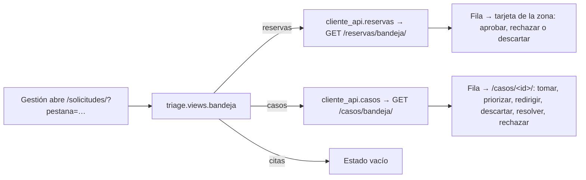
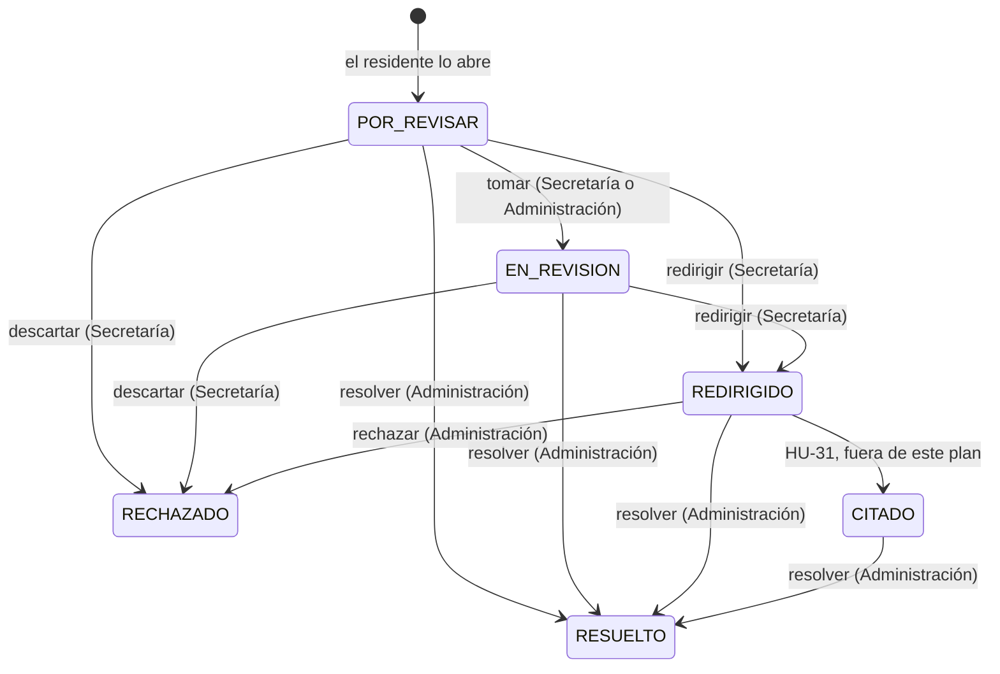

# AdMind — Plan guiado del Dashboard de Gestión de Reservas

> [!IMPORTANT]
> **Alejo:** llena la columna *Respuesta* de la sección 3 (D5 a D9). Para empezar o retomar, en un chat nuevo: `Ejecuta el plan Documentacion/Admind_Documentacion/07_Planes/activos/Plan_Dashboard_De_Solicitudes.md`. El agente te pregunta primero si lo quieres guiado o si lo construye él.

> [!WARNING] Antes de F1 hay que traer lo que está en GitHub
> El 2026-10-13 `desarrollo` en GitHub iba adelante de la máquina de Alejo en los dos repositorios (Backend `0b627d1`, Frontend `7cd762c`) y este plan se escribió **sin ver esos commits**. Notion marca como finalizadas dos tareas de HU-29 que no están en el código local. F0 los trae y compara; si traen código de casos o cambios en `reservas` o `triage`, se para.

## 1. Seguimiento

**Dónde voy:** **construido por el agente el 2026-10-13** (F0 a F5), sin commit. Alejo pidió que lo construyera el agente y aceptó las recomendadas (D5 a D9 en a). El código de Camilo del 12/10 ya estaba integrado cuando se empezó, así que F4 y F5 ampliaron sus casos en vez de crearlos (ver *Desviaciones*). Falta de Alejo: `migrate` en `admind_db` (`reservas/0006` y `casos/0004`), los commits, la prueba manual en el navegador y avisarle a Camilo.

| Fase | Deja funcionando | Estado | Modo | Explicada de vuelta | Verificación | Commit | Fecha |
|---|---|---|---|---|---|---|---|
| F0 | Punto de partida confirmado, con lo de GitHub | hecha | construida | — | Backend `87d67c5` y Frontend `0adf5eb`, ya con lo de Camilo. Back 672 (2 fallas que venían de su commit), front 397, `makemigrations --check` limpio | — | 2026-10-13 |
| F1 | Secretaría ya no aprueba reservas; el catálogo tiene los permisos del plan | hecha | construida | saltada | `pytest apps/permisos apps/cuentas apps/reservas` en verde | — | 2026-10-13 |
| F2 | La API de reservas cierra HU-14: orden, categoría, descarte y aviso | hecha | construida | saltada | `pytest apps/reservas tests/aislamiento` en verde; la prueba del intruso vuelve a pasar | — | 2026-10-13 |
| F3 | El dashboard con sus tres pestañas y la de Reservas completa | hecha | construida | saltada | Front en verde; medido en el navegador a 1280 y 375 px: la tabla no se desborda, la fila entera lleva a la tarjeta | — | 2026-10-13 |
| F4 | La API de casos (HU-29) | hecha | construida | saltada | `pytest apps/casos tests/aislamiento`: 105 pasan. Suite completa: 706, todas pasan | — | 2026-10-13 |
| F5 | La pestaña Casos, el detalle del caso y los casos del residente | hecha | construida | saltada | Front 414, todas pasan. Recorrido de punta a punta, front real contra la API de pruebas: 43 comprobaciones sin fallas | — | 2026-10-13 |

### Desviaciones

- **2026-10-13 · B0.1 y B0.2 · lo que trae GitHub.** Un commit de Camilo del 12/10 en cada repositorio (Backend `0b627d1`, Frontend `7cd762c`, «sprint 4,5 y casos»). Trae:
  - **La app `casos` completa, en los dos repositorios.** Modelo `Caso` (`titulo`, `cuerpo`, `autor`, `prioridad` de texto, `motivo_rechazo`; estados `ABIERTO`, `APROBADO`, `RECHAZADO`, `REDIRIGIDO`), `FotoDeCaso`, migraciones `0001` a `0003`, `crear`, `rechazar` y `redirigir`, el permiso nuevo `caso.gestionar` (Secretaría, junto con `caso.ver_todos`), y en el front la lista, el formulario, `cliente_api/casos.py` y el ítem «Casos» del lateral. **Choca con F4 y F5 enteras**, que construían lo mismo desde cero con otros nombres.
  - **La campana (HU-18)**: `reservas/0005_campana`, que ocupa el número de migración de B2.1, y `notificar_disponibilidad` dentro de `decidir_solicitud`, `liberar`, `enviar` y `expirar_vencidas`.
  - **Condiciones del alquiler** en el área (`areas/0006`), que precargan el motivo en el formulario de decisión que B3.4 cambia.
  - **`casos/_pestanas.html`** incluido en `triage/bandeja.html`, y otros nombres de estado para el residente: tocan B3.1 y B3.2.
  - Secretaría **sigue** con `reserva.aprobar` y `reserva.rechazar`, y ninguna ruta nueva está en la prueba del intruso.
- **Lo que le falta a lo de Camilo frente a lo que definió Alejo:** Administración solo ve los redirigidos y no tiene cómo responder ni resolver (un conjunto sin secretaria no puede atender casos); no hay «En revisión», «Citado» ni «Resuelto»; el caso no guarda la vivienda (la deduce de los vínculos del autor); la prioridad no se puede cambiar; no hay aviso al residente ni auditoría.
- **Cómo queda el plan si se integra:** F1 a F3 valen con ajustes (la migración de B2.1 pasa a `0006`; `caso.gestionar` reemplaza a `caso.redirigir`). F4 y F5 dejan de crear la app y pasan a **ampliar la de Camilo**, con sus nombres (`titulo`, `cuerpo`, `autor`) y sin tocar sus migraciones.
- **Integrar no es un `pull` limpio.** Los dos repositorios tienen cambios sin commit sobre archivos que el commit de Camilo también cambia. Simulado sin tocar nada (`git stash create` y `git merge-tree`): el backend mezcla solo; el front deja **un conflicto, en `apps/areas/views.py`**. Hace falta guardar antes el trabajo local (commit o `stash`), y eso lo decide Alejo: el árbol tiene además cambios de otro chat (`conjuntos`, `personas`, `cuentas`, «límites de texto»).

- **2026-10-13 · B0.1 · la integración ya estaba hecha.** Al retomar, el otro chat había hecho commit de lo local y traído lo de Camilo: no hubo `stash` ni conflicto que resolver.
- **F1 · `caso.redirigir` no se creó (P17).** Camilo ya había puesto `caso.gestionar` a la Secretaría para rechazar y redirigir: se usa ese, también para tomar y descartar un caso. El descarte de una **reserva** sí usa `solicitud.rechazar_formal`.
- **B2.1 · la migración es `reservas/0006`**, porque `0005` es la campana de Camilo. El dato viejo se arregla con `RunSQL`, no con `RunPython`: el manager de `Solicitud` filtra por conjunto y en una migración no hay conjunto activo.
- **B2.3 · el servicio conserva sus propias comprobaciones** (motivo al aprobar, categoría al rechazar) aunque el serializer ya las haga: `decidir_solicitud` se puede llamar sin pasar por HTTP. Rechazar y descartar comparten una función, `_cerrar`.
- **F2 · dos pruebas ajenas creaban reservas rechazadas sin categoría** (`areas/tests.py` y `reglas/tests.py`) y la restricción nueva las rechazó: se les puso `OTRO`. Además se corrigió `test_el_detalle_de_solicitud_incluye_condiciones_de_renta_de_su_area`, de Camilo, que guardaba un área sin conjunto activo.
- **B2.6 · la prueba del intruso quedó en verde entera.** Además de las rutas del plan se registraron `campanas`, `usuario-eliminar` y `usuario-perfil` (esta, como ruta sin conjunto), que el plan dejaba fuera: eran tres líneas y con ellas la suite completa pasa.
- **F4 · los casos se ampliaron, no se crearon.** Se conservan los nombres de Camilo (`titulo`, `cuerpo`, `autor`, `motivo_rechazo`, estado `ABIERTO` para «Por revisar») y sus migraciones `0001` a `0003`; lo nuevo va en `casos/0004`. `APROBADO`, que ninguna operación producía, deja de existir. La prioridad sigue siendo texto y el orden se arma con `Case/When` (P11 pedía un entero). **La vivienda no se guarda en el caso** (P10): se sigue deduciendo de dónde reside quien lo abre, como lo dejó Camilo. La foto del caso, que el plan no traía, se conserva.
- **B4.5 · rutas.** No hay `/casos/bandeja/`: `GET /casos/` responde los propios o todos según el permiso, como ya hacía. Las acciones se llaman `tomar`, `prioridad`, `redirigir`, `descartar`, `responder` y `rechazar`. `rechazar` era de la Secretaría en lo de Camilo: ahora es de Administración y el de Secretaría es `descartar`, con causal.
- **F5 · el residente consulta en su lista, no en el detalle.** La lista de Camilo ya abría cada caso con su texto; ahí se ve también la respuesta. El detalle (`/casos/<id>/`) es de gestión. `/casos/` de gestión redirige a la pestaña Casos del dashboard.
- **B3.1 · el dashboard pide las dos listas siempre**, para poder decir cuántas hay pendientes en cada pestaña.
- **B3.4 · un solo formulario para aceptar y rechazar**, con la categoría como desplegable opcional («Solo si vas a rechazar»): sin JavaScript no se puede pedir un campo según el botón. El front valida antes de llamar a la API.
- **Visual.** Tras medir en el navegador se ajustó `solicitudes.css`: la tabla se desbordaba 57 px a 1280 px y los filtros medían 36 px de alto, menos del mínimo táctil. Las capturas del panel se agotaron casi siempre; quedó una del dashboard.
- **No se probó contra `admind_db`** ni con usuarios reales: `migrate` es de Alejo (D9). El recorrido se hizo con un pytest desechable, fuera del repositorio.

### Conceptos por repasar

Las cinco fases las construyó el agente y la explicación de vuelta quedó saltada. Para la sustentación, con la pregunta de cada una:

- **F1, un catálogo de permisos en vez de un `if` por rol.** ¿Qué hace la Secretaría que no pueda hacer el administrador, y en qué archivo se decidió que no aprueba?
- **F2, una regla escrita en tres capas.** ¿En qué tres sitios dice que un rechazo lleva categoría y qué pasaría si se quitara cada uno? ¿Por qué el descarte de la Secretaría no tiene «Otro» y el rechazo del administrador sí?
- **F2, ordenar por una condición.** ¿Por qué la bandeja de reservas va por antigüedad y no por prioridad? (La promesa de equidad sobre un bien escaso.)
- **F3, un front que muestra y no decide.** Si la secretaria le quita el `hidden` al botón Aceptar en el navegador, ¿qué pasa? ¿Por qué las pestañas y los filtros son enlaces?
- **F4, una máquina de estados.** ¿Qué hace `_pasar` y por qué dos personas que responden el mismo caso a la vez no dejan dos respuestas? ¿Qué garantiza que un caso no quede cerrado sin respuesta aunque el código falle?
- **F4, funcionar con cero secretarías.** ¿Por qué redirigir no es un requisito para que el administrador responda?
- **F5, la misma información con menos permisos.** ¿Por qué hay dos serializers de caso? ¿Por qué los casos, las citas y las reservas no son una sola tabla con un campo `tipo`?

## 2. Instrucciones para el agente

> [!IMPORTANT]
> **Primero pregunta.** Antes de tocar nada, pregúntale a Alejo si este plan se trabaja **guiado** (explicas por bloques y él aplica) o si lo **construyes** tú. No entres en modo guiado sin su respuesta.

### 2.1 Qué leer antes de empezar

1. [ejecutar_plan_guiado](../../09_Protocolos/ejecutar_plan_guiado.md): cómo se trabaja este plan en modo guiado y qué cambia si Alejo pide que lo construyas.
2. Este plan completo.
3. [triage](../../05_Modulos/triage.md): la Secretaría clasifica y no decide, la prioridad y el rechazo formal. [reservas](../../05_Modulos/reservas.md): los estados de una solicitud y lo que ya hace HU-14. [permisos](../../05_Modulos/permisos.md): el catálogo.
4. [capas](../../03_Reglas/capas.md), [aislamiento](../../03_Reglas/aislamiento.md) e [invariantes](../../03_Reglas/invariantes.md): antes de F2 y de F4.
5. [reglas_frontend](../../03_Reglas/reglas_frontend.md) e [implementacion](../../04_Diseno/implementacion.md): antes de F3.
6. `Backend/Admind_Backend/apps/reservas/README.md`, `apps/casos/README.md`, `apps/triage/README.md`, `apps/notificaciones/README.md` y `apps/anuncios/` (el modelo de una app completa y pequeña).
7. `Frontend/Admind_Front-End/apps/triage/README.md`, `apps/reservas/README.md`, `apps/casos/README.md` y `templates/componentes/README.md`.

### 2.2 Reglas propias de este plan

- **La Secretaría no aprueba.** Después de F1 no existe camino por el que una secretaria deje una solicitud en `RESERVADA` ni un caso en `RESUELTO`. No es un botón oculto: la API responde 403.
- **Sobre una reserva no existe la prioridad** (si D5 queda en a). No hay campo, ni columna, ni ruta. No se construye una ruta que responda «denegado».
- **Las tres solicitudes no son una tabla.** El dashboard es una pantalla: cada pestaña le pide las filas a su módulo. No se crea un modelo ni un endpoint que mezcle reservas y casos.
- **Los valores de `EstadoSolicitud` no se renombran.** De ellos dependen los índices únicos de concurrencia. Los nombres de pantalla viven en el front.
- **Las pantallas de este plan no cargan JavaScript.** Pestañas y filtros son enlaces; los formularios son `POST` normales.
- `apps/reservas/servicios.py` y `tests.py` del backend tienen cambios sin commit del 13/10 (`reservas_por_cumplir`): no se revierten ni se reordenan. Otro chat puede estar trabajando: se relee un archivo antes de editarlo.
- Las migraciones se generan con `makemigrations`; en `admind_db` las corre Alejo (D9). Sin commits ni `push` salvo que Alejo los pida.
- Hay que **avisarle a Camilo** (lo hace Alejo): Secretaría pierde `reserva.aprobar` y `reserva.rechazar`; cambian sus pruebas de HU-14; el cuerpo de `POST …/decision/` gana `categoria`; `/reservas/bandeja/` cambia de orden y de permiso; la pantalla `/solicitudes/` de gestión se reemplaza; y la app `casos` se construye aquí.

## 3. Decisiones que toma Alejo

D1 a D4 las respondió Alejo en el chat de planeación (2026-10-13). D5 a D9 están abiertas.

| ID | Decisión | Opciones | Recomendada | Respuesta |
|---|---|---|---|---|
| D1 | Forma del dashboard | a) Una tabla que mezcla los tres tipos b) Tres pestañas separadas con aspecto de tabla de Notion | — | **b** (2026-10-13) |
| D2 | Qué hace la Secretaría | a) Decide igual que Administración b) No aprueba: en reservas solo descarta; en casos ve, prioriza, descarta con comentario y redirige al administrador; en citas descarta o reagenda | — | **b** (2026-10-13). Revierte lo que el código hace desde HU-14 y cierra la pregunta de [pendientes](../../08_Estado/pendientes.md) sección 5 |
| D3 | Estados que ve la gente | Los de la tabla de la sección 6 | — | **Los de Alejo** (2026-10-13) |
| D4 | Alcance | a) HU-14, HU-29 y la base del dashboard; Citas sin función b) También citas | — | **a** (2026-10-13). El profesor amplió el plazo una semana |
| D5 | ¿Las reservas llevan prioridad? | a) No: la pestaña Reservas no tiene esa columna y entre reservas manda la antigüedad b) Sí | a: es la regla escrita en [triage](../../05_Modulos/triage.md) (nadie adelanta una reserva) y no toca el modelo | **a** (2026-10-13) |
| D6 | Qué es «En revisión» en un caso | a) Un paso opcional: Secretaría o Administración oprimen «Tomar» para avisar que alguien lo está viendo; se puede redirigir o cerrar sin pasar por ahí b) Solo lo pone Administración al tomar un caso redirigido c) No existe el botón: el estado se quita | a: no obliga a un clic más en la cola con más tráfico y le dice al residente que ya lo están viendo | **a** (2026-10-13) |
| D7 | Causales de descarte de la Secretaría (lista cerrada, sin «Otro») | a) Reservas: datos incompletos, solicitud duplicada, la vivienda no corresponde. Casos: no es competencia de la administración, duplicado, información insuficiente b) Otras, que escribe Alejo aquí | a | **a** (2026-10-13) |
| D8 | El ID que se ve en la tabla | a) Prefijo y los seis primeros caracteres del identificador (`RES-3C4D5E`, `CAS-9A1B2C`), calculado al mostrar b) Un consecutivo por conjunto (`CAS-0012`): pide una columna, una migración que numere lo que ya existe y un candado para no repetir | a: no toca la base y sirve igual para citar una solicitud | **a** (2026-10-13) |
| D9 | Quién corre `migrate` en `admind_db` | a) Alejo, al final b) El agente | a | **a** (2026-10-13) |

Si D5 queda en b, se para: hay que agregar el campo a `Solicitud` y este plan no lo detalla. Si D6 queda en c, no existen B4.4 (`tomar`) ni el botón «Tomar» de F5, y `EN_REVISION` sale del modelo. Si D8 queda en b, se para y se detalla antes de F2.

## 4. Decisiones menores que el plan ya fija

| ID | Decisión |
|---|---|
| P1 | El dashboard vive en la app `triage` del front, en `/solicitudes/`, con `?pestana=reservas`, `casos` o `citas`. La pantalla se titula «Dashboard de Gestión de Reservas»; el ítem del lateral sigue diciendo «Solicitudes», porque el residente entra por el mismo a su historial |
| P2 | Entra quien tiene `solicitud.bandeja_ver` (Administración, Secretaría y Superusuario; ya es un permiso sensible). `GET /reservas/bandeja/` pasa a exigir ese permiso: hoy le basta `reserva.ver_todas`, que Vigilancia tiene. La bandeja de casos exige `caso.ver_todos` |
| P3 | Descargar un comprobante de reserva deja de mirar `reserva.aprobar` y mira `solicitud.bandeja_ver` (`apps/reservas/views.py`, `ComprobanteDeSolicitudView`): si no, la Secretaría dejaría de verlos al perder `reserva.aprobar` |
| P4 | «Completada» no se guarda: es una `RESERVADA` cuya franja ya terminó, y la API lo dice con `completada: true`. «Cancelada» existe como valor pero nada lo produce: la cancelación es HU-17 |
| P5 | El rechazo de una reserva lleva `categoria_rechazo` en una sola columna, con dos listas cerradas: de fondo (Administración: `NO_DISPONIBLE`, `CONDICIONES_NO_CUMPLIDAS`, `DOCUMENTACION_INCOMPLETA`, `INCUMPLE_REGLAMENTO`, `OTRO`) y de forma (Secretaría, D7). Las solicitudes ya rechazadas quedan con `OTRO`: tienen texto, que es lo que `OTRO` exige |
| P6 | Aprobar sigue pidiendo motivo, como lo dejó Camilo. Rechazar pide categoría; el texto solo es obligatorio con `OTRO` |
| P7 | El descarte de la Secretaría es una ruta propia (`…/descarte/`) con `solicitud.rechazar_formal`: causal y comentario obligatorios. Deja la solicitud en `RECHAZADA`, igual que el rechazo de fondo |
| P8 | Al aprobar, rechazar o descartar se avisa a **la persona que hizo la solicitud**, por aplicación y correo, con `origen="reserva.decision"`. El aviso no dice quién decidió |
| P9 | El detalle de una reserva es la tarjeta que ya existe en la pantalla de su zona (`reservas:solicitudes-area`): la fila enlaza ahí con ancla `#solicitud-<id>`. Una página de detalle propia queda fuera |
| P10 | Un caso se abre a nombre de una vivienda con la que la persona tiene vínculo vigente, resida o no (`unidades.unidades_de`). Sin vivienda responde 400 |
| P11 | La prioridad del caso es un entero (`BAJA=1`, `NORMAL=2`, `ALTA=3`, `URGENTE=4`) con valor por defecto en la base, para ordenar con `-prioridad`. La API la entrega por nombre |
| P12 | Administración puede resolver o rechazar un caso desde cualquier estado abierto: el sistema funciona con cero secretarías. Redirigir es el camino de la Secretaría, no un requisito |
| P13 | La Secretaría descarta y redirige solo casos `POR_REVISAR` o `EN_REVISION`. Uno redirigido ya está en manos del administrador |
| P14 | Un caso tiene **una** respuesta, no un hilo. La nota de redirección es interna: el residente no la ve, ni ve quién actuó ni la justificación de la prioridad |
| P15 | Cada cambio de estado de un caso avisa a quien lo abrió, con `origen="caso.<estado>"`. Cambiar la prioridad no avisa. Abrir un caso no avisa a gestión: para eso está el contador de la pestaña |
| P16 | `CITADO` existe en el modelo porque está en la lista de Alejo, pero nada lo produce hasta que exista Citas (HU-31) |
| P17 | Permiso nuevo `caso.redirigir`. Secretaría gana `caso.ver_todos` y `caso.redirigir`. «Tomar» lo puede quien tenga `caso.redirigir` o `caso.responder` |
| P18 | Cada pestaña muestra cuántas filas tiene pendientes: reservas `APARTADA` y casos abiertos |
| P19 | Los nombres de pantalla concuerdan con lo nombrado: la reserva está «En revisión», «Aprobada», «Rechazada», «Cancelada» o «Completada»; el caso, «Por revisar», «En revisión», «Redirigido», «Citado», «Resuelto» o «Rechazado». Viven en un diccionario del front |
| P20 | La pestaña Citas muestra un estado vacío que dice que todavía no está disponible. No hay botones de mentira |

## 5. Punto de partida verificado

Comprobado en el código el 2026-10-13.

**Repositorios.** Backend `desarrollo` en `d4e98e5` y Frontend en `a946880`. Los dos tienen cambios sin commit en `areas`, `reglas` y `reservas` (en reservas, solo `reservas_por_cumplir` y sus pruebas). `git ls-remote` muestra `desarrollo` en GitHub en `0b627d1` (Backend) y `7cd762c` (Frontend): commits que no están en la máquina y que no se pudieron leer.

**Lo que no hay:** `apps/casos/`, `apps/citas/` y `apps/triage/` del backend solo tienen README; ninguna está en `INSTALLED_APPS` ni en `config/urls.py`. En el front, `apps/casos/` y `apps/citas/` solo tienen README. `Solicitud` no tiene categoría de rechazo. Decidir una solicitud no avisa a nadie.

**Lo que ya existe y se reutiliza:**

- `Backend/Admind_Backend/apps/reservas/servicios.py`: `solicitudes_para_bandeja()` y `solicitudes_para_area(area)` (ordenan por `-creada_en`), `decidir_solicitud(actor, solicitud_id, decision, motivo)`, `avisar_a_la_administracion`, `dia_en_letras`, `con_comprobantes`, y las excepciones `SolicitudNoEncontrada` y `DecisionNoPermitida`.
- `apps/reservas/views.py`: `BandejaDeSolicitudesView` (`solicitudes-bandeja`), `SolicitudesDeAreaView` (`solicitudes-area`), `DecidirSolicitudView` (`solicitud-decision`) y `ComprobanteDeSolicitudView`. `apps/reservas/serializers.py`: `DecisionDeSolicitudSerializer`, `SolicitudSerializer` y `SolicitudParaAdministrarSerializer`. Migraciones de `reservas` hasta `0004`.
- `apps/permisos/catalogo.py`: ya trae `caso.crear`, `caso.ver_todos`, `caso.responder`, `solicitud.bandeja_ver`, `solicitud.priorizar` y `solicitud.rechazar_formal`. Secretaría tiene hoy `reserva.aprobar` y `reserva.rechazar`, y no tiene ningún permiso de casos.
- `apps/notificaciones/canal.py`: `Aviso(titulo, cuerpo, origen, referencia)` y `notificar(aviso, persona_ids)`. No repite un aviso con el mismo `origen` y `referencia`; `origen` mide hasta 30 caracteres.
- `apps/auditoria/servicios.py`: `registrar`. `apps/permisos/views.py`: `exigir_permiso`. `apps/comun/aislamiento/`: `VistaDeConjunto` y `fk_compuesta`. `apps/unidades/servicios.py`: `unidades_de(persona)`.
- `tests/aislamiento/test_intruso.py`: los diccionarios `DETALLES`, `LISTADOS` y `ACCIONES`, y los ayudantes `solicitud_de` y `solicitud_apartada_de`.
- Front: `apps/triage/views.py` (`bandeja`) y `templates/triage/bandeja.html`; `apps/reservas/views.py` (`pantalla_solicitudes_area`, `decidir`, `para_gestion`) y `templates/reservas/solicitudes_area.html`; `cliente_api/reservas.py` (`solicitudes_para_bandeja`, `decidir`); las clases `am-pestanas`, `am-pestana`, `am-tabla-caja`, `am-tabla`, `am-pastilla--*` y `am-vacio`; `apps/conjuntos/templates/conjuntos/_pasos.html` como ejemplo de pestañas hechas con enlaces.

**Diferencias entre notas y código, y entre Notion y código:**

- [reservas](../../05_Modulos/reservas.md) dice en el paso 4 que aprobar o rechazar «todavía no existe»; existe desde el 05/10, como dice su propia advertencia de arriba.
- `templates/componentes/README.md` lista `Pestanas`, `Tabla` y `Pastilla` como componentes, pero no son archivos: son clases de `design-system/tokens/componentes.css`.
- `solicitudes_area.html` muestra «Aceptar» y «Rechazar» a todo el que abre la pantalla, sin mirar el permiso. La API sí lo exige.
- `triage/bandeja.html` no sobreescribe `estado_vista` y sale con la pastilla «Maqueta con datos de ejemplo».
- En Notion, HU-29 tiene finalizadas «FK opcional `caso_id` desde la infracción» y «Tablero de tres columnas con filtros e hilo»: ninguna está en el código local, y dependen de un modelo `Caso` que no existe. D1 cambia el tablero por una tabla; la tarea la corrige el equipo.
- La prueba del intruso falla hoy por cinco rutas sin registrar. Este plan registra las tres de HU-14 y las suyas. `usuario-perfil` y `usuario-eliminar` siguen fuera.

## 6. Mapa de la funcionalidad



**Estados de una reserva en pantalla** (los valores internos no cambian):

| En pantalla | Valor | Quién lo produce |
|---|---|---|
| En revisión | `APARTADA` | El residente, al enviar |
| Aprobada | `RESERVADA` | Administración |
| Rechazada | `RECHAZADA` | Administración (de fondo) o Secretaría (descarte) |
| Completada | `RESERVADA` con la franja ya terminada | Se calcula |
| Cancelada | `CANCELADA` | Nadie todavía (HU-17) |

**Estados de un caso:**



Administración también rechaza desde `POR_REVISAR` y `EN_REVISION` (P12). `RESUELTO` y `RECHAZADO` son terminales.

**Al terminar existe:**

- **Backend:** `categoria_rechazo` en `Solicitud`, la ruta `solicitud-descarte`, la app `casos` con su tabla y nueve rutas bajo `/casos/`, y el permiso `caso.redirigir`.
- **Frontend:** el dashboard en `/solicitudes/`, la app `casos` (mis casos, abrir uno y el detalle), `cliente_api/casos.py` y `static/css/solicitudes.css`.

## F0 · Confirmar el punto de partida

- [ ] **B0.1** · Pedirle a Alejo que haga `git pull` en Backend y Frontend (los dos tienen cambios sin commit; el agente no mezcla por él). Después, `git log --oneline d4e98e5..HEAD` y `a946880..HEAD` y la lista de archivos que cambiaron.
- [ ] **B0.2** · Comparar lo que llegó con la sección 5. Si hay código en `apps/casos/` de cualquiera de los dos repositorios, o cambios en `apps/reservas/`, `apps/triage/`, `apps/permisos/catalogo.py` o el lateral, **se para** y se le dice a Alejo qué choca con qué fase.
- [ ] **B0.3** · Correr las dos suites y `makemigrations --check --dry-run` ([pruebas_y_ejecucion](../../02_Arquitectura/pruebas_y_ejecucion.md)). Anotar las cifras en *Seguimiento*.
- [ ] **B0.4** · Confirmar que D5 a D9 tienen respuesta.

## F1 · La Secretaría no aprueba

**Deja funcionando:** una secretaria que intenta aprobar o rechazar de fondo recibe 403; el catálogo tiene los permisos que usan las fases siguientes.

**Concepto de la fase:** los roles no se preguntan con un `if` en cada vista. Hay un catálogo, cada vista exige un permiso, y cambiar lo que puede un rol es cambiar una línea.

- [ ] **B1.1** · explicado · `Backend/Admind_Backend/apps/permisos/catalogo.py`
  - **Qué:** `"caso.redirigir"` entra a `PERMISOS`. En `PERMISOS_POR_ROL[Rol.SECRETARIA]` salen `reserva.aprobar` y `reserva.rechazar` y entran `caso.ver_todos` y `caso.redirigir`.
  - **Concepto:** forma y fondo. La Secretaría conserva `solicitud.rechazar_formal`, que es otra operación con otra lista de motivos.
  - **Comprobación:** `pytest apps/permisos apps/cuentas`.
- [ ] **B1.2** · explicado · `apps/permisos/tests.py`, `apps/cuentas/tests.py`, `apps/reservas/tests.py`
  - **Qué:** las pruebas que afirman lo contrario. En `permisos/tests.py`, `con_aprobacion` pasa a `{ADMINISTRACION, SUPERUSUARIO}` y el conjunto mínimo de Secretaría cambia. En `reservas/tests.py`, `test_secretaria_consulta_solicitudes_del_area_y_puede_aceptar_con_motivo` se parte en dos: Secretaría consulta (200) y al decidir recibe **403**; las demás pruebas que deciden con la secretaria pasan a decidir con Administración.
  - **Concepto:** una prueba es la regla escrita. Si la regla cambia, la prueba se cambia a propósito y se dice por qué; no se borra.
  - **Comprobación:** `pytest apps/reservas apps/permisos apps/cuentas`.
- [ ] **B1.3** · tuyo (modelo: B1.1) · `apps/reservas/views.py`
  - **Qué:** `BandejaDeSolicitudesView` exige `solicitud.bandeja_ver` (P2) y `ComprobanteDeSolicitudView` cambia `reserva.aprobar` por `solicitud.bandeja_ver` en sus dos usos (P3).
  - **Comprobación:** la secretaria de las pruebas sigue descargando un comprobante; el vigilante recibe 403 en `/reservas/bandeja/`.

**Cierre de F1**

- **Verificación:** `./.venv/Scripts/python.exe -m pytest -q apps/permisos apps/cuentas apps/reservas`.
- **Explicar de vuelta:** «cuéntame qué pasa desde que una secretaria oprime Aceptar hasta que recibe el 403, y en qué archivo se decidió».
- **Pregunta de jurado:** ¿qué hace la Secretaría que no pueda hacer el administrador, y por qué no le dieron el permiso de aprobar?
- **Commit sugerido:** `fix(permisos): la Secretaría clasifica y no aprueba reservas [HU-14]`

## F2 · La API de reservas cierra HU-14

**Deja funcionando:** la bandeja trae primero lo que más lleva esperando; rechazar exige categoría; la Secretaría descarta con causal; el residente recibe el aviso; las rutas de HU-14 están en la prueba del intruso.

**Concepto de la fase:** una regla que tiene que ser imposible de saltar se escribe tres veces, cada una en su capa: el serializer mira lo que llegó, el servicio mira el estado guardado y la base tiene la última palabra.

- [ ] **B2.1** · explicado · `apps/reservas/models.py` y migración `0005_categoria_de_rechazo`
  - **Qué:** `CategoriaDeRechazo` (`TextChoices`, las dos listas de P5 y D7), dos constantes `DE_FONDO` y `DE_FORMA`, el campo `categoria_rechazo = models.CharField(max_length=30, blank=True)` y dos restricciones.
  - **Concepto:** una migración que agrega una regla sobre datos que ya existen tiene que arreglar primero esos datos.
  - **Forma:**
    ```python
    models.CheckConstraint(
        condition=Q(categoria_rechazo="") | Q(categoria_rechazo__in=CategoriaDeRechazo.values),
        name="solicitud_categoria_de_rechazo_valida",
    ),
    models.CheckConstraint(
        condition=~Q(estado=EstadoSolicitud.RECHAZADA) | ~Q(categoria_rechazo=""),
        name="solicitud_rechazada_con_categoria",
    ),
    ```
    En la migración, entre `AddField` y los `AddConstraint`, un `RunPython` que pone `OTRO` a las `RECHAZADA` que ya existen (con función de vuelta vacía).
  - **Comprobación:** `makemigrations --check --dry-run` limpio; una prueba que intenta guardar una `RECHAZADA` sin categoría y espera `IntegrityError`.
- [ ] **B2.2** · explicado · `apps/reservas/serializers.py`
  - **Qué:** `DecisionDeSolicitudSerializer` gana `categoria` (opcional, de la lista de fondo) y un `validate()`; `motivo` deja de ser obligatorio en el campo.
  - **Concepto:** lo que se decide mirando solo la petición va en el serializer ([capas](../../03_Reglas/capas.md)).
  - **Forma:** con `RESERVADA`, `motivo` obligatorio y `categoria` vacía. Con `RECHAZADA`, `categoria` obligatoria; con `OTRO`, `motivo` obligatorio. Errores por campo: `{"categoria": ["Elige el motivo del rechazo."]}`.
    `SolicitudSerializer` gana `categoria_rechazo`, `categoria_rechazo_nombre` y `completada` (P4).
  - **Comprobación:** las pruebas de B2.6.
- [ ] **B2.3** · explicado · `apps/reservas/servicios.py`
  - **Qué:** `decidir_solicitud` recibe `categoria=""` y la guarda; la validación de «motivo vacío» sale del servicio (ya la hizo el serializer). Dentro de la transacción, después de auditar, llama a `avisar_de_la_decision(solicitud)`.
  - **Concepto:** el aviso se pide dentro de la transacción y el correo sale cuando se confirma (`transaction.on_commit`, que ya hace `notificar`): si la decisión se deshace, no llega un correo de algo que no pasó.
  - **Forma:**
    ```python
    def avisar_de_la_decision(solicitud):
        """A quien hizo la solicitud. No dice quién decidió (P8)."""
        # título: «Tu reserva fue aprobada» o «Tu reserva fue rechazada»
        # cuerpo: área, día en letras, horario; si se rechazó, la categoría y el comentario
        notificar(Aviso(titulo, cuerpo, origen="reserva.decision", referencia=solicitud.id), [solicitud.persona_id])

    def completada(solicitud):
        """Una reserva aprobada cuya franja ya terminó (P4). Se calcula: no hay proceso que la marque."""
    ```
  - **Comprobación:** aprobar deja una `Notificacion` para el residente y ninguna para quien decidió.
- [ ] **B2.4** · tuyo (modelo: `decidir_solicitud` y `DecidirSolicitudView`) · `apps/reservas/servicios.py`, `serializers.py`, `views.py`, `urls.py`
  - **Qué:** `descartar_solicitud(actor, solicitud_id, causal, comentario)` y `DescartarSolicitudView.post` en `solicitudes/<uuid:solicitud_id>/descarte/`, nombre `solicitud-descarte`, con `exigir_permiso(request, "solicitud.rechazar_formal")`.
  - **Qué cambia respecto al modelo:** la causal es de la lista de forma y el comentario es obligatorio siempre; la auditoría registra `solicitud.rechazar_formal`; el resto es igual (bloquea la fila, solo sobre `APARTADA`, 409 si no, avisa).
  - **Comprobación:** una secretaria descarta (200) y la franja queda libre; con una categoría de fondo recibe 400; Administración sin ese permiso recibe 403.
- [ ] **B2.5** · explicado · `apps/reservas/servicios.py`
  - **Qué:** `solicitudes_para_bandeja` y `solicitudes_para_area` ordenan con las pendientes primero y, dentro de cada grupo, la más antigua primero.
  - **Concepto:** ordenar por una condición, no por una columna.
  - **Forma:**
    ```python
    .annotate(decidida=Case(When(estado=EstadoSolicitud.APARTADA, then=0), default=1))
    .order_by("decidida", "enviada_en")
    ```
  - **Comprobación:** con tres solicitudes enviadas en momentos distintos y una ya aprobada, la primera fila es la más antigua sin decidir.
- [ ] **B2.6** · tuyo · `apps/reservas/tests.py` y `tests/aislamiento/test_intruso.py`
  - **Qué:** una prueba por cada criterio de HU-14 (orden, aviso al aprobar, rechazo sin categoría falla, `OTRO` exige texto, rechazar libera la franja) y las del descarte. En el intruso: `solicitudes-bandeja` en `LISTADOS`, `solicitudes-area` en `DETALLES` (el área del otro conjunto responde 404), y `solicitud-decision` y `solicitud-descarte` en `ACCIONES`, con `solicitud_apartada_de`.
  - **Comprobación:** `test_toda_ruta_de_la_api_esta_cubierta` ya solo se queja de `usuario-perfil` y `usuario-eliminar`.

**Cierre de F2**

- **Verificación:** `./.venv/Scripts/python.exe -m pytest -q apps/reservas tests/aislamiento` y `makemigrations --check --dry-run`.
- **Explicar de vuelta:** «cuéntame en qué tres sitios está escrito que un rechazo lleva categoría, y qué pasaría si quitaras cada uno».
- **Pregunta de jurado:** ¿por qué el rechazo de la Secretaría no tiene «Otro» y el del administrador sí?
- **Commit sugerido:** `feat(reservas): categoría de rechazo, descarte de Secretaría y aviso al residente [HU-14]`

## F3 · El dashboard y la pestaña Reservas

**Deja funcionando:** `/solicitudes/` muestra a gestión tres pestañas; la de Reservas es una tabla con sus filas, su filtro y su contador; cada fila lleva a la tarjeta donde se decide.

**Concepto de la fase:** el front muestra y no decide. La pestaña, el filtro y el orden viajan en la URL; qué puede hacer cada rol lo resolvió la API.

- [ ] **B3.1** · explicado · `Frontend/Admind_Front-End/apps/triage/views.py`
  - **Qué:** `bandeja` conserva la rama del residente y cambia la de gestión: lee `?pestana=` (por defecto `reservas`) y `?ver=` (`pendientes`, por defecto, o `todas`), pide las filas y las prepara para la tabla.
  - **Concepto:** una vista por pantalla; los datos se transforman para mostrarse (etiqueta, pastilla, antigüedad) en la vista, no en la plantilla.
  - **Forma:**
    ```python
    ESTADO_DE_RESERVA = {  # valor de la API → (texto, clase de pastilla). P19
        "APARTADA": ("En revisión", "tramite"), "RESERVADA": ("Aprobada", "confirmado"),
        "RECHAZADA": ("Rechazada", "error"), "CANCELADA": ("Cancelada", "neutro"),
    }
    def codigo(prefijo, identificador): ...        # D8: RES-3C4D5E
    def hace_cuanto(fecha_iso, ahora): ...          # «hoy», «hace 1 día», «hace 5 días»
    def fila_de_reserva(solicitud, ahora): ...      # completada → ("Completada", "neutro")
    ```
    Contexto de la plantilla: `pestana`, `ver`, `pestanas` (clave, nombre, pendientes, url), `filas`, `error`.
  - **Comprobación:** las pruebas de B3.5.
- [ ] **B3.2** · explicado · `apps/triage/templates/triage/bandeja.html` y `static/css/solicitudes.css` (nuevo)
  - **Qué:** la plantilla sobreescribe `estado_vista`, pinta las pestañas con `am-pestanas` (enlaces, la activa con `am-es-activa` y `aria-current="page"`), los dos filtros como enlaces y la tabla con `am-tabla-caja` y `am-tabla`. La tabla de cada pestaña va en un parcial: `triage/_tabla_reservas.html`.
  - **Concepto:** el aspecto de Notion sale de lo que ya tiene el sistema de diseño: fila baja, estado en pastilla con texto, y la fila entera lleva al detalle. Ningún color nuevo.
  - **Forma:** columnas de Reservas: ID · Zona · Día y franja · Estado · Residente · Vivienda · Solicitada · Pago. La celda del ID es el enlace (`reservas:solicitudes-area` con `#solicitud-<id>`) y en el CSS se estira a toda la fila con `::after`, solo con variables.
  - **Comprobación:** la pantalla ya no muestra «Maqueta con datos de ejemplo»; con el teclado, cada fila tiene un solo enlace con foco visible.
- [ ] **B3.3** · tuyo (modelo: B3.2) · `apps/triage/templates/triage/_citas.html`
  - **Qué:** el estado vacío de la pestaña Citas con `am-vacio` (P20): «Las citas todavía no están disponibles» y una línea que dice qué se verá ahí.
  - **Comprobación:** `?pestana=citas` responde 200 sin llamar a la API.
- [ ] **B3.4** · explicado · `apps/reservas/templates/reservas/solicitudes_area.html`, `apps/reservas/views.py`, `urls.py` y `cliente_api/reservas.py`
  - **Qué:** cada tarjeta gana `id="solicitud-<id>"`. El formulario de decisión solo sale con `reserva.aprobar` o `reserva.rechazar`, y gana un `select` de categoría. Con `solicitud.rechazar_formal` sale otro formulario, «Descartar», con causal y comentario, que va a una vista nueva `descartar`. La tarjeta muestra la categoría del rechazo junto al comentario.
  - **Concepto:** ocultar el botón no es lo que impide la acción: lo impide la API. El botón se oculta para no ofrecer algo que va a fallar.
  - **Forma:** `cliente_api.reservas.descartar(request, solicitud_id, datos)` → `POST reservas/solicitudes/<id>/descarte/`. `decidir` manda también `categoria`. Los textos de las categorías vienen de `categoria_rechazo_nombre`; las opciones del `select` son una constante del front con las mismas claves.
  - **Comprobación:** las pruebas de B3.5.
- [ ] **B3.5** · tuyo · `tests/test_triage.py` y `tests/test_reservas.py`
  - **Qué:** las tres pruebas de `test_triage.py` que esperan la lista de zonas se reemplazan por las del dashboard: gestión ve las tres pestañas con su contador; la tabla trae las columnas y el enlace a la tarjeta; `?ver=todas` trae las decididas; una reserva `completada` dice «Completada»; sin `solicitud.bandeja_ver` no hay dashboard; el residente sigue viendo su historial. En `test_reservas.py`: Administración ve «Aceptar» y «Rechazar» con categoría, Secretaría ve solo «Descartar», Vigilancia ninguno. `SECRETARIA` pierde los dos permisos en las constantes de las pruebas.
  - **Comprobación:** la suite del front en verde.

**Cierre de F3**

- **Verificación:** `./.venv/Scripts/python.exe -m pytest -q` en el front; con los dos servidores, abrir `/solicitudes/` como Administración y como Secretaría.
- **Explicar de vuelta:** «cuéntame qué pasa desde que oprimo la pestaña Reservas hasta que veo la tabla, y qué parte hace cada servidor».
- **Pregunta de jurado:** si en el navegador le quito el `hidden` al botón Aceptar siendo secretaria, ¿qué pasa?
- **Commit sugerido:** `feat(triage): dashboard de gestión con pestañas y tabla de reservas [HU-14]`

## F4 · La API de casos

**Deja funcionando:** un residente abre un caso; gestión lo ve en su bandeja ordenada; cada rol hace solo sus transiciones; un caso no se cierra sin respuesta escrita; cada cambio avisa al residente.

**Concepto de la fase:** una máquina de estados. Cada operación dice de qué estados sale y a cuál llega; todo lo demás responde 409.

- [ ] **B4.1** · explicado · `Backend/Admind_Backend/apps/casos/` (`__init__.py`, `apps.py`, `models.py`), `config/settings.py` y migración `0001_initial`
  - **Qué:** la app y el modelo `Caso(ModeloDeConjunto)`.
  - **Concepto:** lo que tiene que ser imposible aunque el código falle lo guarda la base: prioridad por defecto, urgente con justificación y cerrado con respuesta.
  - **Forma:**
    ```python
    class EstadoDeCaso(models.TextChoices):
        POR_REVISAR, EN_REVISION, REDIRIGIDO, CITADO, RESUELTO, RECHAZADO
    class Prioridad(models.IntegerChoices):
        BAJA = 1; NORMAL = 2; ALTA = 3; URGENTE = 4
    ABIERTOS = [POR_REVISAR, EN_REVISION, REDIRIGIDO, CITADO]
    CERRADOS = [RESUELTO, RECHAZADO]

    class Caso(ModeloDeConjunto):
        persona  = FK("personas.Persona", PROTECT, related_name="casos")
        unidad   = FK("unidades.Unidad", PROTECT, related_name="casos")
        asunto = CharField(max_length=120); descripcion = TextField()
        estado = CharField(max_length=15, choices=..., default=POR_REVISAR)
        prioridad = PositiveSmallIntegerField(choices=..., default=NORMAL, db_default=NORMAL)
        justificacion_prioridad = TextField(blank=True)
        nota_de_redireccion = TextField(blank=True)
        respuesta = TextField(blank=True)             # la respuesta o el comentario del rechazo
        causal_rechazo = CharField(max_length=30, blank=True)   # solo en el descarte de Secretaría (D7)
        cerrado_por = FK("personas.Persona", PROTECT, null=True, blank=True, related_name="+")
        cerrado_en = DateTimeField(null=True, blank=True)
        creado_en = DateTimeField(auto_now_add=True)
    ```
    Restricciones: estado y prioridad válidos; `caso_urgente_con_justificacion`; `caso_cerrado_con_respuesta` (`~Q(estado__in=CERRADOS) | ~Q(respuesta="")`). Índices `["conjunto", "estado", "-prioridad", "creado_en"]` y `["conjunto", "persona"]`. Al final de la migración, `fk_compuesta("casos_caso", "unidad_id", "unidades_unidad")`.
  - **Comprobación:** `makemigrations --check --dry-run` limpio; un `INSERT` sin prioridad queda en `NORMAL`.
- [ ] **B4.2** · explicado · `apps/casos/servicios.py`
  - **Qué:** las excepciones (`CasoNoEncontrado`, `TransicionNoPermitida`, `SinVivienda`, `ViviendaNoEncontrada`), las consultas y el corazón: una sola función que hace toda transición.
  - **Concepto:** bloquear la fila, revisar el estado, escribir, auditar y avisar, en una transacción. Las operaciones públicas solo dicen de dónde a dónde.
  - **Forma:**
    ```python
    def _pasar(actor, caso_id, *, desde, hacia, accion, **campos):
        with transaction.atomic():
            caso = Caso.objects.select_for_update(of=("self",)).filter(pk=caso_id).first()
            # None → CasoNoEncontrado; caso.estado not in desde → TransicionNoPermitida
            # fija estado y campos; si hacia es terminal, cerrado_por y cerrado_en
            # auditoria.registrar(actor, accion, "Caso", caso.id, antes={...}, despues={...})
            # avisar(caso)  → Aviso(..., origen=f"caso.{hacia.lower()}", referencia=caso.id) a [caso.persona_id]
        return caso

    def abrir(persona, unidad_id, asunto, descripcion): ...     # la vivienda sale de unidades_de(persona) (P10)
    def casos_para_bandeja(ver="abiertos", orden="prioridad"): ...   # abiertos primero; -prioridad, creado_en
    def casos_de(persona): ...
    def detalle(caso_id): ...   # para gestión
    def detalle_propio(persona, caso_id): ...
    ```
    `orden="antiguedad"` ignora la prioridad: es la salida de emergencia de [triage](../../05_Modulos/triage.md).
  - **Comprobación:** las pruebas de B4.6.
- [ ] **B4.3** · tuyo (modelo: `_pasar`) · `apps/casos/servicios.py`
  - **Qué:** `redirigir(actor, caso_id, nota)`, `descartar(actor, caso_id, causal, comentario)`, `resolver(actor, caso_id, respuesta)` y `rechazar(actor, caso_id, motivo)`.
  - **Qué cambia respecto al modelo:** solo `desde`, `hacia`, `accion` y los campos. `redirigir` y `descartar` salen de `POR_REVISAR` y `EN_REVISION` (P13); `resolver` y `rechazar`, de cualquier abierto (P12).
  - **Comprobación:** las pruebas de B4.6.
- [ ] **B4.4** · tuyo (modelo: `_pasar`) · `apps/casos/servicios.py`
  - **Qué:** `tomar(actor, caso_id)` (de `POR_REVISAR` a `EN_REVISION`, D6) y `priorizar(actor, caso_id, prioridad, justificacion)`.
  - **Qué cambia respecto al modelo:** `priorizar` no cambia el estado ni avisa (P15); solo sobre casos abiertos; audita el valor anterior y el nuevo.
  - **Comprobación:** `URGENTE` sin justificación responde 400.
- [ ] **B4.5** · explicado · `apps/casos/serializers.py`, `views.py`, `urls.py` y `config/urls.py`
  - **Qué:** las rutas bajo `/casos/`, cada una con su permiso.
  - **Concepto:** la misma información con menos permisos: dos serializers, y el del residente no lleva la nota interna, la justificación ni quién actuó (P14).
  - **Forma:**

    | Ruta | Nombre | Permiso | Qué hace |
    |---|---|---|---|
    | `GET /casos/` | `casos` | `caso.crear` | Los propios |
    | `POST /casos/` | `casos` | `caso.crear` | Abre uno: `unidad`, `asunto`, `descripcion` → 201 |
    | `GET /casos/bandeja/` | `casos-bandeja` | `caso.ver_todos` | `?ver=abiertos\|todos`, `?orden=prioridad\|antiguedad` |
    | `GET /casos/<id>/` | `caso-detalle` | `caso.ver_todos` o `caso.crear` | Gestión ve cualquiera; el residente, solo el suyo; si no, 404 |
    | `POST /casos/<id>/tomar/` | `caso-tomar` | `caso.redirigir` o `caso.responder` | → `EN_REVISION` |
    | `POST /casos/<id>/prioridad/` | `caso-prioridad` | `solicitud.priorizar` | `prioridad`, `justificacion` |
    | `POST /casos/<id>/redireccion/` | `caso-redireccion` | `caso.redirigir` | `nota` opcional |
    | `POST /casos/<id>/descarte/` | `caso-descarte` | `solicitud.rechazar_formal` | `causal`, `comentario` |
    | `POST /casos/<id>/respuesta/` | `caso-respuesta` | `caso.responder` | `respuesta` obligatoria → `RESUELTO` |
    | `POST /casos/<id>/rechazo/` | `caso-rechazo` | `caso.responder` | `motivo` obligatorio → `RECHAZADO` |

    `TransicionNoPermitida` → 409 con `detail`; `CasoNoEncontrado` → 404 sin detalle.
  - **Comprobación:** las pruebas de B4.6.
- [ ] **B4.6** · tuyo · `apps/casos/tests.py`, `tests/aislamiento/test_intruso.py` y `apps/casos/README.md`
  - **Qué:** una prueba por criterio de HU-29 (resolver sin respuesta falla; el rechazo con motivo cuenta como respuesta; cada cambio de estado avisa por la aplicación y por correo; creado sin prioridad queda en `NORMAL`) y las de roles: la secretaria redirige y descarta pero no resuelve (403); Administración resuelve uno sin redirigir; nadie mueve un caso cerrado (409); el orden de la bandeja; un residente no ve el caso de otro (404). Las nueve rutas en la prueba del intruso. El README deja de decir «Pendiente».
  - **Comprobación:** `pytest apps/casos tests/aislamiento`.

**Cierre de F4**

- **Verificación:** `./.venv/Scripts/python.exe -m pytest -q` completa y `makemigrations --check --dry-run`.
- **Explicar de vuelta:** «cuéntame el recorrido de un caso desde que el residente lo abre hasta que queda resuelto, y qué garantiza que no quede cerrado sin respuesta».
- **Pregunta de jurado:** dos personas responden el mismo caso en el mismo segundo: ¿qué ve cada una y por qué no quedan dos respuestas?
- **Commit sugerido:** `feat(casos): casos con prioridad, redirección y respuesta obligatoria [HU-29]`

## F5 · La pestaña Casos y los casos del residente

**Deja funcionando:** la pestaña Casos del dashboard; el detalle de un caso con las acciones de cada rol; el residente abre un caso y ve la respuesta.

**Concepto de la fase:** la misma pantalla para dos roles: el detalle se arma con lo que la API entrega y con los permisos de la sesión.

- [ ] **B5.1** · tuyo (modelo: `cliente_api/reservas.py`) · `Frontend/Admind_Front-End/cliente_api/casos.py`
  - **Qué:** una función por ruta de B4.5, con su docstring de una línea.
  - **Comprobación:** las pruebas de B5.5 las simulan con `mock.patch`.
- [ ] **B5.2** · tuyo (modelo: B3.1 y B3.2) · `apps/triage/views.py` y `templates/triage/_tabla_casos.html`
  - **Qué:** la rama `casos` de `bandeja`: columnas ID · Asunto · Estado · Prioridad · Residente · Vivienda · Creado. Filtros `ver` (abiertos o todos) y `orden` (prioridad o antigüedad). Sin `caso.ver_todos` la pestaña no aparece.
  - **Qué cambia respecto al modelo:** el diccionario de estados es el del caso (P19) y hay pastilla de prioridad: «Urgente» con `error`, «Alta» con `tramite`, las otras con `neutro`.
  - **Comprobación:** la columna de antigüedad sigue visible con cualquier filtro.
- [ ] **B5.3** · explicado · `apps/casos/` del front (`__init__.py`, `apps.py`, `urls.py`, `views.py`, `forms.py`, plantillas), `config/settings.py` y `config/urls.py`
  - **Qué:** `/casos/` (mis casos y el botón «Abrir un caso»), `/casos/nuevo/` (asunto, descripción y vivienda) y `/casos/<id>/` (el detalle).
  - **Concepto:** el formulario valida la forma en el front para no perder lo escrito; la regla la vuelve a revisar la API.
  - **Forma:** el detalle muestra asunto, descripción, vivienda, estado y, si la hay, la respuesta. A gestión le suma la nota de redirección, la prioridad con su justificación y quién lo cerró. Las acciones salen según estado y permiso: «Tomar», «Cambiar prioridad», «Redirigir al administrador», «Descartar», «Responder y resolver», «Rechazar». Cada una es un formulario `POST` a una vista que llama a `cliente_api.casos` y vuelve al detalle.
  - **Comprobación:** las pruebas de B5.5.
- [ ] **B5.4** · tuyo · `templates/componentes/lateral.html`
  - **Qué:** el ítem «Casos» para quien tiene `caso.crear`, junto a «Solicitudes».
  - **Comprobación:** un residente lo ve; Vigilancia no.
- [ ] **B5.5** · tuyo · `tests/test_casos.py`, `tests/test_triage.py` y `apps/casos/README.md`, `apps/triage/README.md`
  - **Qué:** la pestaña Casos con sus columnas y filtros; la secretaria ve «Redirigir» y «Descartar» y no «Responder»; Administración ve «Responder» en un caso sin redirigir; un caso cerrado no muestra acciones; el residente abre uno, lo ve en su lista y lee la respuesta sin el nombre de quien respondió; un error de la API se muestra sin perder lo escrito. Los dos README quedan al día.
  - **Comprobación:** la suite del front en verde.

**Cierre de F5**

- **Verificación:** las dos suites completas; con los dos servidores, el guion de prueba manual.
- **Explicar de vuelta:** «cuéntame por qué la secretaria no ve el botón Responder y qué pasaría si mandara la petición a mano».
- **Pregunta de jurado:** ¿por qué los casos, las citas y las reservas no son una sola tabla con un campo `tipo`?
- **Commit sugerido:** `feat(casos): pestaña Casos del dashboard y casos del residente [HU-29]`

## Cierre del plan

1. Las dos suites y `makemigrations --check --dry-run`.
2. Informe final en el chat: qué se hizo por fase, desviaciones, conceptos por repasar y lo que quedó fuera.
3. [actualizar_contexto](../../09_Protocolos/actualizar_contexto.md): D1 a D9 pasan a [construccion](../../06_Decisiones/construccion.md); [triage](../../05_Modulos/triage.md), [reservas](../../05_Modulos/reservas.md) y [permisos](../../05_Modulos/permisos.md) recogen lo construido y dejan de decir que la Secretaría aprueba; [historias](../../08_Estado/historias.md), [pendientes](../../08_Estado/pendientes.md) y [mapa_codigo](../../02_Arquitectura/mapa_codigo.md) se ponen al día.
4. El plan pasa a `07_Planes/hechos/` ([abrir_y_cerrar_un_plan](../../09_Protocolos/abrir_y_cerrar_un_plan.md)).

## Lo que el agente no puede hacer

- `git pull` antes de F1 y `migrate` en `admind_db` al final (`reservas/0005` y `casos/0001`).
- Avisarle a Camilo lo de la sección 2.2 y confirmar con él qué eran las dos tareas finalizadas de HU-29.
- Corregir en Notion la tarea «Tablero de tres columnas» y los criterios que cambian.
- El PR `desarrollo → pruebas` revisado y la prueba manual de quien no programó.

## Guion de prueba manual

Con un conjunto que tenga Administración, Secretaría, dos residentes con vivienda y una zona con reserva.

1. **Residente A** reserva una franja y la envía. **Residente B** hace lo mismo con otra franja, después.
2. **Secretaría** abre `/solicitudes/`: ve tres pestañas; en Reservas, la de A va primero y el contador dice 2. Abre la de B: solo tiene «Descartar». La descarta con causal y comentario.
3. **Residente B** recibe el aviso en la aplicación y en el correo; en su historial dice «Rechazada» con la causal y el comentario, sin el nombre de la secretaria. La franja vuelve a estar libre.
4. **Administración** abre la de A: «Aceptar» y «Rechazar» con categoría. Intenta rechazar sin categoría: no deja. Con «Otro» y sin texto: no deja. La aprueba. **Residente A** recibe el aviso.
5. **Residente A** abre un caso desde «Casos». **Secretaría** lo ve en la pestaña Casos como «Por revisar» y «Normal»; lo sube a «Urgente» sin justificación (no deja) y con justificación (queda primero); lo redirige con una nota.
6. **Residente A** ve «Redirigido» y no ve la nota. **Administración** intenta resolver sin respuesta: no deja. Responde y resuelve. **Residente A** lee la respuesta.
7. **Residente B** abre un caso. **Administración** lo responde sin que nadie lo redirija: tiene que poder.
8. La pestaña Citas dice que todavía no está disponible. **Vigilancia** no ve «Solicitudes» y, escribiendo la dirección, no entra al dashboard.

## Fuera de este plan

- **Citas** (HU-31 y HU-32): sus estados (Solicitado, Agendado, Reagendado, Cancelado, Realizada), que la Secretaría descarte o reagende, y pasar un caso a «Citado».
- **Cancelar una reserva en firme** (HU-17), **condiciones del alquiler** (HU-15), **la campana** al liberarse una franja (HU-18) y **las dos oportunidades por franja** (HU-19).
- **La vista combinada** de los tres tipos y la exigencia de la bandeja de triage completa (HU-22). **Prioridad y rechazo formal sobre citas** (HU-23 y HU-24, que aquí quedan cubiertas solo para casos y reservas).
- **El hilo de mensajes** de un caso o de una reserva, y que el residente responda.
- **La FK desde una infracción hacia un caso** (HU-30).
- **Buscador y orden por columna** en las tablas, y una página de detalle propia para la reserva.
- **Un consecutivo por conjunto** como ID (si D8 queda en a).
- `usuario-perfil` y `usuario-eliminar` en la prueba del intruso: siguen dejando esa prueba en rojo.
