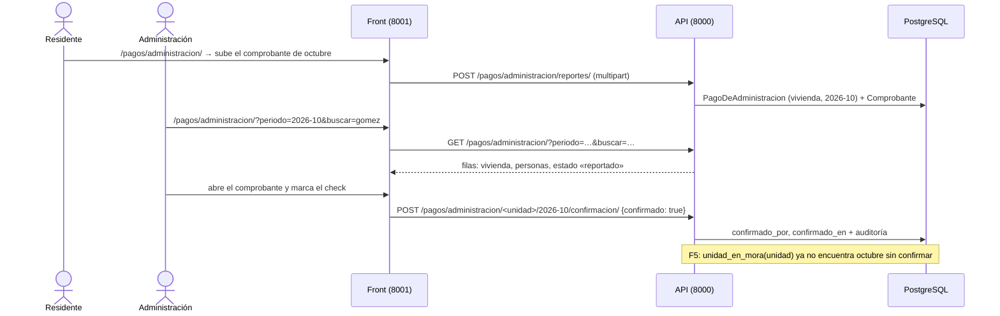

# AdMind — Plan guiado del pago de administración

> [!IMPORTANT]
> **Alejo:** llena la columna *Respuesta* de la sección 3 (D5 a D10). Para empezar o retomar, en un chat nuevo: `Ejecuta el plan Documentacion/Admind_Documentacion/07_Planes/activos/Plan_Pago_De_Administracion.md`. El agente te pregunta primero si lo quieres guiado o si lo construye él.

> [!WARNING] Esto es HU-35, no HU-16
> En Notion, **HU-16** es el pago del alquiler de una reserva, declarado solo por el administrador (uno de sus criterios prohíbe que el residente lo declare). Lo que Alejo pidió el 2026-10-10, el residente sube el comprobante de la administración y el administrador confirma, es **HU-35** (Sprint 7). Alejo eligió abrir el plan como HU-35. HU-16 sigue sin empezar y será otro submódulo de Pagos.

## 1. Seguimiento

**Dónde voy:** **construido por el agente el 2026-10-10** (F0 a F5), sin commit. Alejo respondió D5 a, D6 a, D7 a, D8 a, D9 a y D10 a, pidió que lo construyera el agente y confirmó seguir con F5 pese a lo legal sin verificar. Falta de Alejo: `migrate` en `admind_db` (`pagos/0001`, `pagos/0002` y `reglas/0007`), los commits, la prueba manual y avisarle a Camilo.

| Fase | Deja funcionando | Estado | Modo | Explicada de vuelta | Verificación | Commit | Fecha |
|---|---|---|---|---|---|---|---|
| F0 | Punto de partida confirmado | hecha | construida | — | Árbol limpio de lo ajeno; cifras base 565 y 318 (no 491 y 260), porque HU-16 y HU-28 se ejecutaron antes (ver Desviaciones) | — | 2026-10-10 |
| F1 | La tabla de pagos por mes, con buscador y check, en la API | hecha | construida | saltada | `pytest apps/pagos tests/aislamiento`: todas pasan salvo la de las cinco rutas de siempre; las rutas nuevas están registradas | — | 2026-10-10 |
| F2 | El residente reporta su pago con comprobante, en la API | hecha | construida | saltada | Las mismas; `makemigrations --check` limpio. Suite completa: 642, 640 pasan | — | 2026-10-10 |
| F3 | Pantalla de Administración y Secretaría | hecha | construida | saltada | Front 352, todas pasan; recorrido con el front real contra la API de pruebas | — | 2026-10-10 |
| F4 | Pantalla del residente | hecha | construida | saltada | Las mismas dos suites y el mismo recorrido, que incluye al residente | — | 2026-10-10 |
| F5 | El pago confirmado alimenta la regla de paz y salvo | hecha | construida | saltada | La mora con la hora simulada; de punta a punta, con el front real: la vivienda sin su mes no reserva y al confirmarlo sí | — | 2026-10-10 |

### Desviaciones

- **B0.1, cifras base.** El frontmatter dice Backend 491 y Frontend 260; al empezar eran **565 y 318**, porque encima de esos commits están sin commit las dos reglas de reserva, [Plan_Pago_De_Reserva](Plan_Pago_De_Reserva.md) y [Plan_Parqueadero_De_Visitantes](Plan_Parqueadero_De_Visitantes.md), que se ejecutaron antes. Las dos fallas del backend son las de siempre: las cinco rutas ajenas y `apps/ingresos/tests.py::test_un_registro_que_no_cumple_responde_400_con_todos_los_motivos_y_no_deja_fila`, que usa la hora real y falla entre las 22:00 y las 05:00.
- **B2.1, la validación del archivo.** El plan prevé que `tipo_real` y el tamaño se queden en `apps/pagos/` si este plan iba primero. Como HU-16 ya había dejado `apps/comun/archivos/comprobantes.py`, `reportar` la importa y `ComprobanteInvalido` envuelve a `ArchivoInvalido`; no se escribió otra validación.
- **B1.2 y B1.6, `pagos-mios`.** Exige `pago.reportar` **o** `pago.ver`. El plan lo registra en `LISTADOS` de la prueba del intruso, cuyo cliente es Administración (que no tiene `pago.reportar`), y esa prueba espera 200. Quien gestiona y no tiene viviendas recibe una lista vacía.
- **B5.2, la mora fuera de una petición.** `unidad_en_mora` se calcula dentro de `usar_conjunto(unidad.conjunto_id)`. Sin eso, la prueba existente `test_paz_y_salvo_restringe_a_la_unidad_en_mora` (que llama la función real antes de simularla) fallaba con «no hay conjunto activo». Dentro de una petición el conjunto es el mismo y nada cambia.
- **B5.1, el orden del catálogo.** `DIA_LIMITE_DE_PAGO` va justo después de *paz y salvo*, para que el tablero las muestre juntas; el plan no fijaba el lugar. Se agregó `entero_entre` junto a `entero`.
- **B1.4, el buscador.** Cada palabra tiene que aparecer **contenida** en el nombre de la vivienda o en el de alguien con vínculo vigente (no como prefijo de palabra). Una palabra de solo dígitos y 5 o más de largo, normalizada como documento, también vale si es prefijo del documento de alguien; con 4 dígitos solo cuenta como texto, así que «1023» no encuentra a nadie.
- **B3.3, la tabla.** Sin una clase para texto solo para lector (no existe en el sistema de diseño), la tabla lleva un `aria-label` con el mes en lugar de un `caption` oculto. Los enlaces «Mes anterior» y «Mes siguiente» conservan la búsqueda.
- **B4.1, los meses del formulario.** Ofrece los 6 meses que la API le muestra al residente; la API admite además el mes siguiente, que la pantalla no ofrece.
- **La cédula viaja en la URL.** El buscador es un formulario `GET`, así que lo que se escribe —incluida una cédula— queda en la dirección, en el historial del navegador y en el registro del servidor, y vuelve a la página en el campo y en los enlaces de mes. La API nunca la devuelve en las filas. Es lo que pide P7; si se quiere que no quede en la URL, el buscador pasa a `POST`, pero se pierde compartir y recargar la búsqueda. Se anotó en *pendientes*.
- **Lo que no se probó.** La prueba manual del guion en el navegador (y el `@change` de Alpine que envía el check) no se recorrió: `migrate` es de Alejo (D10) y el panel necesita los dos servidores con `admind_db`. El recorrido con el front real contra la API real, en la base de pruebas, pasó los 12 pasos del guion con la sesión armada a mano; ahí el check se envió con el formulario, sin JavaScript.
- **Concurrencia.** No se escribió una prueba de dos clics a la vez sobre el mismo mes: el plan no la pide. `pago_bloqueado` toma la fila con `select_for_update` y, si no existe, la crea y reintenta si la base rechaza el duplicado.

### Conceptos por repasar

Las seis fases las construyó el agente y la explicación de vuelta quedó saltada. Para la sustentación, una pregunta por fase:

- **F1, el estado no es una columna.** ¿Por qué `estado` se calcula y no se guarda, y qué pasaría si fuera una columna y alguien quita el check? ¿Cómo sale la fila de una vivienda que nunca reportó nada?
- **F2, no confiar en lo que dice el navegador.** Alguien renombra `virus.exe` a `pago.pdf` y lo sube: ¿en qué línea se detiene y por qué? ¿Quién puede descargar un comprobante y por qué un vecino de otra vivienda recibe 404?
- **F3, un formulario `GET` y un `POST` por acción.** Secretaría arma a mano el `POST` del check: ¿qué responde la API y por qué el botón ausente no es lo que la frena? ¿Qué viaja al servidor al escribir una cédula?
- **F4, un archivo que pasa de largo.** Sigue el archivo desde que el residente lo elige hasta que queda en la base: ¿por qué servidores pasa y dónde se valida? ¿El residente «declara que pagó»?
- **F5, la conexión entre dos módulos.** Hoy es 11, el día límite es 10 y la vivienda no tiene el check de este mes: sigue la solicitud desde `enviar` hasta el motivo que lee el residente. ¿Qué puede y qué no puede hacer AdMind con una vivienda en mora, y por qué el `import` de `mora.py` va dentro de la función?

## 2. Instrucciones para el agente

> [!IMPORTANT]
> **Primero pregunta.** Antes de tocar nada, pregúntale a Alejo si este plan se trabaja **guiado** (explicas por bloques y él aplica) o si lo **construyes** tú. No entres en modo guiado sin su respuesta.

### 2.1 Qué leer antes de empezar

1. [ejecutar_plan_guiado](../../09_Protocolos/ejecutar_plan_guiado.md): cómo se trabaja este plan en modo guiado y qué cambia si Alejo pide que lo construyas.
2. Este plan completo.
3. [legal](../../01_Contexto/legal.md) §4.2 y [abiertas](../../06_Decisiones/abiertas.md) 12.10 b: lo que el sistema no puede hacer con la mora y lo que sigue sin verificar. Pesa en F5.
4. [motor_reglas](../../05_Modulos/motor_reglas.md): *Reglas alfa* (paz y salvo, día límite de pago) y *La mora*. Antes de F5.
5. [unidades](../../05_Modulos/unidades.md): vínculos vigentes y a quién corresponde cada hecho.
6. [capas](../../03_Reglas/capas.md), [aislamiento](../../03_Reglas/aislamiento.md) e [invariantes](../../03_Reglas/invariantes.md).
7. [reglas_frontend](../../03_Reglas/reglas_frontend.md) e [implementacion](../../04_Diseno/implementacion.md): antes de F3.
8. `Backend/Admind_Backend/apps/pagos/README.md`, `apps/documentos/` (un archivo guardado en la base y servido por una vista validada) y `apps/reglas/README.md`.
9. `Frontend/Admind_Front-End/apps/pagos/README.md`, `apps/unidades/README.md` y `templates/componentes/README.md`.

### 2.2 Reglas propias de este plan

- **El sistema no verifica el dinero ni lo mueve.** No hay pasarela, ni monto obligatorio, ni saldo. El aviso «AdMind no verifica el dinero: el pago lo confirma una persona de la administración» va en las dos pantallas (criterio 3). El texto vive en un solo sitio del front.
- **No existe ninguna operación de sanción.** Nada de multas, intereses ni bloqueos manuales por mora. Lo único que la mora toca es la regla *paz y salvo*, que Administración enciende o no desde el tablero de reglas, y solo sobre zonas comunes ([legal](../../01_Contexto/legal.md) §4.2).
- **La cédula se usa para buscar y no se imprime.** No sale de la API: el buscador filtra en el servidor.
- **Un comprobante solo se sirve por la vista validada.** Nunca hay una URL directa al archivo.
- Las migraciones se generan con `makemigrations`; en `admind_db` las corre Alejo (D10).
- Sin commits ni `push` salvo que Alejo los pida.
- Hay que **avisarle a Camilo** (lo hace Alejo): tres permisos nuevos en el catálogo, una app nueva en `config/` de cada repositorio, una regla nueva en el catálogo de reglas con su migración, y que *paz y salvo* empieza a restringir de verdad.

## 3. Decisiones que toma Alejo

D1 a D4 se respondieron en el chat de planeación (2026-10-10). D5 a D10 las respondió Alejo al empezar a ejecutar el plan, el mismo día, todas en a, junto con que lo construyera el agente y que siguiera con F5.

| ID | Decisión | Opciones | Recomendada | Respuesta |
|---|---|---|---|---|
| D1 | Con qué historia se abre | a) HU-35 b) HU-16 redefinida c) Las dos en un plan | a | **a** (2026-10-10) |
| D2 | Qué marca cada check | a) Vivienda y mes b) Solo la vivienda | a | **a** (2026-10-10) |
| D3 | El pago confirmado alimenta paz y salvo | a) No, solo el registro b) Sí | a | **b** (2026-10-10). Es la fase F5. Lo legal de restringir por mora sigue sin verificar ([abiertas](../../06_Decisiones/abiertas.md) 12.10 b) |
| D4 | Secretaría marca el check | a) Solo Administración marca; Secretaría ve y busca b) También Secretaría | a | **a** (2026-10-10) |
| D5 | `pago.ver` exige segundo factor | a) Sí, es sensible: muestra quién vive dónde y sus comprobantes b) No | a: Secretaría ya entra con segundo factor por `solicitud.bandeja_ver` | **a** (2026-10-10) |
| D6 | Quién puede reportar el pago de una vivienda | a) Cualquier persona con vínculo vigente en ella, propietario o arrendatario, resida o no b) Solo quien reside c) Solo el propietario | a: el arrendatario suele ser quien paga, y el propietario que no reside también | **a** (2026-10-10) |
| D7 | Qué archivos sirven de comprobante | a) PDF, JPG o PNG, hasta 5 MB b) Solo PDF | a: lo normal es una foto o un pantallazo de la transferencia | **a** (2026-10-10) |
| D8 | Administración puede quitar un check ya puesto | a) Sí, y queda en la auditoría quién y cuándo b) No: un check puesto solo lo anula el Superusuario | a: un check puesto por error se corrige en el momento | **a** (2026-10-10) |
| D9 | Desde cuándo cuenta la mora (F5) | a) Desde el mes en que el conjunto definió por primera vez el *día límite de pago*: está en mora la vivienda con algún mes vencido sin confirmar desde entonces b) Solo el último mes vencido | a: con b, quien debe tres meses y paga el último sale de mora | **a** (2026-10-10) |
| D10 | Quién corre `migrate` en `admind_db` | a) Alejo, al final b) El agente | a | **a** (2026-10-10) |

Si D5 queda en b, `pago.ver` no entra a `PERMISOS_SENSIBLES`. Si D6 cambia, cambia el filtro de `unidades_para_reportar` (B2.1). Si D7 queda en b, `TIPOS_DE_COMPROBANTE` solo trae PDF. Si D8 queda en b, B1.5 no acepta `confirmado: false` y la pantalla no muestra «Quitar». Si D9 queda en b, `periodos_vencidos` devuelve un solo mes.

## 4. Decisiones menores que el plan ya fija

| ID | Decisión |
|---|---|
| P1 | Un **periodo** es un mes. En la base es un `DateField` con el día 1; en la API y en la URL viaja como `AAAA-MM` |
| P2 | `PagoDeAdministracion` tiene a lo sumo una fila por vivienda y periodo (único en la base). La fila nace cuando el residente reporta o cuando Administración marca; una vivienda sin fila está «Sin reporte» |
| P3 | Tres estados, calculados y no guardados: `sin_reporte`, `reportado` (hay comprobante y falta el check) y `confirmado` (tiene el check). En pantalla van como pastilla con texto |
| P4 | Administración puede marcar sin comprobante: el pago pudo llegar por otro canal. Queda quién marcó y cuándo |
| P5 | Subir otro comprobante no borra el anterior; el vigente es el más reciente. Con el periodo ya confirmado, reportar responde 409 |
| P6 | El comprobante se guarda en la base (`BinaryField`), como el reglamento. Su tipo lo decide la firma del archivo, no la extensión |
| P7 | El buscador es un formulario `GET` y filtra **en el servidor**, sin distinguir mayúsculas ni tildes: por nombre de la vivienda, por nombre de quien tiene vínculo vigente, o por documento (desde 5 dígitos, por prefijo). Las filas se filtran en Python con una función pura: un conjunto tiene cientos de viviendas, no millones |
| P8 | La tabla muestra vivienda, personas con vínculo vigente (nombre y si es propietario o arrendatario), estado, quién reportó y cuándo, enlace al comprobante y el check. Ni cédula ni monto |
| P9 | Cada check es su propio formulario `POST`. Con JavaScript se envía al cambiar; sin él, hay un botón. No pide confirmación: se deshace con otro clic (D8) |
| P10 | El residente ve los últimos 6 periodos de cada vivienda suya, y puede reportar desde 11 meses atrás hasta el mes siguiente. Administración puede abrir cualquier mes |
| P11 | La URL del front es `/pagos/administracion/`. Quien tiene `pago.ver` ve la tabla; quien solo tiene `pago.reportar` ve «Mis pagos». El ítem del lateral dice «Pagos» |
| P12 | La regla nueva `DIA_LIMITE_DE_PAGO` es alfa, con `{"dia": 1 a 28}` y `MODOS_POR_TIPO` vacío: ningún evaluador la evalúa; la lee `pagos`. Sin esa regla definida, ninguna vivienda está en mora |
| P13 | `apps/reglas/mora.py` conserva su firma, `unidad_en_mora(unidad)`, y delega en `apps/pagos/`. Los evaluadores de reservas y de ingresos no se tocan |
| P14 | No se avisa por el canal de notificaciones ni al reportar ni al confirmar. La constancia son los campos de quién y cuándo (ver *Fuera de este plan*) |

## 5. Punto de partida verificado

Comprobado en el código el 2026-10-10.

**Repositorios.** Backend `desarrollo` en `2d6bbe0` y Frontend en `1f624b5`. Encima, sin commit, las dos reglas de reserva de ese día. En `admind_db` solo falta `reglas/0006`.

**Lo que no hay:** `apps/pagos/` tiene solo el README en los dos repositorios; no está en `INSTALLED_APPS` ni en `config/urls.py`. No existe ningún permiso `pago.*`.

**Lo que ya existe y se reutiliza:**

- `Backend/Admind_Backend/apps/reglas/mora.py`: `unidad_en_mora(unidad)`, que hoy devuelve `False`. La llaman `apps/reglas/evaluador.py` (`requiere_paz_y_salvo`) y `apps/ingresos/evaluador.py`.
- `apps/reglas/catalogo.py`: `TipoDeRegla`, `NIVEL_POR_TIPO`, `MODOS_POR_TIPO`, `DESCRIPCION_POR_TIPO`, `PARAMETROS_POR_TIPO`, `describir` y `NOTA_POR_TIPO`, que hoy dice de paz y salvo «Todavía no restringe: falta el módulo de pagos.» (lo afirma `apps/reglas/tests.py`, en `test_el_catalogo_trae_cada_tipo_con_su_nivel_y_su_descripcion`). `entero(minimo)` no tiene máximo.
- `apps/reglas/models.py`: los `CHECK` `regla_tipo_valido` y `regla_nivel_coherente` salen del catálogo: un tipo nuevo pide migración (la última es `0006_reserva_al_dia_y_franjas_seguidas`).
- `apps/ingresos/evaluador.py`: salta toda regla cuyo `MODOS_POR_TIPO` no incluya `ingreso`; `apps/reglas/evaluador.py` salta los tipos sin evaluador.
- `apps/unidades/servicios.py`: `unidades_del_conjunto(con_personas=True)` (cada unidad con `vinculos_de_hoy`), `unidades_de(persona)` (vínculo vigente, resida o no) y `Hecho.MORA`.
- `apps/documentos/`: `Reglamento` con `contenido`, `nombre`, `peso`, `huella`; `servicios.guardar` valida vacío, tamaño y firma `%PDF-`; `ArchivoDelReglamentoView` lo sirve con `HttpResponse`.
- `apps/conjuntos/servicios.py`: `tipo_real_de_imagen(contenido)` → `image/png`, `image/jpeg`, `image/webp` o `None`.
- `apps/personas/models.py`: `normalizar_documento(numero)`.
- `apps/permisos/views.py`: `exigir_permiso` y `tiene_permiso_en_conjunto`; `apps/permisos/catalogo.py`: `PERMISOS`, `PERMISOS_SENSIBLES`, `PERMISOS_POR_ROL`.
- Front: `cliente_api/http.py` (`pedir` con `archivos` y `pedir_archivo`), `cliente_api/documentos.py` como modelo de subida y descarga, `apps/reglas/forms.py` (`FORMULARIO_POR_TIPO`) y el tablero, que pinta cada tipo que trae el catálogo.

**Diferencias entre notas y código:**

- [historias](../../08_Estado/historias.md) y [pendientes](../../08_Estado/pendientes.md) nombraban HU-16 y HU-35 juntas, sin decir cuál es cuál. Quedó aclarado en las dos el 2026-10-10. `apps/pagos/README.md` del backend describe el pago de administración (HU-35) y no menciona el de la reserva: se corrige al cerrar el plan.
- [motor_reglas](../../05_Modulos/motor_reglas.md) y `mora.py` dicen que la mora llega «con HU-35 (Sprint 7)»: es este plan.
- [pendientes](../../08_Estado/pendientes.md) dice que pagos «necesita la cuota mensual por vivienda (maestro §11.5)». Este plan no la usa: registra si se pagó, no cuánto.

## 6. Mapa de la funcionalidad



Al terminar existe:

- **Backend:** app `pagos` con `PagoDeAdministracion` y `Comprobante`, su servicio y cinco rutas bajo `/pagos/administracion/`; tres permisos; la regla alfa `DIA_LIMITE_DE_PAGO`; y `mora.unidad_en_mora` con respuesta real.
- **Frontend:** app `pagos` con la tabla de gestión y «Mis pagos», `cliente_api/pagos.py`, el ítem «Pagos» del lateral y el formulario del día límite en el tablero de reglas.

## F0 · Confirmar el punto de partida

- [x] **B0.1** · Correr las dos suites y `makemigrations --check --dry-run` ([pruebas_y_ejecucion](../../02_Arquitectura/pruebas_y_ejecucion.md)). Tienen que coincidir con el frontmatter; si no, se para y se le avisa a Alejo. Revisar `git status` de los dos repositorios: otro chat puede estar trabajando.
- [x] **B0.2** · Confirmar con Alejo que D5 a D10 están respondidas. Si [Plan_Parqueadero_De_Visitantes](../hechos/Plan_Parqueadero_De_Visitantes.md) se ejecutó antes, las cifras de pruebas del frontmatter serán mayores: se anota la cifra real en *Seguimiento*.

## F1 · La tabla de pagos por mes en la API

**Deja funcionando:** `GET /pagos/administracion/` devuelve una fila por vivienda para un mes, filtrable con `buscar`, y Administración pone y quita el check. Secretaría consulta y no marca.

**Concepto de la fase:** una consulta que arma filas a partir de dos tablas (viviendas y pagos), y un permiso para ver separado de un permiso para actuar.

- [x] **B1.1** · explicado · `Backend/Admind_Backend/apps/pagos/models.py` (y `__init__.py`, `apps.py`, `migrations/__init__.py`), `config/settings.py`, `config/urls.py`
  - **Qué:** el modelo, la app en `INSTALLED_APPS`, `path("pagos/", include("apps.pagos.urls"))` y `makemigrations pagos`.
  - **Concepto:** la fila guarda hechos (quién reportó, quién confirmó, cuándo), no un estado; el estado se calcula. La unicidad por vivienda y mes la garantiza la base.
  - **Forma:**
    ```python
    class PagoDeAdministracion(ModeloDeConjunto):
        unidad = models.ForeignKey("unidades.Unidad", on_delete=models.PROTECT, related_name="pagos_de_administracion")
        periodo = models.DateField()  # siempre el día 1 del mes
        reportado_por = models.ForeignKey("personas.Persona", null=True, blank=True, on_delete=models.PROTECT, related_name="+")
        reportado_en = models.DateTimeField(null=True, blank=True)
        confirmado_por = models.ForeignKey("personas.Persona", null=True, blank=True, on_delete=models.PROTECT, related_name="+")
        confirmado_en = models.DateTimeField(null=True, blank=True)
    ```
    `Meta.constraints`: los de `ModeloDeConjunto`; `UniqueConstraint(fields=["conjunto", "unidad", "periodo"], name="pago_unico_por_vivienda_y_mes")`; `CheckConstraint(condition=Q(periodo__day=1), name="pago_periodo_es_dia_uno")`; y dos `CheckConstraint` que amarran cada pareja: `confirmado_por` y `confirmado_en` van los dos o ninguno, igual `reportado_*`. En la migración, a mano: `fk_compuesta("pagos_pagodeadministracion", "unidad_id", "unidades_unidad")`.
  - **Comprobación:** `makemigrations --check --dry-run` limpio.
- [x] **B1.2** · explicado · `Backend/Admind_Backend/apps/permisos/catalogo.py`
  - **Qué:** `pago.ver`, `pago.confirmar` y `pago.reportar` en `PERMISOS`. Administración: `pago.ver` y `pago.confirmar`. Secretaría: `pago.ver`. Residente: `pago.reportar`. Con D5 a, `pago.ver` en `PERMISOS_SENSIBLES`.
  - **Concepto:** ver y actuar son permisos distintos: por eso Secretaría consulta la tabla y no puede marcar (D4).
  - **Comprobación:** las pruebas de `apps/permisos` y `apps/cuentas`; si alguna cuenta permisos por rol, se actualiza la cifra.
- [x] **B1.3** · explicado · `Backend/Admind_Backend/apps/pagos/periodos.py` (nuevo)
  - **Qué:** funciones puras sobre meses, sin base de datos.
  - **Concepto:** lo que no toca la base se separa y se prueba solo, en milisegundos.
  - **Forma:**
    ```python
    def periodo_de(texto):       # "2026-10" → date(2026, 10, 1); ValueError si no sirve
    def texto_de(periodo):       # date(2026, 10, 1) → "2026-10"
    def actual(hoy=None):        # el día 1 del mes de hoy
    def sumar_meses(periodo, n): # n puede ser negativo
    ```
- [x] **B1.4** · explicado · `Backend/Admind_Backend/apps/pagos/servicios.py`
  - **Qué:** las filas del mes y el buscador.
  - **Concepto:** una vivienda sin pago también es una fila: se parte de las viviendas y se les pega el pago si existe. El buscador es una función pura que recibe la fila y el texto.
  - **Forma:**
    ```python
    def estado_de(pago):
        """`sin_reporte`, `reportado` o `confirmado` (P3). `pago` puede ser None."""

    def sin_tildes(texto):
        """Minúsculas y sin marcas diacríticas, con `unicodedata.normalize("NFD", ...)`."""

    def coincide(unidad, consulta):
        """Si la vivienda responde a lo buscado: su nombre, el de alguien con vínculo vigente, o un documento (P7)."""

    def filas_del_periodo(periodo, buscar=""):
        """Una fila por vivienda del conjunto activo: la unidad, sus vínculos de hoy y su pago del mes o None."""
    ```
    `filas_del_periodo` usa `unidades_del_conjunto(con_personas=True)` y un diccionario `{unidad_id: pago}` armado con una sola consulta a `PagoDeAdministracion` (con `select_related` de quién reportó y quién confirmó). `coincide` parte la consulta en palabras: todas tienen que aparecer. Una palabra de solo dígitos y 5 o más de largo se compara, ya normalizada con `normalizar_documento`, como prefijo del documento.
  - **Comprobación:** B1.7.
- [x] **B1.5** · explicado · `Backend/Admind_Backend/apps/pagos/servicios.py`
  - **Qué:** poner y quitar el check.
  - **Concepto:** `get_or_create` dentro de una transacción con `select_for_update`: dos clics a la vez dejan una sola fila y un solo resultado. La operación es idempotente: marcar lo marcado no cambia nada ni duplica la auditoría.
  - **Forma:**
    ```python
    class UnidadNoEncontrada(Exception): ...

    def confirmar(actor, unidad_id, periodo, confirmado=True):
        """Pone o quita el check. Audita `pago.confirmar` o `pago.desmarcar` solo si algo cambió."""
    ```
    Quitar el check deja `confirmado_por` y `confirmado_en` en `None`; el rastro de quién lo había puesto queda en la auditoría (`antes`).
- [x] **B1.6** · tuyo (modelo: `apps/ingresos/views.py`) · `Backend/Admind_Backend/apps/pagos/serializers.py`, `views.py`, `urls.py`
  - **Qué:** `PagosDeAdministracionView.get` (`pago.ver`) con `?periodo=AAAA-MM` (por defecto, el actual) y `?buscar=`; `ConfirmacionView.post` (`pago.confirmar`) en `administracion/<uuid:unidad_id>/<str:periodo>/confirmacion/` con `{"confirmado": bool}`. Nombres de ruta: `pagos-administracion` y `pago-confirmacion`.
  - **Qué cambia respecto al modelo:** un periodo mal escrito responde 400 bajo `periodo`.
  - **Contrato de `GET`:**
    ```json
    {"periodo": "2026-10", "filas": [{
      "unidad": {"id": "…", "nombre": "Torre 1 – 101"},
      "personas": [{"nombre": "Laura Gómez", "tipo": "propietario"}],
      "estado": "reportado",
      "reportado_por": "Laura Gómez", "reportado_en": "2026-10-05T10:00:00-05:00",
      "confirmado_por": null, "confirmado_en": null,
      "comprobante": null
    }]}
    ```
    `comprobante` queda en `null` hasta F2. **El documento no va en la respuesta.**
- [x] **B1.7** · tuyo (modelo: `apps/ingresos/tests.py`) · `Backend/Admind_Backend/apps/pagos/tests.py`
  - **Qué:** `periodos` (ida y vuelta, cambio de año al sumar meses); una fila por vivienda aunque no tenga pago; el buscador encuentra por vivienda, por nombre sin tilde («gomez» halla «Gómez») y por cédula con puntos, y no por 4 dígitos; la respuesta no trae ningún documento; Administración marca y desmarca y queda en `Registro`; marcar dos veces deja una fila y un registro; Secretaría ve y recibe 403 al marcar; Residente recibe 403 en la tabla; la base rechaza dos pagos del mismo mes y un periodo que no sea día 1.
  - **Además:** `pagos-administracion` en `LISTADOS` y `pago-confirmacion` en `ACCIONES` de `tests/aislamiento/test_intruso.py`.

**Cierre de F1**

- **Verificación:** `./.venv/Scripts/python.exe -m pytest -q apps/pagos tests/aislamiento` y la suite completa: ninguna falla nueva.
- **Explicar de vuelta:** «Cuéntame cómo sale la fila de una vivienda que nunca ha reportado nada, y qué cambia en la base cuando Administración le pone el check.»
- **Pregunta de jurado:** ¿Por qué el estado del pago no es una columna? ¿Qué pasaría si lo fuera y alguien quita el check?
- **Commit sugerido:** `feat(pagos): tabla de pagos de administración por mes, con buscador y confirmación [HU-35]`

## F2 · El residente reporta su pago con comprobante

**Deja funcionando:** un residente sube el comprobante de un mes de su vivienda y consulta sus pagos; quien gestiona lo descarga; nadie más lo ve.

**Concepto de la fase:** subir un archivo sin confiar en lo que dice el navegador, y servirlo solo después de comprobar quién lo pide.

- [x] **B2.1** · explicado · `Backend/Admind_Backend/apps/pagos/models.py` y `servicios.py`
  - **Qué:** el modelo `Comprobante` (migración `0002_comprobante`) y `reportar`.
  - **Concepto:** la firma del archivo (sus primeros bytes) dice qué es de verdad; la extensión y el `Content-Type` los escribe quien sube.
  - **Forma:**
    ```python
    class Comprobante(ModeloDeConjunto):
        pago = models.ForeignKey(PagoDeAdministracion, on_delete=models.PROTECT, related_name="comprobantes")
        contenido = models.BinaryField()
        tipo = models.CharField(max_length=20)      # el real: application/pdf, image/jpeg o image/png
        nombre = models.CharField(max_length=120)
        peso = models.PositiveIntegerField()
        huella = models.CharField(max_length=64)    # SHA-256
        subido_por = models.ForeignKey("personas.Persona", on_delete=models.PROTECT, related_name="+")
        subido_en = models.DateTimeField(auto_now_add=True)
    ```
    ```python
    TAMANO_MAXIMO = 5 * 1024 * 1024
    class ComprobanteInvalido(Exception): ...   # trae `mensaje`
    class PeriodoNoPermitido(Exception): ...    # fuera de la ventana de P10
    class YaConfirmado(Exception): ...          # P5

    def tipo_real(contenido):
        """`application/pdf` si empieza por %PDF-; si no, lo que diga `tipo_real_de_imagen`, sin WebP (D7)."""
    def unidades_para_reportar(persona):
        """Las viviendas sobre las que tiene vínculo vigente (D6): hoy es `unidades_de(persona)`."""
    def reportar(actor, unidad_id, periodo, nombre, contenido):
        """Crea o toma el pago del mes, le agrega el comprobante, fija `reportado_*` y audita `pago.reportar`."""
    ```
    **Si [Plan_Pago_De_Reserva](../hechos/Plan_Pago_De_Reserva.md) se ejecutó antes**, ya existe `apps/comun/archivos/comprobantes.py` con `tipo_real`, `validar_comprobante` y el tamaño máximo: se importan de ahí y no se escriben otra vez. Si este plan va primero, `tipo_real` se queda aquí y el otro plan la mueve a `comun`.
    Una vivienda que no es de la persona lanza `UnidadNoEncontrada` (404: no se dice si existe). FK compuesta de `pago_id` en la migración.
- [x] **B2.2** · tuyo (modelo: `apps/documentos/views.py`) · `Backend/Admind_Backend/apps/pagos/views.py`, `serializers.py`, `urls.py`
  - **Qué:** tres rutas. `ReportesView.post` (`pago.reportar`, multipart con `unidad`, `periodo`, `archivo`) → 201, nombre `pago-reportes`. `MisPagosView.get` (`pago.reportar`) → por cada vivienda de la persona, sus últimos 6 periodos con estado; nombre `pagos-mios`. `ComprobanteView.get` en `administracion/comprobantes/<uuid:comprobante_id>/`, nombre `pago-comprobante`.
  - **Qué cambia respecto al modelo:** el archivo se lee hasta `TAMANO_MAXIMO + 1`, como el reglamento. Errores: 400 bajo `archivo` o `periodo`, 404 y 409.
  - **Quién descarga un comprobante:** quien tiene `pago.ver`, o quien tiene `pago.reportar` **y** vínculo vigente con la vivienda de ese pago. Cualquier otro recibe 404. La respuesta lleva el tipo guardado y `Content-Disposition: inline`.
  - **`GET /pagos/administracion/`** ahora llena `comprobante` con `{"id": …, "nombre": …, "subido_en": …}` del más reciente, o `null`.
- [x] **B2.3** · tuyo (modelo: B1.7) · `Backend/Admind_Backend/apps/pagos/tests.py`
  - **Qué:** reportar deja el pago en `reportado` con quién y cuándo (criterio 1); un `.pdf` que por dentro es texto se rechaza y un PNG llamado `.pdf` se guarda como `image/png`; más de 5 MB se rechaza; no se reporta una vivienda ajena (404) ni un periodo fuera de la ventana; con el mes confirmado responde 409; el segundo comprobante no borra el primero; el arrendatario de la vivienda descarga el comprobante que subió el propietario, y el vecino de otra vivienda recibe 404 (criterio 5); Administración y Secretaría lo descargan.
  - **Además:** `pago-reportes` y `pago-comprobante` en la prueba del intruso (`ACCIONES` y `DETALLES`), y `pagos-mios` en `LISTADOS`.

**Cierre de F2**

- **Verificación:** `pytest -q apps/pagos tests/aislamiento`.
- **Explicar de vuelta:** «Alguien renombra `virus.exe` a `pago.pdf` y lo sube. Cuéntame en qué línea se detiene y por qué.»
- **Pregunta de jurado:** ¿Por qué el comprobante no se guarda en una carpeta pública con un nombre difícil de adivinar?
- **Commit sugerido:** `feat(pagos): reporte del pago con comprobante y descarga validada [HU-35]`

## F3 · Pantalla de Administración y Secretaría

**Deja funcionando:** en `/pagos/administracion/`, quien gestiona elige el mes, busca, abre comprobantes y, si es Administración, marca.

**Concepto de la fase:** un formulario `GET` para consultar (la URL se puede compartir y recargar) y un `POST` por cada acción que cambia algo.

- [x] **B3.1** · tuyo (modelo: `cliente_api/documentos.py`) · `Frontend/Admind_Front-End/cliente_api/pagos.py`
  - **Qué:** `listar(request, periodo=None, buscar="")`, `confirmar(request, unidad_id, periodo, confirmado)`, `mios(request)`, `reportar(request, unidad_id, periodo, archivo)` y `comprobante(request, comprobante_id)`, cada una con el contrato en su docstring.
- [x] **B3.2** · explicado · `Frontend/Admind_Front-End/apps/pagos/` (`__init__.py`, `apps.py`, `urls.py`, `views.py`), `config/settings.py`, `config/urls.py`
  - **Qué:** la vista `administracion`, que decide qué pantalla mostrar, y `confirmar` (POST).
  - **Concepto:** la vista del front no decide permisos: usa los de la sesión para elegir la pantalla, y la API es la que niega.
  - **Forma:**
    ```python
    AVISO_DEL_DINERO = "AdMind no verifica el dinero: el pago lo confirma una persona de la administración."

    def administracion(request):
        if tiene_permiso(request, "pago.ver"):
            return tabla_de_gestion(request)
        if tiene_permiso(request, "pago.reportar"):
            return mis_pagos(request)        # F4; mientras tanto, redirige a paneles:inicio
        return redirect("paneles:inicio")
    ```
    `tabla_de_gestion` lee `periodo` y `buscar` de `request.GET`, calcula el mes anterior y el siguiente para los enlaces, y pasa `puede_confirmar = tiene_permiso(request, "pago.confirmar")`. `confirmar` vuelve a la misma URL con su `periodo` y su `buscar`.
- [x] **B3.3** · explicado · `Frontend/Admind_Front-End/apps/pagos/templates/pagos/gestion.html`
  - **Qué:** la pantalla. Arriba, el aviso del dinero (`aviso-info`, `role="note"`). El mes en letras («octubre de 2026») con enlaces «Mes anterior» y «Mes siguiente». El buscador: un `<form method="get">` con el campo `buscar` (etiqueta «Buscar por nombre, cédula o apartamento»), el `periodo` oculto y un enlace «Quitar búsqueda». La tabla `am-tabla` de P8.
  - **Concepto:** accesibilidad del sistema visual: el estado va en una pastilla con texto, el check tiene una etiqueta que nombra la vivienda («Pagado: Torre 1 – 101») y la tabla tiene estado vacío (`am-vacio`) para «ninguna vivienda coincide».
  - **Forma del check (P9):**
    ```html
    <form method="post" action="" x-data>
      
      <input type="hidden" name="buscar" value="{{ buscar }}">
      <input type="hidden" name="confirmado" value="01">
      <label><input type="checkbox" checked @change="$el.form.submit()"> …</label>
      <noscript><button class="am-btn am-btn--texto" type="submit">Guardar</button></noscript>
    </form>
    ```
    `@change` solo funciona dentro de un `x-data` y con Alpine cargado: la página lo carga en ``, como `unidades/lista.html`. Sin `pago.confirmar` (Secretaría), en esa columna va solo la pastilla, sin formulario. El comprobante es un enlace a la vista del front de B3.4, que abre en otra pestaña.
- [x] **B3.4** · tuyo (modelo: la vista del front que sirve el reglamento, en `apps/conjuntos/`) · `Frontend/Admind_Front-End/apps/pagos/views.py` y `urls.py`
  - **Qué:** `comprobante(request, comprobante_id)`: pide el archivo con `api_pagos.comprobante` y lo devuelve con el tipo que dio la API.
  - **Qué cambia respecto al modelo:** un 404 de la API es un 404 del front; nunca se guarda el archivo en el servidor del front.
- [x] **B3.5** · explicado · `Frontend/Admind_Front-End/templates/componentes/lateral.html`
  - **Qué:** el ítem «Pagos», visible con `pago.ver` o `pago.reportar`. No necesita la condición que excluye a Vigilancia: ese rol no tiene ninguno de los dos permisos.
  - **Concepto:** el ítem activo sale del espacio de nombres de la URL (`app_name = "pagos"`), no de la vista.
  - **Comprobación:** `test_vigilancia_solo_ve_las_secciones_permitidas_en_el_lateral` sigue pasando sin tocarla.
- [x] **B3.6** · tuyo (modelo: `tests/test_ingresos.py`) · `Frontend/Admind_Front-End/tests/test_pagos.py`
  - **Qué:** la tabla muestra el aviso del dinero, el mes en letras, las pastillas y el enlace al comprobante; el buscador manda `buscar` y `periodo` a la API y conserva lo escrito; Administración ve los checks y Secretaría no; marcar manda `confirmado=True` y vuelve al mismo mes y a la misma búsqueda; en el HTML no aparece ninguna cédula; el ítem «Pagos» sale según el permiso.

**Cierre de F3**

- **Verificación:** suite del front y, con los dos servidores, marcar un pago y buscar por apellido sin tilde.
- **Explicar de vuelta:** «Cuéntame qué viaja al servidor cuando escribes una cédula en el buscador, y por qué la cédula no está en la página que vuelve.»
- **Pregunta de jurado:** Secretaría abre las herramientas del navegador y arma a mano el `POST` del check. ¿Qué pasa?
- **Commit sugerido:** `feat(pagos): pantalla de pagos de administración para gestión [HU-35]`

## F4 · Pantalla del residente

**Deja funcionando:** el residente ve los últimos meses de su vivienda y sube el comprobante de uno.

**Concepto de la fase:** un formulario con archivo (`multipart/form-data`) que pasa por el front hasta la API sin quedarse en ningún disco.

- [x] **B4.1** · explicado · `Frontend/Admind_Front-End/apps/pagos/forms.py` y `views.py`
  - **Qué:** `ReportarPagoForm` (`unidad`, `periodo`, `archivo`) y la vista `mis_pagos` con su `POST`.
  - **Concepto:** `request.FILES`, `enctype` y cómo `cliente_api.http.pedir` reenvía el archivo con `archivos={...}`.
  - **Forma:** las opciones de `unidad` y de `periodo` salen de `api_pagos.mios(request)`; el campo `archivo` lleva `accept=".pdf,image/png,image/jpeg"`, que es solo ayuda: valida la API. Los 400 caen en su campo con `errores_de_la_api_al_formulario`; el 409 («Ese mes ya está confirmado») va arriba.
- [x] **B4.2** · tuyo (modelo: B3.3) · `Frontend/Admind_Front-End/apps/pagos/templates/pagos/mis_pagos.html`
  - **Qué:** el aviso del dinero, una tarjeta por vivienda con sus 6 meses (mes en letras, pastilla, quién reportó y quién confirmó, enlace al comprobante) y el formulario de reporte. Con una sola vivienda, el campo `unidad` no se muestra.
  - **Qué cambia respecto al modelo:** estado vacío si la persona no tiene ninguna vivienda («No tienes una vivienda registrada. Habla con la administración.»).
- [x] **B4.3** · tuyo (modelo: B3.6) · `Frontend/Admind_Front-End/tests/test_pagos.py`
  - **Qué:** el residente ve sus meses y el aviso, y no la tabla de gestión; reportar manda la vivienda, el periodo y el archivo; un 400 de la API sobre el archivo cae en su campo; el 409 se muestra arriba.

**Cierre de F4**

- **Verificación:** suite del front y los pasos 1 a 6 del guion de prueba manual.
- **Explicar de vuelta:** «Sigue el archivo desde que el residente lo elige hasta que queda en la base: por qué servidores pasa y dónde se valida.»
- **Pregunta de jurado:** ¿El residente «declara que pagó»? ¿Quién decide que el pago es válido y dónde queda escrito?
- **Commit sugerido:** `feat(pagos): el residente reporta su pago de administración [HU-35]`

## F5 · El pago confirmado alimenta la regla de paz y salvo

> [!CAUTION] Lo legal sigue sin verificar
> Alejo eligió conectar la mora (D3 b, 2026-10-10) sin haber verificado [abiertas](../../06_Decisiones/abiertas.md) 12.10 b: que restringir por mora las zonas de recreación procede, y que nada impide hoy crear como área un bien esencial y exigirle paz y salvo. Las salvaguardas de esta fase: la regla está **apagada por defecto**, la enciende Administración a conciencia y su descripción lo advierte; sin *día límite de pago* definido no hay mora; y la mora solo toca reservas e ingresos a zonas comunes, nada más. Antes de empezar F5, el agente le recuerda esto a Alejo en una línea y sigue si él lo confirma.

**Deja funcionando:** con *paz y salvo* y *día límite de pago* definidas, una vivienda con un mes vencido sin confirmar no reserva ni ingresa; al confirmarle el mes, vuelve a poder (criterio 4).

**Concepto de la fase:** el punto de conexión entre dos módulos: `reglas` pregunta «¿está en mora?» sin saber cómo se responde, y `pagos` responde sin saber quién pregunta.

- [x] **B5.1** · explicado · `Backend/Admind_Backend/apps/reglas/catalogo.py` y migración `reglas/0007_dia_limite_de_pago`
  - **Qué:** el tipo `DIA_LIMITE_DE_PAGO` («Día límite de pago»): nivel alfa, `MODOS_POR_TIPO` vacío, parámetros `{"dia": entero_entre(1, 28)}` y su texto en `describir` («La administración se paga hasta el día 10 de cada mes»). La descripción fija es la de [motor_reglas](../../05_Modulos/motor_reglas.md).
  - **Concepto:** el catálogo cerrado: un tipo nuevo es una entrada en cada diccionario y una migración, porque los `CHECK` de la base salen del catálogo.
  - **Forma:** `entero_entre(minimo, maximo)` es un validador nuevo junto a `entero`. Se cambia `NOTA_POR_TIPO[REQUIERE_PAZ_Y_SALVO]` por «Solo restringe si también defines el día límite de pago.», y la descripción de paz y salvo gana: «Aplícala solo si el reglamento del conjunto lo permite.»
  - **Comprobación:** en `apps/reglas/tests.py` se actualizan `PARAMETROS_VALIDOS`, la lista de `test_el_catalogo_trae_cada_tipo_con_su_nivel_y_su_descripcion` (el tipo nuevo, su `modos: []` y la nota nueva) y un caso de parámetros inválidos (`{"dia": 29}`).
- [x] **B5.2** · explicado · `Backend/Admind_Backend/apps/pagos/mora.py` (nuevo)
  - **Qué:** la respuesta real.
  - **Concepto:** definir «mora» con precisión antes de programarla: qué meses cuentan, desde cuándo y qué pasa si no hay regla.
  - **Forma:**
    ```python
    def dia_limite(hoy):
        """El `dia` de la regla DIA_LIMITE_DE_PAGO vigente hoy en el conjunto activo, o None."""
    def primer_periodo():
        """El mes de la `vigencia_desde` más antigua de cualquier versión de esa regla, o None (D9)."""
    def periodos_vencidos(hoy=None):
        """Los meses que ya debían estar pagados: desde `primer_periodo` hasta el mes en curso si hoy
        pasó del día límite, o hasta el mes anterior si no. Vacío sin regla."""
    def unidad_en_mora(unidad, hoy=None):
        """Si a la vivienda le falta el check en alguno de los periodos vencidos."""
    ```
    `unidad_en_mora` hace una sola consulta: cuenta los pagos confirmados de la vivienda dentro de los periodos vencidos y compara con cuántos son.
- [x] **B5.3** · explicado · `Backend/Admind_Backend/apps/reglas/mora.py`
  - **Qué:** `unidad_en_mora(unidad)` delega en `apps.pagos.mora`, importándolo **dentro de la función**.
  - **Concepto:** dependencia circular: `pagos` lee reglas y `reglas` pregunta por pagos. El `import` tardío rompe el ciclo al cargar, y el módulo `mora.py` sigue siendo el único punto por donde `reglas` mira hacia afuera.
  - **Comprobación:** las pruebas que simulan la mora con `monkeypatch.setattr(mora, "unidad_en_mora", ...)` en `apps/reglas/tests.py` y `apps/reservas/tests.py` siguen pasando sin tocarlas.
- [x] **B5.4** · tuyo (modelo: B1.7) · `Backend/Admind_Backend/apps/pagos/tests.py`
  - **Qué:** con la hora simulada. Sin regla de día límite, nadie está en mora. Con día 10 definido este mes: el día 10 no hay mora y el 11 sí; al confirmar el mes, deja de haberla. Dos meses vencidos y solo el último confirmado: sigue en mora (D9 a). Un mes anterior a `primer_periodo` no cuenta. Y de punta a punta: con paz y salvo definida, la vivienda en mora envía una solicitud de reserva y recibe el motivo «El apartamento no está a paz y salvo con la administración.»; Administración confirma el mes, y la siguiente solicitud queda apartada.
- [x] **B5.5** · tuyo (modelo: `AcompanantesForm` en `apps/reglas/forms.py`) · `Frontend/Admind_Front-End/apps/reglas/forms.py` y `tests/test_reglas.py`
  - **Qué:** `DiaLimiteDePagoForm` con `dia` (`min_value=1`, `max_value=28`, ayuda: «Hasta el 28, para que exista en todos los meses.») en `FORMULARIO_POR_TIPO`. El tablero la pinta sola entre las reglas del conjunto.
  - **Qué cambia respecto al modelo:** una prueba que la define desde el tablero y otra que rechaza 29.

**Cierre de F5**

- **Verificación:** las dos suites completas y `makemigrations --check --dry-run`.
- **Explicar de vuelta:** «Hoy es 11, el día límite es 10 y la vivienda no tiene el check de este mes. Sigue la solicitud de reserva desde `enviar` hasta el motivo que lee el residente, nombrando cada función.»
- **Pregunta de jurado:** ¿El sistema sanciona al moroso? ¿Qué puede hacer y qué no puede hacer AdMind con una vivienda en mora, y por qué?
- **Commit sugerido:** `feat(pagos): la mora se calcula con los pagos confirmados y el día límite [HU-35]`

## Cierre del plan

1. Las dos suites completas y `makemigrations --check --dry-run`.
2. Informe final en el chat: qué se hizo por fase, desviaciones y conceptos por repasar.
3. [actualizar_contexto](../../09_Protocolos/actualizar_contexto.md): `bitacora`, `historias` (HU-35), `estado_actual`, `pendientes` (se cierra «Pagos: paz y salvo y día límite no tienen efecto»), `construccion` (las decisiones D5 a D10), `mapa_codigo` y `frontend` (app `pagos`), `permisos` (tres permisos), una nota nueva `05_Modulos/pagos.md` con su línea en `README.md`, `motor_reglas` (día límite construido, la mora ya responde), `abiertas` 12.10 b (se construyó sin verificar) y los README de `apps/pagos/` y `apps/reglas/` en los dos repositorios.
4. Cerrar el plan según [abrir_y_cerrar_un_plan](../../09_Protocolos/abrir_y_cerrar_un_plan.md).

## Lo que el agente no puede hacer

- `migrate` en `admind_db` (D10): `pagos/0001` y `0002`, y `reglas/0007`.
- Los commits y el `push`, salvo que Alejo los pida.
- Avisarle a Camilo (sección 2.2).
- Verificar lo legal de F5 con la guía legal o con el docente.
- Notion: HU-35 está en el Sprint 7 y «Sin empezar»; moverla y ajustar sus criterios lo hace el equipo.
- La parte humana de la DoD: PR `desarrollo → pruebas` revisado y la prueba manual de quien no programó.

## Guion de prueba manual

Con un conjunto que tenga dos viviendas con propietario (101 y 102), y usuarios de Administración, Secretaría y dos residentes.

1. El residente del 101 abre «Pagos»: ve el aviso de que AdMind no verifica el dinero y sus últimos seis meses «Sin reporte».
2. Sube como comprobante de este mes un archivo de texto renombrado a `.pdf`: lo rechaza. Sube una foto: queda «Reportado», con su nombre y la hora.
3. El residente del 102 intenta abrir la dirección del comprobante del 101: no lo encuentra.
4. Secretaría abre «Pagos»: ve la tabla del mes, con el 101 «Reportado» y el 102 «Sin reporte». No tiene checks. Abre el comprobante del 101.
5. Secretaría busca por el apellido del propietario del 101 sin tilde, por su cédula y por «101»: en los tres casos queda solo esa fila. En la página no aparece ninguna cédula.
6. Administración marca el check del 101: queda «Confirmado», con quién y cuándo. El residente del 101 lo ve confirmado e intenta subir otro comprobante de ese mes: no lo deja.
7. Administración marca el 102 sin comprobante, y después le quita la marca.
8. Administración pasa al mes anterior y al siguiente con los enlaces.
9. En «Reglas», Administración define *Día límite de pago* con un día anterior a hoy y activa *Paz y salvo*.
10. El residente del 102 intenta reservar el salón: la solicitud se rechaza por no estar a paz y salvo. El del 101 reserva sin problema.
11. Administración marca el mes del 102. El residente del 102 vuelve a reservar: queda apartada.
12. Un vigilante no ve «Pagos» en el menú.

## Fuera de este plan

- **HU-16:** el pago del alquiler de una reserva, declarado por el administrador. Será el submódulo Pagos / Pago de reserva.
- El **monto** de la cuota por vivienda, saldos, intereses y cartera (maestro §11.5). Aquí solo se registra si el mes se pagó.
- **Avisos** por el canal de notificaciones: a Administración cuando alguien reporta, al residente cuando se confirma, y el recordatorio antes del día límite.
- Un documento de **paz y salvo** para descargar.
- Marcar varios checks de una vez e importar pagos desde un archivo.
- Depurar los comprobantes al cumplirse un plazo de retención: el plazo no está definido (Ley 1581).
- Excluir de *paz y salvo* las áreas que sean bienes esenciales: las áreas no tienen clasificación desde el 2026-10-05.
- Las cinco rutas que hoy hacen fallar `test_toda_ruta_de_la_api_esta_cubierta`.
