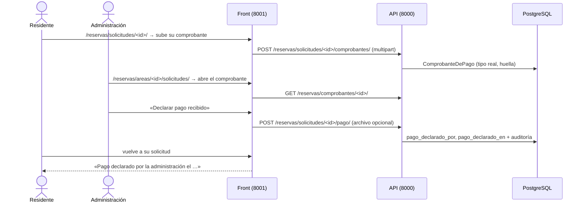

# AdMind — Plan guiado del pago declarado de una reserva

> [!IMPORTANT]
> **Alejo:** llena la columna *Respuesta* de la sección 3 (D5 a D7). Para empezar o retomar, en un chat nuevo: `Ejecuta el plan Documentacion/Admind_Documentacion/07_Planes/activos/Plan_Pago_De_Reserva.md`. El agente te pregunta primero si lo quieres guiado o si lo construye él.

> [!NOTE] No es el pago de administración
> Este plan es **HU-16**: el pago del alquiler de **una reserva**. El pago mensual de la administración es HU-35 y tiene su propio plan, [Plan_Pago_De_Administracion](Plan_Pago_De_Administracion.md). Los dos se pueden ejecutar en cualquier orden.

## 1. Seguimiento

**Dónde voy:** **construido por el agente el 2026-10-10** (F0 a F4), sin commit. Alejo respondió D5 a, D6 a y D7 a y pidió que lo construyera el agente. Falta de Alejo: `migrate` en `admind_db` (`reservas/0003` y `0004`), los commits, la prueba manual y avisarle a Camilo.

| Fase | Deja funcionando | Estado | Modo | Explicada de vuelta | Verificación | Commit | Fecha |
|---|---|---|---|---|---|---|---|
| F0 | Punto de partida confirmado | hecha | construida | — | Árbol como el plan lo cree; `apps/pagos` sin `tipo_real`. Front 260 pasan. Back: 220 pasan hasta la primera falla, que es de `ingresos` y depende de la hora (ver Desviaciones) | — | 2026-10-10 |
| F1 | Administración declara el pago de una solicitud, en la API | hecha | construida | saltada | `pytest apps/reservas tests/aislamiento`: pasan todas salvo la de las cinco rutas de siempre | — | 2026-10-10 |
| F2 | Comprobantes: adjuntar, subir y descargar con validación, en la API | hecha | construida | saltada | `pytest apps/reservas tests/archivos tests/aislamiento` igual; `makemigrations --check` limpio. Suite completa: 528, 526 pasan | — | 2026-10-10 |
| F3 | La tarjeta de la solicitud con el bloque de pago, para gestión | hecha | construida | saltada | Front 288, todas pasan; recorrido con el front real contra la API de pruebas (declarar con un PNG llamado `.pdf` y abrirlo) | — | 2026-10-10 |
| F4 | El residente ve el pago de su solicitud y sube su comprobante | hecha | construida | saltada | Las mismas dos suites y el mismo recorrido, que incluye al residente | — | 2026-10-10 |

### Desviaciones

- **B0.1, línea base del backend.** La primera corrida de la suite completa se hizo con `-x` y paró en la primera falla (`apps/ingresos/tests.py::test_un_registro_que_no_cumple_responde_400_con_todos_los_motivos_y_no_deja_fila`), así que no hay cifra total «antes». Esa falla **no es de este plan ni de la falla conocida**: la prueba usa la hora real, la zona de prueba abre de 05:00 a 22:00 y de noche responde 3 motivos en vez de 2. Con el cambio, la suite completa dio 528 (491 + 37 nuevas), con dos fallas: esa y la de las cinco rutas. Las cinco rutas son las mismas de siempre; las cuatro nuevas están registradas.
- **B2.4, la descarga de un comprobante.** El plan dice que exige `reserva.solicitar`, `reserva.aprobar` o `reserva.declarar_pago`, y a la vez que Vigilancia (que solo tiene `reserva.ver_todas`) recibe **404** (P8, criterio 5, B2.5). Las dos cosas no caben: con solo esos tres, Vigilancia recibiría 403. Se sumó `reserva.ver_todas` a lo que se exige para entrar, y el servicio decide por pertenencia: Vigilancia entra, no es dueña ni gestiona, y recibe 404. Así no se le confirma que el comprobante existe.
- **B2.4, cómo se cargan los comprobantes.** El plan pide `Prefetch("comprobantes", queryset=...defer("contenido"))`. Se usa con `to_attr="comprobantes_cargados"` (`servicios.con_comprobantes`) y el serializer, si no lo encuentra, hace una consulta que tampoco trae el contenido. Sin eso, un `refresh_from_db()` (que hace `liberar`) habría vuelto a traer los archivos enteros al serializar.
- **Fases juntas en el backend.** El plan escribe `PagoDeSolicitudView` sin cuerpo en F1 y con `archivo` en F2; se construyó una sola vez con el archivo opcional, así que F1 y F2 se verificaron juntas.
- **B3.2, aviso al volver.** El plan dice que las vistas vuelven a la zona «como hace `decidir`», que escribe «La decisión quedó guardada». Para declarar y retirar eso sería falso, así que vuelven con `?pago=declarado` o `?pago=retirado` y la pantalla dice «El pago quedó declarado.» o «La declaración del pago quedó retirada.».
- **B3.3, botones.** «Declarar pago recibido», «Retirar la declaración» y «Subir comprobante» son botones secundarios: la tarjeta ya tiene «Aceptar» como primario y dos primarios compiten.
- **B3.2, el área del formulario.** Si el campo `area` no es un identificador, la vista responde 404 (no hay a dónde volver). `decidir`, que es de Camilo, no lo valida y no se tocó.
- **Concurrencia.** No se escribió una prueba con dos administradores a la vez (la pregunta de *explicar de vuelta* de F1): el plan no la pide. La lógica está cubierta en secuencia (la segunda recibe 409) y el bloqueo es `select_for_update`, como `decidir_solicitud`. Si se quiere, va en `tests/concurrencia/`.
- **Verificación en el navegador.** No se recorrió en el navegador ni con `admind_db`, porque `migrate` es de Alejo (D7). Sí se recorrió el front real contra la API real en la base de pruebas, con un pytest desechable fuera del repositorio.

### Conceptos por repasar

Las cuatro fases las construyó el agente y la explicación de vuelta quedó saltada. Para la sustentación, con la pregunta de cada una:

- **F1, bloquear la fila y que la base no deje un dato a medias.** ¿Qué pasa cuando dos administradores oprimen «Declarar pago» en el mismo segundo, y por qué el `CHECK` sirve aunque el código de Python tenga un error?
- **F2, no confiar en lo que el navegador dice del archivo, y autorizar mirando a quién pertenece.** ¿Dónde se decide el tipo de un archivo y por qué no es la extensión? ¿Qué parte de «quién puede descargar» es el permiso y cuál es la pertenencia?
- **F3, un front que muestra y no decide.** Secretaría no ve el botón: ¿eso es lo que le impide declarar? (No: lo impide la API con 403.)
- **F4, la misma información con menos permisos.** ¿Por qué subir un comprobante no es declarar el pago, y qué ruta no existe para el residente?

## 2. Instrucciones para el agente

> [!IMPORTANT]
> **Primero pregunta.** Antes de tocar nada, pregúntale a Alejo si este plan se trabaja **guiado** (explicas por bloques y él aplica) o si lo **construyes** tú. No entres en modo guiado sin su respuesta.

### 2.1 Qué leer antes de empezar

1. [ejecutar_plan_guiado](../../09_Protocolos/ejecutar_plan_guiado.md): cómo se trabaja este plan en modo guiado y qué cambia si Alejo pide que lo construyas.
2. Este plan completo.
3. [reservas](../../05_Modulos/reservas.md): los estados de una solicitud y la frase «el dinero lo valida una persona».
4. [legal](../../01_Contexto/legal.md) §4.2: cobrar por un bien común solo procede si el reglamento lo autoriza. El sistema no cobra.
5. [capas](../../03_Reglas/capas.md), [aislamiento](../../03_Reglas/aislamiento.md) e [invariantes](../../03_Reglas/invariantes.md).
6. [reglas_frontend](../../03_Reglas/reglas_frontend.md) e [implementacion](../../04_Diseno/implementacion.md): antes de F3.
7. `Backend/Admind_Backend/apps/reservas/README.md`, `apps/documentos/` (un archivo guardado en la base y servido por una vista validada) y `apps/comun/README.md`.
8. `Frontend/Admind_Front-End/apps/reservas/README.md`, `apps/triage/README.md` y `templates/componentes/README.md`.

### 2.2 Reglas propias de este plan

- **El sistema no verifica el dinero ni lo cobra.** No hay monto, ni pasarela, ni saldo. Declarar un pago es dejar constancia de que una persona dijo haberlo recibido. El aviso «AdMind no verifica el dinero: el pago lo declara una persona de la administración» va junto al bloque de pago en las dos pantallas (criterio 3), escrito en un solo sitio del front.
- **El residente no declara.** No existe ruta, botón ni campo con el que un residente marque su pago como recibido (criterio 4). Subir un comprobante no cambia nada del estado del pago.
- **Aprobar una reserva no depende del pago.** `decidir_solicitud` (HU-14, de Camilo) no se toca.
- **Un comprobante solo se sirve por la ruta validada.** Nunca hay una URL directa al archivo.
- **Las pantallas de este plan no cargan JavaScript.** `tests/test_reservas.py` comprueba que una solicitud que ya no está en trámite no carga Alpine; eso se conserva.
- Las migraciones se generan con `makemigrations`; en `admind_db` las corre Alejo (D7).
- Sin commits ni `push` salvo que Alejo los pida.
- Hay que **avisarle a Camilo** (lo hace Alejo): un permiso nuevo en el catálogo, dos migraciones en `reservas`, un módulo nuevo en `apps/comun/`, el campo `pago` en las respuestas de solicitudes, y cambios en `solicitudes_area.html` y `triage/bandeja.html`, que son suyos.

## 3. Decisiones que toma Alejo

D1 a D4 se respondieron en el chat de planeación (2026-10-10). D5 a D7 las respondió Alejo al empezar a ejecutar el plan, el mismo día, junto con que lo construyera el agente.

| ID | Decisión | Opciones | Recomendada | Respuesta |
|---|---|---|---|---|
| D1 | Cuándo se puede declarar el pago | a) Con la solicitud apartada o reservada; aprobar no depende del pago b) Solo después de aprobada c) El pago es requisito para aprobar | a | **a** (2026-10-10) |
| D2 | Dónde declara el administrador | a) En la tarjeta de la solicitud, donde ya aprueba b) Pantalla Pagos / Reservas c) Las dos | a | **a** (2026-10-10) |
| D3 | Quién declara | a) Solo Administración b) Administración y Secretaría | a | **a** (2026-10-10) |
| D4 | Quién adjunta el comprobante | a) Solo quien declara b) El residente también puede subirlo desde su solicitud | a | **b** (2026-10-10) |
| D5 | Dónde se guarda el archivo. La tarea de Notion dice «fuera de la base de datos, con ruta por conjunto»; el logo, el reglamento y las fotos de anuncios se guardan **dentro** de la base | a) Dentro de la base, como los otros tres b) En disco, con una carpeta por conjunto | a: un solo mecanismo para todos los archivos, el respaldo de la base se los lleva y el aislamiento por conjunto ya está resuelto. Hay que ajustar la tarea en Notion | **a** (2026-10-10) |
| D6 | Administración puede retirar una declaración hecha por error | a) Sí, con motivo obligatorio, y queda en la auditoría b) No: solo se corrige con la anulación del Superusuario (HU-20, sin construir) | a: un clic en la tarjeta equivocada tiene que poder corregirse hoy | **a** (2026-10-10) |
| D7 | Quién corre `migrate` en `admind_db` | a) Alejo, al final b) El agente | a | **a** (2026-10-10) |

Si D5 queda en b, se para y se le pregunta a Alejo dónde vive la carpeta y cómo se respalda: cambia B2.1 y B2.5 y este plan no lo detalla. Si D6 queda en b, no existen B1.5 ni el botón «Retirar» de F3.

## 4. Decisiones menores que el plan ya fija

| ID | Decisión |
|---|---|
| P1 | Todo vive en `apps/reservas/`, no en `apps/pagos/`: el pago declarado es un dato de la solicitud. Así este plan no depende del de pago de administración |
| P2 | La declaración son dos campos de `Solicitud`: `pago_declarado_por` y `pago_declarado_en`. Van los dos o ninguno, y lo exige la base |
| P3 | Permiso nuevo `reserva.declarar_pago`, solo para Administración (D3). No es sensible. El residente no recibe permiso nuevo: sube su comprobante con `reserva.solicitar` y solo en una solicitud suya |
| P4 | Se declara con la solicitud `APARTADA` o `RESERVADA` (D1). En cualquier otro estado responde 409. Declarar dos veces responde 409 |
| P5 | Si una solicitud con pago declarado se rechaza, la declaración **no se borra**: la tarjeta lo sigue mostrando, porque hay un dinero por devolver fuera del sistema |
| P6 | El comprobante es opcional al declarar. Sirve PDF, JPG o PNG de hasta 5 MB; el tipo lo decide la firma del archivo, no la extensión (criterio 2). Se guarda con su huella SHA-256 |
| P7 | Una solicitud tiene como máximo 3 comprobantes. El residente sube mientras la solicitud esté `APARTADA` o `RESERVADA` y el pago no esté declarado; después responde 409 |
| P8 | Descargan un comprobante quien tiene `reserva.declarar_pago` o `reserva.aprobar` (Administración y Secretaría) y la persona que hizo la solicitud. Cualquier otro recibe 404, también Vigilancia aunque tenga `reserva.ver_todas` |
| P9 | El residente ve si su pago está declarado y cuándo, sin el nombre de quien lo declaró, igual que hoy no ve quién decidió su solicitud. Gestión sí ve el nombre |
| P10 | La validación del archivo vive en `apps/comun/archivos/comprobantes.py`, para que la usen reservas y pagos. Si el plan de pago de administración ya dejó `tipo_real` en `apps/pagos/servicios.py`, se mueve a `comun` y `pagos` la importa de ahí |
| P11 | Sin JavaScript, la confirmación de contenido es una frase junto al botón que dice exactamente qué se declara: de quién, qué área, qué día en letras y qué horario |
| P12 | No se avisa por el canal de notificaciones ni al subir ni al declarar (ver *Fuera de este plan*) |

## 5. Punto de partida verificado

Comprobado en el código el 2026-10-10.

**Repositorios.** Backend `desarrollo` en `2d6bbe0` y Frontend en `1f624b5`. Encima, sin commit, las dos reglas de reserva de ese día. En `admind_db` solo falta `reglas/0006`. Ninguno de los otros dos planes del 2026-10-10 se ha ejecutado.

**Lo que no hay:** `Solicitud` no tiene ningún campo de pago; no existe ningún comprobante de reserva ni ningún permiso de pago.

**Lo que ya existe y se reutiliza:**

- `Backend/Admind_Backend/apps/reservas/models.py`: `Solicitud` y `EstadoSolicitud`. Migraciones hasta `0002`.
- `apps/reservas/servicios.py`: `decidir_solicitud` (modelo de `select_for_update` más auditoría), `solicitudes_para_area`, `solicitudes_para_bandeja`, `solicitudes_de`, `detalle`, y las excepciones `SolicitudNoEncontrada` y `DecisionNoPermitida`.
- `apps/reservas/serializers.py`: `SolicitudSerializer` (lo que ve el residente), `SolicitudParaAdministrarSerializer` (suma `residente` y `decidida_por`) y `DetalleDeSolicitudSerializer`.
- `apps/reservas/views.py` y `urls.py`: `SolicitudesDeAreaView` (`solicitudes-area`), `BandejaDeSolicitudesView`, `DecidirSolicitudView` (`solicitud-decision`) y `DetalleDeSolicitudView` (`solicitud-detalle`).
- `apps/documentos/`: `Reglamento` (archivo en `BinaryField` con `nombre`, `peso`, `huella`), `servicios.guardar` y `ArchivoDelReglamentoView`.
- `apps/conjuntos/servicios.py`: `tipo_real_de_imagen(contenido)` → `image/png`, `image/jpeg`, `image/webp` o `None`.
- `apps/comun/aislamiento/migraciones.py`: `fk_compuesta`. `apps/permisos/views.py`: `exigir_permiso` y `tiene_permiso_en_conjunto`. `apps/auditoria/servicios.py`: `registrar`.
- Front: `apps/reservas/views.py` (`pantalla_solicitudes_area`, `decidir`, `pantalla_de_la_solicitud`, `con_fechas`, `hora_en_letras`), `templates/reservas/solicitudes_area.html` y `solicitud.html`, `apps/triage/` (`bandeja`, el historial del residente), `cliente_api/reservas.py` y `cliente_api/http.py` (`pedir` con `archivos` y `pedir_archivo`). La vista del front que sirve el reglamento está en `apps/conjuntos/views.py`.

**Diferencias entre notas y código, y entre Notion y código:**

- La tarea de Notion «Almacenamiento del archivo fuera de la base de datos, con ruta por conjunto» contradice lo construido: los tres archivos que el sistema guarda hoy están dentro de la base. Es la D5.
- [reservas](../../05_Modulos/reservas.md) nombra los campos `pago_declarado_por` y `fecha_declaracion`. Este plan usa `pago_declarado_en`, como las demás fechas del modelo (`decidida_en`, `enviada_en`).
- El historial del residente en `triage/bandeja.html` no enlaza al detalle de la solicitud. Este plan agrega ese enlace, porque el detalle es donde se sube el comprobante.
- `solicitudes-bandeja`, `solicitudes-area` y `solicitud-decision` siguen sin registrar en la prueba del intruso (son tres de las cinco rutas de la falla conocida). Este plan registra las suyas y no arregla esas.

## 6. Mapa de la funcionalidad



Al terminar existe:

- **Backend:** dos campos en `Solicitud`, la tabla `ComprobanteDePago`, el módulo `apps/reservas/pago.py`, `apps/comun/archivos/comprobantes.py`, el permiso `reserva.declarar_pago` y cuatro rutas bajo `/reservas/`.
- **Frontend:** el bloque «Pago» en la tarjeta de gestión y en el detalle del residente, y cuatro funciones en `cliente_api/reservas.py`.

## F0 · Confirmar el punto de partida

- [x] **B0.1** · Correr las dos suites y `makemigrations --check --dry-run` ([pruebas_y_ejecucion](../../02_Arquitectura/pruebas_y_ejecucion.md)). Anotar las cifras reales en *Seguimiento*: si antes se ejecutó otro plan, no coinciden con el frontmatter. Revisar `git status` de los dos repositorios: otro chat puede estar trabajando.
- [x] **B0.2** · Confirmar con Alejo que D5 a D7 están respondidas. Mirar si existe `tipo_real` en `Backend/Admind_Backend/apps/pagos/servicios.py` (P10).

## F1 · Administración declara el pago

**Deja funcionando:** `POST /reservas/solicitudes/<id>/pago/` deja constancia de quién declaró y cuándo; nadie más puede; las respuestas de solicitudes traen el estado del pago.

**Concepto de la fase:** una acción que cambia una fila con concurrencia posible: bloquear la fila, revisar el estado, escribir y auditar, todo en una transacción.

- [x] **B1.1** · explicado · `Backend/Admind_Backend/apps/reservas/models.py` y migración `0003_pago_declarado`
  - **Qué:** dos campos en `Solicitud` y una restricción.
  - **Concepto:** dos columnas que solo tienen sentido juntas se amarran con un `CHECK`: la base no acepta «declarado sin fecha» aunque el código tenga un error.
  - **Forma:**
    ```python
    pago_declarado_por = models.ForeignKey(
        "personas.Persona", on_delete=models.PROTECT, null=True, blank=True, related_name="pagos_de_reserva_declarados"
    )
    pago_declarado_en = models.DateTimeField(null=True, blank=True)
    ```
    ```python
    models.CheckConstraint(
        condition=Q(pago_declarado_por__isnull=True, pago_declarado_en__isnull=True)
        | Q(pago_declarado_por__isnull=False, pago_declarado_en__isnull=False),
        name="solicitud_pago_declarado_completo",
    )
    ```
  - **Comprobación:** `makemigrations --check --dry-run` limpio después de generar la migración.
- [x] **B1.2** · explicado · `Backend/Admind_Backend/apps/permisos/catalogo.py`
  - **Qué:** `"reserva.declarar_pago"` en `PERMISOS` y en `PERMISOS_POR_ROL[Rol.ADMINISTRACION]`.
  - **Concepto:** Secretaría aprueba reservas y no declara pagos: por eso es un permiso aparte y no se reutiliza `reserva.aprobar`.
  - **Comprobación:** las pruebas de `apps/permisos` y `apps/cuentas`; si alguna cuenta permisos, se actualiza la cifra.
- [x] **B1.3** · explicado · `Backend/Admind_Backend/apps/reservas/pago.py` (nuevo)
  - **Qué:** el servicio del pago, en su propio módulo para no alargar `servicios.py`.
  - **Concepto:** `select_for_update` y condición sobre el estado: dos administradores que declaran a la vez dejan una sola declaración, y la segunda recibe un error claro.
  - **Forma:**
    ```python
    SE_PUEDE_PAGAR = [EstadoSolicitud.APARTADA, EstadoSolicitud.RESERVADA]

    class PagoNoPermitido(Exception): ...   # la solicitud no está apartada ni reservada → 409
    class PagoYaDeclarado(Exception): ...   # → 409

    def declarar(actor, solicitud_id):
        with transaction.atomic():
            solicitud = Solicitud.objects.select_for_update(of=("self",)).filter(pk=solicitud_id).first()
            # None → servicios.SolicitudNoEncontrada
            # estado fuera de SE_PUEDE_PAGAR → PagoNoPermitido
            # ya declarado → PagoYaDeclarado
            # fija pago_declarado_por y pago_declarado_en, guarda con update_fields
            # auditoria.registrar(actor, "reserva.declarar_pago", "Solicitud", solicitud.id, despues={...})
        return solicitud
    ```
    En F2 `declarar` gana los parámetros del archivo.
- [x] **B1.4** · tuyo (modelo: `DecidirSolicitudView`) · `Backend/Admind_Backend/apps/reservas/views.py`, `urls.py`, `serializers.py`
  - **Qué:** `PagoDeSolicitudView.post` en `solicitudes/<uuid:solicitud_id>/pago/`, nombre `solicitud-pago`, con `exigir_permiso(request, "reserva.declarar_pago")`. Responde 200 con `SolicitudParaAdministrarSerializer`, o 404 y 409 con `detail`.
  - **Qué cambia respecto al modelo:** no recibe cuerpo en F1. `SolicitudSerializer` gana el campo `pago`; `SolicitudParaAdministrarSerializer` le suma `declarado_por`.
  - **Contrato de `pago`:**
    ```json
    {"declarado": true, "declarado_en": "2026-10-12T09:30:00-05:00", "declarado_por": "Andrés Gómez", "comprobantes": []}
    ```
    `declarado_por` solo va en el serializer de gestión (P9). `comprobantes` queda vacío hasta F2. Las consultas `solicitudes_para_area` y `solicitudes_para_bandeja` suman `pago_declarado_por` a su `select_related`.
- [x] **B1.5** · tuyo (modelo: B1.3) · `apps/reservas/pago.py`, `views.py`, `urls.py` (solo con D6 a)
  - **Qué:** `retirar_declaracion(actor, solicitud_id, motivo)` y la ruta `solicitudes/<uuid:solicitud_id>/pago/retirar/`, nombre `solicitud-pago-retirar`, con el mismo permiso.
  - **Qué cambia respecto al modelo:** el motivo es obligatorio (400 bajo `motivo`); sin pago declarado responde 409; deja los dos campos en `None` y audita `reserva.retirar_pago` con `antes` (quién y cuándo había declarado) y el motivo en `detalle`. Los comprobantes no se tocan.
- [x] **B1.6** · tuyo (modelo: las pruebas de decisión de `apps/reservas/tests.py`) · `Backend/Admind_Backend/apps/reservas/tests.py`
  - **Qué:** declarar sobre una apartada y sobre una reservada guarda quién y cuándo, y deja fila en `Registro` (criterio 1); el residente dueño de la solicitud recibe 403 (criterio 4); Secretaría recibe 403 y sí ve `pago.declarado` en el listado; sobre una rechazada o una en trámite, 409; dos veces, 409; una solicitud con pago declarado que se rechaza conserva la declaración (P5); la base rechaza `pago_declarado_en` sin `pago_declarado_por`; el residente ve `declarado` y `declarado_en`, y no `declarado_por`. Con D6 a: retirar exige motivo, limpia los campos y queda en la auditoría.
  - **Además:** `solicitud-pago` y `solicitud-pago-retirar` en `ACCIONES` de `tests/aislamiento/test_intruso.py`.

**Cierre de F1**

- **Verificación:** `./.venv/Scripts/python.exe -m pytest -q apps/reservas tests/aislamiento` y la suite completa: ninguna falla nueva.
- **Explicar de vuelta:** «Cuéntame qué pasa en la base, paso a paso, cuando dos administradores oprimen "Declarar pago" sobre la misma solicitud en el mismo segundo.»
- **Pregunta de jurado:** ¿Qué significa en AdMind que un pago esté «declarado»? ¿El sistema sabe si el dinero llegó?
- **Commit sugerido:** `feat(reservas): declaración del pago de una reserva por Administración [HU-16]`

## F2 · Comprobantes

**Deja funcionando:** al declarar se puede adjuntar un archivo; el residente sube el suyo; quien corresponde lo descarga y nadie más.

**Concepto de la fase:** no confiar en lo que el navegador dice del archivo, y autorizar la descarga mirando a quién pertenece.

- [x] **B2.1** · explicado · `Backend/Admind_Backend/apps/comun/archivos/comprobantes.py` (carpeta nueva, con `__init__.py`, como `bloqueo/`) y `apps/comun/README.md`
  - **Qué:** la validación compartida de un comprobante (P10).
  - **Concepto:** la firma de un archivo son sus primeros bytes y dice qué es de verdad; el nombre y el `Content-Type` los escribe quien sube. Y `comun` no importa apps de negocio: por eso las firmas de imagen se escriben aquí en vez de traer `tipo_real_de_imagen` de `conjuntos`.
  - **Forma:**
    ```python
    TAMANO_MAXIMO_DE_COMPROBANTE = 5 * 1024 * 1024
    FIRMAS = {
        "application/pdf": lambda inicio: inicio.startswith(b"%PDF-"),
        "image/png": lambda inicio: inicio.startswith(b"\x89PNG\r\n\x1a\n"),
        "image/jpeg": lambda inicio: inicio.startswith(b"\xff\xd8\xff"),
    }

    class ArchivoInvalido(Exception): ...   # trae `mensaje`

    def tipo_real(contenido):
        """El tipo según la firma, o None."""
    def validar_comprobante(contenido):
        """Devuelve {"tipo", "peso", "huella"} o lanza ArchivoInvalido: vacío, muy pesado o de un tipo que no sirve."""
    ```
  - **Comprobación:** `tests/archivos/test_comprobantes.py` (carpeta nueva con `__init__.py`, como `tests/esquema/`; no toca la base): un PDF, un PNG y un JPG mínimos pasan; un texto llamado `pago.pdf` no; 5 MB más un byte no; la huella es la SHA-256 del contenido.
- [x] **B2.2** · explicado · `Backend/Admind_Backend/apps/reservas/models.py` y migración `0004_comprobante_de_pago`
  - **Qué:** el modelo `ComprobanteDePago`.
  - **Concepto:** un `BinaryField` nunca se trae sin pedirlo: toda consulta de listado usa `defer("contenido")`.
  - **Forma:**
    ```python
    class ComprobanteDePago(ModeloDeConjunto):
        solicitud = models.ForeignKey(Solicitud, on_delete=models.PROTECT, related_name="comprobantes")
        contenido = models.BinaryField()
        tipo = models.CharField(max_length=20)       # el real
        nombre = models.CharField(max_length=120)
        peso = models.PositiveIntegerField()
        huella = models.CharField(max_length=64)
        subido_por = models.ForeignKey("personas.Persona", on_delete=models.PROTECT, related_name="+")
        subido_en = models.DateTimeField(auto_now_add=True)
    ```
    En la migración, a mano: `fk_compuesta("reservas_comprobantedepago", "solicitud_id", "reservas_solicitud")`. Índice por `(conjunto, solicitud)`.
- [x] **B2.3** · explicado · `Backend/Admind_Backend/apps/reservas/pago.py`
  - **Qué:** adjuntar al declarar, subir por el residente y decidir quién ve.
  - **Concepto:** la autorización tiene dos partes, el permiso (qué puede hacer el rol) y la pertenencia (sobre qué fila). El permiso lo revisa la vista; la pertenencia, el servicio.
  - **Forma:**
    ```python
    MAXIMO_DE_COMPROBANTES = 3
    class DemasiadosComprobantes(Exception): ...   # → 409

    def guardar_comprobante(actor, solicitud, nombre, contenido):
        """Valida con `comprobantes.validar_comprobante`, revisa el tope y crea la fila. Lo usan las dos de abajo."""
    def declarar(actor, solicitud_id, nombre=None, contenido=None):
        """Como en F1; si llega archivo, lo guarda en la misma transacción."""
    def subir_comprobante(persona, solicitud_id, nombre, contenido):
        """El residente, sobre una solicitud suya, apartada o reservada y sin pago declarado (P7). Audita `reserva.subir_comprobante`."""
    def comprobante_para(persona, puede_gestionar, comprobante_id):
        """El comprobante con su contenido si la persona puede verlo (P8); si no, None."""
    ```
    `subir_comprobante` sobre una solicitud ajena lanza `SolicitudNoEncontrada`: no se dice si existe.
- [x] **B2.4** · tuyo (modelo: `apps/documentos/views.py`) · `Backend/Admind_Backend/apps/reservas/views.py`, `urls.py`, `serializers.py`
  - **Qué:** `PagoDeSolicitudView` acepta `archivo` opcional en multipart. Rutas nuevas: `solicitudes/<uuid:solicitud_id>/comprobantes/` (`POST`, `reserva.solicitar`, nombre `solicitud-comprobantes`, responde 201) y `comprobantes/<uuid:comprobante_id>/` (`GET`, nombre `solicitud-comprobante`).
  - **Qué cambia respecto al modelo:** el archivo se lee hasta `TAMANO_MAXIMO_DE_COMPROBANTE + 1`. `ArchivoInvalido` responde 400 bajo `archivo`. La descarga exige `reserva.solicitar`, `reserva.aprobar` o `reserva.declarar_pago`, y pasa `puede_gestionar` al servicio con `tiene_permiso_en_conjunto`. Responde con el tipo guardado y `Content-Disposition: inline`.
  - **`pago.comprobantes`** en los serializers: `[{"id", "nombre", "subido_en", "del_residente"}]`, y en el de gestión también `subido_por`. Las tres consultas de listado y `detalle` cargan los comprobantes con `Prefetch("comprobantes", queryset=ComprobanteDePago.objects.defer("contenido").order_by("subido_en"))`.
- [x] **B2.5** · tuyo (modelo: B1.6) · `Backend/Admind_Backend/apps/reservas/tests.py`
  - **Qué:** declarar con comprobante lo guarda con su tipo real y su huella; un PNG llamado `.pdf` queda como `image/png` y un texto llamado `.pdf` se rechaza sin declarar el pago (criterio 2); el residente sube a su solicitud y no a la de otro (404); con el pago declarado ya no sube (409); el cuarto comprobante responde 409; el dueño, Administración y Secretaría descargan; otro residente y Vigilancia reciben 404 (criterio 5); el listado no trae el contenido.
  - **Además:** `solicitud-comprobantes` en `ACCIONES` y `solicitud-comprobante` en `DETALLES` de la prueba del intruso.

**Cierre de F2**

- **Verificación:** `pytest -q apps/reservas tests/archivos tests/aislamiento` y `makemigrations --check --dry-run`.
- **Explicar de vuelta:** «Un residente copia la dirección del comprobante de su vecino y la abre con su sesión. Sigue la petición hasta la línea que le responde 404.»
- **Pregunta de jurado:** ¿Por qué guardar la huella SHA-256 del comprobante, si ya se guarda el archivo?
- **Commit sugerido:** `feat(reservas): comprobante del pago de una reserva, con validación y descarga protegida [HU-16]`

## F3 · La tarjeta de la solicitud, para gestión

**Deja funcionando:** en `/reservas/areas/<id>/solicitudes/`, cada solicitud apartada, reservada o rechazada muestra su pago; Administración declara, adjunta y retira; Secretaría solo ve.

**Concepto de la fase:** una pantalla que muestra lo mismo a dos roles y ofrece acciones solo a uno, sin que el front decida nada: decide la API.

- [x] **B3.1** · tuyo (modelo: `decidir` y `cliente_api/documentos.py`) · `Frontend/Admind_Front-End/cliente_api/reservas.py`
  - **Qué:** `declarar_pago(request, solicitud_id, archivo=None)`, `retirar_pago(request, solicitud_id, motivo)`, `subir_comprobante(request, solicitud_id, archivo)` y `comprobante(request, comprobante_id)`, cada una con su contrato en el docstring.
- [x] **B3.2** · explicado · `Frontend/Admind_Front-End/apps/reservas/views.py` y `urls.py`
  - **Qué:** las vistas `declarar_pago` y `retirar_pago` (POST, vuelven a la pantalla del área como hace `decidir`) y `comprobante` (GET, devuelve el archivo). `pantalla_solicitudes_area` pasa `puede_declarar_pago` y le da a cada solicitud la frase de P11.
  - **Concepto:** el front no guarda el archivo: lo recibe en `request.FILES` y lo reenvía a la API en la misma petición.
  - **Forma:**
    ```python
    AVISO_DEL_DINERO = "AdMind no verifica el dinero: el pago lo declara una persona de la administración."

    def frase_del_pago(solicitud):
        """«la reserva de Laura Gómez (Torre 1 – 101) en Salón comunal, el sábado 17 de octubre de 2026, de 8:00 a. m. a 12:00 p. m.»"""
    ```
    Usa `con_fechas` y `hora_en_letras`, que ya existen. El archivo opcional va como `request.FILES.get("archivo")`.
- [x] **B3.3** · explicado · `Frontend/Admind_Front-End/apps/reservas/templates/reservas/_pago.html` (nuevo) y `solicitudes_area.html`
  - **Qué:** un fragmento con el bloque «Pago», incluido en cada tarjeta. Contiene el aviso del dinero (`aviso-info`, `role="note"`), una pastilla con texto («Pago declarado» o «Sin pago declarado»), quién y cuándo, y los comprobantes como enlaces que abren en otra pestaña, cada uno con quién lo subió.
  - **Concepto:** un fragmento con parámetros (``) se escribe una vez y se usa en dos pantallas; F4 lo reutiliza.
  - **Forma:** con `puede_declarar_pago` y la solicitud apartada o reservada sin pago: un `<form method="post" enctype="multipart/form-data">` con el campo `archivo` («Comprobante, si lo tienes»), la frase «Vas a declarar que recibiste el pago de {{ frase }}.» y el botón «Declarar pago recibido». Con pago declarado y D6 a: un segundo formulario con `motivo` obligatorio y el botón «Retirar la declaración». Sin el permiso, ninguno de los dos formularios.
  - **Comprobación:** la página no carga Alpine ni ningún script nuevo.
- [x] **B3.4** · tuyo (modelo: `test_bandeja_muestra_solicitud_del_residente_y_acciones_con_motivo`) · `Frontend/Admind_Front-End/tests/test_reservas.py`
  - **Qué:** la tarjeta muestra el aviso, la pastilla y los comprobantes; Administración ve el formulario con la frase completa y Secretaría no; declarar con archivo lo manda a la API y vuelve a la zona; un 400 sobre el archivo y un 409 se muestran arriba; retirar exige motivo; la vista `comprobante` devuelve el contenido con su tipo y un 404 de la API es un 404.

**Cierre de F3**

- **Verificación:** suite del front y, con los dos servidores, declarar un pago con una foto y abrirla.
- **Explicar de vuelta:** «Cuéntame por dónde pasa el archivo desde que el administrador lo elige hasta que queda guardado, y qué servidor lo valida.»
- **Pregunta de jurado:** Secretaría no ve el botón. ¿Eso es lo que le impide declarar el pago?
- **Commit sugerido:** `feat(reservas): bloque de pago en las solicitudes del área [HU-16]`

## F4 · El residente ve su pago y sube su comprobante

**Deja funcionando:** desde su historial, el residente abre su solicitud, ve si el pago está declarado y sube su comprobante.

**Concepto de la fase:** la misma información con menos permisos: qué ve y qué no ve quien no gestiona, y por qué «subir» no es «declarar».

- [x] **B4.1** · explicado · `Frontend/Admind_Front-End/apps/reservas/views.py`, `urls.py` y `templates/reservas/solicitud.html`
  - **Qué:** la vista `subir_comprobante` (POST, vuelve al detalle) y el bloque de pago en el detalle, dentro de las ramas `APARTADA` y `RESERVADA` y, si hay pago declarado, también en `RECHAZADA`.
  - **Concepto:** se reutiliza `_pago.html` con otros parámetros: sin nombres de la administración y con un formulario distinto.
  - **Forma:** mientras no haya pago declarado y queden cupos de comprobante: `<form method="post" enctype="multipart/form-data">` con `archivo` obligatorio, el texto «Subir el comprobante no confirma el pago: lo declara la administración cuando lo verifique.» y el botón «Subir comprobante». Con pago declarado: «Pago declarado por la administración el …». Los errores de la API (400 bajo `archivo`, 409) se muestran en el bloque.
  - **Comprobación:** `test_una_solicitud_que_ya_no_esta_en_tramite_lo_dice_y_no_carga_javascript` sigue pasando sin tocarla.
- [x] **B4.2** · tuyo (modelo: el enlace «Solicitudes» de las tarjetas de gestión) · `Frontend/Admind_Front-End/apps/triage/templates/triage/bandeja.html`
  - **Qué:** en cada tarjeta del historial del residente, el enlace «Ver solicitud» a `reservas:solicitud`, y junto al estado, la pastilla del pago si la solicitud está apartada o reservada.
  - **Qué cambia respecto al modelo:** es un archivo de Camilo: solo se agregan esas dos cosas y `tests/test_triage.py` sigue pasando sin tocar sus aserciones.
- [x] **B4.3** · tuyo (modelo: B3.4) · `Frontend/Admind_Front-End/tests/test_reservas.py` y `tests/test_triage.py`
  - **Qué:** el detalle de una apartada muestra el aviso, «Sin pago declarado» y el formulario de subida; subir manda el archivo a la API; con el pago declarado no hay formulario y no aparece el nombre de quien declaró; en ninguna pantalla del residente existe un control para declarar (criterio 4); el historial enlaza al detalle.

**Cierre de F4**

- **Verificación:** las dos suites completas y el guion de prueba manual.
- **Explicar de vuelta:** «Muéstrame en el código por qué un residente no puede declarar su propio pago: qué ruta no existe para él y qué responde la que sí existe.»
- **Pregunta de jurado:** El residente subió el comprobante hace una semana y su pago sigue «sin declarar». ¿Es un error del sistema?
- **Commit sugerido:** `feat(reservas): el residente ve el pago de su reserva y sube su comprobante [HU-16]`

## Cierre del plan

1. Las dos suites completas y `makemigrations --check --dry-run`.
2. Informe final en el chat: qué se hizo por fase, desviaciones y conceptos por repasar.
3. [actualizar_contexto](../../09_Protocolos/actualizar_contexto.md): `bitacora`, `historias` (HU-16), `estado_actual`, `pendientes`, `construccion` (D5 a D7), `mapa_codigo` (rutas nuevas de `reservas` y `apps/comun/archivos/comprobantes.py`), `frontend`, `permisos` (`reserva.declarar_pago`), la sección *Cómo está construido* de [reservas](../../05_Modulos/reservas.md), `restricciones_bd` (el `CHECK` del pago) y los README de `apps/reservas/` y `apps/comun/` en el backend y de `apps/reservas/` en el front.
4. Cerrar el plan según [abrir_y_cerrar_un_plan](../../09_Protocolos/abrir_y_cerrar_un_plan.md).

## Lo que el agente no puede hacer

- `migrate` en `admind_db` (D7): `reservas/0003` y `0004`.
- Los commits y el `push`, salvo que Alejo los pida.
- Avisarle a Camilo (sección 2.2).
- Notion: pasar HU-16 a «En revisión» y, con D5 a, cambiar la tarea «Almacenamiento del archivo fuera de la base de datos». El agente no toca Notion.
- La parte humana de la DoD: PR `desarrollo → pruebas` revisado y la prueba manual de quien no programó.

## Guion de prueba manual

Con un conjunto que tenga un área con reserva, dos residentes (Laura y Pedro) y usuarios de Administración, Secretaría y Vigilancia.

1. Laura reserva el salón y envía la solicitud. En su detalle ve el aviso de que AdMind no verifica el dinero y «Sin pago declarado».
2. Laura sube como comprobante un archivo de texto renombrado a `.pdf`: lo rechaza. Sube una foto: aparece en la lista.
3. Laura busca en su pantalla cómo marcar el pago como recibido: no existe.
4. Pedro abre la dirección del comprobante de Laura: no lo encuentra.
5. Secretaría abre las solicitudes del salón: ve «Sin pago declarado» y el comprobante de Laura, lo abre, y no tiene botón para declarar.
6. Administración abre la misma pantalla: lee la frase con el nombre de Laura, su apartamento, el día en letras y el horario, y oprime «Declarar pago recibido» adjuntando un PDF.
7. La tarjeta muestra «Pago declarado», quién y cuándo, y los dos comprobantes con quién subió cada uno.
8. Laura recarga su solicitud: «Pago declarado por la administración», sin nombre, y ya no puede subir más.
9. Administración aprueba la solicitud: el pago declarado sigue ahí.
10. Con D6 a: Administración retira la declaración sin motivo (no lo deja) y con motivo (queda «Sin pago declarado»).
11. Administración declara el pago de otra solicitud apartada y después la rechaza: la tarjeta rechazada conserva «Pago declarado».
12. Vigilancia no puede abrir ningún comprobante.

## Fuera de este plan

- **HU-15:** las condiciones del alquiler (valor, depósito, política de cancelación). Sin ellas el sistema no sabe cuánto vale una reserva: aquí solo consta que el pago se declaró.
- El **monto** pagado, el depósito y su devolución.
- Que el pago sea **requisito para aprobar** (D1 c) y marcar qué áreas se cobran.
- Una pantalla **Pagos / Reservas** con todas las reservas y su estado de pago (D2 b).
- **Avisos** por el canal de notificaciones: a Administración cuando el residente sube un comprobante y al residente cuando se declara el pago.
- La cancelación de reservas en firme (HU-17) y qué pasa con un pago declarado al cancelar.
- Depurar los comprobantes al cumplirse un plazo de retención, que no está definido (Ley 1581).
- Registrar en la prueba del intruso las tres rutas de HU-14 que hoy faltan.
