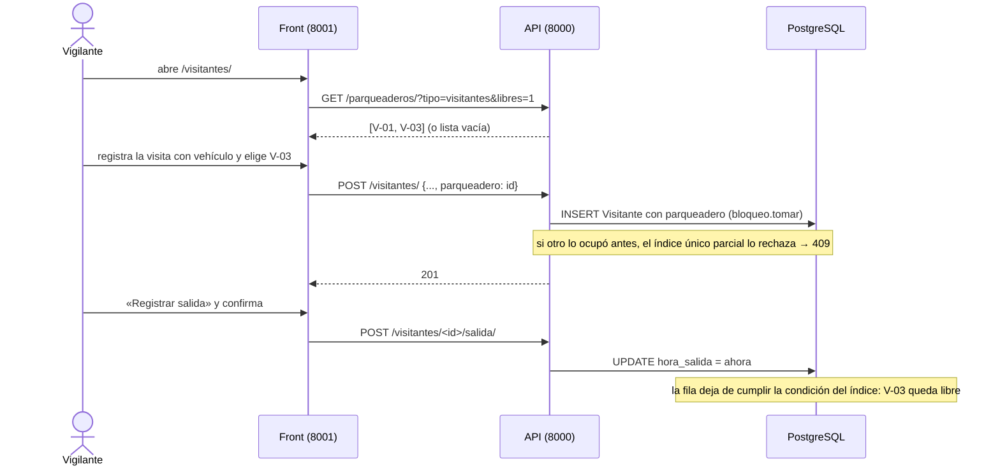

# AdMind — Plan guiado del parqueadero de visitantes

> [!IMPORTANT]
> **Alejo:** llena la columna *Respuesta* de la sección 3 (D3 a D8). Para empezar o retomar, en un chat nuevo: `Ejecuta el plan Documentacion/Admind_Documentacion/07_Planes/activos/Plan_Parqueadero_De_Visitantes.md`. El agente te pregunta primero si lo quieres guiado o si lo construye él.

## 1. Seguimiento

**Dónde voy:** **construido por el agente el 2026-10-10** (F0 a F5), sin commit. Alejo respondió D3 a, D4 a, D5 a, D6 a, D7 a y D8 a y pidió que lo construyera el agente. Falta de Alejo: `migrate` en `admind_db` (`parqueaderos/0001`, `visitantes/0002` y `0003`), los commits, la prueba manual y avisarle a Camilo.

| Fase | Deja funcionando | Estado | Modo | Explicada de vuelta | Verificación | Commit | Fecha |
|---|---|---|---|---|---|---|---|
| F0 | Punto de partida confirmado | hecha | construida | — | Árbol limpio de lo ajeno; encima, sin commit, las dos reglas de reserva y HU-16, por eso las cifras base son 528 y 288 y no 491 y 260 (ver Desviaciones) | — | 2026-10-10 |
| F1 | Catálogo de parqueaderos en la API | hecha | construida | saltada | `pytest apps/parqueaderos tests/aislamiento`: todas pasan salvo la de las cinco rutas de siempre; las rutas nuevas están registradas | — | 2026-10-10 |
| F2 | `visitantes` con capa de servicio, auditoría y salida | hecha | construida | saltada | Las 6 pruebas de Camilo pasan sin tocarlas; `pytest apps/visitantes tests/aislamiento` igual | — | 2026-10-10 |
| F3 | Ocupar un parqueadero al registrar la visita; la salida lo libera | hecha | construida | saltada | `pytest apps/visitantes apps/parqueaderos tests/concurrencia tests/esquema` verde; la prueba de concurrencia pasó tres veces seguidas. Suite completa: 565, 563 pasan | — | 2026-10-10 |
| F4 | Pantalla «Parqueaderos» de Administración | hecha | construida | saltada | Front 318, todas pasan | — | 2026-10-10 |
| F5 | Portería: elegir parqueadero, ver ocupación y registrar salida | hecha | construida | saltada | Las 7 pruebas de Camilo pasan sin tocar sus aserciones; recorrido del guion con el front real contra la API de pruebas, verde | — | 2026-10-10 |

### Desviaciones

- **B0.1, cifras base.** El frontmatter dice Backend 491 y Frontend 260; al empezar eran **528 y 288**, porque encima de esos commits están sin commit las dos reglas de reserva y [Plan_Pago_De_Reserva](Plan_Pago_De_Reserva.md) (HU-16), que se ejecutó antes. Además la prueba `apps/ingresos/tests.py::test_un_registro_que_no_cumple_responde_400_con_todos_los_motivos_y_no_deja_fila` **depende de la hora**: de noche (zona de prueba cerrada desde las 22:00) falla; no es de este plan.
- **B5.4, la confirmación de la salida.** El plan manda reutilizar `templates/componentes/confirmacion_de_contenido.html`, pero ese fragmento es el panel de la reserva: vive dentro de un `x-data` de Alpine (`x-show="revisando"`), dice «Vas a solicitar el …» y trae el botón «Enviar solicitud». No sirve para una salida. En su lugar cada visita sin salida lleva un `<details>` sin JavaScript con la frase «Vas a registrar la salida de {nombre}, con el vehículo de placa {placa}. Se libera el parqueadero {código}.» y su botón. Se agregó `.confirmar-accion` (3 líneas, solo variables) a `static/css/estructura.css`; lo usa también «Retirar» de Parqueaderos.
- **B3.3, la fila del parqueadero se bloquea.** `registrar_ingreso` toma el parqueadero con `select_for_update` dentro de una transacción antes de ocuparlo, y `desactivar` lo toma igual. El plan no lo pedía; sin eso, una visita podía entrar justo cuando Administración retiraba el puesto y quedaba un parqueadero retirado con una visita abierta. La exclusión entre visitas sigue decidiéndola el índice, no este bloqueo.
- **B1.4, `ocupado` desde F1.** El plan dice que en F1 `ocupado` es siempre `False` y que F3 lo calcula. Como se construyó todo junto, `parqueaderos()` ya cuenta las visitas abiertas con la relación inversa `visitas`; la verificación de F1 se corrió al final.
- **B2.1, el orden de las respuestas.** Antes, `VisitantesView.post` revisaba el rol Vigilancia **antes** de validar el cuerpo; ahora valida el cuerpo y el servicio revisa el rol, así que alguien que no es Vigilancia y manda un cuerpo inválido recibe 400 en vez de 403. Con un cuerpo válido responde 403 igual que antes. La auditoría no guarda el nombre ni la cédula del visitante, solo la unidad, si traía vehículo y el parqueadero.
- **B4.2, los de residentes.** La pastilla de un parqueadero de residentes dice «Sin asignar» y no «Libre»: no existe ninguna asignación hasta HU-34 y «Libre» sería falso. La pantalla vuelve con `?hecho=creado` o `?hecho=retirado` y dice «Parqueadero creado.» o «Parqueadero retirado.».
- **B5.5, las pruebas de Camilo.** Ninguna de las 7 falló, pero ahora cada pantalla de portería pide los libres a la API y sin simulación llamarían a la API de verdad. Se agregó al principio de `tests/test_visitantes.py` una fixture automática que simula `cliente_api.parqueaderos.listar`, sin cambiar ninguna aserción.
- **B5.3, el selector.** Las opciones llevan « · accesible» cuando el puesto lo es. Si el puesto que se eligió ya no está entre los libres cuando llega el POST, el mensaje sale en el campo («Ese parqueadero ya no está libre…») sin llamar a la API; el 409 de la API cubre solo la ventana mínima entre cargar la lista y guardar.
- **Lo que no se probó.** `static/js/visitantes.js` (ocultar, desactivar y limpiar el selector) no tiene prueba automática y no se recorrió en el navegador: `migrate` es de Alejo y el panel necesita los dos servidores con `admind_db`. Sí se recorrió el front real contra la API real en la base de pruebas, sin JavaScript.
- **Concurrencia.** Solo se escribió la prueba que pide B3.6 (diez registros sobre el mismo puesto).

### Conceptos por repasar

Las seis fases las construyó el agente y la explicación de vuelta quedó saltada. Para la sustentación, una pregunta por fase:

- **F1, una app nueva de la tabla a la ruta.** ¿Por qué lo prohibido (asignar un parqueadero de visitantes a una unidad) es una operación que no existe y no un permiso denegado? ¿Qué prueba lo demuestra?
- **F2, refactorizar.** ¿Qué hacía `VisitantesView.post` y qué hace ahora, y por qué las pruebas de Camilo sirven de red? ¿Qué cambió en el orden de las respuestas?
- **F3, recurso limitado.** Dos vigilantes eligen el último puesto en el mismo segundo: ¿qué pasa en cada petición, hasta la base? ¿Por qué no basta con preguntar si está libre antes de guardar, y por qué el índice es parcial?
- **F4, un front sin base de datos.** ¿Por qué el ítem del lateral es solo comodidad y quién decide si un residente puede crear parqueaderos?
- **F5, la pantalla muestra lo que la API le dijo hace un momento.** ¿Qué pasa si el vigilante deja la pantalla abierta media hora y el puesto que ve libre ya no lo está?

## 2. Instrucciones para el agente

> [!IMPORTANT]
> **Primero pregunta.** Antes de tocar nada, pregúntale a Alejo si este plan se trabaja **guiado** (explicas por bloques y él aplica) o si lo **construyes** tú. No entres en modo guiado sin su respuesta.

### 2.1 Qué leer antes de empezar

1. [ejecutar_plan_guiado](../../09_Protocolos/ejecutar_plan_guiado.md): cómo se trabaja este plan en modo guiado y qué cambia si Alejo pide que lo construyas.
2. Este plan completo.
3. [parqueaderos](../../05_Modulos/parqueaderos.md): el diseño. Un parqueadero de visitantes no se asigna a una unidad; su ocupación pertenece a la visita.
4. [legal](../../01_Contexto/legal.md) §4.2: lo prohibido es una operación que no existe, no un permiso denegado.
5. [capas](../../03_Reglas/capas.md), [aislamiento](../../03_Reglas/aislamiento.md) e [invariantes](../../03_Reglas/invariantes.md): dónde va cada regla, la FK compuesta y lo que toda tabla nueva respeta.
6. [reglas_frontend](../../03_Reglas/reglas_frontend.md) e [implementacion](../../04_Diseno/implementacion.md): antes de F4.
7. `Backend/Admind_Backend/apps/visitantes/README.md`, `apps/parqueaderos/README.md`, `apps/comun/bloqueo/` y `tests/concurrencia/README.md`.
8. `Frontend/Admind_Front-End/apps/visitantes/README.md`, `apps/parqueaderos/README.md` y `templates/componentes/README.md`.
9. Como modelo de código ya construido: `Backend/Admind_Backend/apps/ingresos/` (servicio con salida, índice único parcial, `bloqueo.tomar`, auditoría) y `apps/areas/` (catálogo con baja lógica).

### 2.2 Reglas propias de este plan

- **El código de `visitantes` es de Camilo.** Se pasa a capa de servicio sin cambiar lo que ya hace: las 6 pruebas de `apps/visitantes/test_visitantes.py` y las 7 de `tests/test_visitantes.py` del front siguen pasando sin tocar sus aserciones. Si una tiene que cambiar, se para y se le pregunta a Alejo.
- **No existe ninguna operación que asigne un parqueadero a una unidad.** Ni ruta, ni función, ni campo. Eso es HU-34 y, para los de visitantes, no existirá nunca.
- Las migraciones se generan con `makemigrations`; en `admind_db` las corre Alejo (D8).
- Sin commits ni `push` salvo que Alejo los pida. Los mensajes del cierre de cada fase son sugerencias.
- Hay que **avisarle a Camilo** (lo hace Alejo): migraciones nuevas en `visitantes`, el permiso nuevo si D3 queda en a, `POST /visitantes/` acepta `parqueadero`, `GET /visitantes/` trae dos campos más, y su vista quedó delgada.

## 3. Decisiones que toma Alejo

D1 y D2 se respondieron en el chat de planeación (2026-10-10). D3 a D8 las respondió Alejo al empezar a ejecutar el plan, el mismo día, todas en a, junto con que lo construyera el agente.

| ID | Decisión | Opciones | Recomendada | Respuesta |
|---|---|---|---|---|
| D1 | La salida del visitante no existe y HU-28 depende de ella | a) El plan incluye la salida y la capa de servicio de `visitantes` b) Esperar a que Camilo la haga c) Liberar sin registrar salida | a | **a** (2026-10-10) |
| D2 | Cómo se representan los parqueaderos de visitantes | a) Puestos con código b) Puestos con código, de carro o de moto c) Solo un número de cupos | a | **a** (2026-10-10) |
| D3 | Con qué permiso se administra el catálogo de parqueaderos | a) Permiso nuevo `parqueadero.gestionar`, para Administración b) Reusar `parqueadero.asignar`, que hoy nadie usa | a: `asignar` queda libre para HU-34 y un permiso dice una sola cosa. Es cambio al catálogo: se le avisa a Camilo | **a** (2026-10-10) |
| D4 | Quién escoge el puesto | a) El vigilante elige uno de la lista de libres b) El sistema da el primero libre | a: el vigilante sabe cuál queda cerca y cuál es accesible | **a** (2026-10-10) |
| D5 | Qué vehículos pueden ocupar un puesto | a) Cualquier visita con vehículo; el vigilante decide si le da puesto b) Solo las de tipo Auto | a | **a** (2026-10-10) |
| D6 | Lista de ocupaciones abiertas hace más de N horas (README de `visitantes`, maestro §11.6) | a) Fuera de este plan b) Dentro, con 12 horas fijas | a: no es criterio de HU-28 | **a** (2026-10-10) |
| D7 | Ley 1581 en la pantalla de portería (finalidad, autorización, retención), que le falta a HU-27 | a) Fuera de este plan b) Dejar el aviso de finalidad con un marcador, como en ingresos | a: es de HU-27 y lo legal sigue sin verificar ([abiertas](../../06_Decisiones/abiertas.md) 12.10 b) | **a** (2026-10-10) |
| D8 | Quién corre `migrate` en `admind_db` | a) Alejo, al final b) El agente | a | **a** (2026-10-10) |

Si D3 queda en b, donde el plan dice `parqueadero.gestionar` se lee `parqueadero.asignar` y B1.3 no cambia el catálogo. Si D4 queda en b, B3.3 no recibe `parqueadero` sino `con_parqueadero` y recorre los libres hasta que `bloqueo.tomar` acepte uno. Si D5 queda en b, B3.2 rechaza un puesto para una moto con 400 bajo `parqueadero`.

## 4. Decisiones menores que el plan ya fija

| ID | Decisión |
|---|---|
| P1 | `Parqueadero` vive en `apps/parqueaderos/`: `codigo`, `tipo` (`residentes` o `visitantes`), `accesible`, `notas`, `activo`. Código único por conjunto, sin distinguir mayúsculas (se guarda en mayúsculas) |
| P2 | El catálogo crea parqueaderos de los dos tipos, para que HU-34 no tenga que migrar. Con los de `residentes` este plan no hace nada más |
| P3 | Retirar un parqueadero es baja lógica (`activo = False`), uno por uno. Ocupado, responde 409. No hay edición: si el código quedó mal, se retira y se crea otro |
| P4 | La ocupación **no es una tabla**: es `Visitante.parqueadero` (FK nula). Un puesto está ocupado mientras exista una visita con ese puesto y sin `hora_salida`. El historial queda en las visitas, que no se borran |
| P5 | La exclusión la decide la base: índice único parcial `(conjunto, parqueadero)` donde `hora_salida IS NULL AND parqueadero IS NOT NULL`, tomado con `bloqueo.tomar` (R1) |
| P6 | Si el puesto se ocupó entre que el vigilante lo vio y lo envió, la API responde 409 y **no registra la visita**. La pantalla conserva lo escrito y vuelve a pedir los libres |
| P7 | Sin puestos libres, el formulario lo dice y la visita se registra sin parqueadero (criterio 2). No es un error |
| P8 | Solo un puesto `activo` y de tipo `visitantes` se ofrece o se acepta. Uno de `residentes` responde 400 bajo `parqueadero` |
| P9 | La salida se registra para toda visita, con o sin vehículo. Registrarla dos veces responde 409 |
| P10 | Quien solo registra ve las visitas de hoy **y las que siguen adentro** de días anteriores: si no, no podría darles salida |
| P11 | «Solo Vigilancia registra» se conserva tal como la escribió Camilo, pero pasa de la vista al servicio (`SoloVigilancia` → 403). La salida la registra el mismo rol |
| P12 | Cada registro y cada salida dejan fila en la auditoría (`visitante.registrar`, `visitante.salida`), con el actor |
| P13 | `GET /parqueaderos/` dice de cada puesto si está ocupado, sin decir por quién. Quién lo ocupa se ve en el listado de visitantes |

## 5. Punto de partida verificado

Comprobado en el código el 2026-10-10.

**Repositorios.** Backend `desarrollo` en `2d6bbe0` y Frontend en `1f624b5`. Encima, sin commit, las dos reglas de reserva de ese día (`apps/reglas/`, `apps/reservas/servicios.py`, `tests/concurrencia/` y `apps/reglas/` del front). En `admind_db` solo falta `reglas/0006`.

**Lo que hay de HU-27 (Camilo), que este plan usa:**

- `Backend/Admind_Backend/apps/visitantes/models.py`: `Visitante(ModeloDeConjunto)` con `nombre`, `cedula`, `placa_vehiculo`, `tipo_vehiculo`, `unidad` y `hora_entrada` (`auto_now_add`). Índice `visitante_por_conjunto_hora`. Una sola migración, `0001_initial`.
- `views.py`: `VisitantesView` con `get` (hoy para quien solo registra; todo con `visitante.ver_historico`) y `post`. **Usa el ORM directo, no deja auditoría y revisa el rol Vigilancia por nombre.** No hay `servicios.py`.
- `serializers.py`: `RegistrarVisitanteSerializer` (`ingresa_con_vehiculo`, `placa_vehiculo`, `tipo_vehiculo` ∈ {Auto, Moto}, `apartamento_visitado`) y `VisitanteSerializer`.
- `urls.py`: una ruta, `visitantes`, registrada en `LISTADOS` de `tests/aislamiento/test_intruso.py` (`listado_de_visitantes`).
- Front: `apps/visitantes/` (`views.lista`, `forms.RegistrarVisitanteForm`, `templates/visitantes/lista.html`), `cliente_api/visitantes.py` (`listar`, `registrar`) y `static/js/visitantes.js`, que muestra u oculta el bloque `data-vehiculo-campos`.

**Lo que no hay:** nada de parqueaderos. `apps/parqueaderos/` tiene solo el README en los dos repositorios, no está en `INSTALLED_APPS` ni en `config/urls.py`, y la visita no tiene salida.

**Lo que ya existe y se reutiliza:**

- `apps/comun/bloqueo/bloqueo.py`: `tomar(crear)` y `RecursoOcupado(restriccion)`.
- `apps/comun/aislamiento/migraciones.py`: `fk_compuesta(tabla, columna, tabla_destino)`; `apps/comun/aislamiento/vistas.py`: `VistaDeConjunto`.
- `apps/permisos/views.py`: `exigir_permiso(request, *permisos)` y `tiene_permiso_en_conjunto(request, permiso)`.
- `apps/auditoria/servicios.py`: `registrar(actor, accion, entidad, entidad_id=None, *, antes, despues, detalle)`.
- `apps/permisos/catalogo.py`: ya existen `parqueadero.ver` y `parqueadero.asignar` (Administración) y `visitante.registrar` (Vigilancia). No existe `parqueadero.gestionar`.
- Front: `templates/componentes/confirmacion_de_contenido.html`, `campo.html`, `errores_formulario.html`; `apps/cuentas/sesion.tiene_permiso`; `cliente_api/http.pedir`.

**Diferencias entre notas y código:**

- [historias](../../08_Estado/historias.md) decía HU-28 «sin empezar» y Alejo recordaba algo adelantado. El código le da la razón a la nota: lo único relacionado es la placa y el tipo de vehículo de la visita, que son de HU-27.
- La migración `visitantes/0001` no trae `fk_compuesta` para `unidad`, que [aislamiento](../../03_Reglas/aislamiento.md) pide en toda FK entre tablas de conjunto. No lo arregla este plan (ver *Fuera de este plan*).
- La prueba `test_toda_ruta_de_la_api_esta_cubierta` falla desde antes por cinco rutas ajenas. Este plan registra las suyas y no arregla esas.

## 6. Mapa de la funcionalidad



Al terminar existe:

- **Backend:** app `parqueaderos` con código (`models`, `servicios`, `serializers`, `views`, `urls`, pruebas) y las rutas `GET`/`POST /parqueaderos/` y `POST /parqueaderos/<id>/desactivar/`. En `visitantes`: `servicios.py`, los campos `hora_salida` y `parqueadero`, y `POST /visitantes/<id>/salida/`.
- **Frontend:** app `parqueaderos` (pantalla de Administración), `cliente_api/parqueaderos.py`, y la pantalla de portería con el selector de puesto, las columnas nuevas y la salida.
- **Capas:** pantalla → `cliente_api` → vista (valida y exige permiso) → servicio (reglas y auditoría) → modelo → PostgreSQL (que decide la exclusión).

## F0 · Confirmar el punto de partida

- [x] **B0.1** · Correr las dos suites y `makemigrations --check --dry-run` ([pruebas_y_ejecucion](../../02_Arquitectura/pruebas_y_ejecucion.md)). Tienen que coincidir con el frontmatter; si no, se para y se le avisa a Alejo. Revisar también `git status` de los dos repositorios: otro chat puede estar trabajando.
- [x] **B0.2** · Confirmar con Alejo que D3 a D8 están respondidas.

## F1 · Catálogo de parqueaderos en la API

**Deja funcionando:** Administración crea, lista y retira parqueaderos por la API; todo lo demás recibe 403 y otro conjunto no los ve.

**Concepto de la fase:** una app nueva completa, de la tabla a la ruta, y por qué lo prohibido es una operación que no existe.

- [x] **B1.1** · explicado · `Backend/Admind_Backend/apps/parqueaderos/models.py` (y `__init__.py`, `apps.py`, `migrations/__init__.py`)
  - **Qué:** el modelo `Parqueadero(ModeloDeConjunto)` y su `TipoDeParqueadero`.
  - **Concepto:** `ModeloDeConjunto` pone `id`, `conjunto` y el filtro por conjunto activo; las reglas que no pueden fallar se repiten como restricción de la base.
  - **Forma:**
    ```python
    class TipoDeParqueadero(models.TextChoices):
        RESIDENTES = "residentes", "Residentes"
        VISITANTES = "visitantes", "Visitantes"

    class Parqueadero(ModeloDeConjunto):
        codigo = models.CharField(max_length=20)
        tipo = models.CharField(max_length=12, choices=TipoDeParqueadero.choices)
        accesible = models.BooleanField(default=False)
        notas = models.CharField(max_length=200, blank=True)
        activo = models.BooleanField(default=True)
        creado_por = models.ForeignKey("personas.Persona", on_delete=models.PROTECT, related_name="+")
        creado_en = models.DateTimeField(auto_now_add=True)
    ```
    `Meta.constraints`: los de `ModeloDeConjunto`, `UniqueConstraint(fields=["conjunto", "codigo"], name="parqueadero_codigo_unico")` y `CheckConstraint` `parqueadero_tipo_valido`. El código se normaliza en `save()`: `strip().upper()`.
  - **Comprobación:** `makemigrations parqueaderos` todavía no corre: falta B1.2.
- [x] **B1.2** · explicado · `Backend/Admind_Backend/config/settings.py` y `config/urls.py`
  - **Qué:** `"apps.parqueaderos"` en `INSTALLED_APPS` y `path("parqueaderos/", include("apps.parqueaderos.urls"))`. Después, `makemigrations parqueaderos`.
  - **Concepto:** cómo Django descubre una app y por qué un cambio en `config/` se le avisa al otro integrante.
  - **Comprobación:** existe `parqueaderos/migrations/0001_initial.py` y `makemigrations --check --dry-run` no encuentra cambios.
- [x] **B1.3** · explicado · `Backend/Admind_Backend/apps/permisos/catalogo.py` (solo con D3 a)
  - **Qué:** `"parqueadero.gestionar"` en `PERMISOS` y en `PERMISOS_POR_ROL[Rol.ADMINISTRACION]`. No es sensible.
  - **Concepto:** roles y permisos viven en código: cambiar el catálogo no necesita migración, pero es decisión de equipo.
  - **Comprobación:** las pruebas de `apps/permisos` siguen pasando; si alguna cuenta permisos, se actualiza la cifra.
- [x] **B1.4** · explicado · `Backend/Admind_Backend/apps/parqueaderos/servicios.py`
  - **Qué:** el servicio, sin HTTP.
  - **Concepto:** la vista no sabe de reglas y el servicio no sabe de HTTP; la unicidad la decide la base y el servicio traduce el error.
  - **Forma:**
    ```python
    class CodigoRepetido(Exception): ...
    class ParqueaderoNoEncontrado(Exception): ...
    class ParqueaderoOcupado(Exception): ...

    def parqueaderos(tipo=None, solo_libres=False):
        """Los activos, por código, cada uno con `ocupado`."""
    def crear(actor, codigo, tipo, accesible=False, notas=""):
        """Crea y audita `parqueadero.crear`. `IntegrityError` → `CodigoRepetido`."""
    def desactivar(actor, parqueadero_id):
        """Baja lógica y auditoría `parqueadero.desactivar`."""
    ```
    En F1 `ocupado` es siempre `False`: no existe todavía la ocupación. F3 lo calcula (B3.4).
  - **Comprobación:** se prueba en B1.6.
- [x] **B1.5** · tuyo (modelo: `apps/areas/views.py` y `apps/areas/serializers.py`) · `Backend/Admind_Backend/apps/parqueaderos/serializers.py`, `views.py`, `urls.py`
  - **Qué:** `ParqueaderosView` (`get` con `parqueadero.ver`, `parqueadero.gestionar` o `visitante.registrar`; `post` con `parqueadero.gestionar`) y `DesactivarParqueaderoView` (`post`, `parqueadero.gestionar`). Rutas con nombre `parqueaderos` y `parqueadero-desactivar`.
  - **Qué cambia respecto al modelo:** `GET` acepta `?tipo=` y `?libres=1`; el código repetido responde 400 bajo `codigo`; desactivar uno ocupado responde 409 con `detail`.
  - **Contrato:** cada parqueadero es `{id, codigo, tipo, accesible, notas, ocupado}`.
  - **Comprobación:** B1.6.
- [x] **B1.6** · tuyo (modelo: `apps/areas/tests.py`) · `Backend/Admind_Backend/apps/parqueaderos/tests.py`
  - **Qué:** crear y listar; el código se guarda en mayúsculas y no se repite (ni por la API ni escribiendo directo en la base); Vigilancia lista y no crea; Residente recibe 403; desactivar lo saca del listado y queda en la auditoría.
  - **Una prueba más, la del criterio 4:** ninguna ruta de la API contiene `asignar` ni acepta una unidad para un parqueadero. Se escribe recorriendo `get_resolver()` como hace `rutas_de_la_api` en `test_intruso.py`.
- [x] **B1.7** · explicado · `Backend/Admind_Backend/tests/aislamiento/test_intruso.py`
  - **Qué:** registrar `parqueaderos` en `LISTADOS` y `parqueadero-desactivar` en `ACCIONES`, cada una con su función que arma el dato en el otro conjunto.
  - **Concepto:** la prueba del intruso: una persona de otro conjunto no ve ni toca nada, y una ruta nueva sin registrar hace fallar la suite.
  - **Comprobación:** la falla conocida sigue listando las mismas cinco rutas, ninguna de `parqueaderos`.

**Cierre de F1**

- **Verificación:** `./.venv/Scripts/python.exe -m pytest -q apps/parqueaderos tests/aislamiento` y la suite completa: las mismas fallas de antes, ninguna nueva.
- **Explicar de vuelta:** «Cuéntame qué pasa desde que Administración envía `POST /parqueaderos/` con un código que ya existe hasta que ve el error.»
- **Pregunta de jurado:** ¿Por qué un vigilante no puede asignar un parqueadero de visitantes a un apartamento, si es Superusuario quien lo intenta?
- **Commit sugerido:** `feat(parqueaderos): catálogo de parqueaderos del conjunto [HU-28]`

## F2 · `visitantes` con capa de servicio, auditoría y salida

**Deja funcionando:** la API registra la salida de un visitante; el registro y la salida quedan en la auditoría; lo que hacía la vista de Camilo sigue igual.

**Concepto de la fase:** mover reglas de la vista al servicio sin cambiar el comportamiento, con las pruebas existentes como red.

- [x] **B2.1** · explicado · `Backend/Admind_Backend/apps/visitantes/servicios.py` (nuevo) y `views.py`
  - **Qué:** se crea el servicio y la vista lo llama. Las pruebas de Camilo no se tocan.
  - **Concepto:** refactorizar es cambiar la forma sin cambiar lo que hace; por eso primero se corre la suite y después se mueve.
  - **Forma:**
    ```python
    class SoloVigilancia(Exception): ...
    class UnidadNoEncontrada(Exception): ...

    def exigir_vigilancia(actor, conjunto_id):
        """La regla de Camilo, ahora aquí: solo el rol Vigilancia registra."""
    def visitantes_para(solo_de_hoy):
        """El listado. En F2 conserva el filtro de hoy tal cual."""
    def registrar_ingreso(actor, conjunto_id, *, nombre, cedula, placa_vehiculo, tipo_vehiculo, unidad_id):
        """Crea la visita y audita `visitante.registrar`. Todo en una transacción."""
    ```
    En la vista quedan `exigir_permiso`, el serializer y la traducción de excepciones a 403 y 404.
  - **Comprobación:** `pytest -q apps/visitantes` pasa igual que antes, sin editar ninguna prueba.
- [x] **B2.2** · explicado · `Backend/Admind_Backend/apps/visitantes/models.py`
  - **Qué:** `hora_salida = models.DateTimeField(null=True, blank=True)` y `salida_registrada_por` (FK nula a `personas.Persona`, `related_name="+"`). `CheckConstraint` `visitante_salida_despues_de_entrada`. Migración `0002_salida`.
  - **Concepto:** una salida es un dato que se agrega; la fila de la visita no se borra ni se reemplaza ([eliminacion](../../03_Reglas/eliminacion.md)).
  - **Comprobación:** `makemigrations --check --dry-run` limpio.
- [x] **B2.3** · explicado · `Backend/Admind_Backend/apps/visitantes/servicios.py`, `views.py`, `urls.py`, `serializers.py`
  - **Qué:** `registrar_salida(actor, conjunto_id, visitante_id)` y la ruta `POST /visitantes/<uuid:visitante_id>/salida/`, con nombre `visitante-salida`.
  - **Concepto:** `select_for_update` para que dos salidas a la vez no se pisen, y `UPDATE` condicionado al estado.
  - **Forma:**
    ```python
    class VisitanteNoEncontrado(Exception): ...
    class YaSalio(Exception): ...

    def registrar_salida(actor, conjunto_id, visitante_id):
        exigir_vigilancia(actor, conjunto_id)
        with transaction.atomic():
            visitante = Visitante.objects.select_for_update().filter(pk=visitante_id).first()
            # None → VisitanteNoEncontrado; con hora_salida → YaSalio
            # pone hora_salida y salida_registrada_por, y audita `visitante.salida`
    ```
    La vista responde 200 con la visita, 404 o 409 (`{"detail": "Este visitante ya salió."}`). `VisitanteSerializer` suma `hora_salida`.
  - **Comprobación:** B2.5.
- [x] **B2.4** · explicado · `Backend/Admind_Backend/apps/visitantes/servicios.py` (P10)
  - **Qué:** `visitantes_para(solo_de_hoy=True)` devuelve las de hoy **o** las que no tienen `hora_salida`.
  - **Concepto:** `Q(...) | Q(...)` y por qué una regla de pantalla («el vigilante ve lo de hoy») se ajusta cuando aparece un caso que la rompe.
  - **Comprobación:** B2.5.
- [x] **B2.5** · tuyo (modelo: las pruebas de `apps/ingresos/tests.py` sobre la salida) · `Backend/Admind_Backend/apps/visitantes/test_visitantes.py`
  - **Qué:** pruebas nuevas al final del archivo: la salida guarda la hora y quién la registró; dos veces responde 409; un Administrador con `visitante.ver_historico` no registra salidas (403); registro y salida dejan su fila en `Registro`; una visita de ayer sin salida sigue en el listado del vigilante.
  - **Además:** `visitante-salida` en `ACCIONES` de `test_intruso.py`.

**Cierre de F2**

- **Verificación:** `pytest -q apps/visitantes tests/aislamiento`.
- **Explicar de vuelta:** «Cuéntame qué hacía antes `VisitantesView.post` y qué hace ahora, línea por línea.»
- **Pregunta de jurado:** ¿Qué gana el proyecto con que «solo Vigilancia registra» esté en el servicio y no en la vista?
- **Commit sugerido:** `refactor(visitantes): capa de servicio, auditoría y registro de salida [HU-27]`

## F3 · Ocupar un parqueadero al registrar la visita

**Deja funcionando:** los cinco criterios de HU-28 en la API, incluida la prueba de concurrencia.

**Concepto de la fase:** recurso limitado y concurrencia. No se pregunta «¿está libre?» antes de escribir: se escribe, y la base acepta a uno solo.

- [x] **B3.1** · explicado · `Backend/Admind_Backend/apps/visitantes/models.py` y migración `0003_parqueadero`
  - **Qué:** `parqueadero = models.ForeignKey("parqueaderos.Parqueadero", on_delete=models.PROTECT, null=True, blank=True, related_name="visitas")` y el índice que decide.
  - **Concepto:** índice único **parcial**: la unicidad vale solo para las filas que cumplen la condición. Al poner `hora_salida`, la fila sale del índice y el puesto queda libre sin borrar nada.
  - **Forma:**
    ```python
    models.UniqueConstraint(
        fields=["conjunto", "parqueadero"],
        condition=Q(hora_salida__isnull=True, parqueadero__isnull=False),
        name="visitante_parqueadero_ocupado_unico",
    )
    ```
    En la migración, a mano después de generarla: `fk_compuesta("visitantes_visitante", "parqueadero_id", "parqueaderos_parqueadero")`, como en `ingresos/migrations/0001_initial.py`.
  - **Comprobación:** `makemigrations --check --dry-run` limpio y la prueba de esquema (`tests/esquema/`) pasa.
- [x] **B3.2** · explicado · `Backend/Admind_Backend/apps/visitantes/serializers.py`
  - **Qué:** `parqueadero = serializers.UUIDField(required=False, allow_null=True, default=None)` en `RegistrarVisitanteSerializer`. En `validate`: sin vehículo, `parqueadero` no se acepta (400 bajo `parqueadero`). `VisitanteSerializer` suma `parqueadero`, que es el código o `None`.
  - **Concepto:** el serializer valida la forma del dato; si el puesto existe y está libre lo decide el servicio.
- [x] **B3.3** · explicado · `Backend/Admind_Backend/apps/visitantes/servicios.py`
  - **Qué:** `registrar_ingreso` recibe `parqueadero_id=None`.
  - **Concepto:** `bloqueo.tomar` es el mismo mecanismo de las reservas y de los ingresos (R1): una transacción propia y la violación del índice traducida a `RecursoOcupado`.
  - **Forma:**
    ```python
    class ParqueaderoNoDisponible(Exception): ...   # no existe, inactivo o no es de visitantes → 400
    class ParqueaderoOcupado(Exception): ...        # otro lo tomó antes → 409

    def registrar_ingreso(actor, conjunto_id, *, ..., parqueadero_id=None):
        # busca el parqueadero: activo y tipo visitantes, o ParqueaderoNoDisponible
        def crear():
            visitante = Visitante.objects.create(..., parqueadero=parqueadero)
            auditoria.registrar(actor, "visitante.registrar", "Visitante", visitante.id, despues={...})
            return visitante
        try:
            return bloqueo.tomar(crear)
        except bloqueo.RecursoOcupado as ocupado:
            if ocupado.restriccion == "visitante_parqueadero_ocupado_unico":
                raise ParqueaderoOcupado() from ocupado
            raise
    ```
    La vista traduce: 400 bajo `parqueadero` («Ese parqueadero no es de visitantes o ya no existe.») y 409 con `detail` («Ese parqueadero se acaba de ocupar. Elige otro o registra la visita sin parqueadero.»).
- [x] **B3.4** · tuyo (modelo: B1.4) · `Backend/Admind_Backend/apps/parqueaderos/servicios.py`
  - **Qué:** `parqueaderos()` anota cuántas visitas abiertas tiene cada puesto y de ahí sale `ocupado`; `solo_libres` filtra los que tienen cero. `desactivar` lanza `ParqueaderoOcupado` si tiene alguna.
  - **Qué cambia respecto al modelo:** se usa la relación inversa `visitas` que crea la FK de B3.1, así `parqueaderos` no importa `visitantes`: `annotate(abiertas=Count("visitas", filter=Q(visitas__hora_salida__isnull=True)))`, igual que `unidades_del_conjunto` cuenta sus vínculos vigentes. No sirve `filter(visitas__hora_salida__isnull=True)`: con el `LEFT JOIN` también trae los puestos que nunca tuvieron visita.
- [x] **B3.5** · tuyo (modelo: B2.5) · `Backend/Admind_Backend/apps/visitantes/test_visitantes.py`
  - **Qué:** una prueba por criterio. (1) Con un puesto libre, la visita lo ocupa y `GET /parqueaderos/?libres=1` ya no lo trae. (2) Sin libres, la lista llega vacía y la visita se registra sin parqueadero con 201. (3) La salida lo libera de inmediato y otra visita lo ocupa. (4) Un puesto de `residentes` responde 400. Más: sin vehículo no se acepta puesto, y uno ya ocupado responde 409 sin crear la visita.
- [x] **B3.6** · explicado · `Backend/Admind_Backend/tests/concurrencia/test_parqueadero_de_visitantes.py` (nuevo)
  - **Qué:** diez registros simultáneos sobre el mismo puesto: exactamente uno lo obtiene y los otros nueve reciben `ParqueaderoOcupado`. Es el criterio 5.
  - **Concepto:** `threading.Barrier` para soltar todos los hilos a la vez, `usar_conjunto` dentro de cada hilo y `connection.close()` al final. Corre contra PostgreSQL real.
  - **Forma:** se copia la estructura de `test_n_residentes_sobre_la_misma_franja_producen_exactamente_un_bloqueo` en `tests/concurrencia/test_bloqueo_de_franjas.py`.
  - **Comprobación:** se corre tres veces seguidas y pasa las tres.

**Cierre de F3**

- **Verificación:** `pytest -q apps/visitantes apps/parqueaderos tests/concurrencia tests/esquema`.
- **Explicar de vuelta:** «Dos vigilantes eligen el último parqueadero en el mismo segundo. Cuéntame qué pasa en cada una de las dos peticiones, hasta la base.»
- **Pregunta de jurado:** ¿Por qué no basta con consultar si el parqueadero está libre antes de guardar la visita?
- **Commit sugerido:** `feat(visitantes): parqueadero de visitantes atado a la visita [HU-28]`

## F4 · Pantalla «Parqueaderos» de Administración

**Deja funcionando:** Administración ve los parqueaderos, crea uno y retira uno, en `/parqueaderos/`.

**Concepto de la fase:** el front no tiene base de datos: cada pantalla es una vista que le pide a la API por `cliente_api`.

- [x] **B4.1** · tuyo (modelo: `cliente_api/areas.py`) · `Frontend/Admind_Front-End/cliente_api/parqueaderos.py`
  - **Qué:** `listar(request, tipo=None, libres=False)`, `crear(request, datos)` y `desactivar(request, parqueadero_id)`, cada una con su docstring del contrato.
- [x] **B4.2** · tuyo (modelo: `apps/areas/` del front) · `Frontend/Admind_Front-End/apps/parqueaderos/` (`__init__.py`, `apps.py`, `forms.py`, `urls.py`, `views.py`, `templates/parqueaderos/lista.html`) y `config/settings.py`, `config/urls.py`
  - **Qué:** `lista` (GET y POST del formulario de creación) y `desactivar` (POST). Tabla `am-tabla` con código, tipo, accesible, notas y una pastilla con texto «Libre» u «Ocupado» (nunca solo color). Estado vacío con `am-vacio`.
  - **Qué cambia respecto al modelo:** sin `parqueadero.gestionar` se ve la tabla sin formulario ni botones; sin `parqueadero.ver` ni `parqueadero.gestionar`, redirige a `paneles:inicio`. Retirar pide confirmación nombrando el código; el 409 de «ocupado» se muestra arriba.
- [x] **B4.3** · explicado · `Frontend/Admind_Front-End/templates/componentes/_enlaces_gestion.html`
  - **Qué:** el ítem «Parqueaderos», dentro de ``.
  - **Concepto:** el menú se arma con los permisos de la sesión, pero es solo comodidad: quien decide es la API.
  - **Comprobación:** `test_vigilancia_solo_ve_las_secciones_permitidas_en_el_lateral` (de Camilo) sigue pasando sin tocarla.
- [x] **B4.4** · tuyo (modelo: `tests/test_areas.py`) · `Frontend/Admind_Front-End/tests/test_parqueaderos.py`
  - **Qué:** la tabla con sus pastillas; crear manda `{codigo, tipo, accesible, notas}`; un 400 de la API cae en `codigo`; sin permiso no hay formulario; el ítem del lateral sale para Administración y no para Residente ni Vigilancia.

**Cierre de F4**

- **Verificación:** `./.venv/Scripts/python.exe -m pytest -q` en el front. Con los dos servidores arriba, crear `V-01` y `V-02` y retirar uno.
- **Explicar de vuelta:** «Cuéntame el recorrido de "crear V-01" desde el botón hasta la fila en la base, nombrando cada archivo.»
- **Pregunta de jurado:** Si alguien quita el `if` del menú, ¿un residente puede crear parqueaderos?
- **Commit sugerido:** `feat(parqueaderos): pantalla del catálogo de parqueaderos [HU-28]`

## F5 · Portería: elegir parqueadero y registrar salida

**Deja funcionando:** el vigilante registra una visita con parqueadero, ve quién está adentro y dónde, y registra la salida.

**Concepto de la fase:** la pantalla muestra lo que la API le dijo hace un momento; la verdad la tiene la base, y por eso el 409 tiene que quedar bien explicado.

- [x] **B5.1** · tuyo (modelo: B4.1) · `Frontend/Admind_Front-End/cliente_api/visitantes.py`
  - **Qué:** `registrar_salida(request, visitante_id)` → `POST visitantes/<id>/salida/`.
- [x] **B5.2** · explicado · `Frontend/Admind_Front-End/apps/visitantes/forms.py` y `views.py`
  - **Qué:** el formulario gana `parqueadero` (`ChoiceField`, no obligatorio), con las opciones que llegan de `api_parqueaderos.listar(request, tipo="visitantes", libres=True)`. La vista las carga junto con las unidades y manda `parqueadero` solo si se eligió.
  - **Concepto:** las opciones de un `ChoiceField` se ponen en `__init__`, como ya hace Camilo con `unidades`; validar contra esas opciones es la primera barrera y la API es la segunda.
  - **Forma:** `RegistrarVisitanteForm(..., unidades=unidades, parqueaderos=libres)`. Primera opción: `("", "Sin parqueadero")`. En `clean`, sin vehículo `parqueadero` queda en `""`. Un 409 de la API se muestra arriba del formulario, que conserva los datos y vuelve a cargar los libres.
- [x] **B5.3** · explicado · `Frontend/Admind_Front-End/apps/visitantes/templates/visitantes/lista.html` y `static/js/visitantes.js`
  - **Qué:** el `select` de parqueadero dentro del bloque `data-vehiculo-campos`; si no hay libres, en su lugar el texto «No hay parqueaderos de visitantes libres. La visita se registra sin parqueadero.» (criterio 2). En `visitantes.js`, el `select` nuevo se desactiva y se limpia junto con placa y tipo.
  - **Concepto:** un campo desactivado no viaja en el formulario; por eso el JavaScript y el `clean` del formulario dicen lo mismo.
- [x] **B5.4** · explicado · `lista.html` y `apps/visitantes/views.py`, `urls.py`
  - **Qué:** columnas «Parqueadero» y «Salida» en la tabla. Para el vigilante, en cada visita sin salida, el botón «Registrar salida», que abre la confirmación con el nombre, la placa y el parqueadero que se libera (`templates/componentes/confirmacion_de_contenido.html`: leer su cabecera para los parámetros). Vista nueva `salida` (`POST /visitantes/<id>/salida/`), que redirige a la lista con `?salida=1`.
  - **Concepto:** se confirma el contenido, no la intención: la persona lee qué visita y qué puesto, no un «¿está seguro?».
  - **Comprobación:** el 409 («ya salió») se muestra como aviso y no rompe la pantalla.
- [x] **B5.5** · tuyo (modelo: las pruebas actuales de `tests/test_visitantes.py`) · `Frontend/Admind_Front-End/tests/test_visitantes.py`
  - **Qué:** pruebas nuevas al final: el formulario ofrece los libres; sin libres muestra el aviso y registra sin `parqueadero`; elegir uno lo manda a la API; el 409 se muestra y conserva lo escrito; la tabla muestra el puesto y la salida; el botón de salida solo lo ve Vigilancia y llama a `registrar_salida`.
  - **Cuidado:** las siete pruebas existentes simulan `cliente_api.unidades.listar`; ahora la vista también llama a `cliente_api.parqueaderos.listar`. Si alguna falla por eso, se simula esa llamada en un ayudante común, sin cambiar lo que la prueba afirma, y se anota en *Desviaciones*.

**Cierre de F5**

- **Verificación:** suite del front completa y el guion de prueba manual de abajo.
- **Explicar de vuelta:** «Cuéntame qué ve el vigilante y qué viaja a la API cuando registra una visita en moto sin parqueadero, y cuando registra una en carro en V-01.»
- **Pregunta de jurado:** ¿Qué pasa si el vigilante deja la pantalla abierta media hora y el parqueadero que ve como libre ya no lo está?
- **Commit sugerido:** `feat(visitantes): elegir parqueadero y registrar salida en portería [HU-28]`

## Cierre del plan

1. Las dos suites completas y `makemigrations --check --dry-run`. Esperado en el backend: las pruebas nuevas en verde y la misma falla conocida.
2. Informe final en el chat: qué se hizo por fase, desviaciones y conceptos por repasar.
3. [actualizar_contexto](../../09_Protocolos/actualizar_contexto.md): `bitacora`, `historias` (HU-28 construida, HU-27 gana la salida y la capa de servicio), `estado_actual`, `pendientes`, `mapa_codigo` (app `parqueaderos` con código y rutas nuevas), `frontend`, `permisos` (si D3 a), la sección *Cómo está construido* de [parqueaderos](../../05_Modulos/parqueaderos.md), `restricciones_bd` (el índice parcial) y los README de las cuatro carpetas de código.
4. Cerrar el plan según [abrir_y_cerrar_un_plan](../../09_Protocolos/abrir_y_cerrar_un_plan.md).

## Lo que el agente no puede hacer

- `migrate` en `admind_db` (D8): `parqueaderos/0001`, `visitantes/0002` y `0003`.
- Los commits y el `push`, salvo que Alejo los pida.
- Avisarle a Camilo (sección 2.2).
- Notion: pasar HU-28 a «En revisión» y ajustar HU-27. El agente no toca Notion.
- La parte humana de la DoD: PR `desarrollo → pruebas` revisado y la prueba manual de quien no programó.

## Guion de prueba manual

Con un conjunto que tenga viviendas, un usuario de Administración y uno de Vigilancia.

1. Administración crea `V-01` y `V-02` (visitantes) y `R-01` (residentes). Intenta crear `v-01`: lo rechaza por repetido.
2. Vigilancia registra una visita en carro: el selector ofrece `V-01` y `V-02` y **no** `R-01`. Elige `V-01`.
3. Registra otra visita en carro y elige `V-02`.
4. Registra una tercera con vehículo: aparece el aviso de que no hay parqueaderos libres y la visita se guarda sin parqueadero.
5. La tabla muestra las tres, con su parqueadero o «—».
6. Registra la salida de la primera: la confirmación nombra al visitante, la placa y `V-01`. Al confirmar, la fila muestra la hora de salida.
7. Registra una visita nueva: `V-01` vuelve a aparecer en el selector.
8. Administración abre «Parqueaderos»: `V-02` dice «Ocupado» y `V-01` «Libre». Intenta retirar `V-02`: no lo deja. Retira `V-01`.
9. En dos navegadores con dos vigilantes, con un solo puesto libre: los dos lo eligen y envían. Uno queda registrado y el otro ve el aviso de que se acaba de ocupar, con sus datos todavía escritos.
10. Administración abre «Visitantes»: ve el historial con parqueadero y salida, sin botón de salida.
11. Buscar en toda la aplicación una forma de asignar `V-02` a un apartamento: no existe.

## Fuera de este plan

- **Lo que le falta a HU-27** y no es la salida: finalidad declarada, autorización y plazo de retención (Ley 1581, D7), el aviso a quienes residen en el apartamento visitado, que conste qué vigilante registró el ingreso como campo propio (hoy queda en la auditoría) y la bicicleta como tipo de vehículo sin placa (criterio 2 de HU-27).
- **HU-34:** asignar parqueaderos de residentes a un apartamento. El catálogo queda listo para eso.
- La FK compuesta que le falta a `visitantes_visitante.unidad_id`. Es de Camilo: se le avisa.
- La lista de ocupaciones abiertas de más de N horas y la liberación manual sin salida (D6).
- Editar un parqueadero, y puestos separados para carro y moto (D2 b).
- Las cinco rutas que hoy hacen fallar `test_toda_ruta_de_la_api_esta_cubierta`.
