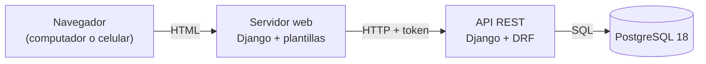

# AdMind — Informe de avance

| Dato               | Detalle                                             |
| ------------------ | --------------------------------------------------- |
| **Proyecto**       | AdMind — administración de conjuntos residenciales  |
| **Asignatura**     | Ingeniería de Software II                           |
| **Institución**    | Universidad de Cundinamarca, sede Facatativá        |
| **Integrantes**    | Manuel Alejandro Aldana Rincón · Camilo Remiso Niño |
| **Docente**        | OSCAR OCHOA                                         |
| **Fecha de corte** | 15 de septiembre de 2026                            |

---

## 1. Qué es AdMind

AdMind es una aplicación para administrar **conjuntos residenciales bajo régimen de propiedad horizontal en Colombia** (Ley 675 de 2001). Hoy muchos conjuntos se administran con grupos de WhatsApp y hojas de cálculo; AdMind reúne en un solo sistema la reserva de zonas comunes, los residentes y sus unidades, los anuncios y las solicitudes a la administración.

Se apoya en cuatro pilares:

- **Multiconjunto:** una sola plataforma para varios conjuntos, con los datos de cada uno aislados de los demás.
- **Reglas configurables:** cada conjunto configura sus reglas de reserva según su propio reglamento.
- **Reserva por orden de llegada:** bloqueo temporal de 3 minutos sobre una franja y aprobación humana.
- **El sistema registra, no decide:** en infracciones, dinero y lo que la ley reserva a la asamblea.

---

## 2. Tipo de aplicación

> [!IMPORTANT] AdMind es una aplicación **web**
> No es una aplicación móvil. Se usa desde el navegador, en computador o en celular, y las pantallas se adaptan al tamaño de la pantalla. No se desarrolla una app nativa para Android ni para iOS.

**Por qué web:** ______

Porque nos ofrece portabilidad y disponibilidad de funcionamiento en varios tipos de dispositivos sin sufrir limitaciones por arquitectura o OS

### 2.1 Cómo está armada

El sistema son **dos servidores** que se comunican por una API:

- **API (backend):** Django con Django REST Framework. Es el único que habla con la base de datos y donde viven las reglas del negocio.
- **Servidor web (frontend):** Django con plantillas HTML. Arma las pantallas que ve el usuario y le pide todos los datos a la API.



![[Pasted image 20260915122021.png]]

![[Pasted image 20260915122031.png]]

![[Pasted image 20260915122056.png]]

![[Pasted image 20260915122109.png]]
## 3. Entorno de trabajo y tecnologías

AdMind **no está desarrollado en .NET**: está hecho en **Python con el framework Django**. Aun así, respeta la organización por capas de la plantilla ASP.NET que se usó como referencia en clase

![[Pasted image 20260915122403.png]]
### 3.1 Tecnologías

| Aspecto                         | Qué usamos                                                              | Versión    |
| ------------------------------- | ----------------------------------------------------------------------- | ---------- |
| Lenguaje                        | Python                                                                  | 3.14       |
| Framework del backend           | Django (versión LTS, con soporte extendido)                             | 5.2.17     |
| API REST                        | Django REST Framework                                                   | 3.18       |
| Frontend                        | Django con plantillas HTML y CSS propio del sistema de diseño de AdMind | 5.2.17     |
| Conexión del front con la API   | requests                                                                | 2.34       |
| Base de datos                   | PostgreSQL                                                              | 18         |
| Conector de Python a PostgreSQL | psycopg                                                                 | 3.3        |
| Pruebas automáticas             | pytest + pytest-django                                                  | 9.1 / 4.14 |

### 3.2 Herramientas

| Para qué                              | Herramienta                                                               |
| ------------------------------------- | ------------------------------------------------------------------------- |
| Editor de código                      | Visual Studio Code, con un espacio de trabajo que abre los tres proyectos |
| Terminal                              | Git Bash                                                                  |
| Control de versiones                  | Git + GitHub                                                              |
| Diseño y consulta de la base de datos | DBeaver                                                                   |
| Seguimiento Scrum                     | Notion (ver §6)                                                           |
| Documentación                         | Obsidian, con la bóveda versionada en GitHub                              |
![[Pasted image 20260915122506.png]]

### 3.3 Equivalencia con .NET

| En la plantilla ASP.NET | En AdMind (Django) | Ejemplo en el código |
|---|---|---|
| `Controllers/` | `views.py` + `urls.py` | `apps/cuentas/views.py` |
| `Dtos/` | `serializers.py` | `apps/cuentas/serializers.py` |
| `Services/` | `servicios.py` | `apps/cuentas/servicios.py` |
| `Repositories/` | Managers del ORM de Django | `TokenDeSesion.objects`, `apps/comun/aislamiento/managers.py` |
| `Utilities/` | `apps/comun/` | `apps/comun/aislamiento/` |
| Entidades / modelos | `models.py` | `apps/personas/models.py` |
| `appsettings.json` | `config/settings.py` + archivo `.env` | `config/settings.py` |
| Paquetes NuGet | `requirements.txt` (pip) | `requirements.txt` |
| Migraciones de Entity Framework | Migraciones de Django | `apps/*/migrations/` |
| xUnit / NUnit | pytest | `apps/*/tests.py`, `tests/` |

![[Pasted image 20260915121644.png|462]]


---

## 4. Repositorios

El código y la documentación están en **tres repositorios separados** en la cuenta de GitHub `ZeroFour-04`:

| Repositorio | Qué contiene | Enlace |
|---|---|---|
| `Admind_Backend` | API REST (Django + Django REST Framework) | https://github.com/ZeroFour-04/Admind_Backend |
| `Admind_Front-End` | Servidor web con las pantallas | https://github.com/ZeroFour-04/Admind_Front-End |
| `Admind_Documentacion` | Documentación del proyecto (bóveda de Obsidian) | https://github.com/ZeroFour-04/Admind_Documentacion |
![[Pasted image 20260915121719.png|293]]
### 4.1 Modelo de ramas

Definido por el docente para los repositorios de código:

| Rama | Qué contiene |
|---|---|
| `main` | Lo entregado |
| `desarrollo` | Integración: los dos integrantes trabajan directamente aquí |
| `pruebas` | Lo terminado, listo para probar antes de pasar a `main` |

No se usan ramas por historia. Para no perder la trazabilidad, cada commit debe llevar el ID de la historia que avanza, por ejemplo `feat(reservas): bloqueo de 3 minutos [HU-11]`. El repositorio de documentación trabaja solo con `main`.

![[Pasted image 20260915121808.png]]

### 4.2 Backend
![[Pasted image 20260915122820.png]]

### 4.3 Frontend
![[Pasted image 20260915123034.png]]


### 4.4 Documentación

![[Pasted image 20260915122621.png]]


---

## 5. Estructura del proyecto

### 5.1 Espacio de trabajo

```
A D M I N D/
├── Backend/Admind_Backend/                repositorio de la API
├── Frontend/Admind_Front-End/             repositorio del servidor web
└── Documentacion/Admind_Documentacion/    repositorio de documentación (bóveda de Obsidian)
```

### 5.2 Backend

```
Admind_Backend/
├── config/                    Configuración del proyecto Django
│   ├── settings.py              Ajustes; la clave y la conexión a la base se leen de .env
│   ├── settings_pruebas.py      Ajustes para las pruebas automáticas
│   └── urls.py                  Rutas principales de la API (/auth/…)
├── apps/                      Una carpeta por módulo del sistema
│   ├── personas/                Persona única por documento
│   ├── cuentas/                 Usuario, inicio de sesión y token
│   │   ├── models.py              Entidades
│   │   ├── serializers.py         Validación de entrada y salida (DTO)
│   │   ├── views.py               Controladores de la API
│   │   ├── servicios.py           Lógica de negocio
│   │   ├── autenticacion.py       Validación del token en cada petición
│   │   └── tests.py               Pruebas
│   ├── conjuntos/               Conjunto residencial
│   ├── permisos/                Catálogo de roles y permisos, y asignaciones
│   ├── comun/                   Piezas compartidas
│   │   ├── aislamiento/           Filtro de datos por conjunto
│   │   └── modelos_base/          Modelo base de toda tabla que pertenece a un conjunto
│   └── areas/, reservas/, …     Módulos siguientes, por ahora solo con su README
├── tests/                     Pruebas transversales (aislamiento y tablas globales)
├── manage.py
├── pytest.ini
└── requirements.txt
```

### 5.3 Frontend

```
Admind_Front-End/
├── config/                    Configuración; la dirección de la API se lee de .env
├── cliente_api/               Único punto que llama a la API
│   ├── http.py                  Envía cada petición con el token y traduce los errores
│   └── cuentas.py               Iniciar y cerrar sesión
├── apps/                      Una carpeta por módulo de pantallas
│   ├── cuentas/                 Ingreso, salida y recuperar contraseña
│   ├── conjuntos/               Selector de conjunto
│   ├── paneles/                 Inicio
│   ├── reservas/                Calendario de zonas comunes
│   └── reglas/, anuncios/, triage/, unidades/
├── templates/                 Plantillas base y componentes (barra superior, menú lateral)
├── static/css/                Estilos propios
├── design-system/             Colores, tipografía y espaciado del sistema de diseño
├── manage.py
└── requirements.txt
```

### 5.4 Flujo por capas

Toda petición a la API sigue el mismo recorrido: **controlador → servicio → repositorio**. La vista no consulta la base directamente y el servicio no sabe nada de HTTP. Ejemplo real, el inicio de sesión:

```
POST /auth/login/
   │
   ▼
urls.py → views.py (IniciarSesionView)       Controlador: recibe la petición HTTP
             │ valida con serializers.py      DTO: revisa correo y contraseña
             ▼
          servicios.py (iniciar_sesion)       Servicio: comprueba la cuenta y crea la sesión
             │
             ▼
          TokenDeSesion.objects               Repositorio: guarda la sesión en PostgreSQL
```


### 5.5 Base de datos

Las tablas se crean con las migraciones de Django sobre PostgreSQL:

| Tabla | Qué guarda |
|---|---|
| `personas_persona` | Personas, únicas por tipo y número de documento |
| `cuentas_usuario` | Cuentas de acceso: correo y contraseña cifrada |
| `cuentas_tokendesesion` | Sesiones abiertas: token, conjunto activo y vencimiento |
| `conjuntos_conjunto` | Conjuntos residenciales |
| `permisos_asignacion` | Rol de cada persona en cada conjunto, con fechas de vigencia |


---

## 6. Herramienta de seguimiento

El seguimiento Scrum se lleva en **Notion**, en el espacio **Gestión Scrum — AdMind**:

| Base de datos | Qué contiene |
|---|---|
| Historias de Usuario | Las 38 historias del backlog (188 story points), cada una con prioridad, sprint previsto, estado, criterios de aceptación y tareas técnicas |
| Sprints | Los sprints del proyecto |

Cada historia pasa por los estados *Sin empezar*, *En progreso*, *En revisión* y *Finalizado*. Además, el archivo `Admind_Avance.md` del repositorio de documentación registra el avance técnico de cada historia con el commit que lo respalda.
![[Pasted image 20260915123347.png]]

---

## 7. Avance a la fecha

### 7.1 Resumen

| Frente | Estado al 15 de septiembre |
|---|---|
| **Backend** | Personas, usuarios, conjuntos, asignaciones de rol y sesiones en PostgreSQL. Catálogo de roles y permisos. Aislamiento de datos entre conjuntos. Endpoints de inicio de sesión, cierre de sesión y selección de conjunto |
| **Frontend** | Ingreso y salida funcionando contra la API. El resto de pantallas son maquetas con datos de ejemplo, todavía sin conectar |
| **Pruebas** | 69 pruebas automáticas en el backend, todas pasan. El frontend aún no tiene pruebas automáticas |
| **Historias** | 7 de 38 en progreso, 0 terminadas |

> [!NOTE] Por qué 0 historias terminadas
> Una historia cuenta como terminada solo cuando cumple la Definición de Terminado: además de sus tareas, necesita la revisión del otro integrante (pull request de `desarrollo` a `pruebas`) y una prueba manual de quien no la programó. HU-04 y HU-05 ya tienen todas sus tareas, pero aún les falta ese paso.

### 7.2 Endpoints disponibles en la API

| Método | Ruta | Qué hace |
|---|---|---|
| `POST` | `/auth/login/` | Inicia sesión con correo y contraseña; devuelve el token, el conjunto activo y los permisos |
| `POST` | `/auth/logout/` | Cierra la sesión |
| `GET` | `/auth/conjuntos/` | Lista los conjuntos donde la persona tiene un rol vigente |
| `POST` | `/auth/conjunto-activo/` | Cambia el conjunto con el que se está trabajando |

### 7.3 Historias en progreso

| HU | Historia | Tareas hechas |
|---|---|---|
| HU-01 | Inicio de sesión con correo y contraseña | 4 de 5 |
| HU-02 | Segundo factor (TOTP) para permisos sensibles | 1 de 5 |
| HU-03 | Asistente por pasos para crear un conjunto | 1 de 5 |
| HU-04 | Persona global única por documento | 5 de 5, falta revisión y prueba manual |
| HU-05 | Aislamiento de datos entre conjuntos | 5 de 5, falta revisión y prueba manual |
| HU-06 | Asignación de roles del catálogo fijo | 3 de 5 |
| HU-26 | Selector de conjunto activo | 3 de 5 |


