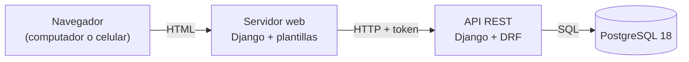

# AdMind — Informe de avance 2

| Dato               | Detalle                                             |
| ------------------ | --------------------------------------------------- |
| **Proyecto**       | AdMind — administración de conjuntos residenciales  |
| **Asignatura**     | Ingeniería de Software II                           |
| **Institución**    | Universidad de Cundinamarca, sede Facatativá        |
| **Integrantes**    | Manuel Alejandro Aldana Rincón · Camilo Remiso Niño |
| **Docente**        | OSCAR OCHOA                                         |
| **Fecha de corte** | 22 de septiembre de 2026 (corte inicial: 21 de septiembre) |
| **Informe anterior** | 15 de septiembre de 2026                          |

---

## 1. Qué es AdMind

AdMind es una aplicación para administrar **conjuntos residenciales bajo régimen de propiedad horizontal en Colombia** (Ley 675 de 2001). Hoy muchos conjuntos se administran con grupos de WhatsApp y hojas de cálculo; AdMind reúne en un solo sistema la reserva de zonas comunes, los residentes y sus unidades, los anuncios y las solicitudes a la administración.

Se apoya en cuatro pilares:

- **Multiconjunto:** una sola plataforma para varios conjuntos, con los datos de cada uno aislados de los demás.
- **Reglas configurables:** cada conjunto configura sus reglas de reserva según su propio reglamento.
- **Reserva por orden de llegada:** bloqueo temporal de 3 minutos sobre una franja y aprobación humana.
- **El sistema registra, no decide:** en infracciones, dinero y lo que la ley reserva a la asamblea.

---

## 2. Tipo de aplicación

> [!IMPORTANT] AdMind es una aplicación **web**
> No es una aplicación móvil. Se usa desde el navegador, en computador o en celular, y las pantallas se adaptan al tamaño de la pantalla. No se desarrolla una app nativa para Android ni para iOS.

**Por qué web:** porque ofrece portabilidad y funciona en varios tipos de dispositivos sin limitaciones de arquitectura ni de sistema operativo.

### 2.1 Cómo está armada

El sistema son **dos servidores** que se comunican por una API:

- **API (backend):** Django con Django REST Framework. Es el único que habla con la base de datos y donde viven las reglas del negocio.
- **Servidor web (frontend):** Django con plantillas HTML. Arma las pantallas que ve el usuario y le pide todos los datos a la API.



![[Pasted image 20260915122021.png]]


| ![[Pasted image 20260922115539.png\|374]] | ![[Pasted image 20260922115637.png\|373]] |
| ----------------------------------------- | ----------------------------------------- |
|                                           |                                           |

> [!TODO] Capturas nuevas para esta sección
> Desde el informe anterior hay más pantallas nuevas. Faltan capturas de: **selector de conjunto** (cada tarjeta con su color), **asistente de creación** (los tres pasos), **verificación en dos pasos** (QR, códigos de respaldo y verificar), **recuperar contraseña**, la **identidad del conjunto** (color y logo), el **tablón de anuncios** y la **bandeja de notificaciones**.


### Creacion de Conjunto y tematizacion

![[Pasted image 20260922120118.png]]
---
![[Pasted image 20260922121837.png]]
![[Pasted image 20260922121928.png]]

## Logo Admind
![[Pasted image 20260922122105.png|461]]
Estamos trabajando en el isotipo de 2 colores para el aplicativo pero todavia esta en desarrollo, los colores de la empresa seran verde oscuro y azul cobalto.
## 3. Entorno de trabajo y tecnologías

AdMind **no está desarrollado en .NET**: está hecho en **Python con el framework Django**. Aun así, respeta la organización por capas de la plantilla ASP.NET que se usó como referencia en clase.

![[Pasted image 20260922122031.png]]

### 3.1 Tecnologías

Desde el informe anterior entran `django-otp` y `qrcode` para el segundo factor. El servidor web suma `pytest` y `pytest-django` para sus propias pruebas automáticas.

| Aspecto                         | Qué usamos                                                              | Versión    |
| ------------------------------- | ----------------------------------------------------------------------- | ---------- |
| Lenguaje                        | Python                                                                  | 3.14       |
| Framework del backend           | Django (versión LTS, con soporte extendido)                             | 5.2.17     |
| API REST                        | Django REST Framework                                                   | 3.18       |
| Frontend                        | Django con plantillas HTML y CSS propio del sistema de diseño de AdMind | 5.2.17     |
| Conexión del front con la API   | requests                                                                | 2.34       |
| Base de datos                   | PostgreSQL                                                              | 18         |
| Conector de Python a PostgreSQL | psycopg                                                                 | 3.3        |
| Pruebas automáticas (backend)   | pytest + pytest-django                                                  | 9.1 / 4.14 |
| Pruebas automáticas (frontend)  | pytest + pytest-django, nuevas en este corte                            | 9.1 / 4.14 |
| Segundo factor (TOTP)           | django-otp, la librería que fija el maestro §7.1                        | 1.7        |
| Código QR del segundo factor    | qrcode, en SVG para no depender de librerías de imágenes                | 8.2        |

### 3.2 Herramientas

| Para qué                              | Herramienta                                                               |
| ------------------------------------- | ------------------------------------------------------------------------- |
| Editor de código                      | Visual Studio Code, con un espacio de trabajo que abre los tres proyectos |
| Terminal                              | Git Bash                                                                  |
| Control de versiones                  | Git + GitHub                                                              |
| Diseño y consulta de la base de datos | DBeaver                                                                   |
| Seguimiento Scrum                     | Notion (ver §6)                                                           |
| Documentación                         | Obsidian, con la bóveda versionada en GitHub                              |

### 3.3 Equivalencia con .NET

| En la plantilla ASP.NET | En AdMind (Django) | Ejemplo en el código |
|---|---|---|
| `Controllers/` | `views.py` + `urls.py` | `apps/cuentas/views.py` |
| `Dtos/` | `serializers.py` | `apps/cuentas/serializers.py` |
| `Services/` | `servicios.py` | `apps/cuentas/servicios.py` |
| `Repositories/` | Managers del ORM de Django | `TokenDeSesion.objects`, `apps/comun/aislamiento/managers.py` |
| `Utilities/` | `apps/comun/` | `apps/comun/aislamiento/` |
| Entidades / modelos | `models.py` | `apps/personas/models.py` |
| `appsettings.json` | `config/settings.py` + archivo `.env` | `config/settings.py` |
| Paquetes NuGet | `requirements.txt` (pip) | `requirements.txt` |
| Migraciones de Entity Framework | Migraciones de Django | `apps/*/migrations/` |
| xUnit / NUnit | pytest | `apps/*/tests.py`, `tests/` |

---

## 4. Repositorios

El código y la documentación están en **tres repositorios separados** en la cuenta de GitHub `ZeroFour-04`:

| Repositorio | Qué contiene | Enlace | Último commit al corte |
|---|---|---|---|
| `Admind_Backend` | API REST (Django + Django REST Framework) | https://github.com/ZeroFour-04/Admind_Backend | `eab833e` "sprint 1 terminado", en `desarrollo` (21/09 22:20) |
| `Admind_Front-End` | Servidor web con las pantallas | https://github.com/ZeroFour-04/Admind_Front-End | `c796773` "sprint 1 terminado", en `desarrollo` (21/09 22:19) |
| `Admind_Documentacion` | Documentación del proyecto (bóveda de Obsidian) | https://github.com/ZeroFour-04/Admind_Documentacion | `3db32b2`, en `main` (21/09 22:21) |

> [!IMPORTANT] Lo que trae este informe todavía no tiene commit
> El 22/09 se construyeron HU-21 (identidad del conjunto: color y logo) y HU-25 (anuncios con alcance de conjunto o vivienda), con el canal de notificaciones y lo mínimo de unidades que necesitan. Es el trabajo que aparece en el §5, el §7.2 y el §7.4. Sigue en las copias locales de `Admind_Backend` y `Admind_Front-End`, en la rama `desarrollo`, **sin commit todavía**.

![[Pasted image 20260915121644.png|462]]

### 4.1 Modelo de ramas

Definido por el docente para los repositorios de código:

| Rama | Qué contiene |
|---|---|
| `main` | Lo entregado |
| `desarrollo` | Integración: los dos integrantes trabajan directamente aquí |
| `pruebas` | Lo terminado, listo para probar antes de pasar a `main` |

No se usan ramas por historia. Para no perder la trazabilidad, cada commit debe llevar el ID de la historia que avanza, por ejemplo `feat(reservas): bloqueo de 3 minutos [HU-11]`. El repositorio de documentación trabaja solo con `main`.

**Estado al corte:**
- El trabajo hasta el 21/09 (Sprint 1 completo y HU-06) está en `desarrollo` y subido a GitHub. `main` sigue con la versión inicial de cada repositorio: del 11/09 en el backend y del 07/09 en el front.
- En el backend existe una rama `pruebas` local, pero quedó desactualizada (5 commits detrás de `desarrollo`) y nunca se volvió a subir a GitHub. En el front existe en GitHub, pero sigue igual a `main`.
- Ninguna historia ha pasado todavía de `desarrollo` a `pruebas` por un pull request.

### 4.2 Documentación

La bóveda de documentación está organizada en carpetas:

```
Admind_Documentacion/
├── Admin_Master.md                     Documento maestro: fuente de verdad del producto
├── Avance/
│   ├── Admind_Avance.md                  Estado técnico por historia, con el commit que lo respalda
│   ├── Avance DDMMAAAA.md                Fotos fijas de texto para el equipo y los agentes de IA (no para el docente)
│   └── Informes/
│       ├── 2026-09-15/                   Informe 1 y sus capturas
│       └── 2026-09-21/                   Este informe
├── Guias/
│   ├── Admind_Guia_Desarrollo.md         Cómo se construye dentro de la arquitectura
│   ├── Admind_Backend_Inicializacion.md  Cómo se creó el backend
│   └── Admind_Backend_Instalacion_Local.md  Cómo correr el backend en otra PC
├── Lab/                                Laboratorio de práctica y su seguimiento
├── Bitacora/                           Errores encontrados y lo que se aprendió
├── Notas/                              Notas de reuniones
└── Credenciales/
```

---

## 5. Estructura del proyecto

### 5.1 Espacio de trabajo

```
A D M I N D/
├── Backend/Admind_Backend/                repositorio de la API
├── Frontend/Admind_Front-End/             repositorio del servidor web
└── Documentacion/Admind_Documentacion/    repositorio de documentación (bóveda de Obsidian)
```

### 5.2 Backend

```
Admind_Backend/
├── config/                    Configuración del proyecto Django
│   ├── settings.py              Ajustes; la clave y la conexión a la base se leen de .env
│   ├── settings_pruebas.py      Ajustes para las pruebas automáticas
│   └── urls.py                  Rutas raíz: /auth/, /conjuntos/, /unidades/, /notificaciones/, /anuncios/
├── apps/                      Una carpeta por módulo del sistema
│   ├── personas/                Persona única por documento
│   ├── cuentas/                 Usuario, sesión, recuperación de contraseña, segundo factor y usuarios
│   │   ├── models.py              Entidades
│   │   ├── serializers.py         Validación de entrada y salida (DTO)
│   │   ├── views.py               Controladores de la API
│   │   ├── servicios.py           Lógica de negocio: sesión, usuarios y recuperación
│   │   ├── dos_factores.py        Lógica de negocio del segundo factor
│   │   ├── autenticacion.py       Validación del token en cada petición
│   │   ├── permisos.py            Bloquea la API hasta verificar el segundo factor
│   │   ├── management/            Comando `crear_usuarios_prueba` (solo con DEBUG, no es una HU)
│   │   └── tests.py, test_dos_factores.py   Pruebas
│   ├── conjuntos/               Conjunto residencial, asistente de creación e identidad
│   │   ├── servicios.py           Crear, editar, requisitos, activación, color y logo
│   │   └── views.py, urls.py      /conjuntos/…
│   ├── permisos/                Catálogo de roles y permisos, y asignaciones
│   ├── unidades/                Viviendas y vínculos de las personas con ellas (lo mínimo que necesita HU-25)
│   ├── notificaciones/          Canal interno: bandeja de la persona, con envío también por correo
│   ├── anuncios/                Tablón con alcance de conjunto o de una vivienda
│   ├── comun/                   Piezas compartidas
│   │   ├── aislamiento/           Filtro de datos por conjunto
│   │   └── modelos_base/          Modelo base de toda tabla que pertenece a un conjunto
│   └── areas/, reservas/, …     Módulos siguientes, por ahora solo con su README
├── tests/                     Pruebas transversales (aislamiento y tablas globales)
├── manage.py
├── pytest.ini
└── requirements.txt
```

### 5.3 Frontend

```
Admind_Front-End/
├── config/                    Configuración; la dirección de la API se lee de .env
├── cliente_api/               Único punto que llama a la API
│   ├── http.py                  Envía cada petición con el token y traduce los errores
│   ├── cuentas.py               Sesión, usuarios, recuperación y segundo factor
│   ├── conjuntos.py             Asistente de creación e identidad (color y logo)
│   ├── anuncios.py              Tablón de anuncios
│   └── notificaciones.py, unidades.py   Bandeja y unidades del conjunto activo
├── apps/                      Una carpeta por módulo de pantallas
│   ├── cuentas/                 Ingreso, salida, recuperar contraseña y segundo factor
│   ├── conjuntos/               Selector con el color de cada conjunto, asistente de creación e identidad
│   ├── usuarios/                Lista, detalle y creación de usuarios, conectado a la API
│   ├── anuncios/                Tablón: lista, publicar y editar, conectado a la API
│   ├── notificaciones/          Bandeja de avisos, conectada a la API
│   ├── paneles/                 Inicio
│   ├── reservas/                Calendario de zonas comunes
│   └── reglas/, triage/, unidades/   Maquetas
├── templates/                 Plantillas base y componentes (barra superior, menú lateral, campo de formulario)
├── static/css/                Estilos propios
├── design-system/             Colores (los 8 acentos por conjunto), tipografía y espaciado
├── tests/                     Pruebas automáticas del servidor web, nuevas en este corte
├── manage.py
└── requirements.txt
```

### 5.4 Flujo por capas

Toda petición a la API sigue el mismo recorrido: **controlador → servicio → repositorio**. La vista no consulta la base directamente y el servicio no sabe nada de HTTP. Ejemplo real, el inicio de sesión:

```
POST /auth/login/
   │
   ▼
urls.py → views.py (IniciarSesionView)       Controlador: recibe la petición HTTP
             │ valida con serializers.py      DTO: revisa correo y contraseña
             ▼
          servicios.py (iniciar_sesion)       Servicio: comprueba la cuenta y crea la sesión
             │
             ▼
          TokenDeSesion.objects               Repositorio: guarda la sesión en PostgreSQL
```

Los módulos nuevos (`conjuntos` para identidad, `anuncios`, `notificaciones`, `unidades`) siguen el mismo recorrido: la vista solo exige el permiso y llama al servicio.

### 5.5 Base de datos

Las tablas se crean con las migraciones de Django sobre PostgreSQL. Todas están aplicadas en la base local de Alejo (0 migraciones pendientes al corte):

| Tabla | Qué guarda |
|---|---|
| `personas_persona` | Personas, únicas por tipo y número de documento |
| `cuentas_usuario` | Cuentas de acceso: correo y contraseña cifrada |
| `cuentas_tokendesesion` | Sesiones abiertas: token, conjunto activo, segundo factor verificado y vencimiento |
| `conjuntos_conjunto` | Conjuntos residenciales, con `acento` (uno de los 8 del catálogo) y la huella del logo |
| `conjuntos_logodeconjunto` | La imagen del logo, en una tabla aparte para no cargarla al leer el conjunto |
| `permisos_asignacion` | Rol de cada persona en cada conjunto, con fechas de vigencia |
| `otp_totp_totpdevice` | Secreto del segundo factor de cada cuenta |
| `otp_static_staticdevice`, `otp_static_statictoken` | Códigos de respaldo del segundo factor |
| `unidades_unidad`, `unidades_vinculounidad` | Viviendas del conjunto y la posición jurídica de cada persona sobre ellas (lo mínimo para HU-25; el resto es de HU-08) |
| `notificaciones_notificacion` | Bandeja de avisos de cada persona |
| `anuncios_anuncio` | Tablón, con alcance de todo el conjunto o de una vivienda |

Las tablas de `django-otp` y las nuevas de este corte entraron a la **lista cerrada de tablas globales** (sin `conjunto_id`) donde corresponde: el segundo factor es de la cuenta, que es global.

---

## 6. Herramienta de seguimiento

El seguimiento Scrum se lleva en **Notion**, en el espacio **Gestión Scrum — AdMind**:

| Base de datos | Qué contiene |
|---|---|
| Historias de Usuario | Las 38 historias del backlog (188 story points), cada una con prioridad, sprint previsto, estado, criterios de aceptación y tareas técnicas |
| Sprints | Los 7 sprints del proyecto, con las historias de cada uno |

Cada historia pasa por los estados *Sin empezar*, *En progreso*, *En revisión* y *Finalizado*. El archivo `Admind_Avance.md` del repositorio de documentación registra el avance técnico de cada historia con el commit que lo respalda.

### 6.1 Estado de las historias al corte (22/09)
![[Pasted image 20260922115444.png]]

| Estado en Notion | Historias | SP |
|---|---|---|
| **Finalizado** | HU-01, HU-03, HU-04, HU-05, HU-06, HU-21, HU-25, HU-26 (8) | **36** |
| **En revisión** | HU-02 (1) | 5 |
| **Sin empezar** | Las 29 restantes | 147 |
| **Total** | **38** | **188** |

> [!NOTE] Avance frente a los cortes anteriores
> | Corte | Historias Finalizado | SP |
> |---|---|---|
> | 15/09 (informe 1) | 0 de 38 | 0 de 188 |
> | 21/09 (borrador de este informe) | 0 de 38 | 0 de 188 |
> | **22/09 (este informe)** | **8 de 38** | **36 de 188** |

**Cambios en Notion desde el informe anterior:**
- **HU-01, HU-03, HU-04, HU-05, HU-06 y HU-26** —las seis del Sprint 1 más HU-06— pasan a **Finalizado**.
- **HU-02** pasa a **En revisión**.
- **HU-21** (identidad del conjunto: color y logo) y **HU-25** (anuncios con alcance de conjunto o vivienda) se construyen el 22/09 y quedan **Finalizado** el mismo día.
- El Sprint 1 y el Sprint 5 (donde caen HU-21 y HU-25) figuran *En curso* en la base de datos de Sprints.


---

## 7. Avance a la fecha

### 7.1 Resumen

| Frente | Estado al 22 de septiembre |
|---|---|
| **Backend** | Personas, usuarios, conjuntos, asignaciones de rol y sesiones en PostgreSQL. Catálogo de roles y permisos. Aislamiento de datos entre conjuntos. Recuperación de contraseña, segundo factor TOTP, asistente de creación de conjuntos, identidad del conjunto (color y logo), canal de notificaciones y tablón de anuncios |
| **Frontend** | Conectados a la API: ingreso y salida, recuperar contraseña, segundo factor, selector de conjunto con su color, asistente de creación, usuarios, identidad del conjunto, tablón de anuncios y bandeja de notificaciones. Inicio, zonas comunes, reglas, solicitudes y unidades siguen siendo maquetas |
| **Pruebas** | Backend: **171 pruebas, todas pasan**. Frontend: **51 pruebas, todas pasan** (nuevas en este corte; el informe 1 no tenía ninguna) |
| **Historias (Notion)** | **8 de 38 Finalizado (36 SP) · 1 En revisión (5 SP) · 29 sin empezar** |
| **Repositorios** | El trabajo hasta el 21/09 (Sprint 1 completo y HU-06) está commiteado y en GitHub. El de HU-21 y HU-25 (22/09) sigue en las copias locales, sin commit |

### 7.2 Estado de las pruebas

**Backend — 171 pruebas, todas pasan:**

| Grupo | Pruebas | Qué cubre |
|---|---|---|
| `apps/personas` | 10 | Persona única por documento (HU-04) |
| `apps/cuentas` | 31 | Sesión, selector, usuarios del conjunto activo y recuperación de contraseña (HU-01, HU-04, HU-26) |
| `apps/cuentas` (segundo factor) | 15 | Quién lo necesita, activarlo, verificarlo, código repetido, vencido y de respaldo (HU-02) |
| `apps/conjuntos` | 19 | Asistente, color, quién crea y quién activa, requisitos (HU-03, HU-26) |
| `apps/conjuntos` (identidad) | 19 | Color, subir y quitar el logo, validación del archivo por su firma, imagen por huella (HU-21) |
| `apps/permisos` | 21 | Catálogo, asignaciones y permisos efectivos (HU-06) |
| `apps/anuncios` | 11 | Alcance de conjunto o vivienda, quién publica y quién edita (HU-25) |
| `apps/notificaciones` | 5 | Bandeja y disparo único por hecho (HU-25) |
| `apps/unidades` | 10 | Unidad y vínculo vigente, lo mínimo que necesita HU-25 |
| `tests/aislamiento` | 27 | Filtro por conjunto, prueba del intruso por endpoint y revisión de todas las rutas (HU-05) |
| `tests/esquema` | 3 | Lista cerrada de tablas globales (HU-05) |
| **Total** | **171** | **Todas pasan** |

**Frontend — 51 pruebas, todas pasan** (`tests/test_acentos.py`, `tests/test_identidad.py`, `tests/test_anuncios.py`): contraste de los 8 acentos, identidad del conjunto (color y logo, incluido el error 403 sin permiso) y el tablón de anuncios. El resto de pantallas —ingreso, selector, segundo factor, usuarios— sigue verificándose a mano contra la API real, como en el informe anterior.

### 7.3 Qué cambió desde el 15 de septiembre

| Fecha | Repositorio | Commit | Qué trae |
|---|---|---|---|
| 15/09 | Front | `7f68d14` | Borra `index.html` y la plantilla de variables de entorno `.env _ejemplo` |
| 16/09 | Documentación | `306e5a6` | Informe de avance 1 |
| 18/09 | Front | `388b07a`, `4155b53` | Borra un HTML de prueba; la marca "AdMind" lleva al selector |
| 20/09 | Backend | `a8e617e` | Crear conjuntos y usuarios por la API, permiso `usuario.gestionar` |
| 20/09 | Front | `19e52f9` | Selector conectado a la API, pantalla Crear conjunto y módulo Usuarios |
| 21/09 22:20 | Backend | `eab833e` | Recuperación de contraseña, segundo factor, asistente de conjuntos, color por conjunto, usuarios limitados al conjunto activo y `exigir_permiso()` en las vistas. 47 pruebas nuevas |
| 21/09 22:19 | Front | `c796773` | Pantallas de recuperación, segundo factor y asistente; selector con colores; entrada directa con un solo conjunto |
| 21/09 22:21 | Documentación | `3db32b2` | Bóveda organizada en carpetas e informe 2 |
| 22/09 | Notion | — | HU-01, HU-03, HU-04, HU-05, HU-06 y HU-26 pasan a Finalizado; HU-02 a En revisión; HU-21 y HU-25 se construyen y quedan Finalizado (§6) |
| 22/09 | Backend y Front | sin commit | Identidad del conjunto (color y logo), canal de notificaciones, tablón de anuncios y lo mínimo de unidades. 51 pruebas nuevas en el backend (171 en total) y 51 pruebas nuevas en el front (antes no tenía ninguna) |

**Decisiones del 21/09:**

| Decisión | Quién | Dónde quedó |
|---|---|---|
| **Administración también crea conjuntos**, para darle más autonomía. Quien crea un conjunto desde Administración queda como su Administración. Solo el Superusuario ve todos los conjuntos de la plataforma | Alejo y Camilo | Código; falta llevarlo al maestro §3.1 y §5.3, que dicen que `conjunto.crear` es solo del Superusuario |
| **Color por conjunto** con el catálogo de 8 acentos del maestro §6.3. Revierte el "un solo acento" del 11/09 | Alejo | Código; falta quitar el aviso de "aplazado" del maestro §6.3 |
| **HU-03 como asistente parcial**, sin partir la historia | Alejo | Notion, HU-03 |

**Decisiones del 22/09:**

| Decisión | Quién | Dónde quedó |
|---|---|---|
| **HU-21 con los 8 acentos y logo** (no color hexadecimal libre); el logo se valida por la firma del archivo, no por lo que declara quien lo sube | Alejo | Código; Notion, HU-21 |
| **HU-25 con lo mínimo** de HU-08 (unidades y vínculos) y del canal de notificaciones, sin construir esos módulos completos | Alejo | Código; Notion, HU-25 |

### 7.4 Endpoints disponibles en la API

| Método | Ruta | Qué hace | Desde |
|---|---|---|---|
| `POST` | `/auth/login/` | Inicia sesión; devuelve el token, el conjunto activo, los permisos y si falta el segundo factor | 15/09 |
| `POST` | `/auth/logout/` | Cierra la sesión | 15/09 |
| `GET` | `/auth/conjuntos/` | Conjuntos donde puede operar: los de sus roles; el Superusuario, todos | 15/09 |
| `POST` | `/auth/conjunto-activo/` | Cambia el conjunto con el que se está trabajando | 15/09 |
| `GET` / `POST` | `/auth/usuarios/` | Lista o crea cuentas con un rol en el conjunto activo. Exige `usuario.gestionar` | 20/09 |
| `GET` | `/auth/usuarios/<id>/` | Una cuenta del conjunto activo; 404 si es de otro | 20/09 |
| `POST` | `/auth/recuperar/` | Envía el enlace de recuperación por correo | 21/09 |
| `POST` | `/auth/recuperar/confirmar/` | Cambia la contraseña con el enlace y cierra las sesiones abiertas | 21/09 |
| `POST` | `/auth/dos-factores/configurar/` | Genera el QR del segundo factor | 21/09 |
| `POST` | `/auth/dos-factores/activar/` | Lo activa con el primer código y entrega 10 códigos de respaldo | 21/09 |
| `POST` | `/auth/dos-factores/verificar/` | Verifica el código en cada ingreso | 21/09 |
| `POST` | `/conjuntos/` | Paso 1 del asistente: crea el conjunto y lo deja como activo. Exige `conjunto.crear` | 21/09 |
| `GET` / `PATCH` | `/conjuntos/actual/` | Resumen del asistente y edición de los datos del conjunto activo | 21/09 |
| `POST` | `/conjuntos/actual/activar/` | Lo deja operativo si cumple los requisitos | 21/09 |
| `GET` / `PATCH` | `/conjuntos/actual/identidad/` | Nombre, dirección y color del conjunto activo. Exige `conjunto.branding` o `conjunto.activar` | 22/09 |
| `PUT` / `DELETE` | `/conjuntos/actual/identidad/logo/` | Sube o quita el logo, validado por la firma del archivo, hasta 512 KB | 22/09 |
| `GET` | `/conjuntos/logos/<huella>/` | La imagen del logo por su huella; 404 si no es de un conjunto donde la persona puede operar | 22/09 |
| `GET` | `/unidades/` | Unidades del conjunto activo. Exige `vinculo.gestionar` o `anuncio.dirigir` | 22/09 |
| `GET` | `/notificaciones/` | Bandeja de avisos de la persona en el conjunto activo | 22/09 |
| `GET` / `POST` | `/anuncios/` | Lista el tablón o publica un anuncio, con alcance de conjunto o de vivienda | 22/09 |
| `GET` / `PATCH` | `/anuncios/<id>/` | Detalle de un anuncio; solo el autor puede editarlo | 22/09 |

Cada ruta está documentada en el README de su app en el backend.

### 7.5 Historias de usuario al corte

**Finalizado en Notion (8 historias, 36 SP):**

| HU | Historia | SP | Qué construye |
|---|---|---|---|
| HU-01 | Inicio de sesión con correo y contraseña | 3 | Login con token, recuperación de contraseña por correo con enlace de un solo uso |
| HU-03 | Asistente por pasos para crear un conjunto | 6 | Asistente en tres pasos (datos, administración, resumen) con guardado parcial y activación |
| HU-04 | Persona global única por documento | 3 | `Persona` única por tipo y número de documento, identificada por UUID |
| HU-05 | Aislamiento de datos entre conjuntos | 2 | Filtro por conjunto en tres capas y prueba del intruso por endpoint |
| HU-06 | Asignación de roles del catálogo fijo | 6 | Catálogo de 6 roles y 46 permisos en código, `Asignacion` con vigencias y permisos efectivos |
| HU-21 | Identidad visual del conjunto: color y logo | 4 | Color de la lista cerrada de 8 acentos y logo validado por la firma del archivo |
| HU-25 | Anuncios con alcance de conjunto o vivienda | 6 | Tablón con dos alcances y canal de notificaciones (bandeja + correo) |
| HU-26 | Selector de conjunto activo | 6 | Selección automática con un solo conjunto, o pantalla con el color de cada uno |

**En revisión en Notion (1 historia, 5 SP):**

| HU | Historia | SP | Qué construye |
|---|---|---|---|
| HU-02 | Segundo factor (TOTP) para permisos sensibles | 5 | `django-otp`, QR de vinculación, 10 códigos de respaldo, obligatorio con algún permiso sensible |

**Sin empezar (29 historias, 147 SP):** el resto del backlog, con la reserva de zonas comunes (HU-09 a HU-19) como el bloque de mayor prioridad todavía sin tocar.

### 7.6 Pendientes

**Para cerrar el Sprint 1 y seguir**

- [x] Commit y subida del trabajo del 21/09 en los tres repositorios (`eab833e`, `c796773`, `3db32b2`).
- [x] Commit y subida del trabajo de HU-21 y HU-25 (22/09).
- [x] `migrate` en la base de Alejo: 0 migraciones pendientes al corte.

**Técnicos**

- [x] Registrar las rutas de usuarios en la prueba del intruso.
- [x] Corregir los errores 500 al crear un usuario con documento repetido o sin conjunto activo.
- [x] `GET /auth/usuarios/` ya solo lista las cuentas del conjunto activo.
- [ ] Límite de intentos en `/auth/recuperar/`.
- [ ] Pruebas automáticas del front para las pantallas que todavía no las tienen (ingreso, selector, segundo factor, usuarios).