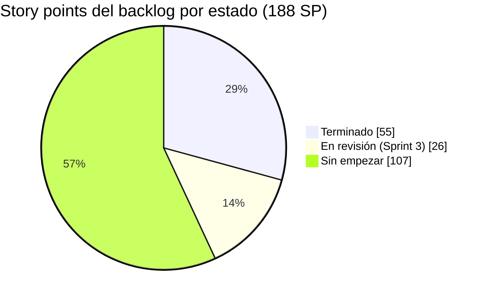
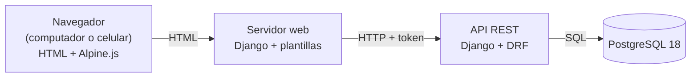
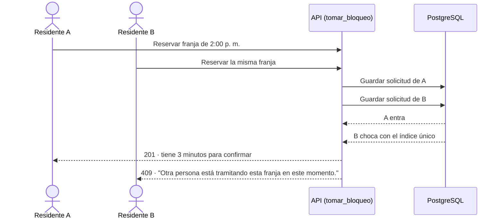
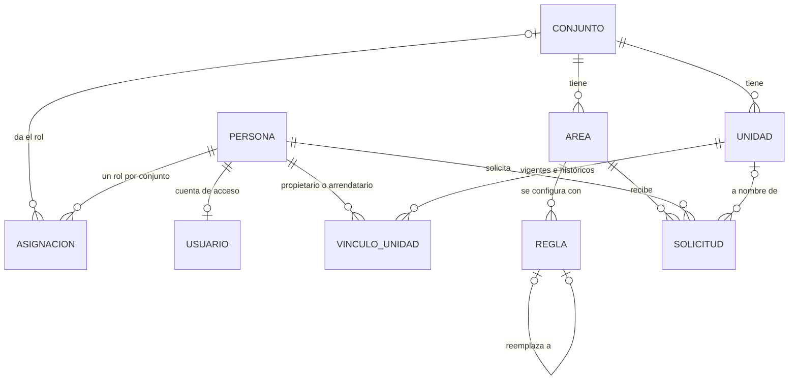
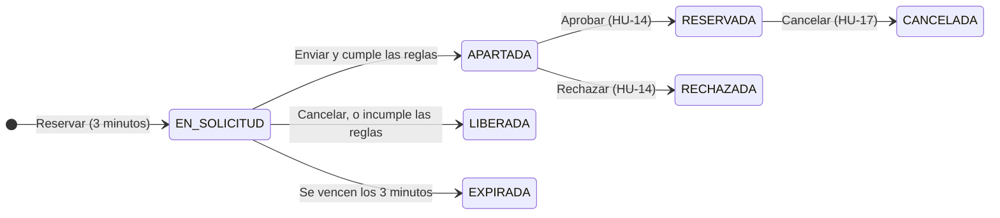

# AdMind — Informe de avance 3

| Dato                 | Detalle                                               |
| -------------------- | ----------------------------------------------------- |
| **Proyecto**         | AdMind — administración de conjuntos residenciales    |
| **Asignatura**       | Ingeniería de Software II                             |
| **Institución**      | Universidad de Cundinamarca, sede Facatativá          |
| **Integrantes**      | Manuel Alejandro Aldana Rincón · Camilo Remiso Niño   |
| **Docente**          | OSCAR OCHOA                                           |
| **Fecha de corte**   | 29 de septiembre de 2026                              |
| **Informe anterior** | 21 de septiembre de 2026 (corte del 22 de septiembre) |
|                      |                                                       |

> [!success] Resumen del corte
> - **Sprint 1 y Sprint 2 terminados:** 10 historias, 45 SP.
> - **Sprint 3 construido y en revisión:** HU-10 a HU-13, 26 SP, con sus criterios cubiertos por pruebas automáticas.
> - **12 de 38 historias terminadas (55 de 188 SP, 29 %)**, contando HU-21 y HU-25, adelantadas del Sprint 5.
> - Con el Sprint 3, el código ya cubre **16 historias y 81 SP (43 %)**.
> - **Pruebas automáticas:** 331 en el backend (330 pasan) y 141 en el frontend (todas pasan). Frente al informe anterior son 160 y 90 más.
> - **Lo nuevo:** reserva de zonas comunes con bloqueo de 3 minutos, motor de reglas, áreas comunes, apartamentos, gestión de roles y auditoría.



**Contenido**

1. [[#1. Qué es AdMind|Qué es AdMind]]
2. [[#2. Tipo de aplicación|Tipo de aplicación]]
3. [[#3. Entorno de trabajo y tecnologías|Entorno de trabajo y tecnologías]]
4. [[#4. Repositorios|Repositorios]]
5. [[#5. Estructura del proyecto|Estructura del proyecto]]
6. [[#6. Seguimiento y estado de las historias|Seguimiento y estado de las historias]]
7. [[#7. Avance a la fecha|Avance a la fecha]]
8. [[#8. Evidencias por pantalla|Evidencias por pantalla]]
9. [[#9. Pendientes y próximos pasos|Pendientes y próximos pasos]]

---

## 1. Qué es AdMind

AdMind es una aplicación para administrar **conjuntos residenciales bajo régimen de propiedad horizontal en Colombia** (Ley 675 de 2001). Hoy muchos conjuntos se administran con grupos de WhatsApp y hojas de cálculo. AdMind reúne en un solo sistema la reserva de zonas comunes, los residentes y sus unidades, los anuncios y las solicitudes a la administración.

Se apoya en cuatro pilares:

- **Multiconjunto:** una sola plataforma para varios conjuntos, con los datos de cada uno aislados de los demás.
- **Reglas configurables:** cada conjunto configura sus reglas de reserva según su propio reglamento.
- **Reserva por orden de llegada:** bloqueo temporal de 3 minutos sobre una franja y aprobación humana.
- **El sistema registra, no decide:** en infracciones, dinero y lo que la ley reserva a la asamblea.

> [!info] En este corte, dos de los pilares ya funcionan de punta a punta
> - **Reglas configurables:** la Administración crea reglas por área, y el sistema las evalúa al enviar la solicitud.
> - **Reserva por orden de llegada:** el residente toma la franja, tiene 3 minutos para confirmar y nadie más puede tomarla mientras tanto.
>
> La aprobación humana es HU-14, la primera historia del Sprint 4.

---

## 2. Tipo de aplicación

> [!IMPORTANT] AdMind es una aplicación **web**
> No es una aplicación móvil. Se usa desde el navegador, en computador o en celular, y las pantallas se adaptan al tamaño de la pantalla. No se desarrolla una app nativa para Android ni para iOS.

**Por qué web:** porque ofrece portabilidad y funciona en varios tipos de dispositivos sin limitaciones de arquitectura ni de sistema operativo.

### 2.1 Cómo está armada

El sistema son **dos servidores** que se comunican por una API:

- **API (backend):** Django con Django REST Framework. Es el único que habla con la base de datos y donde viven las reglas del negocio.
- **Servidor web (frontend):** Django con plantillas HTML. Arma las pantallas que ve el usuario y le pide todos los datos a la API.
- **Navegador:** recibe HTML. Desde este corte usa **Alpine.js** solo en las pantallas que lo necesitan: la cuenta regresiva de la reserva y la identidad del conjunto (color y recorte de la foto).



> [!example] Captura 1 · AdMind en computador y en celular
> La misma pantalla (por ejemplo, el calendario de reservas) en los dos tamaños.
>
> | Computador | Celular |
> | ---------- | ------- |
> | *(pega aquí la captura)* | *(pega aquí la captura)* |

---

## 3. Entorno de trabajo y tecnologías

AdMind **no está desarrollado en .NET**: está hecho en **Python con el framework Django**. Aun así, respeta la organización por capas de la plantilla ASP.NET que se usó como referencia en clase.

> [!example] Captura 2 · Espacio de trabajo en Visual Studio Code
> Los tres proyectos abiertos en el mismo espacio de trabajo.
>
> *(pega aquí la captura)*

### 3.1 Tecnologías

Desde el informe anterior entra **Alpine.js 3.17.4**, guardado dentro del proyecto (no se carga de internet). El resto de versiones no cambió.

| Aspecto                         | Qué usamos                                                              | Versión    |
| ------------------------------- | ----------------------------------------------------------------------- | ---------- |
| Lenguaje                        | Python                                                                  | 3.14       |
| Framework del backend           | Django (versión LTS, con soporte extendido)                             | 5.2.17     |
| API REST                        | Django REST Framework                                                   | 3.18       |
| Frontend                        | Django con plantillas HTML y CSS propio del sistema de diseño de AdMind | 5.2.17     |
| Interacción en el navegador     | Alpine.js, autoalojado en `static/js/vendor/` (**nuevo**)               | 3.17.4     |
| Conexión del front con la API   | requests                                                                | 2.34       |
| Base de datos                   | PostgreSQL                                                              | 18         |
| Conector de Python a PostgreSQL | psycopg                                                                 | 3.3        |
| Pruebas automáticas             | pytest + pytest-django, en los dos servidores                           | 9.1 / 4.14 |
| Segundo factor (TOTP)           | django-otp                                                              | 1.7        |
| Código QR del segundo factor    | qrcode, en SVG                                                          | 8.2        |

### 3.2 Herramientas

| Para qué                              | Herramienta                                                               |
| ------------------------------------- | ------------------------------------------------------------------------- |
| Editor de código                      | Visual Studio Code, con un espacio de trabajo que abre los tres proyectos |
| Terminal                              | Git Bash                                                                  |
| Control de versiones                  | Git + GitHub                                                              |
| Diseño y consulta de la base de datos | DBeaver                                                                   |
| Seguimiento Scrum                     | Notion (ver §6)                                                           |
| Documentación                         | Obsidian, con la bóveda versionada en GitHub                              |

### 3.3 Equivalencia con .NET

| En la plantilla ASP.NET | En AdMind (Django) | Ejemplo en el código |
|---|---|---|
| `Controllers/` | `views.py` + `urls.py` | `apps/reservas/views.py` |
| `Dtos/` | `serializers.py` | `apps/reservas/serializers.py` |
| `Services/` | `servicios.py` | `apps/reservas/servicios.py` |
| `Repositories/` | Managers del ORM de Django | `Solicitud.objects`, `apps/comun/aislamiento/managers.py` |
| `Utilities/` | `apps/comun/` | `apps/comun/aislamiento/`, `apps/comun/bloqueo/` |
| Entidades / modelos | `models.py` | `apps/areas/models.py` |
| `appsettings.json` | `config/settings.py` + archivo `.env` | `config/settings.py` |
| Paquetes NuGet | `requirements.txt` (pip) | `requirements.txt` |
| Migraciones de Entity Framework | Migraciones de Django | `apps/*/migrations/` |
| xUnit / NUnit | pytest | `apps/*/tests.py`, `tests/` |

---

## 4. Repositorios

El código y la documentación están en **tres repositorios separados** en la cuenta de GitHub `ZeroFour-04`:

| Repositorio | Qué contiene | Enlace | Último commit al corte |
|---|---|---|---|
| `Admind_Backend` | API REST (Django + Django REST Framework) | https://github.com/ZeroFour-04/Admind_Backend | `71c84d2` "Apartado visual y visualizacion de rol", en `desarrollo` (29/09 10:41) |
| `Admind_Front-End` | Servidor web con las pantallas | https://github.com/ZeroFour-04/Admind_Front-End | `a40d3e7` "Cambio de vistas y agregar permisos a sueper usuario", en `desarrollo` (29/09 10:44) |
| `Admind_Documentacion` | Documentación del proyecto (bóveda de Obsidian) | https://github.com/ZeroFour-04/Admind_Documentacion | `5d6f04c`, en `main` (29/09 11:04) |

> [!NOTE] Todo lo del informe anterior ya está en GitHub
> El trabajo de HU-21 y HU-25, que al corte del 22/09 seguía sin commit, entró ese mismo día (`3c70e3a` y `b42ce93`). Los Sprints 2 y 3 se commitearon el 27/09 y se subieron el 28/09.

> [!warning] Lo único sin commit al corte
> **Un solo rol por persona y conjunto**, construido el 29/09 en el backend y en el front (ver §7.5). Sigue en las copias locales, en la rama `desarrollo`. Su migración ya está aplicada en la base local.

> [!example] Captura 3 · Repositorios en GitHub
> La rama `desarrollo` de los dos repositorios de código, con los commits de los Sprints 2 y 3.
>
> *(pega aquí la captura)*

### 4.1 Modelo de ramas

Definido por el docente para los repositorios de código:

| Rama | Qué contiene |
|---|---|
| `main` | Lo entregado |
| `desarrollo` | Integración: los dos integrantes trabajan directamente aquí |
| `pruebas` | Lo terminado, listo para probar antes de pasar a `main` |

No se usan ramas por historia. Para no perder la trazabilidad, cada commit lleva el ID de la historia que avanza. Desde el 27/09 los commits siguen el formato `tipo(app): descripción [HU-XX]`, por ejemplo `feat(reservas): franjas, tomar el bloqueo de 3 minutos y liberarlo [HU-11]`. El repositorio de documentación trabaja solo con `main`.

**Estado al corte:**
- Todo el trabajo está en `desarrollo` y subido a GitHub, salvo lo indicado arriba.
- `main` sigue con la versión inicial de cada repositorio: del 11/09 en el backend y del 07/09 en el front.
- La rama `pruebas` del backend existe solo en local; en el front existe en GitHub, igual a `main`. Los Sprints 1 y 2 todavía no han pasado de `desarrollo` a `pruebas` por un pull request.

### 4.2 Documentación

La bóveda de documentación está organizada en carpetas:

```
Admind_Documentacion/
├── Admin_Master.md                        Documento maestro: fuente de verdad del producto
├── AVANCE.md                              Estado por sprint e historia al 29/09 (nuevo)
├── Avance/
│   ├── Admind_Avance.md                     Estado técnico por historia, con el commit que lo respalda
│   ├── Avance DDMMAAAA.md                   Fotos fijas de texto para el equipo
│   └── Informes/
│       ├── 2026-09-15/                      Informe 1 y sus capturas
│       ├── 2026-09-21/                      Informe 2 y sus capturas
│       └── 2026-09-29/                      Este informe
├── Guias/
│   ├── Admind_Guia_Desarrollo.md            Cómo se construye dentro de la arquitectura
│   ├── Admind_Guia_Estructura_Actual.md     Recorrido explicado por el código actual (nuevo)
│   ├── Admind_Plan_Sprints_2_3.md           Plan de los Sprints 2 y 3: fases, decisiones y guion de prueba (nuevo)
│   ├── Admind_Backend_Inicializacion.md     Cómo se creó el backend
│   └── Admind_Backend_Instalacion_Local.md  Cómo correr el backend en otra PC
├── Lab/                                   Laboratorio de práctica y su seguimiento
├── Bitacora/                              Errores encontrados y lo que se aprendió
├── Notas/                                 Notas de reuniones y de desarrollo
└── Credenciales/
```

---

## 5. Estructura del proyecto

### 5.1 Espacio de trabajo

```
A D M I N D/
├── Backend/Admind_Backend/                repositorio de la API
├── Frontend/Admind_Front-End/             repositorio del servidor web
└── Documentacion/Admind_Documentacion/    repositorio de documentación (bóveda de Obsidian)
```

### 5.2 Backend

Lo marcado con `[nuevo]` entró desde el informe anterior.

```
Admind_Backend/
├── config/                    Configuración del proyecto Django
│   ├── settings.py              Ajustes; la clave y la conexión a la base se leen de .env
│   ├── settings_pruebas.py      Ajustes para las pruebas automáticas
│   └── urls.py                  Rutas raíz: /auth/, /conjuntos/, /unidades/, /notificaciones/,
│                                /anuncios/, /areas/, /personas/, /reglas/, /reservas/
├── apps/                      Una carpeta por módulo del sistema
│   ├── personas/                Persona única por documento; búsqueda exacta y vincular (HU-04, HU-07)
│   ├── cuentas/                 Sesión, recuperación, segundo factor, usuarios, roles y perfil
│   ├── conjuntos/               Asistente de creación e identidad: color y foto 1:1 (HU-03, HU-21)
│   │   └── imagenes.py            Lee el tamaño de la foto sin librerías de imágenes        [nuevo]
│   ├── permisos/                Catálogo de roles y permisos; asignar, cambiar y retirar (HU-06)
│   ├── auditoria/               Registro de solo inserción: quién hizo qué, antes y después [nuevo]
│   ├── areas/                   Áreas comunes: clasificación y horario por bloques (HU-09)  [nuevo]
│   ├── unidades/                Apartamentos y vínculos vigentes e históricos (HU-08)
│   ├── reglas/                  Motor de reglas (HU-10, HU-13)                              [nuevo]
│   │   ├── catalogo.py            7 tipos de regla beta que solo restringen
│   │   ├── alfa.py                Reglas fijas del sistema: reside, no en el pasado, área disponible
│   │   ├── evaluador.py           Evalúa todas las reglas en AND, sin detenerse en la primera falla
│   │   └── mora.py                Paz y salvo provisional hasta HU-35
│   ├── reservas/                Franjas, bloqueo de 3 minutos, confirmación y envío (HU-11 a HU-13) [nuevo]
│   ├── notificaciones/          Canal interno: bandeja de la persona y correo
│   ├── anuncios/                Tablón con alcance de conjunto o de una vivienda (HU-25)
│   ├── comun/                   Piezas compartidas
│   │   ├── aislamiento/           Filtro de datos por conjunto
│   │   ├── bloqueo/               Mecanismo compartido de bloqueo y expiración              [nuevo]
│   │   └── modelos_base/          Modelo base de toda tabla que pertenece a un conjunto
│   └── casos/, citas/, …        Módulos siguientes, por ahora solo con su README
├── tests/                     Pruebas transversales
│   ├── aislamiento/             Prueba del intruso y revisión de todas las rutas
│   ├── concurrencia/            10 residentes a la vez sobre la misma franja                [nuevo]
│   └── esquema/                 Lista cerrada de tablas globales
├── manage.py
├── pytest.ini
└── requirements.txt
```

### 5.3 Frontend

```
Admind_Front-End/
├── config/                    Configuración; la dirección de la API se lee de .env
├── cliente_api/               Único punto que llama a la API
│   ├── http.py                  Envía cada petición con el token y traduce los errores (ahora también 409 y 429)
│   ├── cuentas.py               Sesión, segundo factor, usuarios, roles y perfil
│   ├── personas.py              Búsqueda por documento y vincular                           [nuevo]
│   ├── conjuntos.py             Asistente de creación e identidad
│   ├── areas.py, reglas.py      Áreas comunes y reglas beta                                 [nuevo]
│   ├── reservas.py              Franjas, bloqueo, liberar y enviar                          [nuevo]
│   └── unidades.py, anuncios.py, notificaciones.py
├── apps/                      Una carpeta por módulo de pantallas
│   ├── cuentas/                 Ingreso, salida, recuperar contraseña, segundo factor y Mi perfil
│   ├── conjuntos/               Selector, asistente en 5 pasos e identidad (color propio y foto)
│   ├── usuarios/                Lista con el rol, detalle (cambiar rol, eliminar) y registrar persona
│   ├── areas/                   Catálogo de áreas comunes                                   [nuevo]
│   ├── unidades/                Apartamentos y vínculos (antes era maqueta)
│   ├── reglas/                  Reglas beta por área (antes era maqueta)
│   ├── reservas/                Franjas del día, solicitud con cuenta regresiva, confirmación y envío
│   ├── anuncios/, notificaciones/   Tablón y bandeja de avisos
│   └── paneles/, triage/        Inicio y solicitudes: siguen siendo maquetas
├── templates/                 Plantillas base y componentes
│   └── componentes/             Barra superior, menú lateral según el rol, panel de confirmación
├── static/
│   ├── css/                     Estilos propios
│   └── js/                      identidad.js (recorte de la foto), reservas.js (cuenta regresiva), usuarios.js
│       └── vendor/alpine.min.js   Alpine.js 3.17.4 autoalojado                              [nuevo]
├── design-system/             Colores (los 8 acentos por conjunto), tipografía y espaciado
├── tests/                     Pruebas automáticas del servidor web
├── manage.py
└── requirements.txt
```

### 5.4 Flujo por capas

Toda petición a la API sigue el mismo recorrido: **controlador → servicio → repositorio**. La vista no consulta la base directamente y el servicio no sabe nada de HTTP. Ejemplo real de este corte, tomar una franja para reservar:

```
POST /reservas/solicitudes/
   │
   ▼
urls.py → views.py (SolicitudesView)            Controlador: exige el permiso reserva.solicitar
             │ valida con serializers.py         DTO: revisa área, fecha y hora de inicio
             ▼
          servicios.py (tomar_bloqueo)           Servicio: ¿reside en una unidad?, ¿el área está disponible?,
             │                                   ¿la franja existe y no ha pasado?
             ▼
          comun/bloqueo (tomar)                  Mecanismo compartido: convierte el choque en "recurso ocupado"
             │
             ▼
          Solicitud.objects                      Repositorio: guarda la solicitud EN_SOLICITUD por 3 minutos;
                                                 un índice único parcial de PostgreSQL impide dos a la vez
```

**Qué pasa si dos residentes toman la misma franja al mismo tiempo.** La exclusividad no depende del código de Python sino de la base de datos: el índice único solo deja entrar una solicitud activa por franja. La prueba de concurrencia lanza 10 residentes a la vez sobre la misma franja y exige exactamente 1 bloqueo y 9 rechazos.



### 5.5 Base de datos

Las tablas se crean con las migraciones de Django sobre PostgreSQL. Todas están aplicadas en la base local (**0 migraciones pendientes** al corte). Tablas nuevas o cambiadas desde el informe anterior:

| Tabla | Qué guarda | Cambio |
|---|---|---|
| `auditoria_registro` | Quién hizo qué, sobre qué, con el antes y el después. No se puede modificar ni borrar desde el código | Nueva |
| `areas_area` | Áreas comunes: clasificación, horario (apertura, cierre y duración de la franja), mantenimiento y si está activa | Nueva |
| `reglas_regla` | Reglas beta por área: tipo, parámetros, vigencia, autor y a qué regla reemplaza | Nueva |
| `reservas_solicitud` | Solicitudes de reserva: franja, estado, vencimiento del bloqueo, datos del formulario y la copia de las reglas evaluadas | Nueva |
| `conjuntos_conjunto` | Suma el color propio del conjunto, además de los 8 acentos | Cambiada (29/09) |
| `permisos_asignacion` | Ahora admite **un solo rol vigente por persona y conjunto** | Cambiada (29/09, sin commit) |
| `unidades_unidad`, `unidades_vinculounidad` | Ya existían; desde este corte tienen pantalla y API completas (HU-08) | Sin cambio de esquema |

El resto de tablas (personas, cuentas, sesiones, segundo factor, conjuntos, notificaciones y anuncios) sigue como en el informe anterior. Todas las tablas nuevas tienen `conjunto_id` obligatorio, y sus relaciones con otras tablas del conjunto usan clave foránea compuesta, así que la base rechaza cualquier dato cruzado entre conjuntos.

**Núcleo de la reserva:**



**Estados de una solicitud:**



Hoy funcionan las transiciones que salen de `EN_SOLICITUD`. Las que llevan HU-14 y HU-17 son del Sprint 4.

---

## 6. Seguimiento y estado de las historias

El seguimiento Scrum se lleva en **Notion**, en el espacio **Gestión Scrum — AdMind**:

| Base de datos | Qué contiene |
|---|---|
| Historias de Usuario | Las 38 historias del backlog (188 story points), cada una con prioridad, sprint previsto, estado, criterios de aceptación y tareas técnicas |
| Sprints | Los 7 sprints del proyecto, con las historias de cada uno |

Cada historia pasa por los estados *Sin empezar*, *En progreso*, *En revisión* y *Finalizado*. El archivo `Admind_Avance.md` del repositorio de documentación registra el avance técnico de cada historia con el commit que lo respalda.

> [!example] Captura 4 · Tablero de historias en Notion
> Sprint 1 y Sprint 2 en *Finalizado*; HU-10 a HU-13 en *En revisión*.
>
> *(pega aquí la captura)*

### 6.1 Estado por sprint al corte (29/09)

| Sprint | Historias | SP | Estado |
|---|---|---|---|
| **1** | HU-01, HU-02, HU-03, HU-04, HU-05, HU-26 | 25 | **Terminado** |
| **2** | HU-06, HU-07, HU-08, HU-09 | 20 | **Terminado** |
| **3** | HU-10, HU-11, HU-12, HU-13 | 26 | **En revisión**: construido y con pruebas automáticas |
| **4** | HU-14 a HU-19 | 28 | Sin empezar; es el siguiente |
| **5** | HU-20, HU-21, HU-25, HU-27, HU-28, HU-29 | 28 | HU-21 y HU-25 terminadas (10 SP); 4 sin empezar |
| **6** | HU-22, HU-23, HU-24, HU-30 a HU-34 | 38 | Sin empezar |
| **7** | HU-35, HU-36, HU-37 | 16 | Sin empezar |
| Condicional | HU-38 | 7 | Sin empezar |
| **Total** | **38** | **188** | **12 terminadas · 4 en revisión · 22 sin empezar** |

### 6.2 Estado de las historias

| Estado | Historias | SP |
|---|---|---|
| **Terminado** | HU-01, HU-02, HU-03, HU-04, HU-05, HU-06, HU-07, HU-08, HU-09, HU-21, HU-25, HU-26 (12) | **55** |
| **En revisión** | HU-10, HU-11, HU-12, HU-13 (4) | 26 |
| **Sin empezar** | Las 22 restantes | 107 |
| **Total** | **38** | **188** |

> [!NOTE] Avance frente a los cortes anteriores
> | Corte | Historias terminadas | SP terminados | Pruebas (back / front) |
> |---|---|---|---|
> | 15/09 (informe 1) | 0 de 38 | 0 de 188 | 69 / 0 |
> | 22/09 (informe 2) | 8 de 38 | 36 de 188 | 171 / 51 |
> | **29/09 (este informe)** | **12 de 38** | **55 de 188** | **331 / 141** |
>
> En esta semana se terminaron 19 SP (HU-02, HU-07, HU-08 y HU-09) y se construyeron los 26 SP del Sprint 3.

---

## 7. Avance a la fecha

### 7.1 Resumen

| Frente | Estado al 29 de septiembre |
|---|---|
| **Backend** | Todo lo del informe anterior, más: auditoría de solo inserción, áreas comunes, apartamentos y vínculos, asignar, cambiar y retirar roles, búsqueda de personas por documento, reglas beta con versionado, reglas alfa y evaluador, bloqueo de 3 minutos, confirmación y envío de la solicitud, perfil de usuario y color propio y foto del conjunto |
| **Frontend** | Conectados a la API: ingreso, recuperar contraseña, segundo factor, selector, asistente en 5 pasos, identidad, usuarios y roles, registrar persona, Mi perfil, áreas comunes, apartamentos, reglas, reservas, anuncios y notificaciones. Solo **Inicio** y **Solicitudes** siguen siendo maquetas |
| **Pruebas** | Backend: **331 pruebas, 330 pasan** (ver §7.6). Frontend: **141 pruebas, todas pasan** |
| **Historias** | **Sprint 1 y Sprint 2 terminados.** 12 de 38 historias terminadas (55 SP) y 4 en revisión (26 SP) |
| **Repositorios** | Todo en `desarrollo` y en GitHub, salvo "un solo rol por conjunto" (29/09), que sigue sin commit |

### 7.2 Qué cambió desde el 22 de septiembre

| Fecha | Repositorio | Commit | Qué trae |
|---|---|---|---|
| 22/09 12:02 | Backend | `3c70e3a` | Commit de HU-21 y HU-25: identidad del conjunto, canal de notificaciones, tablón de anuncios y lo mínimo de unidades |
| 22/09 12:03 | Front | `b42ce93` | Las pantallas de HU-21 y HU-25 y las primeras 51 pruebas del front |
| 27/09 16:41 – 17:29 | Backend | `08f4126` … `66f8897` (15 commits) | Auditoría, Sprint 2 (HU-06 a HU-09) y Sprint 3 (HU-10 a HU-13), un commit por paso con su historia. Migraciones de `auditoria`, `areas`, `reglas` y `reservas` |
| 27/09 16:48 – 17:30 | Front | `daf56af` … `c1d8f6b` (9 commits) | Pantallas de los Sprints 2 y 3 y Alpine.js 3.17.4 |
| 28/09 | GitHub | — | El trabajo del 27/09 se sube a `origin/desarrollo` |
| 28/09 07:27 | Documentación | `b16692e` | Plan de ejecución de los Sprints 2 y 3 y registro de avance actualizado |
| 29/09 09:21 | Backend y front | `f053d31`, `96a30b4` | HU-21 ampliada: color propio además de los 8 acentos y foto cuadrada del conjunto en lugar del logo |
| 29/09 10:41 | Backend | `71c84d2` (Camilo) | Perfil de la cuenta, eliminar a un usuario del conjunto y Superusuario con todos los permisos |
| 29/09 10:44 | Front | `a40d3e7` (Camilo) | Pantalla Mi perfil, botón Eliminar usuario y menú lateral según el rol |
| 29/09 11:04 | Documentación | `5d6f04c` | Guía de la estructura actual y estado por sprint e historia |
| 29/09 | Backend y front | sin commit | Un solo rol vigente por persona y conjunto: cambiar el rol en vez de sumar otro |

### 7.3 Sprint 2 — terminado (20 SP)

| HU | Historia | SP | Qué construye | Backend | Front |
|---|---|---|---|---|---|
| HU-06 | Asignación de roles del catálogo fijo | 6 | Asignar, cambiar y retirar el rol de una persona, con auditoría. El conjunto nunca queda sin Administración: si se intenta, responde 409, y la comprobación bloquea las filas para que dos cambios a la vez no lo rompan. Eliminar a un usuario retira sus roles del conjunto sin borrar la cuenta | `b5003af`, `71c84d2`, sin commit | `25132e8`, `a40d3e7`, sin commit |
| HU-07 | Vincular persona existente por documento | 3 | Búsqueda por documento **exacto**, por POST para que el documento nunca viaje en la URL. Cada búsqueda queda en la auditoría y hay un máximo de 20 por hora. Si la persona existe se vincula con un rol; si no, pasa al alta con el documento ya escrito | `37aeb85` | `f4da065` |
| HU-08 | Vínculos de unidad y enrutamiento de avisos | 7 | Apartamentos del conjunto, vínculos de propietario y arrendatario con "vive aquí", vigentes e históricos. Cerrar un vínculo no borra nada. Los avisos llegan a quien corresponde según el vínculo | `89e793c` | `a9350c2` |
| HU-09 | Catálogo de áreas comunes | 4 | Áreas con clasificación obligatoria (común, común esencial, común de uso exclusivo), horario en bloques fijos, mantenimiento y desactivar sin borrar. Paso "Áreas" del asistente | `f933349`, `ff24541` | `daf56af` |
| — | Auditoría (transversal) | — | Registro de solo inserción que usan HU-06, HU-07, HU-08, HU-10 y HU-13 | `08f4126` | — |

### 7.4 Sprint 3 — construido, en revisión (26 SP)

| HU | Historia | SP | Qué construye | Commits (back / front) | Para cerrarla |
|---|---|---|---|---|---|
| HU-10 | Reglas beta de reserva | 9 | 7 tipos de regla que **solo restringen** (anticipación mínima y máxima, cupo por unidad, aforo, franja horaria, días no reservables, paz y salvo). Editar crea una versión nueva y la anterior queda en el historial. Sin reglas, el conjunto no puede quedar operativo | `bb5586f`, `a8be0ae` / `2e11201` | Revisión y prueba manual |
| HU-11 | Bloqueo exclusivo de 3 minutos | 7 | Franjas del día con su estado, bloqueo exclusivo garantizado por la base de datos, un solo bloqueo por persona y conjunto, liberación al cancelar o al cerrar la pestaña, y cuenta regresiva en pantalla | `ddac827`, `05c621c`, `9d99568`, `06f2340` / `d7b04a8`, `6aa1a3d` | Probar a mano la liberación al cerrar la pestaña |
| HU-12 | Confirmación antes de enviar | 2 | Panel que muestra lo que se va a enviar y resalta avisos: menos de 24 horas, límite de anticipación y otra solicitud en curso | `000c335` / `f6b8fef` | Dos criterios necesitan prueba manual; "fechas de alta demanda" espera a PB-24 |
| HU-13 | Envío y motor de reglas alfa y beta | 8 | Al enviar se evalúan todas las reglas sin detenerse en la primera falla. Si cumple, la solicitud queda **apartada** y se avisa a la Administración; si no, se libera y se muestran **todos** los motivos. La evaluación queda guardada en la solicitud | `a8e6ca5`, `66f8897` / `c1d8f6b` | La regla de paz y salvo da siempre "al día" hasta HU-35 |

### 7.5 Decisiones

**Del 27/09**, en el plan de los Sprints 2 y 3 (`Guias/Admind_Plan_Sprints_2_3.md`). Alejo aprobó las doce recomendaciones:

| ID | Decisión |
|---|---|
| D1 | Las franjas de un área son **bloques fijos**: hora de apertura, hora de cierre y duración de cada franja |
| D2 | Estado nuevo `LIBERADA` para cuando el residente cancela o las reglas rechazan la solicitud. Es distinto de `EXPIRADA`, que es cuando se vencen los 3 minutos |
| D3 | Un solo bloqueo activo **por persona y conjunto** |
| D4 | Catálogo beta de 7 tipos de regla y versionado al editar. Es provisional hasta validarlo con un reglamento real |
| D5 | La regla de paz y salvo da siempre "al día" hasta que exista el módulo de pagos (HU-35) |
| D6 | Máximo **20 búsquedas por documento por hora**; al pasarse, 429 |
| D7 | Se puede reservar aunque el conjunto no esté operativo, hasta que exista el reglamento (HU-33) |
| D8 | Auditoría de solo inserción controlada en el código; separar usuarios de base de datos queda para después |
| D9 | Las "fechas de alta demanda" del panel llegan con PB-24 |
| D10 | Una persona sin cuenta se vincula igual; la respuesta avisa que no tiene cuenta |
| D11 | Un commit por paso, con el ID de la historia |
| D12 | Alpine.js autoalojado para la cuenta regresiva y el panel de confirmación |

**Del 29/09:**

| Decisión | Quién | Dónde quedó |
|---|---|---|
| **Color propio** para el conjunto, además de los 8 acentos. Si el texto blanco de los botones baja de un contraste de 4.5:1, solo se advierte | Alejo | Código (`f053d31`, `96a30b4`). Revierte el "sin color libre" del 22/09; falta el maestro §6.3 |
| **Foto cuadrada (1:1)** del conjunto en lugar del logo. Se recorta en el navegador y la API rechaza la que no sea cuadrada | Alejo | Código (`f053d31`, `96a30b4`) |
| **Un solo rol vigente por persona y conjunto.** En otro conjunto puede tener otro. Para darle otro rol se cambia: se cierra el actual y se abre el nuevo | Alejo | Código sin commit. Falta el maestro §5.3 y el criterio de HU-06, que hablaban de varios roles |
| **El Superusuario tiene todos los permisos del catálogo** en cualquier conjunto, tras elegir uno como activo | Camilo | Código (`71c84d2`). Falta el maestro §5.3 |
| **Eliminar usuario** retira todos sus roles del conjunto activo; la cuenta y la persona no se borran | Camilo | Código (`71c84d2`) |

### 7.6 Estado de las pruebas

**Backend — 331 pruebas: 330 pasan y 1 falla.**

| Grupo | Pruebas | Qué cubre | HU |
|---|---|---|---|
| `apps/personas` | 10 | Persona única por documento | HU-04 |
| `apps/personas` (búsqueda) | 9 | Búsqueda exacta, auditoría, límite de 20 por hora y vincular | HU-07 |
| `apps/cuentas` | 36 | Sesión, selector, recuperación, usuarios, perfil, cambiar rol y eliminar usuario | HU-01, HU-06, HU-26 |
| `apps/cuentas` (segundo factor) | 15 | Quién lo necesita, activarlo, verificarlo, códigos repetidos, vencidos y de respaldo | HU-02 |
| `apps/conjuntos` | 21 | Asistente, requisitos, quién crea y quién activa | HU-03, HU-26 |
| `apps/conjuntos` (identidad) | 37 | Acentos, color propio, foto 1:1 validada por firma, tamaño y forma | HU-21 |
| `apps/permisos` | 21 | Catálogo, asignaciones, permisos efectivos y un rol por conjunto | HU-06 |
| `apps/permisos` (roles) | 15 | Asignar, cambiar y retirar; nunca cero Administración; auditoría | HU-06 |
| `apps/auditoria` | 6 | Registro de solo inserción: no se modifica ni se borra | Transversal |
| `apps/areas` | 13 | Clasificación obligatoria, horario, mantenimiento y desactivar | HU-09 |
| `apps/unidades` | 19 | Unidades, vínculos vigentes e históricos y a quién llega cada aviso | HU-08, HU-25 |
| `apps/reglas` | 38 | Catálogo beta, parámetros, versionado, reglas alfa y evaluación en AND | HU-10, HU-13 |
| `apps/reservas` | 23 | Franjas, bloqueo, liberar, avisos del panel y envío | HU-11, HU-12, HU-13 |
| `apps/anuncios` | 11 | Alcance de conjunto o vivienda, quién publica y quién edita | HU-25 |
| `apps/notificaciones` | 5 | Bandeja y un solo aviso por hecho | HU-25 |
| `tests/aislamiento` | 46 | Filtro por conjunto, prueba del intruso por endpoint y revisión de todas las rutas | HU-05 |
| `tests/concurrencia` | 3 | 10 residentes a la vez sobre la misma franja → un solo bloqueo | HU-11 |
| `tests/esquema` | 3 | Lista cerrada de tablas globales | HU-05 |
| **Total** | **331** | **330 pasan · 1 falla** | |

> [!warning] La prueba que falla
> `test_toda_ruta_de_la_api_esta_cubierta` revisa que toda ruta de la API esté registrada en la prueba del intruso, que comprueba que nadie vea datos de otro conjunto. Las dos rutas nuevas del 29/09, `/auth/usuarios/perfil/` y `/auth/usuarios/<id>/eliminar/`, todavía no están registradas. La prueba cumple su función: avisa que falta revisarlas.

**Frontend — 141 pruebas, todas pasan:**

| Archivo | Pruebas | Qué cubre | HU |
|---|---|---|---|
| `tests/test_acentos.py` | 38 | Contraste de los 8 acentos y del color propio | HU-21, HU-26 |
| `tests/test_identidad.py` | 24 | Color, foto 1:1 y permisos de la pantalla de identidad | HU-21 |
| `tests/test_usuarios.py` | 16 | Rol en la lista, cambiar y eliminar, registrar persona, el documento nunca en la URL, límite de búsquedas | HU-06, HU-07 |
| `tests/test_unidades.py` | 7 | Lista, detalle y vínculo duplicado | HU-08 |
| `tests/test_areas.py` | 10 | Clasificación obligatoria y acciones según el permiso | HU-09 |
| `tests/test_reglas.py` | 14 | Formulario por tipo de regla y errores en su campo | HU-10 |
| `tests/test_reservas.py` | 17 | Estado de cada franja en texto, 409, cuenta regresiva, cancelar, panel y envío | HU-11, HU-12, HU-13 |
| `tests/test_anuncios.py` | 14 | Tablón: lista, publicar y editar | HU-25 |
| `tests/test_cuenta_perfil.py` | 1 | Mi perfil | — |
| **Total** | **141** | **Todas pasan** | |

> [!example] Captura 5 · Pruebas automáticas en la terminal
> Salida de `pytest` en los dos servidores.
>
> | Backend | Frontend |
> | ------- | -------- |
> | *(pega aquí la captura)* | *(pega aquí la captura)* |

### 7.7 Rutas nuevas de la API

Las 21 rutas del informe anterior siguen, con dos ampliaciones: la identidad del conjunto ahora acepta el color propio y la foto cuadrada, y `/unidades/` ahora también registra apartamentos. Estas son las nuevas:

| Módulo | Método | Ruta | Qué hace | Desde |
|---|---|---|---|---|
| Usuarios | `GET` | `/auth/usuarios/perfil/` | Datos de la cuenta autenticada y su rol en el conjunto activo | 29/09 |
| Usuarios | `POST` | `/auth/usuarios/<id>/roles/` | Asigna un rol del catálogo. Exige `rol.asignar` | 27/09 |
| Usuarios | `POST` | `/auth/usuarios/<id>/roles/<asignación>/cambiar/` | Cambia su rol por otro | 29/09 (sin commit) |
| Usuarios | `POST` | `/auth/usuarios/<id>/roles/<asignación>/retirar/` | Retira el rol; 409 si es la última Administración | 27/09 |
| Usuarios | `POST` | `/auth/usuarios/<id>/eliminar/` | Retira todos sus roles del conjunto activo | 29/09 |
| Personas | `POST` | `/personas/buscar/` | Busca por documento exacto; 429 al pasar de 20 por hora | 27/09 |
| Personas | `POST` | `/personas/vincular/` | Vincula a la persona encontrada con un rol | 27/09 |
| Unidades | `POST` | `/unidades/` | Registra un apartamento. Exige `vinculo.gestionar` | 27/09 |
| Unidades | `GET` | `/unidades/<id>/` | Detalle con vínculos vigentes e históricos | 27/09 |
| Unidades | `POST` | `/unidades/<id>/vinculos/` | Registra un vínculo: propietario o arrendatario, y si vive ahí | 27/09 |
| Unidades | `POST` | `/unidades/<id>/vinculos/<id>/cerrar/` | Cierra el vínculo; el histórico se conserva | 27/09 |
| Áreas | `GET` / `POST` | `/areas/` | Lista o crea áreas comunes | 27/09 |
| Áreas | `GET` / `PATCH` | `/areas/<id>/` | Detalle y edición: horario y mantenimiento | 27/09 |
| Áreas | `POST` | `/areas/<id>/desactivar/` | Desactiva el área sin borrarla | 27/09 |
| Reglas | `GET` / `POST` | `/reglas/` | Lista o crea reglas beta | 27/09 |
| Reglas | `GET` / `PATCH` | `/reglas/<id>/` | Detalle; editar crea una versión nueva | 27/09 |
| Reglas | `POST` | `/reglas/<id>/retirar/` | Cierra la vigencia de la regla | 27/09 |
| Reservas | `GET` | `/reservas/franjas/?area=…&fecha=…` | Franjas del día con su estado, sin revelar quién las tiene | 27/09 |
| Reservas | `GET` / `POST` | `/reservas/solicitudes/` | Lista las propias o toma el bloqueo de 3 minutos; 409 si la franja está ocupada | 27/09 |
| Reservas | `GET` | `/reservas/solicitudes/<id>/` | Detalle con los segundos restantes y los avisos del panel | 27/09 |
| Reservas | `POST` | `/reservas/solicitudes/<id>/liberar/` | Libera la franja antes de que venza | 27/09 |
| Reservas | `POST` | `/reservas/solicitudes/<id>/enviar/` | Envía y evalúa las reglas: queda apartada o se libera con sus motivos | 27/09 |

Cada ruta está documentada en el README de su app en el backend.

### 7.8 Historias de usuario al corte

**Terminadas (12 historias, 55 SP):**

| HU | Historia | Sprint | SP | Qué construye |
|---|---|---|---|---|
| HU-01 | Inicio de sesión con correo y contraseña | 1 | 3 | Login con token y recuperación de contraseña por correo con enlace de un solo uso |
| HU-02 | Segundo factor (TOTP) para permisos sensibles | 1 | 5 | QR de vinculación, 10 códigos de respaldo; obligatorio con algún permiso sensible |
| HU-03 | Asistente por pasos para crear un conjunto | 1 | 6 | Asistente en 5 pasos (datos, administración, áreas, reglas, resumen) con guardado parcial. El requisito del reglamento queda para HU-33 |
| HU-04 | Persona global única por documento | 1 | 3 | `Persona` única por tipo y número de documento |
| HU-05 | Aislamiento de datos entre conjuntos | 1 | 2 | Filtro por conjunto en tres capas y prueba del intruso en cada ruta |
| HU-26 | Selector de conjunto activo | 1 | 6 | Entrada directa con un solo conjunto, o selector con el color de cada uno |
| HU-06 | Asignación de roles del catálogo fijo | 2 | 6 | Asignar, cambiar y retirar roles; nunca cero Administración; auditoría |
| HU-07 | Vincular persona existente por documento | 2 | 3 | Búsqueda exacta con auditoría y límite, y vínculo con un rol |
| HU-08 | Vínculos de unidad y enrutamiento de avisos | 2 | 7 | Apartamentos y vínculos vigentes e históricos |
| HU-09 | Catálogo de áreas comunes | 2 | 4 | Clasificación cerrada, horario en bloques y mantenimiento |
| HU-21 | Identidad visual del conjunto | 5 | 4 | 8 acentos o color propio, y foto cuadrada del conjunto |
| HU-25 | Anuncios con alcance de conjunto o vivienda | 5 | 6 | Tablón con dos alcances y canal de notificaciones (bandeja + correo) |

**En revisión (4 historias, 26 SP):** HU-10, HU-11, HU-12 y HU-13, el Sprint 3 completo (ver §7.4).

**Sin empezar (22 historias, 107 SP):** el resto del backlog. El Sprint 4 empieza por **HU-14** (bandeja del administrador: aprobar o rechazar, 8 SP), que cierra el ciclo de la reserva: hoy una solicitud llega a `APARTADA` y ahí se queda.

---

## 8. Evidencias por pantalla

Capturas del sistema funcionando contra la API real, ordenadas por sprint.

### 8.1 Sprint 1 — terminado

> [!example] Captura 6 · Ingreso y recuperación de contraseña (HU-01)
> | Inicio de sesión | Recuperar contraseña |
> | ---------------- | -------------------- |
> | *(pega aquí la captura)* | *(pega aquí la captura)* |

> [!example] Captura 7 · Segundo factor (HU-02)
> | QR y códigos de respaldo | Verificación al ingresar |
> | ------------------------ | ------------------------ |
> | *(pega aquí la captura)* | *(pega aquí la captura)* |

> [!example] Captura 8 · Selector de conjunto con el color de cada uno (HU-26)
> *(pega aquí la captura)*

> [!example] Captura 9 · Asistente de creación en 5 pasos (HU-03)
> Datos, Administración, Áreas, Reglas y Resumen.
>
> *(pega aquí la captura)*

### 8.2 Sprint 2 — terminado

> [!example] Captura 10 · Usuarios y roles (HU-06)
> | Lista con la columna Rol | Detalle con "Cambiar rol" y "Eliminar usuario" |
> | ------------------------ | ---------------------------------------------- |
> | *(pega aquí la captura)* | *(pega aquí la captura)* |

> [!example] Captura 11 · El conjunto no puede quedar sin Administración (HU-06)
> La alerta al intentar quitarle el rol al último administrador.
>
> *(pega aquí la captura)*

> [!example] Captura 12 · Registrar persona por documento (HU-07)
> | Búsqueda por documento | Persona encontrada, lista para vincular |
> | ---------------------- | --------------------------------------- |
> | *(pega aquí la captura)* | *(pega aquí la captura)* |

> [!example] Captura 13 · Apartamentos y vínculos (HU-08)
> | Lista de apartamentos | Detalle con vínculos vigentes e históricos |
> | --------------------- | ------------------------------------------ |
> | *(pega aquí la captura)* | *(pega aquí la captura)* |

> [!example] Captura 14 · Áreas comunes (HU-09)
> | Catálogo de áreas | Formulario con la clasificación |
> | ----------------- | ------------------------------- |
> | *(pega aquí la captura)* | *(pega aquí la captura)* |

### 8.3 Sprint 3 — en revisión

> [!example] Captura 15 · Reglas beta (HU-10)
> | Reglas agrupadas por área | Alta de una regla |
> | ------------------------- | ----------------- |
> | *(pega aquí la captura)* | *(pega aquí la captura)* |

> [!example] Captura 16 · Reservar una franja (HU-11)
> | Franjas del día con su estado | Solicitud con la cuenta regresiva de 3 minutos |
> | ----------------------------- | ---------------------------------------------- |
> | *(pega aquí la captura)* | *(pega aquí la captura)* |

> [!example] Captura 17 · Otra persona ya tiene la franja (HU-11)
> El aviso que ve el segundo residente cuando intenta tomar la misma franja.
>
> *(pega aquí la captura)*

> [!example] Captura 18 · Panel de confirmación antes de enviar (HU-12)
> *(pega aquí la captura)*

> [!example] Captura 19 · Resultado del envío (HU-13)
> | Solicitud apartada | Solicitud rechazada con todos sus motivos |
> | ------------------ | ----------------------------------------- |
> | *(pega aquí la captura)* | *(pega aquí la captura)* |

### 8.4 Historias adelantadas y cambios del 29/09

> [!example] Captura 20 · Identidad del conjunto (HU-21)
> | Color propio con la advertencia de contraste | Recorte de la foto 1:1 |
> | -------------------------------------------- | ---------------------- |
> | *(pega aquí la captura)* | *(pega aquí la captura)* |

> [!example] Captura 21 · Tablón de anuncios y notificaciones (HU-25)
> | Tablón de anuncios | Bandeja de notificaciones |
> | ------------------ | ------------------------- |
> | *(pega aquí la captura)* | *(pega aquí la captura)* |

> [!example] Captura 22 · Mi perfil y menú según el rol
> | Mi perfil | Menú lateral de un administrador |
> | --------- | -------------------------------- |
> | *(pega aquí la captura)* | *(pega aquí la captura)* |

---

## 9. Pendientes y próximos pasos

**Hecho desde el informe anterior**

- [x] Commit y subida del trabajo de HU-21 y HU-25 (`3c70e3a`, `b42ce93`).
- [x] Sprints 2 y 3 commiteados por historia y subidos a GitHub (`66f8897`, `c1d8f6b`).
- [x] Migraciones aplicadas en la base local: 0 pendientes.
- [x] Pruebas automáticas del front para usuarios y roles.

**Técnicos**

- [ ] Registrar las rutas de perfil y eliminar usuario en la prueba del intruso (la prueba que falla hoy).
- [ ] Commit y subida de "un solo rol por conjunto".
- [ ] Límite de intentos en `/auth/recuperar/` (viene del informe anterior).
- [ ] Pruebas automáticas del front para el ingreso y el segundo factor.

**Para cerrar el Sprint 3**

- [ ] Revisión y prueba manual de HU-10 a HU-13 por el integrante que no las programó, con el guion del plan de los Sprints 2 y 3.
- [ ] Probar a mano la liberación de la franja al cerrar la pestaña (HU-11) y los dos criterios manuales de HU-12.

**Repositorios y documentación**

- [ ] Pasar los Sprints 1 y 2 de `desarrollo` a `pruebas` por pull request. En el backend hay que volver a subir la rama `pruebas` a GitHub.
- [ ] Llevar al documento maestro las decisiones del §7.5: estado `LIBERADA`, un bloqueo por persona y conjunto, catálogo de reglas beta, color propio y foto, un rol por conjunto y permisos del Superusuario.

**Siguiente en el backlog**

- [ ] **HU-14 — Bandeja del administrador: aprobar o rechazar** (Sprint 4, 8 SP). Con ella, una solicitud apartada pasa a reservada o rechazada y el ciclo de la reserva queda completo.
