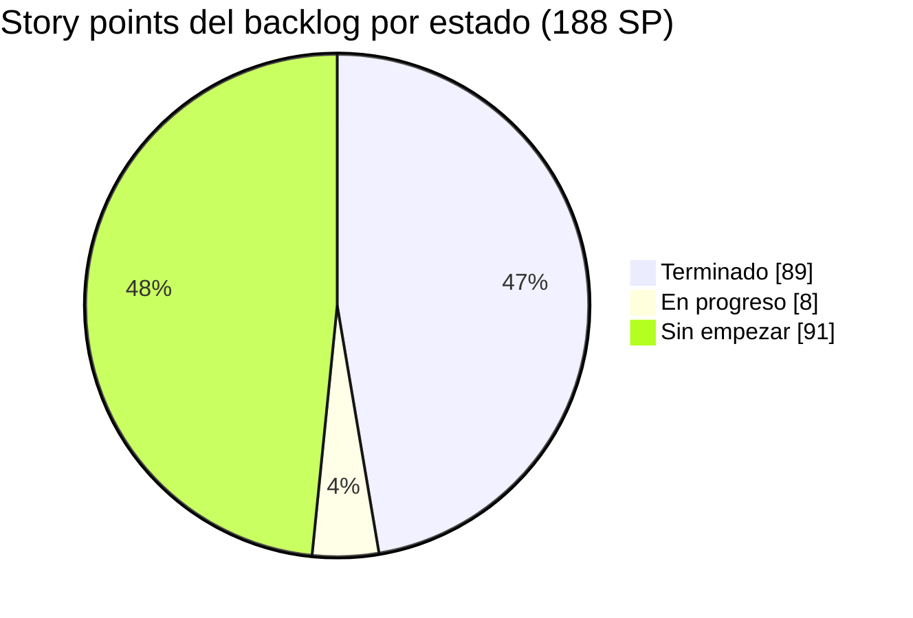
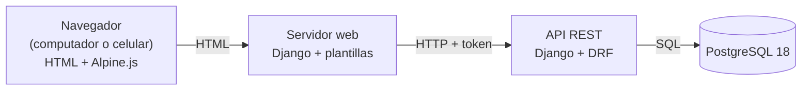
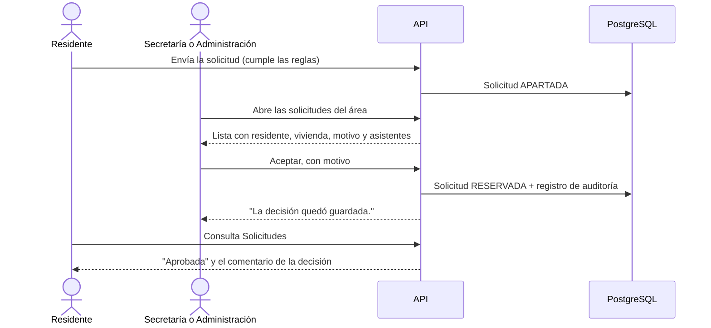
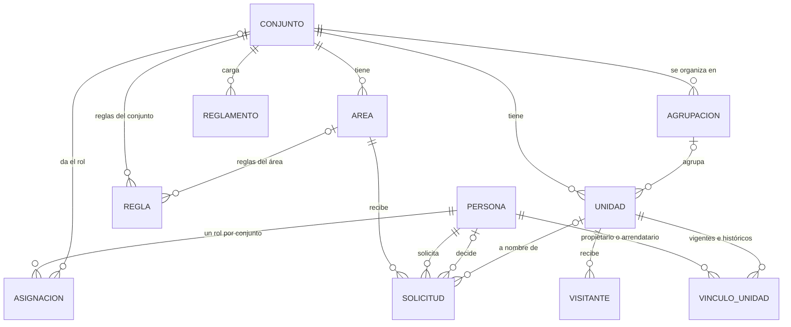
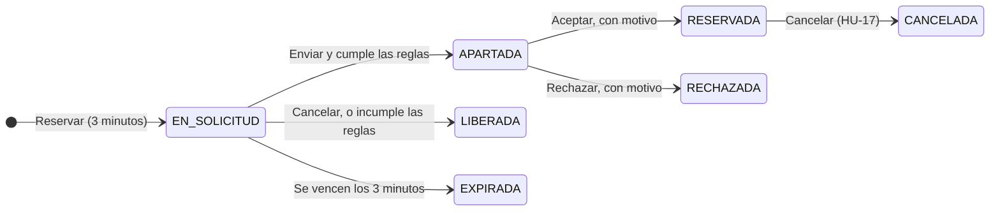
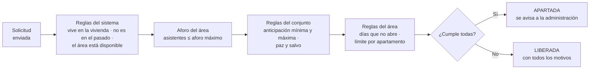

# AdMind — Informe de avance 4

| Dato                 | Detalle                                             |
| -------------------- | --------------------------------------------------- |
| **Proyecto**         | AdMind — administración de conjuntos residenciales  |
| **Asignatura**       | Ingeniería de Software II                           |
| **Institución**      | Universidad de Cundinamarca, sede Facatativá        |
| **Integrantes**      | Manuel Alejandro Aldana Rincón · Camilo Remiso Niño |
| **Docente**          | OSCAR OCHOA                                         |
| **Fecha de corte**   | 6 de octubre de 2026                                |
| **Informe anterior** | 29 de septiembre de 2026                            |

> [!success] Resumen del corte
> - **Sprints 1, 2 y 3 terminados:** 14 historias de usuario y 71 story points (SP).
> - **El ciclo de la reserva quedó completo:** la administración ya aprueba o rechaza cada solicitud (HU-14, la primera historia del Sprint 4).
> - **17 de 38 historias terminadas (89 de 188 SP, 47 %)**, contando HU-21 y HU-25, adelantadas del Sprint 5. Otras 2 están en progreso (8 SP).
> - **Un conjunto ya se puede crear completo y dejar operativo:** el asistente pasó de 5 a 7 pasos, genera las viviendas en lote y recibe el reglamento en PDF.
> - **Motor de reglas por niveles:** reglas del sistema, del conjunto y de cada área, evaluadas todas juntas.
> - **Pruebas automáticas:** 416 en el backend (415 pasan) y 208 en el frontend (todas pasan). Frente al informe anterior son 85 y 67 más.



> [!NOTE] Cómo se cuenta una historia terminada en este informe
> Una historia se reporta **terminada** cuando su flujo principal funciona de punta a punta, está en la rama `desarrollo` de GitHub y tiene pruebas automáticas que pasan. La revisión cruzada entre los dos integrantes y el paso a la rama `pruebas` se hacen al cierre y están en la sección 9. Una historia **en progreso** tiene una parte funcionando y otra por construir.

**Contenido**

1. [Qué es AdMind](#1.%20Qué%20es%20AdMind)
2. [Tipo de aplicación](#2.%20Tipo%20de%20aplicación)
3. [Entorno de trabajo y tecnologías](#3.%20Entorno%20de%20trabajo%20y%20tecnologías)
4. [Repositorios](#4.%20Repositorios)
5. [Estructura del proyecto](#5.%20Estructura%20del%20proyecto)
6. [Seguimiento y estado de las historias](#6.%20Seguimiento%20y%20estado%20de%20las%20historias)
7. [Avance a la fecha](#7.%20Avance%20a%20la%20fecha)
8. [Evidencias por pantalla](#8.%20Evidencias%20por%20pantalla)
9. [Pendientes y próximos pasos](#9.%20Pendientes%20y%20próximos%20pasos)

---

## 1. Qué es AdMind

AdMind es una aplicación para administrar **conjuntos residenciales bajo régimen de propiedad horizontal en Colombia** (Ley 675 de 2001). Hoy muchos conjuntos se administran con grupos de WhatsApp y hojas de cálculo. AdMind reúne en un solo sistema la reserva de zonas comunes, los residentes y sus viviendas, los anuncios, los visitantes y las solicitudes a la administración.

Se apoya en cuatro pilares:

- **Multiconjunto:** una sola plataforma para varios conjuntos, con los datos de cada uno aislados de los demás.
- **Reglas configurables:** cada conjunto configura sus reglas de reserva según su propio reglamento.
- **Reserva por orden de llegada:** bloqueo temporal de 3 minutos sobre una franja y aprobación humana.
- **El sistema registra, no decide:** en infracciones, dinero y lo que la ley reserva a la asamblea.

> [!info] En este corte, tres de los pilares ya funcionan de punta a punta
> - **Multiconjunto:** un conjunto se crea con el asistente, con sus viviendas, áreas, reglas y reglamento, y queda operativo sin tocar la base de datos a mano.
> - **Reglas configurables:** la administración define reglas para todo el conjunto y para cada área, y el sistema las evalúa al enviar la solicitud.
> - **Reserva por orden de llegada:** el residente toma la franja, tiene 3 minutos para confirmar, y la administración o la secretaría **aprueba o rechaza** con un motivo que el residente puede leer. En el informe anterior faltaba esta última parte.

---

## 2. Tipo de aplicación

> [!IMPORTANT] AdMind es una aplicación **web**
> No es una aplicación móvil. Se usa desde el navegador, en computador o en celular, y las pantallas se adaptan al tamaño de la pantalla. No se desarrolla una app nativa para Android ni para iOS.

**Por qué web:** porque ofrece portabilidad y funciona en varios tipos de dispositivos sin limitaciones de arquitectura ni de sistema operativo.

### 2.1 Cómo está armada

El sistema son **dos servidores** que se comunican por una API:

- **API (backend):** Django con Django REST Framework. Es el único que habla con la base de datos y donde viven las reglas del negocio.
- **Servidor web (frontend):** Django con plantillas HTML. Arma las pantallas que ve el usuario y le pide todos los datos a la API.
- **Navegador:** recibe HTML. Usa **Alpine.js** solo en las pantallas que lo necesitan: la cuenta regresiva de la reserva, el recorte de la foto del conjunto y, desde este corte, el paso de viviendas del asistente.



> [!example] Captura 1 · AdMind en computador y en celular
> La misma pantalla (por ejemplo, el calendario de zonas comunes) en los dos tamaños.
>
> | Computador | Celular |
> | ---------- | ------- |
> | *(pega aquí la captura)* | *(pega aquí la captura)* |

---

## 3. Entorno de trabajo y tecnologías

AdMind **no está desarrollado en .NET**: está hecho en **Python con el framework Django**. Aun así, respeta la organización por capas de la plantilla ASP.NET que se usó como referencia en clase.

> [!example] Captura 2 · Espacio de trabajo en Visual Studio Code
> Los tres proyectos abiertos en el mismo espacio de trabajo, con las carpetas nuevas `apps/documentos` y `apps/visitantes` a la vista.
>
> *(pega aquí la captura)*

### 3.1 Tecnologías

Las versiones no cambiaron desde el informe anterior y **no se agregó ninguna dependencia**. Lo nuevo de este corte (fotos de los anuncios, reglamento en PDF, límites de intentos y correo de recuperación) se construyó con lo que ya traen Django y Django REST Framework.

| Aspecto                         | Qué usamos                                                              | Versión    |
| ------------------------------- | ----------------------------------------------------------------------- | ---------- |
| Lenguaje                        | Python                                                                  | 3.14       |
| Framework del backend           | Django (versión LTS, con soporte extendido)                             | 5.2.17     |
| API REST                        | Django REST Framework                                                   | 3.18       |
| Frontend                        | Django con plantillas HTML y CSS propio del sistema de diseño de AdMind | 5.2.17     |
| Interacción en el navegador     | Alpine.js, guardado dentro del proyecto (no se carga de internet)       | 3.17.4     |
| Conexión del front con la API   | requests                                                                | 2.34       |
| Base de datos                   | PostgreSQL                                                              | 18         |
| Conector de Python a PostgreSQL | psycopg                                                                 | 3.3        |
| Pruebas automáticas             | pytest + pytest-django, en los dos servidores                           | 9.1 / 4.14 |
| Segundo factor (TOTP)           | django-otp                                                              | 1.7        |
| Código QR del segundo factor    | qrcode, en SVG                                                          | 8.2        |
| Correo (recuperación de acceso) | Envío por SMTP con el módulo de correo de Django                        | 5.2.17     |

### 3.2 Herramientas

| Para qué                              | Herramienta                                                               |
| ------------------------------------- | ------------------------------------------------------------------------- |
| Editor de código                      | Visual Studio Code, con un espacio de trabajo que abre los tres proyectos |
| Terminal                              | Git Bash                                                                  |
| Control de versiones                  | Git + GitHub                                                              |
| Diseño y consulta de la base de datos | DBeaver                                                                   |
| Seguimiento Scrum                     | Notion (ver sección 6)                                                    |
| Documentación                         | Obsidian, con la bóveda versionada en GitHub                              |

### 3.3 Equivalencia con .NET

| En la plantilla ASP.NET | En AdMind (Django) | Ejemplo en el código |
|---|---|---|
| `Controllers/` | `views.py` + `urls.py` | `apps/reservas/views.py` |
| `Dtos/` | `serializers.py` | `apps/reservas/serializers.py` |
| `Services/` | `servicios.py` | `apps/reservas/servicios.py` |
| `Repositories/` | Managers del ORM de Django | `Solicitud.objects`, `apps/comun/aislamiento/managers.py` |
| `Utilities/` | `apps/comun/` | `apps/comun/aislamiento/`, `apps/comun/bloqueo/` |
| Entidades / modelos | `models.py` | `apps/unidades/models.py` |
| `appsettings.json` | `config/settings.py` + archivo `.env` | `config/settings.py` |
| Paquetes NuGet | `requirements.txt` (pip) | `requirements.txt` |
| Migraciones de Entity Framework | Migraciones de Django | `apps/*/migrations/` |
| xUnit / NUnit | pytest | `apps/*/tests.py`, `tests/` |

---

## 4. Repositorios

El código y la documentación están en **tres repositorios separados** en la cuenta de GitHub `ZeroFour-04`:

| Repositorio | Qué contiene | Enlace | Último commit al corte |
|---|---|---|---|
| `Admind_Backend` | API REST (Django + Django REST Framework) | https://github.com/ZeroFour-04/Admind_Backend | `279e963` "telefono arreglado", en `desarrollo` (06/10 10:31) |
| `Admind_Front-End` | Servidor web con las pantallas | https://github.com/ZeroFour-04/Admind_Front-End | `fff4651` "Reservas 2.0", en `desarrollo` (06/10 10:58) |
| `Admind_Documentacion` | Documentación del proyecto (bóveda de Obsidian) | https://github.com/ZeroFour-04/Admind_Documentacion | `febe940` "Creacion de vivienda y conjunto", en `main` (06/10 08:22) |

> [!success] Todo el trabajo del corte está en GitHub
> Al corte, los dos repositorios de código no tienen cambios sin guardar: la copia local y la rama `desarrollo` de GitHub están en el mismo commit. El cambio que el informe anterior dejó sin commit (un solo rol por persona y conjunto) entró el mismo 29/09 (`ee256ff` en el backend y `7fa88ea` en el front).

> [!example] Captura 3 · Repositorios en GitHub
> La rama `desarrollo` de los dos repositorios de código, con los commits del 1 al 6 de octubre.
>
> | Backend | Frontend |
> | ------- | -------- |
> | *(pega aquí la captura)* | *(pega aquí la captura)* |

### 4.1 Modelo de ramas

Definido por el docente para los repositorios de código:

| Rama | Qué contiene |
|---|---|
| `main` | Lo entregado |
| `desarrollo` | Integración: los dos integrantes trabajan directamente aquí |
| `pruebas` | Lo terminado, listo para probar antes de pasar a `main` |

No se usan ramas por historia. El repositorio de documentación trabaja solo con `main`.

**Estado al corte:**
- Todo el trabajo está en `desarrollo` y subido a GitHub.
- `main` sigue con la versión inicial de cada repositorio.
- La rama `pruebas` del backend existe solo en la copia local; en el front existe en GitHub, igual a `main`. El paso de `desarrollo` a `pruebas` por pull request sigue pendiente (sección 9).
- Varios commits de esta semana llevan mensajes cortos sin el número de la historia. Retomar el formato `tipo(app): descripción [HU-XX]` está entre los pendientes.

### 4.2 Documentación

El 30 de septiembre la bóveda de documentación se reorganizó en carpetas numeradas, con un índice y notas cortas, para que cualquier integrante encuentre rápido lo que necesita:

```
Admind_Documentacion/
├── README.md                Índice: una línea por nota
├── 01_Contexto/             Qué es el proyecto, equipo, alcance y marco legal
├── 02_Arquitectura/         Cómo está hecho: mapa del código, backend, frontend y pruebas
├── 03_Reglas/               Lo que se respeta al construir: capas, aislamiento, Git y Scrum
├── 04_Diseno/               Sistema visual
├── 05_Modulos/              Reglas de negocio de cada módulo (reservas, motor de reglas, permisos…)
├── 06_Decisiones/           Decisiones cerradas, tomadas al construir y abiertas
├── 07_Planes/               Planes de trabajo activos y ejecutados
├── 08_Estado/               Estado actual, historias, pendientes y bitácora
├── 09_Protocolos/           Pasos de las tareas que se repiten, con sus plantillas
├── Guias/                   Tutoriales: estructura actual, desarrollo e instalación
└── Archivo/
    └── Informes/
        ├── 2026-09-15/        Informe 1
        ├── 2026-09-21/        Informe 2
        ├── 2026-09-29/        Informe 3
        └── 2026-10-06/        Este informe y sus capturas
```

---

## 5. Estructura del proyecto

### 5.1 Espacio de trabajo

```
A D M I N D/
├── Backend/Admind_Backend/                repositorio de la API
├── Frontend/Admind_Front-End/             repositorio del servidor web
└── Documentacion/Admind_Documentacion/    repositorio de documentación (bóveda de Obsidian)
```

### 5.2 Backend

Lo marcado con `[nuevo]` entró desde el informe anterior; `[cambió]` ya existía y se amplió.

```
Admind_Backend/
├── config/                    Configuración del proyecto Django
│   ├── settings.py              Ajustes; la clave y la conexión a la base se leen de .env
│   ├── settings_pruebas.py      Ajustes para las pruebas automáticas
│   └── urls.py                  Rutas raíz: /auth/, /conjuntos/, /unidades/, /notificaciones/, /anuncios/,
│                                /areas/, /personas/, /reglas/, /reservas/, /visitantes/, /documentos/
├── apps/                      Una carpeta por módulo del sistema
│   ├── personas/                Persona única por documento; búsqueda exacta y vincular (HU-04, HU-07)
│   ├── cuentas/                 Sesión, recuperación, segundo factor, usuarios, roles y perfil  [cambió]
│   │   ├── limites.py             Máximo de enlaces por hora en recuperación y segundo factor   [nuevo]
│   │   └── dos_factores.py        Enlace por correo para quitar el segundo factor               [nuevo]
│   ├── conjuntos/               Asistente de creación, requisitos para operar e identidad (HU-03, HU-21) [cambió]
│   ├── permisos/                Catálogo de 5 roles y sus permisos; un rol por conjunto (HU-06) [cambió]
│   ├── auditoria/               Registro de solo inserción: quién hizo qué, antes y después
│   ├── areas/                   Áreas comunes: horario por bloques y aforo máximo (HU-09)       [cambió]
│   ├── unidades/                Viviendas, agrupaciones y vínculos (HU-08, HU-39)               [cambió]
│   │   └── estructura.py          Generador de viviendas en lote: torres, pisos, numeración     [nuevo]
│   ├── reglas/                  Motor de reglas por niveles (HU-10, HU-13)                      [cambió]
│   │   ├── catalogo.py            5 tipos de regla: 3 del conjunto y 2 de cada área
│   │   ├── sistema.py             Reglas fijas del sistema: reside, no en el pasado, área disponible
│   │   ├── evaluador.py           Evalúa todas las reglas, sin detenerse en la primera falla
│   │   └── mora.py                Paz y salvo provisional hasta el módulo de pagos
│   ├── reservas/                Franjas, bloqueo de 3 minutos, envío y decisión (HU-11 a HU-14) [cambió]
│   ├── documentos/              Reglamento del conjunto en PDF (HU-03, parte de HU-33)          [nuevo]
│   ├── visitantes/              Registro del ingreso de visitantes y su historial (HU-27)       [nuevo]
│   ├── notificaciones/          Canal interno: bandeja de la persona y correo
│   ├── anuncios/                Tablón con alcance de conjunto o vivienda y fotos (HU-25)       [cambió]
│   ├── comun/                   Piezas compartidas
│   │   ├── aislamiento/           Filtro de datos por conjunto
│   │   ├── bloqueo/               Mecanismo compartido de bloqueo y expiración
│   │   └── modelos_base/          Modelo base de toda tabla que pertenece a un conjunto
│   └── casos/, citas/, pagos/, …  Módulos siguientes, por ahora solo con su README
├── tests/                     Pruebas transversales
│   ├── aislamiento/             Prueba del intruso y revisión de todas las rutas
│   ├── concurrencia/            10 residentes a la vez sobre la misma franja
│   └── esquema/                 Lista cerrada de tablas globales
├── manage.py
├── pytest.ini
└── requirements.txt
```

### 5.3 Frontend

```
Admind_Front-End/
├── config/                    Configuración; la dirección de la API se lee de .env
├── cliente_api/               Único punto que llama a la API
│   ├── http.py                  Envía cada petición con el token y traduce los errores
│   ├── cuentas.py               Sesión, segundo factor, usuarios, roles y perfil
│   ├── conjuntos.py             Asistente de creación e identidad
│   ├── unidades.py              Viviendas, vínculos y generador de la estructura             [cambió]
│   ├── reglas.py, areas.py      Tablero de reglas y áreas comunes                             [cambió]
│   ├── reservas.py              Franjas, bloqueo, envío, solicitudes por área y decisión      [cambió]
│   ├── documentos.py            Reglamento del conjunto                                       [nuevo]
│   ├── visitantes.py            Ingreso de visitantes e historial                             [nuevo]
│   └── personas.py, anuncios.py, notificaciones.py
├── apps/                      Una carpeta por módulo de pantallas
│   ├── cuentas/                 Ingreso, recuperar contraseña, segundo factor y Mi perfil      [cambió]
│   ├── conjuntos/               Selector, asistente en 7 pasos e identidad                    [cambió]
│   ├── usuarios/                Lista con el rol, detalle y registrar persona
│   ├── areas/                   Catálogo de áreas comunes, con aforo                          [cambió]
│   ├── unidades/                Apartamentos y vínculos
│   ├── reglas/                  Tablero de reglas por niveles                                 [cambió]
│   ├── reservas/                Calendario, solicitud con cuenta regresiva, envío y
│   │                            solicitudes de un área con Aceptar y Rechazar                 [cambió]
│   ├── triage/                  Solicitudes: zonas para la gestión, historial para el residente [nuevo]
│   ├── visitantes/              Formulario de ingreso e historial                             [nuevo]
│   ├── anuncios/, notificaciones/   Tablón con fotos y bandeja de avisos                      [cambió]
│   └── paneles/                 Inicio: es la única pantalla que sigue siendo maqueta
├── templates/                 Plantillas base y componentes
│   └── componentes/             Barra superior, menú lateral según el rol, panel de confirmación
├── static/
│   ├── css/                     Estilos propios
│   ├── img/                     Ícono de AdMind para la pestaña del navegador                 [nuevo]
│   └── js/                      identidad.js, reservas.js, usuarios.js y, nuevos en este corte,
│       │                        viviendas.js, calendario-reservas.js y visitantes.js
│       └── vendor/alpine.min.js   Alpine.js 3.17.4, guardado en el proyecto
├── design-system/             Colores, tipografía y espaciado
├── tests/                     Pruebas automáticas del servidor web
├── manage.py
└── requirements.txt
```

### 5.4 Flujo por capas

Toda petición a la API sigue el mismo recorrido: **controlador → servicio → repositorio**. La vista no consulta la base directamente y el servicio no sabe nada de HTTP. Ejemplo real de este corte, aprobar o rechazar una solicitud de reserva:

```
POST /reservas/solicitudes/<id>/decision/
   │
   ▼
urls.py → views.py (DecidirSolicitudView)        Controlador: exige el permiso de aprobar o el de rechazar,
             │                                   según la decisión que llega
             │ valida con serializers.py         DTO: la decisión es RESERVADA o RECHAZADA y el motivo es obligatorio
             ▼
          servicios.py (decidir_solicitud)       Servicio: ¿la solicitud existe?, ¿sigue apartada?
             │                                   Guarda quién decidió, cuándo y por qué, y lo deja en la auditoría
             ▼
          Solicitud.objects                      Repositorio: bloquea la fila mientras decide, para que dos
                                                 personas no resuelvan la misma solicitud a la vez
```

**Qué pasa si se intenta decidir dos veces.** El servicio solo acepta solicitudes en estado *apartada*. La segunda decisión recibe un 409 con el mensaje "Solo se pueden decidir solicitudes que estén apartadas", y la primera queda intacta.



### 5.5 Base de datos

Las tablas se crean con las migraciones de Django sobre PostgreSQL. Todas están aplicadas en la base local (**0 migraciones pendientes** al corte) y el modelo no tiene cambios sin migrar. Tablas nuevas o cambiadas desde el informe anterior:

| Tabla | Qué guarda | Cambio |
|---|---|---|
| `unidades_agrupacion` | Lo que junta viviendas: una torre, un bloque o una manzana, con la palabra que usa cada conjunto | Nueva |
| `unidades_unidad` | Suma el tipo (apartamento o casa), la agrupación, el número y el piso | Cambiada |
| `documentos_reglamento` | El reglamento del conjunto en PDF, con su huella y quién lo subió. Subir uno nuevo conserva el anterior | Nueva |
| `visitantes_visitante` | Nombre, cédula, vehículo (opcional), vivienda visitada y hora de entrada, que pone el servidor | Nueva |
| `anuncios_fotodeanuncio` | Las fotos de cada anuncio, hasta 4 | Nueva |
| `areas_area` | Suma el **aforo máximo**, obligatorio. Se retira la clasificación del área. Cada franja dura al menos 2 horas | Cambiada |
| `reglas_regla` | El área pasa a ser opcional: una regla sin área es del conjunto. Solo puede haber una regla vigente de cada tipo por conjunto o por área | Cambiada |
| `reservas_solicitud` | Suma el motivo de la decisión, quién decidió y cuándo | Cambiada |
| `permisos_asignacion` | Un solo rol vigente por persona y conjunto; el catálogo queda en 5 roles | Cambiada (ya en GitHub) |

Todas las tablas nuevas tienen `conjunto_id` obligatorio, así que heredan el aislamiento entre conjuntos.

**Núcleo del sistema al corte:**



**Estados de una solicitud:**



Desde este corte funcionan también las dos transiciones que salen de `APARTADA`. Solo falta la cancelación de una reserva en firme (HU-17).

---

## 6. Seguimiento y estado de las historias

El seguimiento Scrum se lleva en **Notion**, en el espacio **Gestión Scrum — AdMind**:

| Base de datos | Qué contiene |
|---|---|
| Historias de Usuario | Las 38 historias del backlog (188 story points), cada una con prioridad, sprint previsto, estado, criterios de aceptación y tareas técnicas |
| Sprints | Los 7 sprints del proyecto, con las historias de cada uno |

Cada historia pasa por los estados *Sin empezar*, *En progreso*, *En revisión* y *Finalizado*. La nota `08_Estado/historias.md` del repositorio de documentación registra el avance de cada historia verificado en el código.

> [!example] Captura 4 · Tablero de historias en Notion
> Sprints 1, 2 y 3 y la historia HU-14 en *Finalizado*; HU-27 y HU-33 en *En progreso*.
>
> *(pega aquí la captura)*

### 6.1 Estado por sprint al corte

| Sprint | Historias | SP | Estado |
|---|---|---|---|
| **1** | HU-01, HU-02, HU-03, HU-04, HU-05, HU-26 | 25 | **Terminado** |
| **2** | HU-06, HU-07, HU-08, HU-09 | 20 | **Terminado** |
| **3** | HU-10, HU-11, HU-12, HU-13 | 26 | **Terminado** |
| **4** | HU-14 a HU-19 | 28 | **Iniciado:** HU-14 terminada (8 SP); 5 sin empezar |
| **5** | HU-20, HU-21, HU-25, HU-27, HU-28, HU-29 | 28 | HU-21 y HU-25 terminadas (10 SP); HU-27 en progreso (5 SP); 3 sin empezar |
| **6** | HU-22, HU-23, HU-24, HU-30 a HU-34 | 38 | HU-33 en progreso (3 SP); 7 sin empezar |
| **7** | HU-35, HU-36, HU-37 | 16 | Sin empezar |
| Condicional | HU-38 | 7 | Sin empezar |
| **Total** | **38** | **188** | **17 terminadas · 2 en progreso · 19 sin empezar** |

> [!NOTE] Una historia nueva: HU-39, estructura de viviendas
> Nació de la retroalimentación del docente sobre el asistente de creación: registrar los apartamentos uno por uno no es práctico en un conjunto real. Su primera parte ya está construida (sección 7.4). Todavía no tiene story points ni sprint asignado, así que no entra en las cuentas de esta tabla.

### 6.2 Estado de las historias

| Estado | Historias | SP |
|---|---|---|
| **Terminado** | HU-01 a HU-14, HU-21, HU-25 y HU-26 (17) | **89** |
| **En progreso** | HU-27 y HU-33 (2), además de HU-39, sin estimar | 8 |
| **Sin empezar** | Las 19 restantes | 91 |
| **Total** | **38** | **188** |

> [!NOTE] Avance frente a los cortes anteriores
> | Corte | Historias terminadas | SP terminados | Pruebas (back / front) |
> |---|---|---|---|
> | 15/09 (informe 1) | 0 de 38 | 0 de 188 | 69 / 0 |
> | 22/09 (informe 2) | 8 de 38 | 36 de 188 | 171 / 51 |
> | 29/09 (informe 3) | 12 de 38 | 55 de 188 | 331 / 141 |
> | **06/10 (este informe)** | **17 de 38** | **89 de 188** | **416 / 208** |
>
> En esta semana se terminaron 34 SP: los 26 del Sprint 3, que estaba en revisión, y los 8 de HU-14.

---

## 7. Avance a la fecha

### 7.1 Resumen

| Frente | Estado al 6 de octubre |
|---|---|
| **Backend** | Todo lo del informe anterior, más: aprobar y rechazar solicitudes con motivo y auditoría, motor de reglas por niveles, aforo de las áreas, generador de viviendas en lote, reglamento en PDF, un conjunto que ya queda operativo, registro de visitantes, fotos en los anuncios, límite de intentos en la recuperación de contraseña y enlace por correo para quitar el segundo factor |
| **Frontend** | Conectadas a la API todas las pantallas del menú, incluida **Solicitudes**, que en el informe anterior era maqueta. Nuevas: asistente en 7 pasos, tablero de reglas, solicitudes por área con Aceptar y Rechazar, visitantes y las dos pantallas para quitar el segundo factor. Solo **Inicio** sigue siendo maqueta |
| **Pruebas** | Backend: **416 pruebas, 415 pasan** (ver 7.6). Frontend: **208 pruebas, todas pasan** |
| **Historias** | **Sprints 1, 2 y 3 terminados**, más HU-14, HU-21 y HU-25: 17 de 38 historias (89 SP). 2 en progreso (8 SP) |
| **Repositorios** | Todo en `desarrollo` y en GitHub. Ningún cambio sin commit |
| **Base de datos** | 0 migraciones pendientes |

### 7.2 Qué cambió desde el 29 de septiembre

| Fecha | Repositorio | Commit | Qué trae |
|---|---|---|---|
| 29/09 12:20 | Backend y front | `ee256ff`, `7fa88ea` | Un solo rol vigente por persona y conjunto, y el catálogo queda en 5 roles. Era lo único sin commit en el informe anterior |
| 01/10 09:50 | Documentación | `8b92443` | La bóveda se reorganiza en carpetas numeradas, con índice y protocolos (el trabajo se hizo el 30/09) |
| 01/10 19:00 | Backend y front | `b205932`, `40bd629` (Camilo) | Registro del ingreso de visitantes y su historial (HU-27) |
| 04/10 23:11 | Front | `2af7114` | Ícono de AdMind en la pestaña del navegador; si el conjunto tiene foto, se usa la foto |
| 05/10 00:23 | Backend y front | `1c82605`, `afcd6e6` | Recuperación de contraseña: máximo 3 enlaces por hora por correo y envío real por SMTP (HU-01) |
| 05/10 05:09 | Backend y front | `5ed32a5`, `ea0e9e5` | Enlace por correo para quitar el segundo factor cuando se pierde la aplicación (HU-02). Se retira la clasificación de las áreas (HU-09) |
| 05/10 05:49 | Backend y front | `a6a6daf`, `27ca6b6` | Anuncios con hasta 4 fotos (HU-25) |
| 05/10 10:22 | Backend y front | `2d11dbe`, `d76ac0f` (Camilo) | **Aprobar y rechazar solicitudes de reserva** (HU-14): solicitudes por área, decisión con motivo y auditoría. Cada franja dura al menos 2 horas |
| 05/10 10:28 | Front | `351e74d` | Corrección del recorte de la foto del conjunto, que subía una imagen vacía (HU-21) |
| 05/10 11:22 | Front | `721efae` (Camilo) | Calendario de zonas comunes: no deja elegir días pasados y se actualiza al cambiar de área |
| 06/10 07:23 | Backend y front | `9b3b231`, `c7475e9` | **Motor de reglas por niveles** y aforo máximo de las áreas (HU-09, HU-10, HU-13) |
| 06/10 08:22 | Backend y front | `c73bfb1`, `6e0c628` | **Asistente de creación completo** en 7 pasos, generador de viviendas y reglamento en PDF (HU-03, HU-39 y parte de HU-33) |
| 06/10 10:31 | Backend y front | `279e963`, `a7e6780` (Camilo) | El teléfono de un usuario se valida: de 7 a 15 dígitos |
| 06/10 10:58 | Front | `fff4651` (Camilo) | Pantalla **Solicitudes**: la gestión entra por zona común y el residente ve su historial con el resultado (HU-14) |

### 7.3 Sprint 3 y HU-14 — terminados (34 SP)

El Sprint 3 estaba construido y en revisión en el informe anterior. En este corte se revisó, se rehízo el motor de reglas con lo aprendido y se cerró. HU-14 es la primera historia del Sprint 4.

| HU | Historia | SP | Qué construye | Commits (back / front) |
|---|---|---|---|---|
| HU-10 | Reglas de reserva configurables | 9 | Reglas en **dos niveles**: del conjunto (anticipación mínima, anticipación máxima y paz y salvo) y de cada área (días que no abre, con su motivo, y límite de reservas por apartamento). Una sola regla vigente por tipo. Cambiar una regla crea una versión nueva y la anterior queda en el historial. Cada regla trae una descripción fija que explica qué hace | `bb5586f`, `a8be0ae`, `9b3b231` / `2e11201`, `c7475e9` |
| HU-11 | Bloqueo exclusivo de 3 minutos | 7 | Franjas del día con su estado, bloqueo exclusivo garantizado por la base de datos, un solo bloqueo por persona y conjunto, liberación al cancelar y cuenta regresiva en pantalla | `ddac827` … `06f2340` / `d7b04a8`, `6aa1a3d` |
| HU-12 | Confirmación antes de enviar | 2 | Panel que muestra lo que se va a enviar y resalta los avisos: menos de 24 horas, límite de anticipación y otra solicitud en curso | `000c335` / `f6b8fef` |
| HU-13 | Envío y evaluación de las reglas | 8 | Al enviar se evalúan, en orden, las reglas del sistema, el aforo del área, las reglas del conjunto y las del área. No se detiene en la primera falla: el residente ve **todos** los motivos. Si cumple, la solicitud queda apartada y se avisa a la administración. La evaluación queda guardada en la solicitud | `a8e6ca5`, `66f8897`, `9b3b231` / `c1d8f6b` |
| HU-14 | Aprobar o rechazar solicitudes | 8 | La administración y la secretaría ven las solicitudes de cada zona común con el residente, la vivienda, el motivo y los asistentes. Aceptan o rechazan con un **motivo obligatorio**. La decisión queda en la auditoría, no se puede tomar dos veces, y rechazar libera la franja. El residente ve el resultado y el comentario en *Solicitudes* | `2d11dbe` / `d76ac0f`, `fff4651` |

**Cómo evalúa el motor de reglas una solicitud:**



Las cuatro etapas se evalúan siempre completas. Como todas las reglas restringen y ninguna concede permisos, no hay conflictos entre niveles.

### 7.4 En progreso y mejoras a historias ya entregadas

**Mejoras a historias terminadas en informes anteriores:**

| HU | Qué se mejoró en este corte |
|---|---|
| HU-01 Inicio de sesión | La recuperación de contraseña limita a 3 enlaces por hora por correo, responda o no una cuenta real, y el correo ya sale por SMTP a una bandeja real |
| HU-02 Segundo factor | Enlace "¿Problemas con la verificación en dos pasos?": llega un correo con un enlace firmado para quitar el segundo factor y configurarlo de nuevo. Máximo 3 por hora |
| HU-03 Asistente de creación | Pasó de 5 a **7 pasos**: datos básicos, viviendas, administración, áreas, reglas, reglamento y resumen. Revisa seis requisitos y, cuando se cumplen, el conjunto queda **operativo**. Lo activa el Superusuario o la Administración |
| HU-06 Roles | Un solo rol vigente por persona y conjunto: para darle otro, se cambia. El catálogo queda en 5 roles |
| HU-09 Áreas comunes | Cada área tiene **aforo máximo** obligatorio y franjas de al menos 2 horas. Se retiró la clasificación del área |
| HU-21 Identidad | Se corrigió el recorte de la foto del conjunto. La foto se usa también como ícono de la pestaña |
| HU-25 Anuncios | Cada anuncio admite hasta 4 fotos (PNG, JPG o WebP, de máximo 5 MB), con galería en el tablón |

**Historias en progreso:**

| HU | Historia | SP | Qué funciona hoy | Qué falta |
|---|---|---|---|---|
| HU-27 | Registro de visitantes y vehículos | 5 | Vigilancia registra el ingreso (nombre, cédula, vehículo y vivienda visitada) y ve los del día. La administración consulta el historial completo | Registrar la salida y el tratamiento de datos personales que pide la Ley 1581 |
| HU-33 | Repositorio de documentos vigentes | 3 | El reglamento del conjunto: se sube en PDF (máximo 10 MB), se valida que sea un PDF real y se conserva el anterior | Otros documentos, las actas y la descarga para el residente |
| HU-39 | Estructura de viviendas (nueva) | Por estimar | El asistente pregunta cómo está organizado el conjunto (apartamentos, casas o ambos; torres, bloques o manzanas; pisos y numeración), muestra la **vista previa** y crea todas las viviendas de una vez. Un conjunto sin viviendas no puede quedar operativo | Que todas las pantallas usen las palabras del conjunto (Torre, Manzana…) y retirar viviendas o agrupaciones con confirmación |

### 7.5 Decisiones

Decisiones tomadas por el equipo desde el informe anterior, en palabras:

| Fecha | Decisión | Quién |
|---|---|---|
| 29/09 | El catálogo queda en **5 roles**: Superusuario, Administración, Secretaría, Vigilancia y Residente. Se retira el rol Consejo | Alejo |
| 04/10 | El límite de enlaces de recuperación se cuenta **por correo** y no por dirección IP: 3 por hora. La respuesta es la misma exista o no la cuenta, así no se revela qué correos están registrados | Alejo |
| 05/10 | Quien pierde la aplicación del segundo factor recupera el acceso con un **enlace por correo** de un solo uso, que lo borra para configurarlo de nuevo. Se prefirió a un código por correo que sirviera como segundo paso. Costo aceptado: el segundo factor queda tan fuerte como el buzón de correo | Alejo |
| 05/10 | Se retira la **clasificación de las áreas** (común, común esencial, de uso exclusivo). Un área se identifica por su nombre dentro del conjunto | Alejo |
| 05/10 | Las fotos de un anuncio **quedan fijas al publicar**, igual que su alcance, y se guardan en la base de datos. Junto al campo se advierte que una foto donde se reconoce a una persona es un dato personal | Alejo |
| 05/10 | Cada franja reservable dura **al menos 2 horas**, y la base de datos lo exige | Camilo |
| 05/10 | La **Secretaría** también ve, aprueba y rechaza las solicitudes de reserva, igual que la Administración. Toda decisión lleva un motivo escrito | Camilo |
| 06/10 | Las reglas se organizan en **tres niveles**: del sistema (fijas en el código), del conjunto y del área. Cada tipo de regla vive en un solo nivel y se define una sola vez | Alejo |
| 06/10 | El **aforo** deja de ser una regla y pasa a ser un dato obligatorio de cada área | Alejo |
| 06/10 | Si un día que no abre cae sobre reservas ya apartadas o aprobadas, el sistema **avisa cuántas son** en el tablero; no las cancela ni impide guardar el cierre | Alejo |
| 06/10 | La **mora** saldrá del módulo de pagos. Hasta que exista, la regla de paz y salvo se puede definir pero no restringe, y la pantalla lo avisa | Alejo |
| 06/10 | Se crea la historia **HU-39**, tras la retroalimentación del docente: las viviendas se generan en lote a partir de la estructura del conjunto, con vista previa. La palabra (torre, bloque, manzana) la pone cada conjunto, y hay conjuntos mixtos de apartamentos y casas | Alejo |
| 06/10 | Para dejar operativo un conjunto se exigen **seis requisitos**: datos básicos, una persona con rol Administración, al menos una vivienda, al menos un área activa, las reglas del conjunto y el reglamento cargado | Alejo |
| 06/10 | La **Administración** también puede dejar operativo su conjunto, no solo el Superusuario | Alejo |

### 7.6 Estado de las pruebas

**Backend — 416 pruebas: 415 pasan y 1 falla.**

| Grupo | Pruebas | Qué cubre | HU |
|---|---|---|---|
| `apps/personas` | 10 | Persona única por documento | HU-04 |
| `apps/personas` (búsqueda) | 9 | Búsqueda exacta, auditoría, límite de 20 por hora y vincular | HU-07 |
| `apps/cuentas` | 41 | Sesión, selector, recuperación con su límite, usuarios, perfil, teléfono, cambiar rol y eliminar usuario | HU-01, HU-06, HU-26 |
| `apps/cuentas` (segundo factor) | 23 | Activarlo, verificarlo, códigos de respaldo y el enlace por correo para quitarlo | HU-02 |
| `apps/conjuntos` | 26 | Asistente, los seis requisitos, quién crea y quién activa | HU-03, HU-26 |
| `apps/conjuntos` (identidad) | 36 | Acentos, color propio y foto 1:1 validada por firma, tamaño y forma | HU-21 |
| `apps/permisos` | 21 | Catálogo, asignaciones, permisos efectivos y un rol por conjunto | HU-06 |
| `apps/permisos` (roles) | 15 | Asignar, cambiar y retirar; nunca cero Administración; auditoría | HU-06 |
| `apps/auditoria` | 6 | Registro de solo inserción: no se modifica ni se borra | Transversal |
| `apps/areas` | 12 | Horario, aforo obligatorio, franja mínima, mantenimiento y desactivar | HU-09 |
| `apps/unidades` | 29 | Viviendas, vínculos vigentes e históricos, y la creación en lote | HU-08, HU-39 |
| `apps/unidades` (estructura) | 11 | El generador: agrupaciones, pisos, numeración y nombres | HU-39 |
| `apps/reglas` | 44 | Catálogo por niveles, parámetros, versionado, una regla por tipo y evaluación completa | HU-10, HU-13 |
| `apps/reservas` | 28 | Franjas, bloqueo, liberar, avisos, envío, y aceptar o rechazar con motivo | HU-11 a HU-14 |
| `apps/anuncios` | 28 | Alcance, quién publica y edita, y las fotos: cantidad, formato y peso | HU-25 |
| `apps/notificaciones` | 5 | Bandeja y un solo aviso por hecho | HU-25 |
| `apps/documentos` | 5 | Subir el reglamento, validar que sea PDF y conservar el anterior | HU-03, HU-33 |
| `apps/visitantes` | 6 | Quién registra, quién ve el historial y qué ve cada uno | HU-27 |
| `tests/aislamiento` | 55 | Filtro por conjunto, prueba del intruso por ruta y revisión de todas las rutas | HU-05 |
| `tests/concurrencia` | 3 | 10 residentes a la vez sobre la misma franja → un solo bloqueo | HU-11 |
| `tests/esquema` | 3 | Lista cerrada de tablas globales | HU-05 |
| **Total** | **416** | **415 pasan · 1 falla** | |

> [!warning] La prueba que falla
> `test_toda_ruta_de_la_api_esta_cubierta` revisa que **toda** ruta de la API esté registrada en la prueba del intruso, la que comprueba que nadie vea datos de otro conjunto. Hay cinco rutas que todavía no están en esa lista: el perfil, eliminar usuario y las tres de las solicitudes de reserva (la bandeja, las solicitudes de un área y la decisión). La prueba cumple su función: avisa que falta registrarlas. Las rutas sí exigen sesión, conjunto activo y permiso; lo que falta es su caso en la prueba. Es el primer pendiente técnico de la sección 9.

**Frontend — 208 pruebas, todas pasan:**

| Archivo | Pruebas | Qué cubre | HU |
|---|---|---|---|
| `tests/test_acentos.py` | 38 | Contraste de los 8 acentos y del color propio | HU-21, HU-26 |
| `tests/test_identidad.py` | 26 | Color, foto 1:1, ícono de la pestaña y permisos | HU-21 |
| `tests/test_anuncios.py` | 25 | Tablón, publicar, editar y la galería de fotos | HU-25 |
| `tests/test_reservas.py` | 22 | Calendario, estado de cada franja, cuenta regresiva, panel, envío y solicitudes por área | HU-11 a HU-14 |
| `tests/test_reglas.py` | 18 | Tablero por niveles: definir, cambiar, quitar y los días que no abre | HU-10 |
| `tests/test_usuarios.py` | 17 | Rol en la lista, cambiar y eliminar, registrar persona y validación del teléfono | HU-06, HU-07 |
| `tests/test_areas.py` | 13 | Formulario con aforo y franja mínima, y acciones según el permiso | HU-09 |
| `tests/test_recuperacion.py` | 10 | Las dos pantallas de recuperación de contraseña y el aviso del límite | HU-01 |
| `tests/test_segundo_factor.py` | 10 | El enlace de problemas, pedirlo y confirmarlo | HU-02 |
| `tests/test_unidades.py` | 7 | Lista, detalle y vínculo duplicado | HU-08 |
| `tests/test_visitantes.py` | 7 | Formulario de ingreso e historial según el rol | HU-27 |
| `tests/test_asistente_reglamento.py` | 5 | Paso del reglamento y el resumen | HU-03 |
| `tests/test_triage.py` | 5 | Solicitudes: zonas para la gestión e historial del residente | HU-14 |
| `tests/test_asistente_viviendas.py` | 4 | Paso de viviendas: vista previa y creación | HU-39 |
| `tests/test_cuenta_perfil.py` | 1 | Mi perfil | — |
| **Total** | **208** | **Todas pasan** | |

> [!example] Captura 5 · Pruebas automáticas en la terminal
> Salida de `pytest` en los dos servidores: "1 failed, 415 passed" en el backend y "208 passed" en el frontend.
>
> | Backend | Frontend |
> | ------- | -------- |
> | *(pega aquí la captura)* | *(pega aquí la captura)* |

### 7.7 Rutas nuevas de la API

Las rutas de los informes anteriores siguen. Tres cambiaron: `POST /anuncios/` ahora recibe fotos, `/reglas/` trabaja por niveles y responde 409 si la regla ya está definida, y `/auth/recuperar/` responde 429 al pasar de 3 enlaces por hora. Estas son las nuevas:

| Módulo | Método | Ruta | Qué hace | Desde |
|---|---|---|---|---|
| Reservas | `GET` | `/reservas/areas/<id>/solicitudes/` | Solicitudes enviadas a un área, con quien las pidió y la decisión | 05/10 |
| Reservas | `GET` | `/reservas/bandeja/` | Todas las solicitudes enviadas o decididas del conjunto | 05/10 |
| Reservas | `POST` | `/reservas/solicitudes/<id>/decision/` | Acepta o rechaza con motivo obligatorio; 409 si ya fue decidida | 05/10 |
| Reglas | `GET` | `/reglas/catalogo/` | Los tipos de regla que se pueden definir, con su nivel y su descripción | 06/10 |
| Unidades | `POST` | `/unidades/estructura/previsualizar/` | Calcula las viviendas que se crearían, sin guardar nada | 06/10 |
| Unidades | `POST` | `/unidades/estructura/` | Crea las agrupaciones y las viviendas, todas o ninguna | 06/10 |
| Unidades | `GET` | `/unidades/agrupaciones/` | Torres, bloques o manzanas del conjunto | 06/10 |
| Documentos | `GET` / `PUT` | `/documentos/reglamento/` | Consulta o carga el reglamento del conjunto | 06/10 |
| Documentos | `GET` | `/documentos/reglamento/archivo/` | Entrega el PDF vigente | 06/10 |
| Visitantes | `GET` / `POST` | `/visitantes/` | Lista los ingresos (los del día o el historial, según el permiso) o registra uno | 01/10 |
| Anuncios | `GET` | `/anuncios/<id>/fotos/<foto>/` | Entrega una foto del anuncio | 05/10 |
| Segundo factor | `POST` | `/auth/dos-factores/restablecer/` | Envía por correo el enlace para quitar el segundo factor | 05/10 |
| Segundo factor | `POST` | `/auth/dos-factores/restablecer/confirmar/` | Lo quita, si el enlace es válido | 05/10 |

Cada ruta está documentada en el README de su app en el backend.

### 7.8 Historias de usuario al corte

**Terminadas (17 historias, 89 SP):**

| HU | Historia | Sprint | SP | Qué construye |
|---|---|---|---|---|
| HU-01 | Inicio de sesión con correo y contraseña | 1 | 3 | Login con token y recuperación de contraseña por correo, con límite de intentos |
| HU-02 | Segundo factor (TOTP) para permisos sensibles | 1 | 5 | QR, 10 códigos de respaldo y enlace por correo para quitarlo |
| HU-03 | Asistente por pasos para crear un conjunto | 1 | 6 | Asistente en 7 pasos; el conjunto queda operativo al cumplir seis requisitos |
| HU-04 | Persona global única por documento | 1 | 3 | `Persona` única por tipo y número de documento |
| HU-05 | Aislamiento de datos entre conjuntos | 1 | 2 | Filtro por conjunto en tres capas y prueba del intruso |
| HU-26 | Selector de conjunto activo | 1 | 6 | Entrada directa con un solo conjunto, o selector con el color de cada uno |
| HU-06 | Asignación de roles del catálogo fijo | 2 | 6 | Asignar, cambiar y retirar el rol; nunca cero Administración; auditoría |
| HU-07 | Vincular persona existente por documento | 2 | 3 | Búsqueda exacta con auditoría y límite, y vínculo con un rol |
| HU-08 | Vínculos de unidad y enrutamiento de avisos | 2 | 7 | Viviendas y vínculos vigentes e históricos |
| HU-09 | Catálogo de áreas comunes | 2 | 4 | Horario en bloques, aforo máximo y mantenimiento |
| HU-10 | Reglas de reserva configurables | 3 | 9 | Reglas del conjunto y de cada área, con versionado |
| HU-11 | Bloqueo exclusivo de 3 minutos | 3 | 7 | Bloqueo garantizado por la base de datos y cuenta regresiva |
| HU-12 | Confirmación antes de enviar | 3 | 2 | Panel de confirmación con avisos |
| HU-13 | Envío y evaluación de las reglas | 3 | 8 | Evaluación completa en cuatro etapas, con todos los motivos |
| HU-14 | Aprobar o rechazar solicitudes | 4 | 8 | Solicitudes por área, decisión con motivo y auditoría |
| HU-21 | Identidad visual del conjunto | 5 | 4 | 8 acentos o color propio, y foto cuadrada del conjunto |
| HU-25 | Anuncios con alcance de conjunto o vivienda | 5 | 6 | Tablón con dos alcances, fotos y avisos |

**En progreso (2 historias, 8 SP):** HU-27 (visitantes) y HU-33 (documentos), además de HU-39, nueva y sin estimar (ver 7.4).

**Sin empezar (19 historias, 91 SP):** el resto del backlog. El Sprint 4 sigue con HU-15 (condiciones del alquiler), HU-16 (pago declarado) y HU-17 (cancelación de reservas en firme).

---

## 8. Evidencias por pantalla

Capturas del sistema funcionando contra la API real, ordenadas por sprint.

### 8.1 Sprint 1 — terminado

> [!example] Captura 6 · Ingreso y recuperación de contraseña (HU-01)
> La pantalla de inicio de sesión y la de pedir el enlace de recuperación.
>
> | Inicio de sesión | Recuperar contraseña |
> | ---------------- | -------------------- |
> | *(pega aquí la captura)* | *(pega aquí la captura)* |

> [!example] Captura 7 · Correo de recuperación y límite de intentos (HU-01)
> El correo que llega a la bandeja con el enlace, y el aviso que sale al pedir un cuarto enlace en la misma hora.
>
> | Correo recibido | Aviso del límite |
> | --------------- | ---------------- |
> | *(pega aquí la captura)* | *(pega aquí la captura)* |

> [!example] Captura 8 · Segundo factor (HU-02)
> La configuración con el código QR y los códigos de respaldo, y la verificación al ingresar.
>
> | QR y códigos de respaldo | Verificación al ingresar |
> | ------------------------ | ------------------------ |
> | *(pega aquí la captura)* | *(pega aquí la captura)* |

> [!example] Captura 9 · Quitar el segundo factor por correo (HU-02)
> El enlace "¿Problemas con la verificación en dos pasos?" y la pantalla que confirma que se quitó.
>
> | Pantalla de problemas | Confirmación |
> | --------------------- | ------------ |
> | *(pega aquí la captura)* | *(pega aquí la captura)* |

> [!example] Captura 10 · Selector de conjunto con el color de cada uno (HU-26)
> Una cuenta con más de un conjunto: cada tarjeta con su color y su foto.
>
> *(pega aquí la captura)*

> [!example] Captura 11 · Asistente de creación: los siete pasos (HU-03)
> La barra con los pasos Datos básicos, Viviendas, Administración, Áreas, Reglas, Reglamento y Resumen, en el paso 1.
>
> *(pega aquí la captura)*

> [!example] Captura 12 · Asistente: paso de viviendas (HU-03, HU-39)
> Las preguntas sobre la estructura del conjunto y la vista previa con el número de viviendas y sus nombres antes de crearlas.
>
> | Preguntas de la estructura | Vista previa |
> | -------------------------- | ------------ |
> | *(pega aquí la captura)* | *(pega aquí la captura)* |

> [!example] Captura 13 · Asistente: reglamento y resumen (HU-03)
> El paso que recibe el PDF del reglamento, y el resumen con los seis requisitos cumplidos y el conjunto operativo.
>
> | Paso del reglamento | Resumen con el conjunto operativo |
> | ------------------- | --------------------------------- |
> | *(pega aquí la captura)* | *(pega aquí la captura)* |

### 8.2 Sprint 2 — terminado

> [!example] Captura 14 · Usuarios y roles (HU-06)
> La lista con la columna Rol, y el detalle de un usuario con "Cambiar rol" y "Eliminar usuario".
>
> | Lista de usuarios | Detalle del usuario |
> | ----------------- | ------------------- |
> | *(pega aquí la captura)* | *(pega aquí la captura)* |

> [!example] Captura 15 · El conjunto no puede quedar sin Administración (HU-06)
> La alerta al intentar quitarle el rol al último administrador.
>
> *(pega aquí la captura)*

> [!example] Captura 16 · Registrar persona por documento (HU-07)
> La búsqueda por documento y la persona encontrada, lista para vincular.
>
> | Búsqueda por documento | Persona encontrada |
> | ---------------------- | ------------------ |
> | *(pega aquí la captura)* | *(pega aquí la captura)* |

> [!example] Captura 17 · Apartamentos y vínculos (HU-08)
> La lista de viviendas, ordenada por agrupación, y el detalle de una con sus vínculos vigentes e históricos.
>
> | Lista de viviendas | Detalle con vínculos |
> | ------------------ | -------------------- |
> | *(pega aquí la captura)* | *(pega aquí la captura)* |

> [!example] Captura 18 · Áreas comunes con aforo (HU-09)
> El catálogo de áreas con su horario y su aforo, y el formulario de una área con el campo de aforo máximo.
>
> | Catálogo de áreas | Formulario del área |
> | ----------------- | ------------------- |
> | *(pega aquí la captura)* | *(pega aquí la captura)* |

### 8.3 Sprint 3 — terminado

> [!example] Captura 19 · Tablero de reglas por niveles (HU-10)
> El tablero con las reglas del conjunto arriba y las de cada área abajo, cada una con su descripción.
>
> *(pega aquí la captura)*

> [!example] Captura 20 · Definir una regla y los días que no abre un área (HU-10)
> El formulario de una regla del conjunto (por ejemplo, anticipación máxima) y la lista de días que no abre un área, con su motivo.
>
> | Definir una regla | Días que no abre |
> | ----------------- | ---------------- |
> | *(pega aquí la captura)* | *(pega aquí la captura)* |

> [!example] Captura 21 · Reservar una franja (HU-11)
> El calendario con las franjas del día y su estado, y la solicitud con la cuenta regresiva de 3 minutos.
>
> | Franjas del día | Solicitud con la cuenta regresiva |
> | --------------- | --------------------------------- |
> | *(pega aquí la captura)* | *(pega aquí la captura)* |

> [!example] Captura 22 · Otra persona ya tiene la franja (HU-11)
> El aviso que ve el segundo residente cuando intenta tomar la misma franja.
>
> *(pega aquí la captura)*

> [!example] Captura 23 · Panel de confirmación antes de enviar (HU-12)
> El panel con el resumen de lo que se va a enviar y sus avisos.
>
> *(pega aquí la captura)*

> [!example] Captura 24 · Resultado del envío (HU-13)
> Una solicitud que cumple y queda apartada, y otra que incumple varias reglas y muestra todos los motivos.
>
> | Solicitud apartada | Solicitud con todos sus motivos |
> | ------------------ | ------------------------------- |
> | *(pega aquí la captura)* | *(pega aquí la captura)* |

### 8.4 Sprint 4 — HU-14 terminada

> [!example] Captura 25 · Solicitudes de una zona común (HU-14)
> La pantalla Solicitudes de la administración, con las zonas y la acción "Solicitudes", y la bandeja de una zona con los botones Aceptar y Rechazar y el campo del motivo.
>
> | Zonas comunes | Solicitudes de la zona |
> | ------------- | ---------------------- |
> | *(pega aquí la captura)* | *(pega aquí la captura)* |

> [!example] Captura 26 · La decisión y lo que ve el residente (HU-14)
> La solicitud ya decidida, con quién decidió y cuándo, y el historial del residente con el estado "Aprobada" o "Rechazada" y el comentario.
>
> | Solicitud decidida | Historial del residente |
> | ------------------ | ----------------------- |
> | *(pega aquí la captura)* | *(pega aquí la captura)* |

### 8.5 Historias adelantadas y en progreso

> [!example] Captura 27 · Identidad del conjunto (HU-21)
> El color propio con la advertencia de contraste, y el recorte de la foto 1:1 ya corregido.
>
> | Color propio | Recorte de la foto |
> | ------------ | ------------------ |
> | *(pega aquí la captura)* | *(pega aquí la captura)* |

> [!example] Captura 28 · Anuncios con fotos (HU-25)
> El formulario de publicar con el campo de fotos, y el tablón con la galería de miniaturas.
>
> | Publicar un anuncio | Tablón con fotos |
> | ------------------- | ---------------- |
> | *(pega aquí la captura)* | *(pega aquí la captura)* |

> [!example] Captura 29 · Registro de visitantes (HU-27)
> El formulario que usa Vigilancia para registrar un ingreso, y el historial que consulta la administración.
>
> | Registrar un ingreso | Historial de visitantes |
> | -------------------- | ----------------------- |
> | *(pega aquí la captura)* | *(pega aquí la captura)* |

> [!example] Captura 30 · Menú según el rol
> El menú lateral de un administrador y el de un residente, para comparar lo que ve cada uno.
>
> | Menú de un administrador | Menú de un residente |
> | ------------------------ | -------------------- |
> | *(pega aquí la captura)* | *(pega aquí la captura)* |

---

## 9. Pendientes y próximos pasos

**Hecho desde el informe anterior**

- [x] Commit y subida de "un solo rol por conjunto" (`ee256ff`, `7fa88ea`).
- [x] Límite de intentos en la recuperación de contraseña, pendiente desde el informe 2.
- [x] Pruebas automáticas del front para la recuperación de contraseña y el segundo factor.
- [x] Revisión del Sprint 3: el motor de reglas se rehízo por niveles y el sprint se cerró.
- [x] HU-14, que era "el siguiente en el backlog": el ciclo de la reserva quedó completo.
- [x] Asistente de creación completo: un conjunto ya queda operativo.
- [x] Todas las migraciones aplicadas en la base local: 0 pendientes.

**Técnicos**

- [ ] Registrar en la prueba del intruso las cinco rutas que faltan (perfil, eliminar usuario y las tres de solicitudes). Es la prueba que falla hoy.
- [ ] HU-14: avisarle al residente por notificación cuando su solicitud se decide (hoy lo consulta en *Solicitudes*) y ofrecer una lista cerrada de causales de rechazo, además del motivo escrito.
- [ ] HU-27: pasar el registro de visitantes por la capa de servicio y dejarlo en la auditoría, como el resto de módulos.
- [ ] HU-03: dejar en la auditoría el momento en que un conjunto queda operativo, y exigir que esté operativo para poder reservar.
- [ ] Probar a mano la liberación de la franja al cerrar la pestaña (HU-11).

**Repositorios y documentación**

- [ ] Pasar los Sprints 1 a 3 de `desarrollo` a `pruebas` por pull request, con la revisión cruzada entre los dos integrantes. En el backend hay que volver a subir la rama `pruebas` a GitHub.
- [ ] Retomar el formato de commit con el número de la historia.
- [ ] Actualizar Notion: los criterios de HU-03, HU-06, HU-09, HU-10 y HU-13 describen el diseño anterior, y falta crear HU-39 con sus story points.

**Siguiente en el backlog**

- [ ] **Terminar lo que está en progreso:** la salida de visitantes (HU-27) y la segunda parte de la estructura de viviendas (HU-39).
- [ ] **Seguir con el Sprint 4:** HU-17, cancelación de reservas en firme (3 SP), y HU-15, condiciones del alquiler al aprobar (4 SP).
- [ ] **Pantalla de Inicio:** reemplazar la maqueta por datos reales del conjunto.
