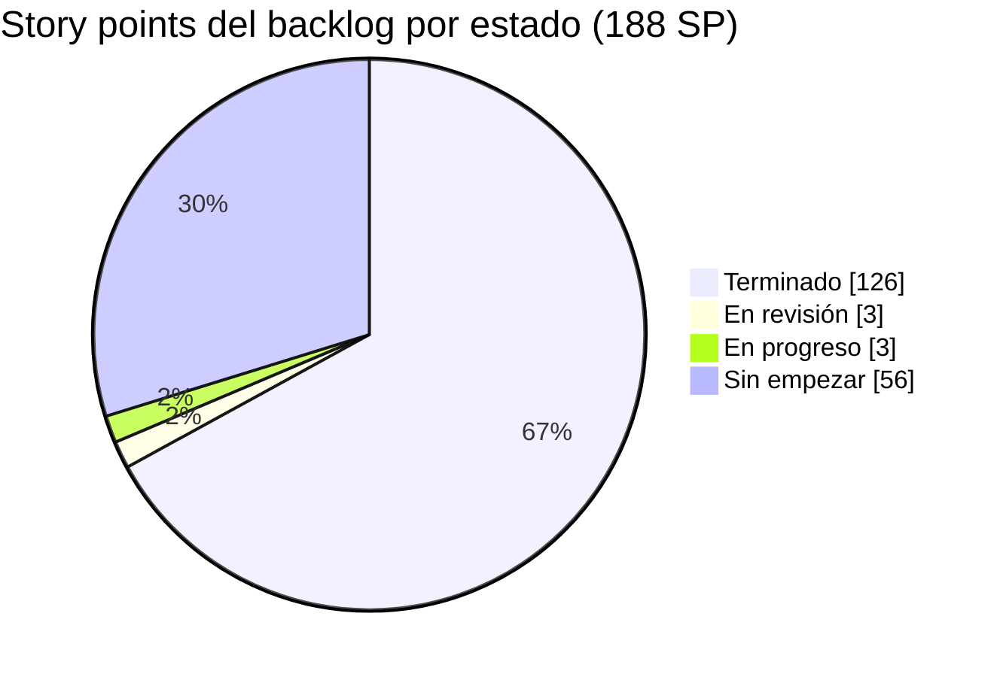
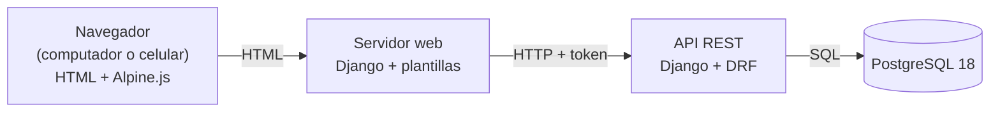
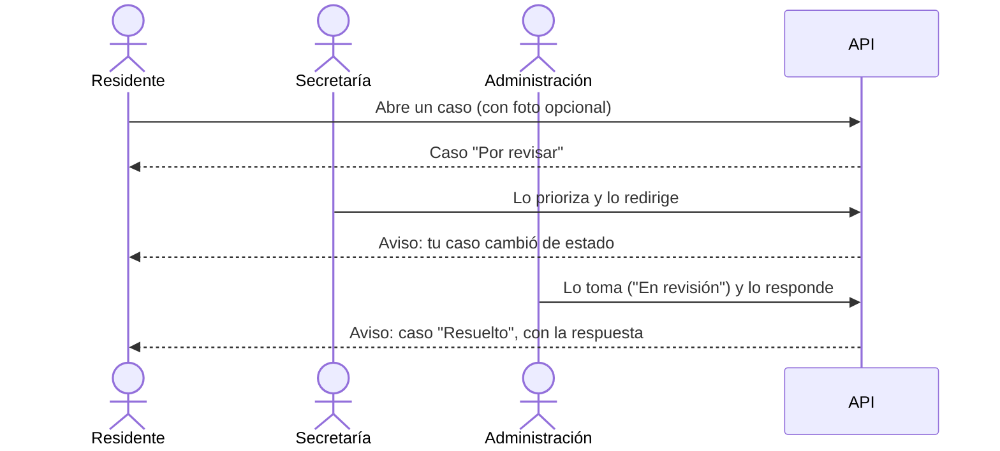
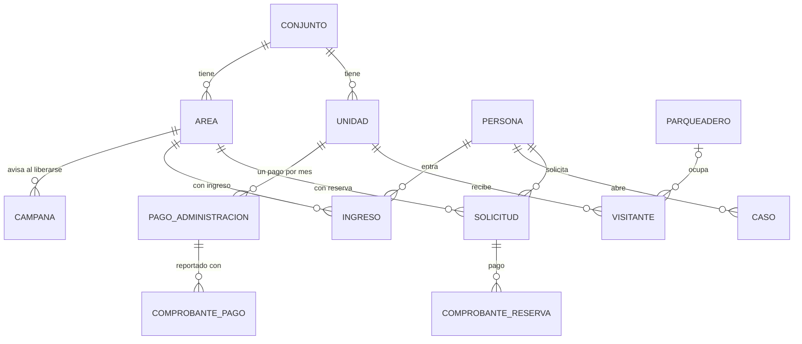
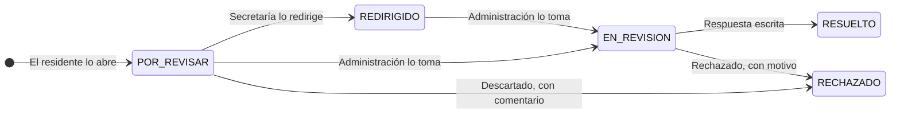
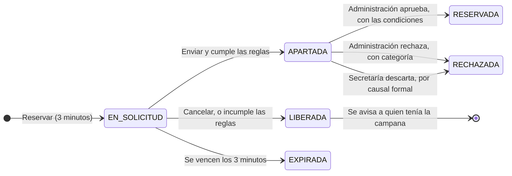

# AdMind — Informe de avance 5

| Dato                 | Detalle                                             |
| -------------------- | --------------------------------------------------- |
| **Proyecto**         | AdMind — administración de conjuntos residenciales  |
| **Asignatura**       | Ingeniería de Software II                           |
| **Institución**      | Universidad de Cundinamarca, sede Facatativá        |
| **Integrantes**      | Manuel Alejandro Aldana Rincón · Camilo Remiso Niño |
| **Docente**          | OSCAR OCHOA                                         |
| **Fecha de corte**   | 13 de octubre de 2026                               |
| **Informe anterior** | 6 de octubre de 2026                                |

> [!success] Resumen del corte
> - **Sprints 1, 2, 3 y 4 terminados:** 20 historias de usuario y 99 story points (SP).
> - **26 de 38 historias terminadas (126 de 188 SP, 67 %)**, contando seis historias de los Sprints 5 y 7. Una más está en revisión y otra en progreso (6 SP).
> - **Dashboard de gestión:** la administración y la secretaría atienden en una sola pantalla, con pestañas, las solicitudes de reserva y los casos que abren los residentes. Cada decisión le llega al residente como aviso.
> - **Portería y pagos:** registro de la salida de los visitantes, parqueaderos de visitantes atados a la visita, pago declarado del alquiler de una reserva y reporte del pago de la administración.
> - **Zonas comunes con ingreso:** el gimnasio o la cancha ya no se reservan; Vigilancia registra quién entra y quién sale, con control de cupos.
> - **Pruebas automáticas:** 708 en el backend y 417 en el frontend, **todas pasan**. Frente al informe anterior son 292 y 209 más, y la prueba que fallaba volvió a verde.



> [!NOTE] Cómo se cuenta una historia terminada en este informe
> El estado de cada historia es el del tablero Scrum del equipo en Notion (sección 6). Una historia **en revisión** está construida y espera la revisión del otro integrante; una **en progreso** tiene una parte funcionando y otra por construir.

**Contenido**

1. [Qué es AdMind](#1.%20Qué%20es%20AdMind)
2. [Tipo de aplicación](#2.%20Tipo%20de%20aplicación)
3. [Entorno de trabajo y tecnologías](#3.%20Entorno%20de%20trabajo%20y%20tecnologías)
4. [Repositorios](#4.%20Repositorios)
5. [Estructura del proyecto](#5.%20Estructura%20del%20proyecto)
6. [Seguimiento y estado de las historias](#6.%20Seguimiento%20y%20estado%20de%20las%20historias)
7. [Avance a la fecha](#7.%20Avance%20a%20la%20fecha)
8. [Evidencias por pantalla](#8.%20Evidencias%20por%20pantalla)
9. [Pendientes y próximos pasos](#9.%20Pendientes%20y%20próximos%20pasos)

---

## 1. Qué es AdMind

AdMind es una aplicación para administrar **conjuntos residenciales bajo régimen de propiedad horizontal en Colombia** (Ley 675 de 2001). Hoy muchos conjuntos se administran con grupos de WhatsApp y hojas de cálculo. AdMind reúne en un solo sistema la reserva de zonas comunes, los residentes y sus viviendas, los anuncios, los visitantes, los pagos y las solicitudes a la administración.

Se apoya en cuatro pilares:

- **Multiconjunto:** una sola plataforma para varios conjuntos, con los datos de cada uno aislados de los demás.
- **Reglas configurables:** cada conjunto configura sus reglas de reserva según su propio reglamento.
- **Reserva por orden de llegada:** bloqueo temporal de 3 minutos sobre una franja y aprobación humana.
- **El sistema registra, no decide:** en infracciones, dinero y lo que la ley reserva a la asamblea.

> [!info] Lo nuevo de este corte frente a los pilares
> - **Reglas configurables:** cada área se configura **con reserva** (salón comunal, BBQ) o **con ingreso** (gimnasio, cancha), y el modo se puede cambiar después. Las áreas con reserva ganaron dos reglas nuevas: *una reserva al día* y *sin franjas seguidas*.
> - **Reserva por orden de llegada:** si la franja está ocupada, el residente activa una **campana** y el sistema le avisa cuando se libere. La administración puede dejar declarado el pago del alquiler.
> - **El sistema registra, no decide:** el pago de la administración lo **reporta** el residente con su comprobante y lo **confirma** una persona de la administración. El sistema no cobra ni calcula multas.

---

## 2. Tipo de aplicación

> [!IMPORTANT] AdMind es una aplicación **web**
> No es una aplicación móvil. Se usa desde el navegador, en computador o en celular, y las pantallas se adaptan al tamaño de la pantalla. No se desarrolla una app nativa para Android ni para iOS.

**Por qué web:** porque ofrece portabilidad y funciona en varios tipos de dispositivos sin limitaciones de arquitectura ni de sistema operativo.

Desde este corte, en pantallas angostas el menú lateral se abre como un panel desplegable desde un botón de la barra superior, y la barra cabe en una sola fila.

### 2.1 Cómo está armada

El sistema son **dos servidores** que se comunican por una API:

- **API (backend):** Django con Django REST Framework. Es el único que habla con la base de datos y donde viven las reglas del negocio.
- **Servidor web (frontend):** Django con plantillas HTML. Arma las pantallas que ve el usuario y le pide todos los datos a la API.
- **Navegador:** recibe HTML. Usa **Alpine.js** solo en las pantallas que lo necesitan, como la cuenta regresiva de la reserva, el paso de viviendas del asistente o el check de los pagos.



> [!example] Captura 1 · AdMind en computador y en celular
> La misma pantalla (por ejemplo, el dashboard de gestión) en los dos tamaños; en el celular, con el menú desplegable abierto.
>
> | Computador | Celular |
> | ---------- | ------- |
> | *(pega aquí la captura)* | *(pega aquí la captura)* |

---

## 3. Entorno de trabajo y tecnologías

AdMind **no está desarrollado en .NET**: está hecho en **Python con el framework Django**. Aun así, respeta la organización por capas de la plantilla ASP.NET que se usó como referencia en clase.

> [!example] Captura 2 · Espacio de trabajo en Visual Studio Code
> Los tres proyectos abiertos en el mismo espacio de trabajo, con las carpetas nuevas `apps/casos`, `apps/ingresos`, `apps/pagos` y `apps/parqueaderos` a la vista.
>
> *(pega aquí la captura)*

### 3.1 Tecnologías

Las versiones no cambiaron desde el informe anterior y **no se agregó ninguna dependencia**. Lo nuevo de este corte (comprobantes de pago, casos con foto, campanas y avisos) se construyó con lo que ya traen Django y Django REST Framework.

| Aspecto                         | Qué usamos                                                              | Versión    |
| ------------------------------- | ----------------------------------------------------------------------- | ---------- |
| Lenguaje                        | Python                                                                  | 3.14       |
| Framework del backend           | Django (versión LTS, con soporte extendido)                             | 5.2.17     |
| API REST                        | Django REST Framework                                                   | 3.18       |
| Frontend                        | Django con plantillas HTML y CSS propio del sistema de diseño de AdMind | 5.2.17     |
| Interacción en el navegador     | Alpine.js, guardado dentro del proyecto (no se carga de internet)       | 3.17.4     |
| Conexión del front con la API   | requests                                                                | 2.34       |
| Base de datos                   | PostgreSQL                                                              | 18         |
| Conector de Python a PostgreSQL | psycopg                                                                 | 3.3        |
| Pruebas automáticas             | pytest + pytest-django, en los dos servidores                           | 9.1 / 4.14 |
| Segundo factor (TOTP)           | django-otp                                                              | 1.7        |
| Código QR del segundo factor    | qrcode, en SVG                                                          | 8.2        |
| Correo (avisos y recuperación)  | Envío por SMTP con el módulo de correo de Django                        | 5.2.17     |

### 3.2 Herramientas

| Para qué                              | Herramienta                                                               |
| ------------------------------------- | ------------------------------------------------------------------------- |
| Editor de código                      | Visual Studio Code, con un espacio de trabajo que abre los tres proyectos |
| Terminal                              | Git Bash                                                                  |
| Control de versiones                  | Git + GitHub                                                              |
| Diseño y consulta de la base de datos | DBeaver                                                                   |
| Seguimiento Scrum                     | Notion (ver sección 6)                                                    |
| Documentación                         | Obsidian, con la bóveda versionada en GitHub                              |

### 3.3 Equivalencia con .NET

| En la plantilla ASP.NET | En AdMind (Django) | Ejemplo en el código |
|---|---|---|
| `Controllers/` | `views.py` + `urls.py` | `apps/casos/views.py` |
| `Dtos/` | `serializers.py` | `apps/casos/serializers.py` |
| `Services/` | `servicios.py` | `apps/casos/servicios.py` |
| `Repositories/` | Managers del ORM de Django | `Caso.objects`, `apps/comun/aislamiento/managers.py` |
| `Utilities/` | `apps/comun/` | `apps/comun/aislamiento/`, `apps/comun/archivos/` |
| Entidades / modelos | `models.py` | `apps/pagos/models.py` |
| `appsettings.json` | `config/settings.py` + archivo `.env` | `config/settings.py` |
| Paquetes NuGet | `requirements.txt` (pip) | `requirements.txt` |
| Migraciones de Entity Framework | Migraciones de Django | `apps/*/migrations/` |
| xUnit / NUnit | pytest | `apps/*/tests.py`, `tests/` |

---

## 4. Repositorios

El código y la documentación están en **tres repositorios separados** en la cuenta de GitHub `ZeroFour-04`:

| Repositorio | Qué contiene | Enlace | Último commit al corte |
|---|---|---|---|
| `Admind_Backend` | API REST (Django + Django REST Framework) | https://github.com/ZeroFour-04/Admind_Backend | `7eb5b5a` "boton eliminar conjunto", en `desarrollo` (13/10 12:25) |
| `Admind_Front-End` | Servidor web con las pantallas | https://github.com/ZeroFour-04/Admind_Front-End | `8279616` "boton eliminar conjunto", en `desarrollo` (13/10 12:25) |
| `Admind_Documentacion` | Documentación del proyecto (bóveda de Obsidian) | https://github.com/ZeroFour-04/Admind_Documentacion | `e08a958` "Dashboard beta", en `main` (13/10 11:55) |

> [!success] Todo el trabajo del corte está en GitHub
> Desde el informe anterior entraron **9 commits al backend y 11 al frontend** en la rama `desarrollo`, de los dos integrantes. El 13/10 los cambios locales se integraron encima de los de Camilo del 12/10 sin reescribir la historia de la rama; hubo un solo conflicto, en el formulario de editar un área, y se conservaron los dos campos.

> [!example] Captura 3 · Repositorios en GitHub
> La rama `desarrollo` de los dos repositorios de código, con los commits del 6 al 13 de octubre.
>
> | Backend | Frontend |
> | ------- | -------- |
> | *(pega aquí la captura)* | *(pega aquí la captura)* |

### 4.1 Modelo de ramas

Definido por el docente para los repositorios de código:

| Rama | Qué contiene |
|---|---|
| `main` | Lo entregado |
| `desarrollo` | Integración: los dos integrantes trabajan directamente aquí |
| `pruebas` | Lo terminado, listo para probar antes de pasar a `main` |

No se usan ramas por historia. El repositorio de documentación trabaja solo con `main`.

**Estado al corte:**
- Todo el trabajo está en `desarrollo` y subido a GitHub.
- `main` sigue con la versión inicial de cada repositorio.
- En el frontend la rama `pruebas` existe en GitHub, igual a `main`. En el backend todavía no está en GitHub. El paso de `desarrollo` a `pruebas` por pull request está en la sección 9.
- Los commits del 13/10 de Alejo retoman el formato `tipo(app): descripción [HU-XX]`; el resto todavía lleva mensajes cortos.

### 4.2 Documentación

La bóveda sigue la organización en carpetas numeradas del informe anterior. El 11/10 se puso al día contra el código: cada nota de estado dice cómo está hoy, cada historia enlaza la nota de su módulo y su plan de trabajo, y los planes ya ejecutados pasaron a `07_Planes/hechos/`.

```
Admind_Documentacion/
├── README.md                Índice: una línea por nota
├── 01_Contexto/             Qué es el proyecto, equipo, alcance y marco legal
├── 02_Arquitectura/         Cómo está hecho: mapa del código, backend, frontend y pruebas
├── 03_Reglas/               Lo que se respeta al construir: capas, aislamiento, Git y Scrum
├── 04_Diseno/               Sistema visual
├── 05_Modulos/              Reglas de negocio de cada módulo (reservas, pagos, ingresos…)
├── 06_Decisiones/           Decisiones cerradas, tomadas al construir y abiertas
├── 07_Planes/               Planes de trabajo, todos ejecutados al corte
├── 08_Estado/               Estado actual, historias, pendientes y bitácora
├── 09_Protocolos/           Pasos de las tareas que se repiten, con sus plantillas
├── Guias/                   Tutoriales: estructura actual, desarrollo e instalación
└── Archivo/
    └── Informes/
        ├── 2026-09-15/        Informe 1
        ├── 2026-09-21/        Informe 2
        ├── 2026-09-29/        Informe 3
        ├── 2026-10-06/        Informe 4
        └── 2026-10-13/        Este informe
```

---

## 5. Estructura del proyecto

### 5.1 Espacio de trabajo

```
A D M I N D/
├── Backend/Admind_Backend/                repositorio de la API
├── Frontend/Admind_Front-End/             repositorio del servidor web
└── Documentacion/Admind_Documentacion/    repositorio de documentación (bóveda de Obsidian)
```

### 5.2 Backend

Lo marcado con `[nuevo]` entró desde el informe anterior; `[cambió]` ya existía y se amplió.

```
Admind_Backend/
├── config/                    Configuración del proyecto Django
│   ├── settings.py              Ajustes; la clave y la conexión a la base se leen de .env
│   ├── settings_pruebas.py      Ajustes para las pruebas automáticas
│   └── urls.py                  Rutas raíz: /auth/, /conjuntos/, /unidades/, /notificaciones/, /anuncios/,
│                                /areas/, /personas/, /reglas/, /reservas/, /visitantes/, /documentos/,
│                                /ingresos/, /parqueaderos/, /pagos/, /casos/                     [cambió]
├── apps/                      Una carpeta por módulo del sistema
│   ├── personas/                Persona única por documento; límites de nombres y teléfono      [cambió]
│   ├── cuentas/                 Sesión, recuperación, segundo factor, usuarios, roles y perfil  [cambió]
│   ├── conjuntos/               Asistente, requisitos para operar, identidad y eliminar         [cambió]
│   ├── permisos/                Catálogo de 5 roles y sus permisos; un rol por conjunto         [cambió]
│   ├── auditoria/               Registro de solo inserción: quién hizo qué, antes y después
│   ├── areas/                   Áreas comunes: modo de uso, aforo y condiciones del alquiler    [cambió]
│   ├── unidades/                Viviendas, agrupaciones, vínculos y generador en lote           [cambió]
│   ├── reglas/                  Motor de reglas por niveles, con 4 tipos nuevos                 [cambió]
│   ├── reservas/                Franjas, bloqueo, envío, decisión, campana y pago declarado     [cambió]
│   ├── ingresos/                Ingreso y salida de residentes a zonas sin reserva              [nuevo]
│   ├── visitantes/              Ingreso, salida y parqueadero de los visitantes (HU-27, HU-28)  [cambió]
│   ├── parqueaderos/            Puestos de parqueadero de visitantes, con código (HU-28)        [nuevo]
│   ├── pagos/                   Pago de la administración: reporte, confirmación y mora (HU-35) [nuevo]
│   ├── casos/                   Casos de los residentes y su ciclo de atención (HU-29)          [nuevo]
│   ├── documentos/              Reglamento del conjunto en PDF
│   ├── notificaciones/          Canal interno: bandeja de la persona y correo
│   ├── anuncios/                Tablón con alcance de conjunto o vivienda y fotos
│   ├── comun/                   Piezas compartidas
│   │   ├── aislamiento/           Filtro de datos por conjunto
│   │   ├── archivos/              Validación de comprobantes por su firma (PDF, JPG, PNG)       [nuevo]
│   │   ├── bloqueo/               Mecanismo compartido de bloqueo y expiración
│   │   └── modelos_base/          Modelo base de toda tabla que pertenece a un conjunto
│   └── citas/, infracciones/, …  Módulos siguientes, por ahora solo con su README
├── tests/                     Pruebas transversales
│   ├── aislamiento/             Prueba del intruso y revisión de todas las rutas
│   ├── archivos/                Validación de los comprobantes                                   [nuevo]
│   ├── concurrencia/            Franjas, último cupo de una zona y último parqueadero            [cambió]
│   └── esquema/                 Lista cerrada de tablas globales
├── manage.py
├── pytest.ini
└── requirements.txt
```

### 5.3 Frontend

```
Admind_Front-End/
├── config/                    Configuración; la dirección de la API se lee de .env
├── cliente_api/               Único punto que llama a la API
│   ├── http.py                  Envía cada petición con el token y traduce los errores
│   ├── reservas.py              Franjas, bloqueo, envío, decisión, descarte, campana y pago      [cambió]
│   ├── casos.py                 Casos y sus acciones                                            [nuevo]
│   ├── ingresos.py              Zonas con ingreso, ingreso y salida                             [nuevo]
│   ├── pagos.py, parqueaderos.py  Pagos de administración y parqueaderos                        [nuevo]
│   └── cuentas.py, conjuntos.py, unidades.py, reglas.py, areas.py, documentos.py,
│       visitantes.py, personas.py, anuncios.py, notificaciones.py
├── apps/                      Una carpeta por módulo de pantallas
│   ├── triage/                  Dashboard de gestión con pestañas Reservas, Casos y Citas        [cambió]
│   ├── casos/                   Abrir un caso, mis casos y el detalle con las acciones de cada rol [nuevo]
│   ├── ingresos/                Ingreso a zonas (Vigilancia) e historial (Administración)        [nuevo]
│   ├── pagos/                   Tabla de pagos con buscador y check, y «Mis pagos»               [nuevo]
│   ├── parqueaderos/            Puestos de parqueadero de visitantes                             [nuevo]
│   ├── unidades/                Recuadros por agrupación, buscador y vínculos                    [cambió]
│   ├── usuarios/                Lista agrupada por rol, con buscador                             [cambió]
│   ├── areas/                   Modo de uso, aforo y condiciones del alquiler                    [cambió]
│   ├── reservas/                Calendario, campana, solicitud, decisión y pago                  [cambió]
│   ├── visitantes/              Ingreso, salida y parqueadero                                    [cambió]
│   ├── conjuntos/               Selector, asistente en 7 pasos, identidad y eliminar             [cambió]
│   ├── cuentas/, reglas/, anuncios/, notificaciones/
│   └── paneles/                 Inicio: es la única pantalla que sigue siendo maqueta
├── templates/                 Plantillas base y componentes
│   └── componentes/             Barra superior, menú lateral desplegable según el rol           [cambió]
├── static/                    CSS propio, ícono, Alpine.js y los scripts de cada pantalla
├── design-system/             Colores, tipografía y espaciado
├── tests/                     Pruebas automáticas del servidor web
├── manage.py
└── requirements.txt
```

### 5.4 Flujo por capas

Toda petición a la API sigue el mismo recorrido: **controlador → servicio → repositorio**. La vista no consulta la base directamente y el servicio no sabe nada de HTTP. Ejemplo real de este corte, responder un caso que abrió un residente:

```
POST /casos/<id>/responder/
   │
   ▼
urls.py → views.py (ResponderCasoView)           Controlador: exige sesión, conjunto activo y el permiso
             │                                   de atender casos
             │ valida con serializers.py         DTO: la respuesta escrita es obligatoria
             ▼
          servicios.py (responder)               Servicio: ¿el caso existe en este conjunto?, ¿su estado
             │                                   permite responderlo? Lo deja Resuelto, guarda quién y
             │                                   cuándo, lo registra en la auditoría y avisa al residente
             ▼
          Caso.objects                           Repositorio: bloquea la fila mientras cambia de estado,
                                                 para que dos personas no atiendan el mismo caso a la vez
```

**Qué pasa si se responde sin texto.** El DTO lo rechaza con un 400. Y si alguien intentara guardarlo por otro camino, la base de datos tampoco lo acepta: un caso resuelto sin respuesta viola una restricción de la tabla.



### 5.5 Base de datos

Las tablas se crean con las migraciones de Django sobre PostgreSQL. Desde el informe anterior entraron **25 migraciones nuevas**, y todas se aplican sin error al construir la base de pruebas desde cero. Tablas nuevas o cambiadas:

| Tabla | Qué guarda | Cambio |
|---|---|---|
| `areas_area` | Suma el **modo de uso** (con reserva o con ingreso), la permanencia máxima de las zonas con ingreso y las **condiciones del alquiler** | Cambiada |
| `ingresos_ingreso` | Quién entró a una zona sin reserva, con cuántos acompañantes, quién lo registró y la hora de salida | Nueva |
| `visitantes_visitante` | Suma la **hora de salida**, quién la registró y el parqueadero ocupado | Cambiada |
| `parqueaderos_parqueadero` | Los puestos de parqueadero de visitantes, con un código único por conjunto | Nueva |
| `reservas_solicitud` | Suma quién declaró el pago y cuándo, y la **categoría del rechazo** | Cambiada |
| `reservas_comprobantedepago` | Los comprobantes del pago de una reserva (PDF, JPG o PNG), dentro de la base | Nueva |
| `reservas_campana` | La campana de un residente sobre una franja ocupada, para avisarle cuando se libere | Nueva |
| `pagos_pagodeadministracion` | El pago de la administración de una vivienda en un mes, y quién lo confirmó | Nueva |
| `pagos_comprobante` | Los comprobantes que reportan los residentes | Nueva |
| `casos_caso` y sus fotos | Los casos de los residentes, con su estado, prioridad, respuesta y quién lo atendió | Nueva |
| `reglas_regla` | Admite cuatro tipos nuevos: acompañantes, una reserva al día, sin franjas seguidas y el día límite de pago | Cambiada |
| `conjuntos_conjunto`, `personas_persona` | Límites de texto: 30 caracteres en el nombre del conjunto y en los nombres y apellidos | Cambiadas |

Todas las tablas nuevas tienen `conjunto_id` obligatorio, así que heredan el aislamiento entre conjuntos. Varias reglas del negocio las exige también la base de datos: un parqueadero no lo ocupan dos visitas abiertas a la vez, un caso resuelto siempre lleva respuesta y un rechazo con «Otro motivo» siempre lleva el texto.

**Núcleo del sistema al corte:**



**Estados de un caso:**



---

## 6. Seguimiento y estado de las historias

El seguimiento Scrum se lleva en **Notion**, en el espacio **Seguimiento Scrum 2.0 — AdMind**:

| Base de datos | Qué contiene |
|---|---|
| Historias de Usuario | Las historias del backlog (38 historias y 188 story points), cada una con prioridad, sprint, estado, criterios de aceptación, la casilla de PR revisado y la de prueba hecha por el otro integrante |
| Tareas | Las tareas técnicas de cada historia, con su estado |
| Sprints | Los 7 sprints del proyecto, con las historias de cada uno |

Cada historia pasa por los estados *Sin empezar*, *En progreso*, *En revisión* y *Finalizado*.

> [!example] Captura 4 · Tablero de historias en Notion
> Sprints 1 a 4 en *Finalizado*, HU-24 en *En revisión* y HU-33 en *En progreso*.
>
> *(pega aquí la captura)*

### 6.1 Estado por sprint al corte

| Sprint | Historias | SP | Estado |
|---|---|---|---|
| **1** | HU-01, HU-02, HU-03, HU-04, HU-05, HU-26 | 25 | **Terminado** |
| **2** | HU-06, HU-07, HU-08, HU-09 | 20 | **Terminado** |
| **3** | HU-10, HU-11, HU-12, HU-13 | 26 | **Terminado** |
| **4** | HU-14 a HU-19 | 28 | **Terminado** |
| **5** | HU-20, HU-21, HU-25, HU-27, HU-28, HU-29 | 28 | HU-21, HU-25, HU-27, HU-28 y HU-29 terminadas (23 SP); HU-20 sin empezar |
| **6** | HU-22, HU-23, HU-24, HU-30 a HU-34 | 38 | HU-24 en revisión (3 SP); HU-33 en progreso (3 SP); 6 sin empezar |
| **7** | HU-35, HU-36, HU-37 | 16 | HU-35 terminada (4 SP); 2 sin empezar |
| Condicional | HU-38 | 7 | Sin empezar |
| **Total** | **38** | **188** | **26 terminadas · 1 en revisión · 1 en progreso · 10 sin empezar** |

> [!NOTE] Historias fuera de las cuentas
> **HU-39**, estructura de viviendas, sigue en progreso y sin story points (sección 7.4). **HU-40**, accesibilidad, se creó en Notion y todavía no tiene criterios ni puntos. Ninguna de las dos entra en la tabla.

### 6.2 Estado de las historias

| Estado | Historias | SP |
|---|---|---|
| **Terminado** | HU-01 a HU-19, HU-21, HU-25 a HU-29 y HU-35 (26) | **126** |
| **En revisión** | HU-24 (1) | 3 |
| **En progreso** | HU-33 (1), además de HU-39, sin estimar | 3 |
| **Sin empezar** | Las 10 restantes | 56 |
| **Total** | **38** | **188** |

> [!NOTE] Avance frente a los cortes anteriores
> | Corte | Historias terminadas | SP terminados | Pruebas (back / front) |
> |---|---|---|---|
> | 15/09 (informe 1) | 0 de 38 | 0 de 188 | 69 / 0 |
> | 22/09 (informe 2) | 8 de 38 | 36 de 188 | 171 / 51 |
> | 29/09 (informe 3) | 12 de 38 | 55 de 188 | 331 / 141 |
> | 06/10 (informe 4) | 17 de 38 | 89 de 188 | 416 / 208 |
> | **13/10 (este informe)** | **26 de 38** | **126 de 188** | **708 / 417** |
>
> En esta semana se terminaron 37 SP: los 20 que le faltaban al Sprint 4, 13 del Sprint 5 (HU-27, HU-28 y HU-29) y los 4 de HU-35.

---

## 7. Avance a la fecha

### 7.1 Resumen

| Frente | Estado al 13 de octubre |
|---|---|
| **Backend** | Todo lo del informe anterior, más: cuatro módulos nuevos (ingresos a zonas, parqueaderos, pagos de administración y casos), pago declarado de las reservas, campana de disponibilidad, condiciones del alquiler, categoría de rechazo y descarte por causal formal, avisos al residente en cada decisión, cuatro reglas nuevas, salida de visitantes y eliminar un conjunto |
| **Frontend** | Pantallas nuevas: dashboard de gestión con pestañas, casos, ingreso a zonas, pagos y «Mis pagos», parqueaderos. Rehechas: Unidades (por agrupación y con buscador), Usuarios (por rol y con buscador) y el detalle de una vivienda. Menú desplegable en celular. Solo **Inicio** sigue siendo maqueta |
| **Pruebas** | Backend: **708 pruebas, todas pasan**. Frontend: **417 pruebas, todas pasan** (ver 7.6) |
| **Historias** | **Sprints 1 a 4 terminados**, más HU-21, HU-25, HU-27, HU-28, HU-29 y HU-35: 26 de 38 historias (126 SP) |
| **Repositorios** | Todo en `desarrollo` y en GitHub |
| **Base de datos** | 25 migraciones nuevas, que se aplican sin error. Un ajuste del modelo queda por migrar (sección 9) |

### 7.2 Qué cambió desde el 6 de octubre

| Fecha | Repositorio | Commit | Qué trae |
|---|---|---|---|
| 06/10 12:14 | Front | `f5b3d08` | En pantallas angostas el menú lateral se abre como panel desplegable y la barra superior cabe en una fila |
| 10/10 18:58 | Backend y front | `37f862c`, `74883d3` | **Zonas comunes con ingreso:** modo de uso del área, cupos, regla de acompañantes, y el ingreso y la salida que registra Vigilancia |
| 10/10 20:20 | Backend y front | `2d6bbe0`, `1f624b5` | Pantalla **Unidades** con un recuadro por torre o manzana y un buscador; el detalle de una vivienda vuelve a su agrupación |
| 10/10 23:46 | Backend y front | `f4c8ae6`, `49c3e80` | **Pago declarado de una reserva** (HU-16), **parqueadero de visitantes** y salida de la visita (HU-27, HU-28), **pago de la administración** (HU-35) y dos reglas nuevas: una reserva al día y sin franjas seguidas |
| 11/10 09:29 | Backend y front | `d4e98e5`, `a946880` | La Administración crea conjuntos desde el selector; Usuarios agrupado por rol, con Residente como rol por defecto; buscador de personas y «Crear nuevo residente» en la vivienda |
| 12/10 18:04 | Backend y front | `0b627d1`, `7cd762c` (Camilo) | **Condiciones del alquiler** de cada área (HU-15), **campana** de disponibilidad de franja (HU-18) y la primera parte de los **casos** (HU-29) |
| 13/10 10:58 | Backend y front | `287621c`, `6c61ac4` | El **modo de uso** de un área se puede cambiar al editarla (HU-09) |
| 13/10 10:58 | Backend y front | `87d67c5`, `7121d94` | Límites de texto en el nombre del conjunto, los nombres, los apellidos y el teléfono |
| 13/10 11:02 | Front | `0adf5eb` | «Reglas» sale del menú de Vigilancia |
| 13/10 11:55 | Backend y front | `85f9f23`, `d0e4af7` | **Dashboard de gestión** (HU-14, HU-24, HU-29): pestañas Reservas y Casos, categoría del rechazo, descarte por la Secretaría, avisos al residente y el ciclo completo de los casos |
| 13/10 12:25 | Backend y front | `7eb5b5a`, `8279616` (Camilo) | **Eliminar un conjunto** desde el resumen del asistente, solo para el Superusuario y como baja lógica: el conjunto queda inactivo y su historial se conserva |
| 10/10 a 13/10 | Documentación | `f3f8bca` … `e08a958` | La bóveda acompaña cada cambio, más la puesta al día del 11/10 y el plan del dashboard |

### 7.3 Sprint 4 — terminado (28 SP)

En el informe anterior solo HU-14 estaba terminada. En este corte se cerró el sprint.

| HU | Historia | SP | Qué construye | Commits (back / front) |
|---|---|---|---|---|
| HU-14 | Aprobar o rechazar solicitudes | 8 | La bandeja trae primero la solicitud que más lleva esperando. **Solo la Administración aprueba o rechaza**; el rechazo lleva una **categoría de una lista cerrada** y, con «Otro motivo», el texto. Aprobar, rechazar o descartar le llega al residente como aviso en la aplicación y por correo. Se entra desde la pestaña Reservas del dashboard | `2d11dbe`, `85f9f23` / `d76ac0f`, `fff4651`, `d0e4af7` |
| HU-15 | Condiciones del alquiler | 4 | Cada área con reserva tiene sus condiciones del alquiler, que se escriben al crearla o editarla y que el residente ve en su solicitud | `0b627d1` / `7cd762c` |
| HU-16 | Pago declarado y comprobante | 4 | La Administración declara que el alquiler de una reserva se pagó; queda quién y cuándo, en la auditoría. El residente o la administración suben el comprobante (PDF, JPG o PNG de hasta 5 MB), validado por su contenido y no por su nombre. Una declaración hecha por error se retira con motivo | `f4c8ae6` / `49c3e80` |
| HU-17 | Cancelación de reservas en firme | 3 | | |
| HU-18 | Aviso de disponibilidad (campana) | 6 | Si la franja está ocupada, el residente activa la campana; cuando la franja se libera, el sistema le avisa una sola vez | `0b627d1` / `7cd762c` |
| HU-19 | Dos oportunidades por franja | 3 | | |

**El ciclo de una solicitud de reserva al corte:**



### 7.4 Sprint 5, Sprint 7 y mejoras a historias ya entregadas

**Historias terminadas de los Sprints 5 y 7:**

| HU | Historia | SP | Qué construye | Commits (back / front) |
|---|---|---|---|---|
| HU-27 | Registro de visitantes y vehículos | 5 | Vigilancia registra el ingreso y la **salida** de cada visita. Quien solo registra ve las de hoy y las que siguen adentro; la Administración consulta todo el historial. Cada ingreso y salida queda en la auditoría | `b205932`, `f4c8ae6` / `40bd629`, `49c3e80` |
| HU-28 | Parqueadero de visitantes | 3 | La Administración crea los puestos con su código. Al registrar una visita con vehículo, el vigilante elige uno de los libres y la salida lo libera. Diez registros simultáneos sobre el mismo puesto dejan a una sola visita con él | `f4c8ae6` / `49c3e80` |
| HU-29 | Tablero de casos con respuesta obligatoria | 5 | El residente abre un caso, con foto opcional. La Secretaría lo prioriza (Urgente exige justificación), lo descarta con comentario o lo redirige; la Administración lo toma y lo responde por escrito. El residente recibe un aviso en cada cambio | `0b627d1`, `85f9f23` / `7cd762c`, `d0e4af7` |
| HU-35 | Reporte de pago de administración | 4 | El residente sube el comprobante de un mes de su vivienda; la Administración lo confirma con un check por vivienda y mes, y la Secretaría consulta y busca. Ninguna fila muestra la cédula. El pago confirmado alimenta la regla de paz y salvo, con el día límite de pago que fija el conjunto | `f4c8ae6` / `49c3e80` |

**En revisión y en progreso:**

| HU | Historia | SP | Estado | Qué funciona hoy | Qué falta |
|---|---|---|---|---|---|
| HU-24 | Rechazo por causal formal de la Secretaría | 3 | En revisión | La Secretaría descarta una solicitud de reserva por una causal de forma, de una lista cerrada, con comentario | La revisión del otro integrante |
| HU-33 | Repositorio de documentos vigentes | 3 | En progreso | El reglamento del conjunto en PDF, validado y con el anterior conservado | Otros documentos, las actas y la descarga para el residente |
| HU-39 | Estructura de viviendas | Por estimar | En progreso | El generador en lote del asistente y, desde este corte, la pantalla Unidades por agrupación | Que todas las pantallas usen las palabras del conjunto (Torre, Manzana…) y retirar viviendas con confirmación |

**Mejoras a historias terminadas en informes anteriores:**

| HU | Qué se mejoró en este corte |
|---|---|
| HU-03 Asistente de creación | La Administración ve «Crear conjunto» en el selector sin entrar antes a un conjunto. El Superusuario puede **eliminar** un conjunto desde el resumen, como baja lógica, y ve también los conjuntos que todavía no están activos |
| HU-06 Roles | Al registrar a alguien, el rol marcado es **Residente**, no Administración. Los roles se ofrecen de menos a más poder |
| HU-08 Vínculos | En el detalle de la vivienda, la persona se busca por nombre, correo o cédula, y desde ahí se puede crear un residente |
| HU-09 Áreas comunes | Cada área es **con reserva** o **con ingreso**, y el modo se cambia al editarla: el sistema retira las reglas que ya no aplican y avisa cuántas reservas o personas adentro quedan afectadas |
| HU-10 Reglas | Dos reglas nuevas para las áreas con reserva: *una reserva al día* (el caso del salón comunal) y *sin franjas seguidas* para una misma vivienda |
| HU-13 Envío | La regla de paz y salvo ya restringe: consulta los pagos de la administración |
| HU-05 Aislamiento | Las rutas nuevas y las que faltaban están en la prueba del intruso, que vuelve a pasar |

**Sin historia en el backlog:** el **ingreso a zonas comunes sin reserva** (gimnasio, cancha, piscina). Vigilancia busca al residente, registra su entrada con sus acompañantes y su salida; el sistema controla el cupo de la zona, saca automáticamente a quien supera la permanencia máxima y le avisa. La Administración ve el historial.

### 7.5 Decisiones

Decisiones tomadas por el equipo desde el informe anterior, en palabras:

| Fecha | Decisión | Quién |
|---|---|---|
| 08/10 | Las áreas comunes se dividen en **con reserva** y **con ingreso**. Las de ingreso no se reservan: Vigilancia registra quién entra, con un cupo y una permanencia máxima | Alejo |
| 08/10 | En las zonas con ingreso, la pantalla de Vigilancia no copia el documento del residente y el historial solo lo ve la Administración, porque quién entra es un dato personal | Alejo |
| 10/10 | Las franjas seguidas se cuentan **por vivienda** y no por persona, igual que el límite de reservas | Alejo |
| 10/10 | Los parqueaderos de visitantes son **puestos con código** que crea la Administración y que el vigilante elige, no un contador de cupos | Alejo |
| 10/10 | El pago del alquiler de una reserva lo **declara la Administración**, y aprobar la reserva no depende del pago. El residente puede subir su comprobante sin declarar nada | Alejo |
| 10/10 | Los comprobantes se guardan **dentro de la base de datos**, como el logo, el reglamento y las fotos, para que el respaldo de la base los incluya | Alejo |
| 10/10 | El pago de la administración se confirma con un **check por vivienda y mes**; solo la Administración lo marca y la Secretaría consulta. Ver los pagos exige el segundo factor | Alejo |
| 10/10 | El pago confirmado alimenta la regla de **paz y salvo**: sin día límite de pago no hay mora, y la mora solo afecta las reservas y los ingresos a zonas comunes | Alejo |
| 11/10 | La Administración puede crear conjuntos desde el selector. Al registrar a alguien, el rol por defecto es Residente | Alejo |
| 11/10 | Desde el detalle de una vivienda **solo se crean residentes**; los demás roles se asignan en Usuarios | Alejo |
| 13/10 | El **modo de uso** de un área se puede cambiar después de crearla. Al cambiarlo se retiran las reglas del modo anterior, sin tocar las reservas ya hechas | Alejo |
| 13/10 | **La Secretaría clasifica y no aprueba:** en reservas descarta por causal formal; en casos prioriza, descarta y redirige. Aprobar y responder es de la Administración | Alejo |
| 13/10 | El dashboard de gestión son **tres pestañas separadas** (Reservas, Casos y Citas), con aspecto de tabla. Las reservas no llevan prioridad; los casos sí | Alejo |
| 13/10 | Límites de texto: **30 caracteres** en el nombre del conjunto y en los nombres y apellidos de una persona | Alejo |
| 13/10 | Un conjunto **no se borra**: eliminarlo lo deja inactivo y conserva su historial. Solo lo hace el Superusuario | Camilo |
| 13/10 | Vigilancia deja de ver «Reglas» en el menú | Alejo |

### 7.6 Estado de las pruebas

**Backend — 708 pruebas, todas pasan.**

| Grupo | Pruebas | Qué cubre | HU |
|---|---|---|---|
| `apps/personas` | 19 | Persona única por documento, búsqueda exacta con auditoría y límite, y los límites de texto | HU-04, HU-07 |
| `apps/cuentas` | 67 | Sesión, recuperación, segundo factor, usuarios, perfil y teléfono | HU-01, HU-02, HU-06, HU-26 |
| `apps/conjuntos` | 67 | Asistente, requisitos, quién crea, eliminar el conjunto e identidad | HU-03, HU-21, HU-26 |
| `apps/permisos` | 43 | Catálogo, asignaciones, un rol por conjunto y nunca cero Administración | HU-06 |
| `apps/auditoria` | 6 | Registro de solo inserción | Transversal |
| `apps/areas` | 22 | Horario, aforo, modo de uso y su cambio, y condiciones del alquiler | HU-09, HU-15 |
| `apps/unidades` | 45 | Viviendas, vínculos, agrupaciones y el generador en lote | HU-08, HU-39 |
| `apps/reglas` | 61 | Reglas por niveles, tipos nuevos, versionado y evaluación completa | HU-10, HU-13 |
| `apps/reservas` | 63 | Franjas, bloqueo, envío, decisión con categoría, descarte, avisos, campana y pago | HU-11 a HU-16, HU-18, HU-24 |
| `apps/ingresos` | 41 | Zonas con ingreso: cupos, acompañantes, salida y quién ve el historial | Sin historia |
| `apps/visitantes` | 27 | Ingreso, salida, parqueadero y quién ve qué | HU-27, HU-28 |
| `apps/parqueaderos` | 14 | Puestos con código único, desactivar y quién los gestiona | HU-28 |
| `apps/pagos` | 68 | Reporte, check por vivienda y mes, buscador, comprobantes y mora | HU-35 |
| `apps/casos` | 19 | Ciclo del caso, prioridad, respuesta obligatoria, avisos y permisos de cada rol | HU-29 |
| `apps/anuncios`, `apps/notificaciones`, `apps/documentos` | 38 | Tablón con fotos, bandeja de avisos y reglamento | HU-25, HU-33 |
| `tests/aislamiento` | 86 | Filtro por conjunto, prueba del intruso por ruta y revisión de todas las rutas | HU-05 |
| `tests/archivos` | 12 | Validación de comprobantes por su contenido | HU-16, HU-35 |
| `tests/concurrencia` | 7 | Diez residentes sobre la misma franja, el último cupo de una zona y el último parqueadero | HU-11, HU-28 |
| `tests/esquema` | 3 | Lista cerrada de tablas globales | HU-05 |
| **Total** | **708** | **Todas pasan** | |

> [!success] La prueba que fallaba en el informe anterior ya pasa
> `test_toda_ruta_de_la_api_esta_cubierta` revisa que **toda** ruta de la API esté en la prueba del intruso, la que comprueba que nadie vea datos de otro conjunto. Las cinco rutas que faltaban (perfil, eliminar usuario y las tres de solicitudes) se registraron, junto con las de los módulos nuevos.

**Frontend — 417 pruebas, todas pasan:**

| Archivo | Pruebas | Qué cubre | HU |
|---|---|---|---|
| `tests/test_reservas.py` | 64 | Calendario, bloqueo, envío, decisión con categoría, descarte, campana y pago | HU-11 a HU-16, HU-18 |
| `tests/test_acentos.py` | 38 | Contraste de los 8 acentos y del color propio | HU-21, HU-26 |
| `tests/test_identidad.py` | 32 | Color, foto, ícono y el menú desplegable en celular | HU-21 |
| `tests/test_pagos.py` | 31 | Tabla de pagos, buscador, check y «Mis pagos» | HU-35 |
| `tests/test_reglas.py` | 30 | Tablero por niveles y las reglas nuevas | HU-10 |
| `tests/test_unidades.py` | 28 | Recuadros por agrupación, buscador, vínculos y crear residente | HU-08, HU-39 |
| `tests/test_anuncios.py` | 25 | Tablón, publicar, editar y fotos | HU-25 |
| `tests/test_areas.py` | 24 | Modo de uso, aforo y condiciones del alquiler | HU-09, HU-15 |
| `tests/test_usuarios.py` | 23 | Lista por rol, rol por defecto y teléfono | HU-06, HU-07 |
| `tests/test_visitantes.py` | 22 | Ingreso, salida y parqueadero en portería | HU-27, HU-28 |
| `tests/test_ingresos.py` | 19 | Ingreso a zonas, historial y el menú de Vigilancia | Sin historia |
| `tests/test_casos.py` | 17 | Abrir un caso, la lista y el detalle con las acciones de cada rol | HU-29 |
| `tests/test_parqueaderos.py` | 15 | Pantalla de parqueaderos | HU-28 |
| `tests/test_triage.py` | 12 | Dashboard con pestañas | HU-14, HU-29 |
| `tests/test_recuperacion.py`, `tests/test_segundo_factor.py` | 20 | Recuperación de contraseña y segundo factor | HU-01, HU-02 |
| `tests/test_asistente_reglamento.py`, `tests/test_asistente_viviendas.py` | 12 | Pasos del asistente, resumen y eliminar el conjunto | HU-03, HU-39 |
| `tests/test_limites_de_texto.py`, `tests/test_cuenta_perfil.py` | 5 | Límites de texto y Mi perfil | — |
| **Total** | **417** | **Todas pasan** | |

> [!example] Captura 5 · Pruebas automáticas en la terminal
> Salida de `pytest` en los dos servidores: "708 passed" en el backend y "417 passed" en el frontend.
>
> | Backend | Frontend |
> | ------- | -------- |
> | *(pega aquí la captura)* | *(pega aquí la captura)* |

### 7.7 Rutas nuevas de la API

Las rutas de los informes anteriores siguen. Tres cambiaron: `PATCH /areas/<id>/` acepta el modo de uso, `POST /reservas/solicitudes/<id>/decision/` exige la categoría al rechazar, y `DELETE /conjuntos/actual/` da de baja el conjunto activo. Estas son las nuevas:

| Módulo | Método | Ruta | Qué hace |
|---|---|---|---|
| Ingresos | `GET` | `/ingresos/zonas/` | Zonas con ingreso, con sus cupos libres |
| Ingresos | `POST` | `/ingresos/residentes/buscar/` | Busca al residente que va a entrar |
| Ingresos | `GET` / `POST` | `/ingresos/` | Lista los ingresos o registra uno, con sus acompañantes |
| Ingresos | `POST` | `/ingresos/<id>/salida/` | Registra la salida |
| Visitantes | `POST` | `/visitantes/<id>/salida/` | Registra la salida de una visita y libera su parqueadero |
| Parqueaderos | `GET` / `POST` | `/parqueaderos/` | Lista o crea los puestos |
| Parqueaderos | `POST` | `/parqueaderos/<id>/desactivar/` | Retira un puesto |
| Reservas | `POST` | `/reservas/campanas/` | Activa la campana sobre una franja ocupada |
| Reservas | `POST` | `/reservas/solicitudes/<id>/descarte/` | La Secretaría descarta por causal formal |
| Reservas | `POST` | `/reservas/solicitudes/<id>/pago/` | Declara el pago del alquiler |
| Reservas | `POST` | `/reservas/solicitudes/<id>/pago/retirar/` | Retira una declaración, con motivo |
| Reservas | `GET` / `POST` | `/reservas/solicitudes/<id>/comprobantes/` | Lista o sube comprobantes de la reserva |
| Reservas | `GET` | `/reservas/comprobantes/<id>/` | Entrega un comprobante |
| Pagos | `GET` | `/pagos/administracion/` | Tabla de pagos del conjunto, con buscador |
| Pagos | `POST` | `/pagos/administracion/<vivienda>/<mes>/confirmacion/` | Pone o quita el check de un mes |
| Pagos | `POST` | `/pagos/administracion/reportes/` | El residente reporta un pago con su comprobante |
| Pagos | `GET` | `/pagos/administracion/mios/` | Los pagos de las viviendas del residente |
| Pagos | `GET` | `/pagos/administracion/comprobantes/<id>/` | Entrega un comprobante |
| Casos | `GET` / `POST` | `/casos/` | Lista los casos o abre uno |
| Casos | `GET` | `/casos/<id>/` | Detalle del caso |
| Casos | `POST` | `/casos/<id>/tomar/`, `/prioridad/`, `/redirigir/`, `/descartar/`, `/responder/`, `/rechazar/` | Las acciones del ciclo del caso, según el rol |
| Casos | `GET` | `/casos/<id>/fotos/<foto>/` | Entrega una foto del caso |

Cada ruta está documentada en el README de su app en el backend.

### 7.8 Historias de usuario al corte

**Terminadas (26 historias, 126 SP):**

| HU | Historia | Sprint | SP |
|---|---|---|---|
| HU-01 | Inicio de sesión con correo y contraseña | 1 | 3 |
| HU-02 | Segundo factor (TOTP) para permisos sensibles | 1 | 5 |
| HU-03 | Asistente por pasos para crear un conjunto | 1 | 6 |
| HU-04 | Persona global única por documento | 1 | 3 |
| HU-05 | Aislamiento de datos entre conjuntos | 1 | 2 |
| HU-26 | Selector de conjunto activo | 1 | 6 |
| HU-06 | Asignación de roles del catálogo fijo | 2 | 6 |
| HU-07 | Vincular persona existente por documento | 2 | 3 |
| HU-08 | Vínculos de unidad y enrutamiento de avisos | 2 | 7 |
| HU-09 | Catálogo de áreas comunes | 2 | 4 |
| HU-10 | Reglas de reserva configurables | 3 | 9 |
| HU-11 | Bloqueo exclusivo de 3 minutos | 3 | 7 |
| HU-12 | Confirmación antes de enviar | 3 | 2 |
| HU-13 | Envío y evaluación de las reglas | 3 | 8 |
| HU-14 | Bandeja del administrador: aprobar o rechazar | 4 | 8 |
| HU-15 | Condiciones del alquiler | 4 | 4 |
| HU-16 | Registro de pago declarado y comprobante | 4 | 4 |
| HU-17 | Cancelación de reservas en firme | 4 | 3 |
| HU-18 | Aviso de disponibilidad de franja (campana) | 4 | 6 |
| HU-19 | Dos oportunidades por franja | 4 | 3 |
| HU-21 | Identidad visual del conjunto | 5 | 4 |
| HU-25 | Anuncios con alcance de conjunto o vivienda | 5 | 6 |
| HU-27 | Registro de visitantes y vehículos | 5 | 5 |
| HU-28 | Parqueadero de visitantes atado a la visita | 5 | 3 |
| HU-29 | Tablero de casos con respuesta obligatoria | 5 | 5 |
| HU-35 | Reporte de pago de administración | 7 | 4 |

**En revisión (1 historia, 3 SP):** HU-24 (rechazo por causal formal de la Secretaría).

**En progreso (1 historia, 3 SP):** HU-33 (documentos vigentes), además de HU-39, sin estimar (ver 7.4).

**Sin empezar (10 historias, 56 SP):** HU-20 (anulación de registros), HU-22 y HU-23 (bandeja de triage y prioridad), HU-30 (infracciones), HU-31 y HU-32 (citas), HU-34 (parqueaderos de residentes), HU-36 y HU-37 (importación y respaldo) y HU-38 (registro de actividades).

---

## 8. Evidencias por pantalla

Capturas del sistema funcionando contra la API real, ordenadas por sprint. Las de los Sprints 1 a 3 están en el informe anterior; aquí van las de lo nuevo.

### 8.1 Mejoras a los Sprints 1 a 3

> [!example] Captura 6 · Eliminar un conjunto (HU-03)
> El resumen del asistente visto por el Superusuario, con el botón de eliminar y su confirmación.
>
> | Resumen con el botón | Confirmación |
> | -------------------- | ------------ |
> | *(pega aquí la captura)* | *(pega aquí la captura)* |

> [!example] Captura 7 · Usuarios agrupados por rol (HU-06)
> La lista de usuarios con un desplegable por rol y el buscador, y el formulario de registrar con Residente marcado por defecto.
>
> | Lista por rol | Registrar con Residente por defecto |
> | ------------- | ----------------------------------- |
> | *(pega aquí la captura)* | *(pega aquí la captura)* |

> [!example] Captura 8 · Unidades por agrupación (HU-08, HU-39)
> La pantalla Unidades con un recuadro por torre o manzana, y el buscador encontrando una vivienda por la cédula de quien vive ahí.
>
> | Recuadros por agrupación | Buscador |
> | ------------------------ | -------- |
> | *(pega aquí la captura)* | *(pega aquí la captura)* |

> [!example] Captura 9 · Detalle de una vivienda con buscador de personas (HU-08)
> «Agregar vínculo» con el buscador, y el modal de «Crear nuevo residente».
>
> | Buscador de personas | Crear nuevo residente |
> | -------------------- | --------------------- |
> | *(pega aquí la captura)* | *(pega aquí la captura)* |

> [!example] Captura 10 · Modo de uso de un área (HU-09)
> «Editar área» con los dos modos (con reserva y con ingreso), y el aviso que deja el cambio en la lista de áreas.
>
> | Editar área | Aviso del cambio |
> | ----------- | ---------------- |
> | *(pega aquí la captura)* | *(pega aquí la captura)* |

> [!example] Captura 11 · Reglas nuevas (HU-10)
> El tablero de reglas de un área con *una reserva al día* y *sin franjas seguidas*, y la regla del conjunto *día límite de pago*.
>
> *(pega aquí la captura)*

### 8.2 Sprint 4 — terminado

> [!example] Captura 12 · Dashboard de gestión, pestaña Reservas (HU-14)
> El dashboard con las pestañas Reservas, Casos y Citas, y la lista de solicitudes de la más antigua a la más reciente.
>
> *(pega aquí la captura)*

> [!example] Captura 13 · Aprobar o rechazar con categoría (HU-14)
> La tarjeta de una solicitud vista por la Administración: aprobar con las condiciones, y rechazar con la lista de categorías y el texto de «Otro motivo».
>
> | Aprobar | Rechazar con categoría |
> | ------- | ---------------------- |
> | *(pega aquí la captura)* | *(pega aquí la captura)* |

> [!example] Captura 14 · La Secretaría descarta por causal formal (HU-24)
> La misma tarjeta vista por la Secretaría: sin Aprobar ni Rechazar, con «Descartar» y su causal.
>
> *(pega aquí la captura)*

> [!example] Captura 15 · Aviso al residente (HU-14)
> La bandeja de notificaciones del residente con el aviso de la decisión, y el correo que le llega.
>
> | Aviso en la aplicación | Correo |
> | ---------------------- | ------ |
> | *(pega aquí la captura)* | *(pega aquí la captura)* |

> [!example] Captura 16 · Condiciones del alquiler (HU-15)
> El campo de condiciones al editar un área, y la solicitud del residente donde se leen.
>
> | Editar el área | Lo que ve el residente |
> | -------------- | ---------------------- |
> | *(pega aquí la captura)* | *(pega aquí la captura)* |

> [!example] Captura 17 · Pago declarado y comprobante (HU-16)
> El bloque «Pago» de una solicitud: la declaración de la Administración y el comprobante subido.
>
> *(pega aquí la captura)*

> [!example] Captura 18 · Campana de disponibilidad (HU-18)
> Una franja ocupada en el calendario con la campana activada, y el aviso que llega cuando se libera.
>
> | Campana activada | Aviso de franja libre |
> | ---------------- | --------------------- |
> | *(pega aquí la captura)* | *(pega aquí la captura)* |

### 8.3 Sprints 5 y 7

> [!example] Captura 19 · Portería: ingreso, parqueadero y salida (HU-27, HU-28)
> El formulario de Vigilancia con el selector de parqueaderos libres, y la tabla de visitas con las columnas «Parqueadero» y «Salida» y el botón «Registrar salida».
>
> | Registrar una visita | Visitas del día |
> | -------------------- | --------------- |
> | *(pega aquí la captura)* | *(pega aquí la captura)* |

> [!example] Captura 20 · Parqueaderos de visitantes (HU-28)
> La pantalla de la Administración con los puestos y su código.
>
> *(pega aquí la captura)*

> [!example] Captura 21 · Abrir un caso (HU-29)
> El formulario del residente con la foto opcional, y la lista de sus casos con el estado de cada uno.
>
> | Abrir un caso | Mis casos |
> | ------------- | --------- |
> | *(pega aquí la captura)* | *(pega aquí la captura)* |

> [!example] Captura 22 · Atender un caso (HU-29)
> La pestaña Casos del dashboard y el detalle de un caso con las acciones de la Secretaría (priorizar, redirigir, descartar) y las de la Administración (tomar, responder).
>
> | Pestaña Casos | Detalle del caso |
> | ------------- | ---------------- |
> | *(pega aquí la captura)* | *(pega aquí la captura)* |

> [!example] Captura 23 · Pagos de la administración (HU-35)
> La tabla de la Administración con el buscador y el check por vivienda y mes, y «Mis pagos» del residente con el formulario para reportar.
>
> | Tabla de pagos | Mis pagos |
> | -------------- | --------- |
> | *(pega aquí la captura)* | *(pega aquí la captura)* |

### 8.4 Zonas comunes con ingreso

> [!example] Captura 24 · Ingreso a una zona común
> La pantalla de Vigilancia con las zonas y sus cupos, y el registro del ingreso de un residente con sus acompañantes.
>
> | Zonas y cupos | Registrar el ingreso |
> | ------------- | -------------------- |
> | *(pega aquí la captura)* | *(pega aquí la captura)* |

> [!example] Captura 25 · Menú según el rol
> El menú lateral de un administrador, el de Vigilancia (sin «Reglas») y el de un residente.
>
> | Administrador | Vigilancia | Residente |
> | ------------- | ---------- | --------- |
> | *(pega aquí la captura)* | *(pega aquí la captura)* | *(pega aquí la captura)* |

---

## 9. Pendientes y próximos pasos

**Hecho desde el informe anterior**

- [x] Registrar en la prueba del intruso las cinco rutas que faltaban: la prueba volvió a verde.
- [x] HU-14: aviso al residente cuando su solicitud se decide y lista cerrada de categorías de rechazo.
- [x] HU-27: el registro de visitantes pasa por la capa de servicio, queda en la auditoría y registra la salida.
- [x] Sprint 4 cerrado.
- [x] Salida de visitantes (HU-27), que era "el siguiente en el backlog".
- [x] Retomar el formato de commit con el número de la historia, en los commits del 13/10.
- [x] Notion al día con el código: criterios comparados, HU-39 creada y la historia de accesibilidad renumerada como HU-40.

**Técnicos**

- [ ] El límite del teléfono quedó distinto entre el modelo y su migración: crear la migración que los iguale y aplicarla en la base local.
- [ ] HU-03: dejar en la auditoría el momento en que un conjunto queda operativo, y exigir que esté operativo para poder reservar.
- [ ] Zonas con ingreso y portería: escribir el aviso de tratamiento de datos personales que pide la Ley 1581 de 2012.
- [ ] Probar a mano la liberación de la franja al cerrar la pestaña (HU-11).

**Repositorios y documentación**

- [ ] Subir la rama `pruebas` del backend a GitHub y pasar los Sprints 1 a 4 de `desarrollo` a `pruebas` por pull request, con la revisión cruzada.
- [ ] Llevar el formato de commit con el número de la historia a todos los commits.

**Siguiente en el backlog**

- [ ] **Cerrar lo que está en revisión y en progreso:** HU-24, HU-33 y la segunda parte de HU-39.
- [ ] **Citas (HU-31):** la tercera pestaña del dashboard ya existe y espera su módulo.
- [ ] **Pantalla de Inicio:** reemplazar la maqueta por datos reales del conjunto.
