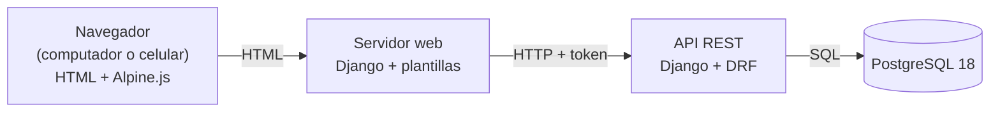

# AdMind — Informe de avance 5

| Dato                 | Detalle                                             |
| -------------------- | --------------------------------------------------- |
| **Proyecto**         | AdMind — administración de conjuntos residenciales  |
| **Asignatura**       | Ingeniería de Software II                           |
| **Institución**      | Universidad de Cundinamarca, sede Facatativá        |
| **Integrantes**      | Manuel Alejandro Aldana Rincón · Camilo Remiso Niño |
| **Docente**          | OSCAR OCHOA                                         |
| **Fecha de corte**   | 13 de octubre de 2026                               |
| **Informe anterior** | 6 de octubre de 2026                                |

> [!success] Resumen del corte
> - **Sprints 1 a 4 cerrados:** 20 historias de usuario y 99 story points (SP). El Sprint 4 se cerró en esta semana: faltaban 20 SP.
> - **26 de 38 historias finalizadas, 126 de 188 SP (67 %).** En el informe anterior eran 17 historias y 89 SP (47 %): 9 historias y 37 SP más.
> - **El ciclo de la reserva quedó completo:** condiciones del alquiler, decisión de la administración con aviso al residente, pago declarado con comprobante y aviso de disponibilidad de una franja.
> - **Sprint 5 en curso, 23 de 28 SP:** visitantes con salida y parqueadero, y tablero de casos de los residentes. Solo falta la anulación de registros.
> - **Pago de la administración (Sprint 7) adelantado:** el residente reporta su pago y la administración lo confirma.
> - **Pruebas automáticas:** 708 en el backend y 417 en el frontend, todas pasan. Frente al informe anterior son 292 y 209 más.


> [!NOTE] Cómo se cuenta una historia finalizada en este informe
> Las cifras son las del tablero de Notion al corte: una historia cuenta como finalizada cuando figura en *Finalizado*. El informe anterior contaba una historia terminada cuando su flujo funcionaba de punta a punta en la rama `desarrollo` con pruebas que pasan.

**Contenido**

1. [Qué es AdMind](#1.%20Qué%20es%20AdMind)
2. [Tipo de aplicación](#2.%20Tipo%20de%20aplicación)
3. [Entorno de trabajo y tecnologías](#3.%20Entorno%20de%20trabajo%20y%20tecnologías)
4. [Repositorios](#4.%20Repositorios)
5. [Estructura del proyecto](#5.%20Estructura%20del%20proyecto)
6. [Seguimiento y estado de las historias](#6.%20Seguimiento%20y%20estado%20de%20las%20historias)
7. [Avance a la fecha](#7.%20Avance%20a%20la%20fecha)
8. [Evidencias por pantalla](#8.%20Evidencias%20por%20pantalla)
9. [Pendientes y próximos pasos](#9.%20Pendientes%20y%20próximos%20pasos)

---

## 1. Qué es AdMind

AdMind es una aplicación para administrar **conjuntos residenciales bajo régimen de propiedad horizontal en Colombia** (Ley 675 de 2001). Reúne en un solo sistema la reserva de zonas comunes, los residentes y sus viviendas, los anuncios, los visitantes, los pagos de administración y los casos que los residentes presentan a la administración.

Se apoya en cuatro pilares:

- **Multiconjunto:** una sola plataforma para varios conjuntos, con los datos de cada uno aislados de los demás.
- **Reglas configurables:** cada conjunto configura sus reglas según su propio reglamento.
- **Reserva por orden de llegada:** bloqueo temporal de 3 minutos sobre una franja y aprobación humana.
- **El sistema registra, no decide:** en infracciones, dinero y lo que la ley reserva a la asamblea.

---

## 2. Tipo de aplicación

AdMind es una aplicación **web**, no móvil: se usa desde el navegador en computador o en celular y las pantallas se adaptan al tamaño. No se desarrolla una app nativa para Android ni para iOS.

### 2.1 Cómo está armada

Son **dos servidores** que se comunican por una API: el **backend** (Django con Django REST Framework), que es el único que habla con la base de datos y donde viven las reglas del negocio, y el **servidor web** (Django con plantillas HTML), que arma las pantallas y le pide los datos a la API. El navegador recibe HTML y usa **Alpine.js** solo donde hace falta.



> [!example] Captura 1 · AdMind en computador y en celular
> La misma pantalla (por ejemplo, el dashboard de solicitudes) en los dos tamaños.
>
> | Computador | Celular |
> | ---------- | ------- |
> | *(pega aquí la captura)* | *(pega aquí la captura)* |

---

## 3. Entorno de trabajo y tecnologías

AdMind **no está desarrollado en .NET**: está hecho en **Python con el framework Django**. Aun así, respeta la organización por capas de la plantilla ASP.NET que se usó como referencia en clase.

> [!example] Captura 2 · Espacio de trabajo en Visual Studio Code
> Los tres proyectos abiertos en el mismo espacio de trabajo, con las carpetas nuevas `apps/pagos`, `apps/parqueaderos`, `apps/ingresos` y `apps/casos` a la vista.
>
> *(pega aquí la captura)*

### 3.1 Tecnologías

Las versiones **no cambiaron** desde el informe anterior y no se agregó ninguna dependencia.

| Aspecto                       | Qué usamos                                                      | Versión    |
| ----------------------------- | --------------------------------------------------------------- | ---------- |
| Lenguaje                      | Python                                                          | 3.14       |
| Backend y frontend            | Django, con Django REST Framework en la API                     | 5.2.17 / 3.18 |
| Interacción en el navegador   | Alpine.js, guardado dentro del proyecto                         | 3.17.4     |
| Base de datos                 | PostgreSQL, con el conector psycopg                             | 18 / 3.3   |
| Pruebas automáticas           | pytest + pytest-django, en los dos servidores                   | 9.1 / 4.14 |

### 3.2 Herramientas

Visual Studio Code con un espacio de trabajo que abre los tres proyectos, Git Bash, Git y GitHub, DBeaver para consultar la base, Notion para el seguimiento Scrum (sección 6) y Obsidian para la documentación.

### 3.3 Equivalencia con .NET

| En la plantilla ASP.NET | En AdMind (Django) | Ejemplo en el código |
|---|---|---|
| `Controllers/` | `views.py` + `urls.py` | `apps/visitantes/views.py` |
| `Dtos/` | `serializers.py` | `apps/reservas/serializers.py` |
| `Services/` | `servicios.py` | `apps/visitantes/servicios.py` |
| `Repositories/` | Managers del ORM de Django | `Visitante.objects`, `apps/comun/aislamiento/managers.py` |
| `Utilities/` | `apps/comun/` | `apps/comun/archivos/comprobantes.py` |
| Entidades / modelos | `models.py` | `apps/pagos/models.py` |
| `appsettings.json` | `config/settings.py` + archivo `.env` | `config/settings.py` |
| Paquetes NuGet | `requirements.txt` (pip) | `requirements.txt` |
| Migraciones de Entity Framework | Migraciones de Django | `apps/*/migrations/` |
| xUnit / NUnit | pytest | `apps/*/tests.py`, `tests/` |

---

## 4. Repositorios

El código y la documentación están en **tres repositorios** de la cuenta de GitHub `ZeroFour-04`:

| Repositorio | Qué contiene | Enlace | Último commit al corte |
|---|---|---|---|
| `Admind_Backend` | API REST (Django + Django REST Framework) | https://github.com/ZeroFour-04/Admind_Backend | `7eb5b5a` "boton eliminar conjunto", en `desarrollo` (13/10 12:25) |
| `Admind_Front-End` | Servidor web con las pantallas | https://github.com/ZeroFour-04/Admind_Front-End | `8279616` "boton eliminar conjunto", en `desarrollo` (13/10 12:25) |
| `Admind_Documentacion` | Documentación del proyecto (bóveda de Obsidian) | https://github.com/ZeroFour-04/Admind_Documentacion | `e08a958` "Dashboard beta", en `main` (13/10 11:55) |

> [!success] El código del corte está en GitHub
> Los dos repositorios de código no tienen cambios sin guardar: la copia local y la rama `desarrollo` de GitHub están en el mismo commit. La documentación tiene al corte notas por subir, entre ellas este informe.

> [!example] Captura 3 · Repositorios en GitHub
> La rama `desarrollo` de los dos repositorios de código, con los commits del 10 al 13 de octubre.
>
> | Backend | Frontend |
> | ------- | -------- |
> | *(pega aquí la captura)* | *(pega aquí la captura)* |

### 4.1 Modelo de ramas

Definido por el docente: `main` (lo entregado), `desarrollo` (integración: los dos integrantes trabajan directamente aquí) y `pruebas` (lo terminado, listo para probar). No se usan ramas por historia.

**Estado al corte:**

- Todo el trabajo está en `desarrollo` y subido a GitHub. `main` no ha recibido cambios desde septiembre.
- La rama `pruebas` del backend **no existe en GitHub** (solo en la copia local); en el frontend existe, igual a `main`. El paso de `desarrollo` a `pruebas` por pull request sigue pendiente (sección 9).

### 4.2 Documentación

La bóveda de documentación está organizada en carpetas numeradas (contexto, arquitectura, reglas, módulos, decisiones, planes, estado y protocolos) con un índice. Cada informe vive en `Archivo/Informes/` con su fecha de corte.

---

## 5. Estructura del proyecto

### 5.1 Espacio de trabajo

```
A D M I N D/
├── Backend/Admind_Backend/                repositorio de la API
├── Frontend/Admind_Front-End/             repositorio del servidor web
└── Documentacion/Admind_Documentacion/    repositorio de documentación (bóveda de Obsidian)
```

### 5.2 Backend

La estructura del informe anterior sigue. Esto es lo que entró desde el 6 de octubre:

| App | Qué hace | Historia | Cambio |
|---|---|---|---|
| `parqueaderos` | Puestos de parqueadero con código, que Administración crea y el vigilante asigna a una visita | HU-28 | Nueva |
| `pagos` | Pago de la administración por vivienda y mes, con comprobante y confirmación | HU-35 | Nueva |
| `ingresos` | Ingreso a zonas con aforo que no se reservan, con salida y permanencia máxima | — | Nueva |
| `casos` | Casos que abren los residentes y su ciclo de atención | HU-29 | Nueva |
| `reservas` | Pago declarado y comprobantes, campana de disponibilidad, descarte formal, categoría de rechazo y bandeja por antigüedad | HU-14, HU-16, HU-18 | Cambió |
| `areas` | Modo de uso (con reserva o con ingreso), condiciones del alquiler | HU-09, HU-15 | Cambió |
| `reglas` | Dos reglas nuevas para las áreas con reserva, día límite de pago y acompañantes | HU-10 | Cambió |
| `visitantes` | Registro de la salida y del parqueadero ocupado, con capa de servicio y auditoría | HU-27, HU-28 | Cambió |
| `conjuntos`, `personas` | Límites de texto y baja de un conjunto por el Superusuario | HU-03 | Cambió |

### 5.3 Frontend

| App | Qué trae | Cambio |
|---|---|---|
| `triage` | El dashboard de gestión `/solicitudes/`, con las pestañas Reservas, Casos y Citas (esta, sin función todavía) | Cambió |
| `casos` | Abrir un caso con foto opcional, lista y detalle con las acciones de cada rol | Nueva |
| `reservas` | Bloque «Pago» en la tarjeta de la solicitud, campana, condiciones del alquiler y categoría de rechazo | Cambió |
| `pagos`, `parqueaderos`, `ingresos` | Pantallas de la administración y del residente para cada módulo nuevo | Nuevas |
| `usuarios`, `unidades` | Usuarios agrupados por rol; Unidades por agrupación con buscador; buscador de personas en la vivienda | Cambió |
| `areas`, `reglas` | Modo de uso editable y las dos reglas nuevas en el tablero | Cambió |

### 5.4 Flujo por capas

Toda petición a la API sigue el mismo recorrido: **controlador → servicio → repositorio**. La vista no consulta la base directamente y el servicio no sabe nada de HTTP. Ejemplo real de este corte, registrar la salida de un visitante:

```
POST /visitantes/<id>/salida/
   │
   ▼
urls.py → views.py (SalidaDeVisitanteView)      Controlador: exige el permiso de registrar visitantes
             │
             ▼
          servicios.py (registrar_salida)       Servicio: solo Vigilancia puede; ¿existe la visita?, ¿ya salió?
             │                                  Guarda la hora y quién la registró, deja la auditoría
             │                                  y, si la visita ocupaba un parqueadero, lo libera
             ▼
          Visitante.objects                     Repositorio: bloquea la fila mientras actualiza, para que
                                                dos salidas a la vez no se pisen
```

Si la visita ya salió, el servicio responde 409 con «Este visitante ya salió» y no cambia nada.

### 5.5 Base de datos

Todas las migraciones están aplicadas en la base local (**0 pendientes**). Tablas nuevas o cambiadas desde el informe anterior:

| Tabla | Qué guarda | Cambio |
|---|---|---|
| `casos_caso`, `casos_fotodecaso` | El caso del residente, su estado, prioridad, respuesta y foto opcional | Nuevas |
| `pagos_pagodeadministracion`, `pagos_comprobante` | Un pago por vivienda y mes, con quién lo confirmó, y el comprobante | Nuevas |
| `parqueaderos_parqueadero` | Puestos de parqueadero de visitantes, con código único | Nueva |
| `ingresos_ingreso` | Quién entró a una zona con aforo, cuándo y con cuántos acompañantes | Nueva |
| `reservas_campana`, `reservas_comprobantedepago` | La franja marcada para avisar al liberarse y el comprobante del pago de una reserva | Nuevas |
| `reservas_solicitud` | Suma quién declaró el pago y cuándo, y la categoría de rechazo | Cambiada |
| `visitantes_visitante` | Suma la hora de salida, quién la registró y el parqueadero ocupado | Cambiada |
| `areas_area` | Suma el modo de uso, la permanencia máxima y las condiciones del alquiler | Cambiada |

Todas las tablas nuevas tienen `conjunto_id` obligatorio y heredan el aislamiento entre conjuntos.

---

## 6. Seguimiento y estado de las historias

El seguimiento Scrum se lleva en **Notion**, en el espacio **Gestión Scrum — AdMind**: la base *Historias de Usuario* (las 38 historias del backlog, 188 SP, con prioridad, sprint, estado, criterios y tareas) y la base *Sprints* (los 7 sprints con sus historias). Cada historia pasa por *Sin empezar*, *En progreso*, *En revisión* y *Finalizado*.

> [!example] Captura 4 · Tablero de historias en Notion
> Las historias de los Sprints 1 a 4 en *Finalizado*, y los estados del Sprint 5.
>
> *(pega aquí la captura)*

### 6.1 Estado por sprint al corte

| Sprint | Historias | SP | Estado en Notion | SP finalizados |
|---|---|---|---|---|
| **1** | HU-01 a HU-05, HU-26 | 25 | **Cerrado** | 25 |
| **2** | HU-06 a HU-09 | 20 | **Cerrado** | 20 |
| **3** | HU-10 a HU-13 | 26 | **Cerrado** | 26 |
| **4** | HU-14 a HU-19 | 28 | **Cerrado** | 28 |
| **5** | HU-20, HU-21, HU-25, HU-27, HU-28, HU-29 | 28 | En curso | 23 (falta HU-20) |
| **6** | HU-22 a HU-24, HU-30 a HU-34 | 38 | Planificado | 0 (HU-24 en revisión, HU-33 en progreso) |
| **7** | HU-35, HU-36, HU-37 | 16 | Planificado | 4 (HU-35, adelantada) |
| Condicional | HU-38 | 7 | — | 0 |
| **Total** | **38** | **188** | | **126** |

### 6.2 Estado de las historias

| Estado | Historias | SP |
|---|---|---|
| **Finalizado** | 26: HU-01 a HU-19, HU-21, HU-25, HU-26, HU-27, HU-28, HU-29 y HU-35 | **126** |
| **En revisión** | HU-24 | 3 |
| **En progreso** | HU-33, además de HU-39 (sin estimar) | 3 |
| **Sin empezar** | 10: HU-20, HU-22, HU-23, HU-30, HU-31, HU-32, HU-34, HU-36, HU-37 y HU-38 | 56 |
| **Total** | **38** | **188** |

HU-39 (estructura de viviendas) y HU-40 (accesibilidad) son historias nuevas, sin puntos, y no entran en estas cuentas. Notion tiene además una mini historia, «Tipos de zona (con y sin reserva)», finalizada, de 5 SP, que está fuera de los 188.

> [!NOTE] Avance frente a los cortes anteriores
> | Corte | Historias finalizadas | SP finalizados | Pruebas (back / front) |
> |---|---|---|---|
> | 15/09 (informe 1) | 0 de 38 | 0 de 188 | 69 / 0 |
> | 22/09 (informe 2) | 8 de 38 | 36 de 188 | 171 / 51 |
> | 29/09 (informe 3) | 12 de 38 | 55 de 188 | 331 / 141 |
> | 06/10 (informe 4) | 17 de 38 | 89 de 188 | 416 / 208 |
> | **13/10 (este informe)** | **26 de 38** | **126 de 188** | **708 / 417** |
>
> En esta semana se finalizaron 37 SP: los 20 que le faltaban al Sprint 4 (HU-15 a HU-19), 13 del Sprint 5 (HU-27, HU-28 y HU-29) y los 4 de HU-35.

---

## 7. Avance a la fecha

### 7.1 Resumen

| Frente | Estado al 13 de octubre |
|---|---|
| **Backend** | Todo lo del informe anterior, más: decisión de reservas con categoría de rechazo y aviso al residente, pago declarado con comprobante, campana de disponibilidad, condiciones del alquiler, casos con su ciclo, visitantes con salida y parqueadero, pago de la administración con la mora, ingreso a zonas con aforo y baja de un conjunto |
| **Frontend** | Dashboard de gestión con pestañas, pantallas de casos, pagos y parqueaderos, modo de uso editable, Unidades por agrupación y Usuarios por rol. Solo **Inicio** sigue siendo maqueta |
| **Pruebas** | Backend: **708, todas pasan**. Frontend: **417, todas pasan** (ver 7.6) |
| **Historias** | **Sprints 1 a 4 cerrados**; 26 de 38 finalizadas (126 de 188 SP). Sprint 5 en curso, 23 de 28 SP |
| **Repositorios** | Todo el código en `desarrollo` y en GitHub. Ningún cambio sin commit |
| **Base de datos** | 0 migraciones sin aplicar |

### 7.2 Qué cambió desde el 6 de octubre

| Fecha | Repositorio | Commit | Qué trae |
|---|---|---|---|
| 06/10 12:14 | Front | `f5b3d08` | Menú lateral desplegable y barra superior en una sola fila en pantallas angostas |
| 10/10 18:58 | Backend y front | `37f862c`, `74883d3` | **Ingreso a zonas con aforo:** áreas que reciben ingresos en vez de reservas, con permanencia máxima, pantalla de Vigilancia e historial |
| 10/10 20:20 | Backend y front | `2d6bbe0`, `1f624b5` | Unidades: un recuadro por agrupación con buscador |
| 10/10 23:46 | Backend y front | `f4c8ae6`, `49c3e80` | **Pago del alquiler** (HU-16), **parqueadero y salida de visitantes** (HU-28), **pago de la administración** (HU-35) y dos reglas nuevas de reserva |
| 11/10 09:29 | Backend y front | `d4e98e5`, `a946880` | Administración crea conjuntos desde el selector; Usuarios por rol con «Residente» por defecto; buscador de personas en la vivienda |
| 12/10 18:04 | Backend y front | `0b627d1`, `7cd762c` (Camilo) | **Campana de disponibilidad** (HU-18), **condiciones del alquiler** (HU-15) y **casos** de los residentes (HU-29) |
| 13/10 10:58 | Backend y front | `287621c`, `87d67c5`, `6c61ac4`, `7121d94`, `0adf5eb` | Modo de uso editable (HU-09), límites de texto, y «Reglas» fuera del menú de Vigilancia |
| 13/10 11:55 | Backend y front | `85f9f23`, `d0e4af7` | **Dashboard de gestión:** HU-14 completa, casos con su ciclo y descarte formal de la Secretaría (HU-24) |
| 13/10 12:25 | Backend y front | `7eb5b5a`, `8279616` (Camilo) | Baja de un conjunto por el Superusuario |

### 7.3 Sprint 4 — cerrado (28 SP)

> [!warning] Revisar antes de entregar (borrar este recuadro)
> En el código verificado el 13/10 **no hay nada de HU-17** (cancelar una reserva en firme: «Cancelada» existe como valor y ninguna ruta la produce) **ni de HU-19** (dos oportunidades por franja: solo hay comentarios sobre ella). En Notion figuran *Finalizado*. Este informe las cuenta finalizadas, como se pidió, y no describe lo que hacen: la única línea que las nombra, bajo la tabla, dice que figuran así en Notion. HU-15 está en forma mínima: el texto de las condiciones se guarda por área, sin versiones.

El Sprint 4 completa el ciclo de la reserva: del envío a la decisión, el pago y el aviso de disponibilidad.

| HU | Historia | SP | Qué hace en el sistema |
|---|---|---|---|
| HU-14 | Aprobar o rechazar solicitudes | 8 | La bandeja muestra primero la solicitud que lleva más tiempo esperando. Administración aprueba, o rechaza eligiendo una categoría (con texto propio si es «Otro motivo»). La Secretaría ya no aprueba: **descarta** solo por causal formal. Cada decisión avisa al residente en la aplicación y por correo, queda en la auditoría y no se puede tomar dos veces |
| HU-15 | Condiciones del alquiler | 4 | Cada área guarda las condiciones de su alquiler. El residente las lee en su solicitud y antes de enviarla; quien aprueba las tiene precargadas en el motivo, que es obligatorio |
| HU-16 | Pago declarado y comprobante | 4 | Administración declara el pago del alquiler de una reserva (queda quién y cuándo, con auditoría) y puede adjuntar el comprobante: PDF, JPG o PNG de hasta 5 MB, validado por su contenido. El residente también puede subir el suyo. Una declaración hecha por error se retira con motivo |
| HU-18 | Aviso de disponibilidad (campana) | 6 | El residente marca una franja ocupada y, cuando se libera, recibe el aviso |

HU-17 (cancelación de reservas en firme, 3 SP) y HU-19 (dos oportunidades por franja, 3 SP) figuran como finalizadas en Notion.

### 7.4 Sprint 5 y siguientes — en curso

**Sprint 5 (23 de 28 SP finalizados).** Las nuevas en este corte:

| HU | Historia | SP | Qué hace en el sistema |
|---|---|---|---|
| HU-27 | Registro de visitantes y vehículos | 5 | Vigilancia registra el ingreso y ahora también la **salida**. Quien solo registra ve los de hoy y los que siguen adentro; con permiso de historial, todos. Cada registro queda en la auditoría |
| HU-28 | Parqueadero de visitantes | 3 | Administración crea los parqueaderos con su código. Al registrar una visita con vehículo, el vigilante elige uno de los libres; la salida lo libera. Si diez registros piden el mismo puesto a la vez, solo uno lo obtiene |
| HU-29 | Tablero de casos | 5 | El residente abre un caso (con foto opcional). La Secretaría lo ve, le da prioridad (para «Urgente» debe justificarla), lo descarta con comentario o lo redirige a la Administración. Administración responde por escrito (obligatorio) o rechaza. El residente recibe un aviso en cada cambio y todo queda en la auditoría |

Falta **HU-20** (anulación de registros por el Superusuario, 5 SP), sin empezar.

**Otras historias con avance:**

| HU | Estado en Notion | SP | Qué hay |
|---|---|---|---|
| HU-35 Pago de la administración | Finalizado | 4 | Quien tiene vínculo con la vivienda sube el comprobante de un mes; Administración confirma con un check por vivienda y mes y Secretaría consulta. El pago confirmado alimenta la regla de *paz y salvo*, que se define con un día límite de pago y está apagada mientras no se defina |
| HU-24 Rechazo formal de la Secretaría | En revisión | 3 | La Secretaría descarta una solicitud de reserva que no está en condiciones de tramitarse, con una causal de lista cerrada (se hizo junto con HU-14) |
| HU-33 Documentos vigentes | En progreso | 3 | Solo el reglamento del conjunto en PDF. Faltan otros documentos, las actas y la descarga para el residente |
| HU-39 Estructura de viviendas | En progreso | Por estimar | El asistente genera las viviendas en lote con vista previa. Falta que todas las pantallas usen las palabras del conjunto (Torre, Manzana…) |
| Ingreso a zonas con aforo | Sin historia numerada | — | Áreas que no se reservan: Vigilancia registra la entrada y la salida, con el aforo como tope y los acompañantes del residente |

**Mejoras a historias ya finalizadas:**

| HU | Qué se mejoró en este corte |
|---|---|
| HU-03 | Administración crea conjuntos desde el selector sin haber entrado a ninguno. El Superusuario puede dar de baja un conjunto (Camilo) |
| HU-06 y HU-08 | Usuarios agrupados por rol con buscador, «Residente» como rol por defecto, y en la vivienda un buscador de personas con la opción de crear un residente |
| HU-09 | El modo de uso de un área (con reserva o con ingreso) se puede cambiar después de crearla; el sistema avisa cuántas reservas y personas quedan afectadas |
| HU-10 | Dos reglas nuevas para las áreas con reserva: *una reserva al día* y *sin franjas seguidas* |

### 7.5 Decisiones

Decisiones tomadas por el equipo desde el informe anterior, en palabras:

| Fecha | Decisión | Quién |
|---|---|---|
| 08/10 | Las zonas con ingreso se construyen aunque falte verificar lo legal de restringir por mora y de registrar quién entra. Salvaguardas: aviso de finalidad en la pantalla de Vigilancia, historial solo con permiso sensible y piscinas fuera | Alejo |
| 10/10 | Los parqueaderos de visitantes son **puestos con código**, creados por Administración y elegidos por el vigilante; no un contador de cupos | Alejo |
| 10/10 | El comprobante de un pago se guarda **dentro de la base de datos**, igual que el logo, el reglamento y las fotos de los anuncios | Alejo |
| 10/10 | El pago de la administración se confirma **por vivienda y mes**; solo Administración marca. Quien debe tres meses y paga el último sigue en mora | Alejo |
| 10/10 | Dos reglas nuevas para las áreas con reserva; la de franjas seguidas se cuenta **por vivienda**, no por persona | Alejo |
| 11/10 | Administración crea conjuntos desde el selector, y al registrar a alguien el rol por defecto es Residente, no Administración | Alejo |
| 13/10 | El modo de uso de un área se puede cambiar. Las reservas ya apartadas siguen válidas y las reglas que solo aplican al modo anterior se retiran solas | Alejo |
| 13/10 | **La Secretaría clasifica y no aprueba:** en reservas solo descarta por causal formal; en casos prioriza, descarta y redirige | Alejo |
| 13/10 | Límites de texto: 30 caracteres para el nombre del conjunto y para nombres y apellidos de una persona, y 10 para el teléfono | Alejo |
| 13/10 | La baja de un conjunto (sin confirmación escrita del nombre y sin auditoría) y el teléfono a 15 caracteres los subió Camilo; **están por confirmar** | Camilo |

### 7.6 Estado de las pruebas

**Backend — 708 pruebas, todas pasan** (el informe anterior tenía 416 y una fallaba).

| Grupo | Pruebas | Qué cubre | HU |
|---|---|---|---|
| `tests/aislamiento`, `esquema` y `concurrencia` | 96 | Prueba del intruso en todas las rutas, tablas globales y carreras: franja, aforo y parqueadero | HU-05, HU-11, HU-28 |
| `apps/pagos` | 68 | Reporte, confirmación, buscador y mora | HU-35 |
| `apps/cuentas` | 67 | Sesión, recuperación, segundo factor, usuarios y roles | HU-01, HU-02, HU-06, HU-26 |
| `apps/conjuntos` | 67 | Asistente, requisitos, identidad, baja | HU-03, HU-21, HU-26 |
| `apps/reservas` | 63 | Franjas, bloqueo, envío, decisión, descarte, pago y campana | HU-11 a HU-18 |
| `apps/reglas` | 61 | Catálogo por niveles, evaluación completa, reglas nuevas y día límite | HU-10, HU-13 |
| `apps/unidades` | 45 | Viviendas, vínculos y generador en lote | HU-08, HU-39 |
| `apps/permisos` | 43 | Catálogo, asignaciones y roles | HU-06 |
| `apps/ingresos` | 41 | Ingreso, aforo, permanencia y salida | — |
| `apps/visitantes` y `apps/parqueaderos` | 41 | Ingreso, salida y puestos | HU-27, HU-28 |
| `apps/anuncios`, `apps/areas` y `apps/casos` | 69 | Anuncios con fotos, áreas y modo de uso, ciclo de los casos | HU-25, HU-09, HU-29 |
| Otras (`personas`, `archivos`, `auditoria`, `notificaciones`, `documentos`) | 47 | Persona única, validación de comprobantes por contenido y auditoría | HU-04, HU-07, HU-16, HU-33 |
| **Total** | **708** | **Todas pasan** | |

**Frontend — 417 pruebas, todas pasan** (el informe anterior tenía 208).

| Archivos | Pruebas | Qué cubre | HU |
|---|---|---|---|
| `test_reservas` y `test_triage` | 76 | Calendario, bloqueo, solicitudes, pago, campana y dashboard | HU-11 a HU-18 |
| `test_acentos` y `test_identidad` | 70 | Color, foto del conjunto, ícono y barra | HU-21, HU-26 |
| `test_pagos` y `test_parqueaderos` | 46 | Pagos de la administración y parqueaderos | HU-35, HU-28 |
| `test_reglas` y `test_areas` | 54 | Tablero de reglas y áreas con modo de uso | HU-10, HU-09 |
| `test_unidades` y `test_usuarios` | 51 | Unidades, vínculos, usuarios por rol | HU-06, HU-08 |
| `test_visitantes`, `test_ingresos` y `test_casos` | 58 | Portería, ingreso a zonas y casos | HU-27, HU-29 |
| `test_anuncios` | 25 | Tablón y galería | HU-25 |
| Recuperación, segundo factor, asistente, límites y perfil | 37 | Acceso, asistente y límites de texto | HU-01, HU-02, HU-03, HU-39 |
| **Total** | **417** | **Todas pasan** | |

Una prueba de `ingresos` usa la hora real del equipo y puede fallar entre las 22:00 y las 05:00 aunque nada esté mal; está anotada entre los pendientes.

> [!example] Captura 5 · Pruebas automáticas en la terminal
> Salida de `pytest` en los dos servidores: "708 passed" en el backend y "417 passed" en el frontend.
>
> | Backend | Frontend |
> | ------- | -------- |
> | *(pega aquí la captura)* | *(pega aquí la captura)* |

### 7.7 Rutas nuevas de la API

La API tiene **84 rutas**, todas en la prueba del intruso. Estas son las nuevas desde el informe anterior; cada una está documentada en el README de su app.

| Módulo | Método | Ruta | Qué hace |
|---|---|---|---|
| Reservas | `POST` | `/reservas/solicitudes/<id>/descarte/` | La Secretaría descarta una solicitud por causal formal |
| Reservas | `POST` | `/reservas/solicitudes/<id>/pago/` | Administración declara el pago del alquiler |
| Reservas | `POST` | `/reservas/solicitudes/<id>/pago/retirar/` | Retira la declaración, con motivo |
| Reservas | `POST` / `GET` | `/reservas/solicitudes/<id>/comprobantes/` y `/reservas/comprobantes/<id>/` | Sube un comprobante y lo entrega |
| Reservas | `POST` | `/reservas/campanas/` | Marca una franja para avisar cuando se libere |
| Casos | `GET` / `POST` | `/casos/` | Lista los casos o abre uno |
| Casos | `GET` | `/casos/<id>/` | Detalle con las acciones que corresponden al rol |
| Casos | `POST` | `/casos/<id>/tomar/`, `prioridad/`, `redirigir/`, `descartar/`, `responder/`, `rechazar/` | Las acciones del ciclo del caso |
| Visitantes | `POST` | `/visitantes/<id>/salida/` | Registra la salida y libera el parqueadero |
| Parqueaderos | `GET` / `POST` | `/parqueaderos/` | Lista o crea puestos |
| Parqueaderos | `POST` | `/parqueaderos/<id>/desactivar/` | Retira un puesto |
| Pagos | `GET` | `/pagos/administracion/` | Tabla de gestión con buscador |
| Pagos | `POST` | `/pagos/administracion/reportes/` | El residente reporta su pago con comprobante |
| Pagos | `POST` | `/pagos/administracion/<vivienda>/<mes>/confirmacion/` | Confirma o quita el check de un mes |
| Pagos | `GET` | `/pagos/administracion/mios/` | Los pagos de las viviendas de quien consulta |
| Ingresos | `GET` / `POST` | `/ingresos/` | Historial o registro de un ingreso a una zona |
| Ingresos | `POST` | `/ingresos/<id>/salida/` | Registra la salida |
| Conjuntos | `DELETE` | `/conjuntos/actual/` | El Superusuario da de baja el conjunto |

### 7.8 Historias de usuario al corte

**Finalizadas desde el informe anterior (9 historias, 37 SP):**

| HU | Historia | Sprint | SP |
|---|---|---|---|
| HU-15 | Condiciones del alquiler | 4 | 4 |
| HU-16 | Pago declarado y comprobante | 4 | 4 |
| HU-17 | Cancelación de reservas en firme | 4 | 3 |
| HU-18 | Aviso de disponibilidad de franja (campana) | 4 | 6 |
| HU-19 | Dos oportunidades por franja y aviso de última | 4 | 3 |
| HU-27 | Registro de visitantes y vehículos | 5 | 5 |
| HU-28 | Parqueadero de visitantes | 5 | 3 |
| HU-29 | Tablero de casos con respuesta obligatoria | 5 | 5 |
| HU-35 | Reporte de pago de administración | 7 | 4 |

**En total, 26 finalizadas (126 SP):** las 17 del informe anterior (HU-01 a HU-14, HU-21, HU-25 y HU-26) más estas 9.

**En revisión:** HU-24. **En progreso:** HU-33 y HU-39. **Sin empezar (10, 56 SP):** HU-20, HU-22, HU-23, HU-30, HU-31, HU-32, HU-34, HU-36, HU-37 y HU-38.

---

## 8. Evidencias por pantalla

Capturas del sistema funcionando contra la API real, de lo que cambió desde el informe anterior.

### 8.1 Sprint 4 — cierre

> [!example] Captura 6 · Dashboard de gestión: pestaña Reservas (HU-14)
> La bandeja con la solicitud más antigua primero, y una tarjeta con Aprobar y Rechazar para Administración.
>
> *(pega aquí la captura)*

> [!example] Captura 7 · Rechazo con categoría y aviso al residente (HU-14)
> El formulario de rechazo con la categoría y el texto de «Otro motivo», y en el residente el aviso recibido y el resultado en su historial.
>
> | Rechazo con categoría | Lo que ve el residente |
> | --------------------- | ---------------------- |
> | *(pega aquí la captura)* | *(pega aquí la captura)* |

> [!example] Captura 8 · Condiciones del alquiler (HU-15)
> El campo de condiciones en el formulario del área y lo que lee el residente en su solicitud.
>
> | Formulario del área | Solicitud del residente |
> | ------------------- | ----------------------- |
> | *(pega aquí la captura)* | *(pega aquí la captura)* |

> [!example] Captura 9 · Pago declarado y comprobante (HU-16)
> El bloque «Pago» de la tarjeta de gestión, con el comprobante adjunto, y el mismo bloque en la solicitud del residente.
>
> | Gestión | Residente |
> | ------- | --------- |
> | *(pega aquí la captura)* | *(pega aquí la captura)* |

> [!example] Captura 10 · Campana de disponibilidad (HU-18)
> Una franja ocupada con la campana marcada, y el aviso que llega cuando se libera.
>
> | Franja con campana | Aviso recibido |
> | ------------------ | -------------- |
> | *(pega aquí la captura)* | *(pega aquí la captura)* |

### 8.2 Sprint 5

> [!example] Captura 11 · Portería: parqueadero y salida (HU-27, HU-28)
> El formulario de Vigilancia con el selector de parqueadero, y la lista con las columnas Parqueadero y Salida y el botón «Registrar salida».
>
> | Registrar ingreso | Lista con salida |
> | ----------------- | ---------------- |
> | *(pega aquí la captura)* | *(pega aquí la captura)* |

> [!example] Captura 12 · Parqueaderos del conjunto (HU-28)
> La pantalla de Administración con los puestos y su código.
>
> *(pega aquí la captura)*

> [!example] Captura 13 · Casos (HU-29)
> La pestaña Casos del dashboard, y el detalle de un caso con las acciones que corresponden al rol.
>
> | Lista de casos | Detalle del caso |
> | -------------- | ---------------- |
> | *(pega aquí la captura)* | *(pega aquí la captura)* |

> [!example] Captura 14 · Abrir un caso (HU-29)
> El formulario del residente, con la foto opcional.
>
> *(pega aquí la captura)*

### 8.3 Otras historias y mejoras

> [!example] Captura 15 · Pago de la administración (HU-35)
> La tabla de gestión con el buscador y el check por vivienda y mes, y «Mis pagos» del residente con el formulario de reporte.
>
> | Gestión | Mis pagos |
> | ------- | --------- |
> | *(pega aquí la captura)* | *(pega aquí la captura)* |

> [!example] Captura 16 · Ingreso a zonas con aforo
> El formulario de un área con modo «Con ingreso» y la pantalla de Vigilancia con el cupo disponible.
>
> | Área con ingreso | Pantalla de Vigilancia |
> | ---------------- | ---------------------- |
> | *(pega aquí la captura)* | *(pega aquí la captura)* |

> [!example] Captura 17 · Cambiar el modo de uso de un área (HU-09)
> «Editar área» con los dos modos y el aviso de lo que quedó afectado.
>
> *(pega aquí la captura)*

> [!example] Captura 18 · Reglas nuevas en el tablero (HU-10)
> El tablero con *una reserva al día* y *sin franjas seguidas* definidas en un área.
>
> *(pega aquí la captura)*

> [!example] Captura 19 · Unidades por agrupación (HU-08, HU-39)
> Los recuadros por agrupación con el buscador, y el detalle de una vivienda con el buscador de personas.
>
> | Unidades | Detalle de la vivienda |
> | -------- | ---------------------- |
> | *(pega aquí la captura)* | *(pega aquí la captura)* |

> [!example] Captura 20 · Usuarios por rol (HU-06)
> La lista con un desplegable por rol y el buscador.
>
> *(pega aquí la captura)*

---

## 9. Pendientes y próximos pasos

**Hecho desde el informe anterior**

- [x] Sprint 4 cerrado: HU-14 completa y HU-15 a HU-19 finalizadas.
- [x] HU-27, HU-28 y HU-29 del Sprint 5 finalizadas.
- [x] HU-35, el pago de la administración, adelantada del Sprint 7.
- [x] La prueba que avisaba de rutas sin registrar en la prueba del intruso quedó en verde: las 84 rutas están cubiertas.
- [x] Todos los cambios del corte están en GitHub y todas las migraciones aplicadas.

**Técnicos**

- [ ] **Teléfono:** el campo admite 15 caracteres y la restricción del modelo, de 7 a 10 dígitos. Hay que confirmar el límite y cerrarlo con una migración nueva; hoy `makemigrations --check` la pide.
- [ ] **Baja de un conjunto:** no deja registro en la auditoría ni pide escribir el nombre para confirmar; falta decidir cómo queda.
- [ ] **Lo legal sin verificar:** el texto del aviso de finalidad de Vigilancia y el plazo de retención de visitantes y comprobantes (Ley 1581), y si la mora puede restringir zonas de recreación antes de encender *paz y salvo* en un conjunto real.
- [ ] Limitar los intentos de contraseña en el inicio de sesión.
- [ ] Probar a mano lo construido: cada historia necesita la prueba de quien no la programó.

**Repositorios y documentación**

- [ ] Pasar de `desarrollo` a `pruebas` por pull request, con la revisión cruzada entre los dos integrantes. En el backend hay que volver a subir la rama `pruebas` a GitHub.
- [ ] Contarle a Camilo los cambios del 6 al 13 de octubre en migraciones, permisos y en su módulo de visitantes.
- [ ] Depurar en Notion las subtareas que no aportan valor y los criterios que describen el diseño anterior, para que el tablero refleje lo entregado.
- [ ] Retomar el formato de commit con el número de la historia.

**Siguiente en el backlog**

- [ ] **Cerrar el Sprint 5:** HU-20, anulación de registros por el Superusuario (5 SP).
- [ ] **Sprint 6 (38 SP):** terminar HU-24 y HU-33, y empezar la bandeja de la Secretaría (HU-22), la prioridad (HU-23), las infracciones (HU-30), las citas (HU-31 y HU-32) y los parqueaderos de residentes (HU-34).
- [ ] **HU-39, segunda parte:** las palabras del conjunto en todas las pantallas y retirar viviendas con confirmación.
- [ ] **Alcance de la entrega:** acordar qué historias entran. Quedan 10 sin empezar, 56 SP.
