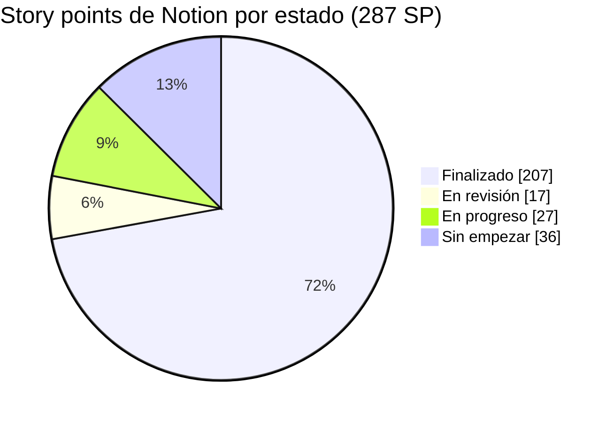
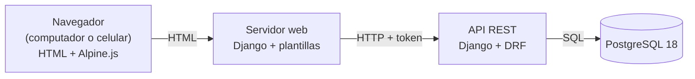

# AdMind — Informe de avance 6

| Dato                 | Detalle                                             |
| -------------------- | --------------------------------------------------- |
| **Proyecto**         | AdMind — administración de conjuntos residenciales  |
| **Asignatura**       | Ingeniería de Software II                           |
| **Institución**      | Universidad de Cundinamarca, sede Facatativá        |
| **Integrantes**      | Manuel Alejandro Aldana Rincón · Camilo Remiso Niño |
| **Docente**          | OSCAR OCHOA                                         |
| **Fecha de corte**   | 18 de noviembre de 2026                             |
| **Informe anterior** | 13 de octubre de 2026                               |

> [!warning] Revisar antes de entregar (borrar este recuadro)
> Lo que este informe cuenta como terminado sale del tablero de Notion tal como lo dejó Alejo, con el criterio que pidió: *Finalizado* más *En revisión*. Estos puntos no cuadran con el código verificado el 18/11 y conviene decidir qué se dice:
>
> 1. **HU-17 (cancelar una reserva en firme) y HU-19 (dos oportunidades por franja):** en `main` no hay ninguna ruta que cancele una reserva ni un contador de oportunidades (una prueba de reservas lo dice en un comentario: «llega con HU-19»). En Notion figuran *Finalizado* con las dos casillas de la DoD marcadas. Se cuentan, pero el informe no describe lo que hacen: solo dice que figuran así.
> 2. **HU-23 (prioridad sobre citas y casos):** la prioridad existe en los casos (HU-29). En `apps/citas` no hay nada de prioridad. Figura *Finalizado*.
> 3. **HU-44 (ajustes de perfil y cambio de contraseña):** hay pantalla de perfil y recuperación de contraseña por correo; no confirmé en el código un cambio de contraseña desde el perfil. Figura *Finalizado* **sin** las dos casillas de la DoD. HU-22 está igual: *Finalizado* sin las casillas.
> 4. **Dos historias llamadas HU-40** en Notion: «Implementar accesibilidad» (*En revisión*, 4 SP) y «Mejorar visual en general» (*Finalizado*, 8 SP). Y una fila de prueba llamada «Prueba» (*Finalizado*, sin puntos) que este informe **no** cuenta.
> 5. **No se pudo leer la base *Sprints* de Notion** (el cupo de consultas se agotó). La tabla 6.1 se armó con el estado de las historias de cada sprint, no con el estado que Notion le da al sprint.
> 6. **No verificado desde el código:** lo que dejaron SonarCloud (vulnerabilidades y su arreglo), el correo desde la nube, las ramas protegidas (sin proteger al 17/11) y HU-57 (presentación y ensayo).
> 7. **Base local:** 11 migraciones del 17/11 siguen **sin aplicar** en `admind_db` (ver 5.5). No se aplicaron porque nadie lo pidió.

> [!success] Resumen del corte
> - **Sprint 6 casi cerrado y la sustentación cubierta:** 33 de las 38 historias del backlog están finalizadas, 156 de 188 story points (SP), el 83 %. En el informe anterior eran 26 historias y 126 SP: 7 historias y 30 SP más (HU-22, HU-23, HU-24, HU-30, HU-31, HU-33 y HU-34).
> - **Todo el tablero:** Notion tiene 59 historias y 287 SP, porque a las 38 del backlog se suman las del trabajo de la sustentación y otras. **47 están terminadas** (44 finalizadas y 3 en revisión), **224 de 287 SP (78 %)**.
> - **Lo nuevo para la sustentación del 17 de noviembre:** reportes en PDF y Excel, funciones, un procedimiento almacenado y triggers en PostgreSQL, correo automático en HTML con logo, páginas de error propias y ajustes de producción.
> - **Entrega continua:** GitHub Actions corre las pruebas en cada PR de los dos repositorios, y los cambios llegan a `main` por pull request. La aplicación está publicada en `https://admind.detkor.com`.
> - **Pruebas automáticas:** 850 en el backend y 541 en el frontend, todas pasan; el backend cubre el 94,1 % de sus líneas. Frente al informe anterior son 142 y 124 más.
> - **Lo que falta:** JWT, CORS y Swagger siguen sin código; HU-20, HU-32, HU-36, HU-37 y HU-38 del backlog siguen sin empezar.



> [!NOTE] Cómo se cuenta una historia terminada en este informe
> Una historia cuenta como terminada cuando en el tablero de Notion figura *Finalizado* o *En revisión*. Es un criterio menos estricto que la Definition of Done del equipo, que además pide el pull request revisado por el otro integrante y la prueba manual de quien no la programó: de las 44 finalizadas, 42 tienen las dos casillas marcadas. Las 3 en revisión tienen código y pruebas, pero nadie las ha probado a mano todavía. El informe anterior usaba solo *Finalizado*.

**Contenido**

1. [Qué es AdMind](#1.%20Qué%20es%20AdMind)
2. [Tipo de aplicación](#2.%20Tipo%20de%20aplicación)
3. [Entorno de trabajo y tecnologías](#3.%20Entorno%20de%20trabajo%20y%20tecnologías)
4. [Repositorios](#4.%20Repositorios)
5. [Estructura del proyecto](#5.%20Estructura%20del%20proyecto)
6. [Seguimiento y estado de las historias](#6.%20Seguimiento%20y%20estado%20de%20las%20historias)
7. [Avance a la fecha](#7.%20Avance%20a%20la%20fecha)
8. [Evidencias por pantalla](#8.%20Evidencias%20por%20pantalla)
9. [Pendientes y próximos pasos](#9.%20Pendientes%20y%20próximos%20pasos)

---

## 1. Qué es AdMind

AdMind es una aplicación para administrar **conjuntos residenciales bajo régimen de propiedad horizontal en Colombia** (Ley 675 de 2001). Reúne en un solo sistema la reserva de zonas comunes, los residentes y sus viviendas, los anuncios, los visitantes, los pagos de administración, los casos y las citas que los residentes presentan a la administración, las infracciones y los documentos del conjunto.

Se apoya en cuatro pilares:

- **Multiconjunto:** una sola plataforma para varios conjuntos, con los datos de cada uno aislados de los demás.
- **Reglas configurables:** cada conjunto configura sus reglas según su propio reglamento.
- **Reserva por orden de llegada:** bloqueo temporal de 3 minutos sobre una franja y aprobación humana.
- **El sistema registra, no decide:** en infracciones, dinero y lo que la ley reserva a la asamblea.

---

## 2. Tipo de aplicación

AdMind es una aplicación **web**, no móvil: se usa desde el navegador en computador o en celular y las pantallas se adaptan al tamaño. No se desarrolla una app nativa para Android ni para iOS.

### 2.1 Cómo está armada

Son **dos servidores** que se comunican por una API: el **backend** (Django con Django REST Framework), que es el único que habla con la base de datos y donde viven las reglas del negocio, y el **servidor web** (Django con plantillas HTML), que arma las pantallas y le pide los datos a la API. El navegador recibe HTML y usa **Alpine.js** solo donde hace falta. En producción los dos servidores se sirven con **gunicorn** y las pantallas entregan sus archivos estáticos con **whitenoise**.



> [!example] Captura 1 · AdMind en computador y en celular
> La misma pantalla (por ejemplo, el dashboard de solicitudes) en los dos tamaños.
>
> | Computador | Celular |
> | ---------- | ------- |
> | *(pega aquí la captura)* | *(pega aquí la captura)* |

---

## 3. Entorno de trabajo y tecnologías

AdMind **no está desarrollado en .NET**: está hecho en **Python con el framework Django**. Aun así, respeta la organización por capas de la plantilla ASP.NET que se usó como referencia en clase.

> [!example] Captura 2 · Espacio de trabajo en Visual Studio Code
> Los tres proyectos abiertos en el mismo espacio de trabajo, con las carpetas nuevas `apps/reportes`, `apps/citas` y `apps/infracciones` a la vista.
>
> *(pega aquí la captura)*

### 3.1 Tecnologías

Las versiones principales **no cambiaron**. Desde el informe anterior se agregaron estas dependencias, todas para la entrega y la sustentación:

| Aspecto                       | Qué usamos                                                      | Versión       |
| ----------------------------- | --------------------------------------------------------------- | ------------- |
| Lenguaje                      | Python                                                          | 3.14          |
| Backend y frontend            | Django, con Django REST Framework en la API                     | 5.2.17 / 3.18 |
| Interacción en el navegador   | Alpine.js, guardado dentro del proyecto                         | 3.17.4        |
| Base de datos                 | PostgreSQL, con el conector psycopg                             | 18 / 3.3      |
| Pruebas automáticas           | pytest + pytest-django, en los dos servidores                   | 9.1 / 4.14    |
| **Nuevo** · Reportes          | reportlab para los PDF y openpyxl para los Excel (backend)      | 5.1.0 / 3.1.5 |
| **Nuevo** · Imágenes          | Pillow, en los reportes (backend)                               | 13.0.0        |
| **Nuevo** · Producción        | gunicorn (los dos) y whitenoise (los dos)                       | 27.0.1 / 6.12.0 |
| **Nuevo** · Cobertura         | pytest-cov y coverage (backend)                                 | 7.1.0 / 7.17.3 |

### 3.2 Herramientas

Visual Studio Code con un espacio de trabajo que abre los tres proyectos, Git Bash, Git y GitHub (con **GitHub Actions** para las pruebas automáticas), **SonarCloud** para el análisis de calidad del código, DBeaver para consultar la base, Notion para el seguimiento Scrum (sección 6) y Obsidian para la documentación. La aplicación corre publicada en un servidor virtual de Oracle Cloud, detrás de Cloudflare.

### 3.3 Equivalencia con .NET

| En la plantilla ASP.NET | En AdMind (Django) | Ejemplo en el código |
|---|---|---|
| `Controllers/` | `views.py` + `urls.py` | `apps/reportes/views.py` |
| `Dtos/` | `serializers.py` | `apps/areas/serializers.py` |
| `Services/` | `servicios.py` | `apps/infracciones/servicios.py` |
| `Repositories/` | Managers del ORM de Django y funciones de PostgreSQL | `Visitante.objects`, `ocupacion_areas` en `apps/areas/models.py` |
| `Utilities/` | `apps/comun/` | `apps/comun/archivos/comprobantes.py` |
| Entidades / modelos | `models.py` | `apps/citas/models.py` |
| `appsettings.json` | `config/settings.py` + variables de entorno | `config/settings.py` |
| Paquetes NuGet | `requirements.txt` (pip) | `requirements.txt` |
| Migraciones de Entity Framework | Migraciones de Django | `apps/*/migrations/` |
| Procedimientos almacenados y triggers de SQL Server | Migraciones con SQL de PostgreSQL | `apps/reservas/migrations/0007_procedimiento_expirar_bloqueos.py` |
| xUnit / NUnit | pytest | `apps/*/tests.py`, `tests/` |

---

## 4. Repositorios

El código y la documentación están en **tres repositorios** de la cuenta de GitHub `ZeroFour-04`:

| Repositorio | Qué contiene | Enlace | Último commit al corte |
|---|---|---|---|
| `Admind_Backend` | API REST (Django + Django REST Framework) | https://github.com/ZeroFour-04/Admind_Backend | `2dd5c44` «Merge pull request #18», en `main` (17/11 09:36) |
| `Admind_Front-End` | Servidor web con las pantallas | https://github.com/ZeroFour-04/Admind_Front-End | `10e2d04` «Merge pull request #11», en `main` (17/11 09:35) |
| `Admind_Documentacion` | Documentación del proyecto (bóveda de Obsidian) | https://github.com/ZeroFour-04/Admind_Documentacion | `693a1fa`, en `main` (03/11) |

> [!success] El código del corte está en GitHub
> Los dos repositorios de código no tienen cambios sin guardar, y la rama `main` de GitHub tiene exactamente el mismo contenido que la copia local. La documentación tiene al corte notas por subir, entre ellas este informe.

> [!example] Captura 3 · Repositorios en GitHub
> La pestaña de pull requests cerrados de los dos repositorios de código, con los fundidos del 16 y 17 de noviembre.
>
> | Backend | Frontend |
> | ------- | -------- |
> | *(pega aquí la captura)* | *(pega aquí la captura)* |

### 4.1 Modelo de ramas

Definido por el docente: `main` (lo entregado), `desarrollo` (integración) y `pruebas` (lo terminado, listo para probar). **Desde el 24 de octubre** cada cambio se hace en una rama corta que sale de `desarrollo` y vuelve a él por **pull request**, con la revisión del otro integrante como regla. Antes todo se subía directo a `desarrollo`.

**Estado al corte:**

- El 27 de octubre se fundieron por pull request las primeras ramas cortas (parqueaderos de residentes, documentos, infracciones y triage). La noche del 16 de noviembre se fundieron las de pruebas, correo, pantallas y cobertura, y se llevó `desarrollo` a `main` con un pull request en cada repositorio; el 17 de noviembre, otro más con los reportes y la base de datos. `main` ya no está donde estaba en septiembre.
- Cada pull request corre las pruebas en GitHub Actions antes de fundirse.
- Tres pull requests del backend del 16 de noviembre (#10, #11 y #13) fueron directo a `main` por error y se revirtieron; el arreglo de la prueba de ingresos quedó en `main` por el camino correcto.
- **Pendiente:** ninguna rama está protegida (al 17/11), la rama `Desarrollo` con mayúscula sigue en GitHub en los dos repositorios, y la rama `pruebas` del backend sigue sin existir en GitHub.

### 4.2 Documentación

La bóveda de documentación está organizada en carpetas numeradas (contexto, arquitectura, reglas, módulos, decisiones, planes, estado, protocolos y sustentación) con un índice. Cada informe vive en `Archivo/Informes/` con su fecha de corte. El 14 de noviembre se entregó al aula el paquete de documentación de la sustentación: **diccionario de datos** (Word y Excel), **manual técnico** (Word y PDF) y **manual de usuario** por rol (Word y PDF).

---

## 5. Estructura del proyecto

### 5.1 Espacio de trabajo

```
A D M I N D/
├── Backend/Admind_Backend/                repositorio de la API
├── Frontend/Admind_Front-End/             repositorio del servidor web
└── Documentacion/Admind_Documentacion/    repositorio de documentación (bóveda de Obsidian)
```

### 5.2 Backend

La estructura del informe anterior sigue. Esto es lo que entró desde el 13 de octubre:

| App | Qué hace | Historia | Cambio |
|---|---|---|---|
| `citas` | Horario de atención del conjunto y citas que se agendan dentro de él | HU-31 | Nueva |
| `infracciones` | Registro, comunicación, cierre y anulación de infracciones | HU-30 | Nueva |
| `reportes` | Descarga de reportes en PDF y Excel, solo para Administración | HU-49 | Nueva |
| `documentos` | El reglamento pasó a ser un **documento con tipo**, con versiones y descarga auditada | HU-33 | Cambió |
| `parqueaderos` | Asignar, reasignar, liberar y consultar el historial de los parqueaderos de los residentes | HU-34 | Cambió |
| `notificaciones` | Correos en HTML con el logo del conjunto, enviados en segundo plano | HU-53 | Cambió |
| `areas`, `reservas`, `pagos`, `casos`, `ingresos`, `infracciones` | Funciones, un procedimiento y triggers de PostgreSQL, y los reportes de uso de zonas, agendas y pagos | HU-48, HU-49 | Cambió |
| `reglas` | La regla de parqueaderos se cuenta por vivienda | HU-34 | Cambió |
| `cuentas`, `personas` | Crear superusuarios desde el selector de conjuntos; la restricción del teléfono quedó alineada con el campo | HU-06, HU-03 | Cambió |
| `config/` | Variables de entorno para depuración y hosts permitidos, cookies seguras, gunicorn y whitenoise | HU-47 | Cambió |

### 5.3 Frontend

| App | Qué trae | Cambio |
|---|---|---|
| `reportes` | Pantalla `/reportes/` con la descarga de los reportes | Nueva |
| `infracciones` | Lista, registro, cierre y anulación de infracciones | Nueva |
| `citas` | Horario de atención y agenda de citas | Nueva |
| `documentos` | Documentos del conjunto por tipo, con subida de versiones y descarga | Nueva |
| `parqueaderos` | Asignar, liberar, historial y «Mi parqueadero» del residente | Cambió |
| `triage` | Filtros por pestaña en el dashboard de gestión | Cambió |
| `conjuntos`, `cuentas` | Crear superusuarios desde el selector; páginas de error propias (403, 404, 500 y de seguridad CSRF) y un filtro que convierte los errores de la API en esas páginas | Cambió |
| `templates/`, `static/` | Menú que solo muestra lo que el rol puede abrir, logo de AdMind, capa visual con degradados, íconos y animación | Cambió |

### 5.4 Flujo por capas

Toda petición a la API sigue el mismo recorrido: **controlador → servicio → repositorio**. La vista no consulta la base directamente y el servicio no sabe nada de HTTP. Ejemplo real de este corte, descargar el reporte de uso de las zonas comunes en PDF:

```
GET /api/reportes/zonas.pdf?desde=…&hasta=…
   │
   ▼
urls.py → views.py (ReporteZonasView)           Controlador: exige el permiso «reporte.ver» (Administración)
             │                                  y valida el rango de fechas
             ▼
          areas/reportes.py (uso_zonas_pdf)     Servicio: arma el PDF con reportlab: encabezado, tabla y pie
             │
             ▼
          areas/models.py (ocupacion_areas)     Repositorio: llama a la función de PostgreSQL
                                                fn_ocupacion_areas(conjunto, desde, hasta)
```

Los datos del reporte los calcula la base y no la aplicación: la función `fn_ocupacion_areas` es la que cuenta las reservas por zona.

### 5.5 Base de datos

> [!WARNING] Migraciones sin aplicar en la base local
> `makemigrations --check` sale limpio (el desajuste del teléfono que había en el informe anterior se cerró con una migración nueva). Pero en la base local `admind_db` **hay 11 migraciones sin aplicar**: las que entraron a `main` el 17 de noviembre (funciones, procedimiento, triggers y la restricción del teléfono). Hay que correr `migrate` antes de probar los reportes y los triggers en esa base.

Tablas nuevas o cambiadas desde el informe anterior:

| Tabla | Qué guarda | Cambio |
|---|---|---|
| `citas_horariodeatencion`, `citas_cita` | El horario de atención de cada conjunto y las citas agendadas | Nuevas |
| `infracciones_registrodeinfraccion` | La infracción registrada, su comunicación, su cierre o su anulación | Nueva |
| `parqueaderos_asignacionparqueadero` | A quién se asignó cada parqueadero, desde cuándo y hasta cuándo | Nueva |
| `documentos_documento` | Antes `documentos_reglamento`: ahora guarda documentos de varios tipos, con sus versiones | Renombrada y ampliada |
| `parqueaderos_parqueadero` | Suma el tipo de vehículo (carro, moto o bicicleta) | Cambiada |
| `reglas_*` | La regla de parqueaderos se cuenta por vivienda | Cambiada |
| `personas_persona` | La restricción del teléfono quedó alineada con el campo | Cambiada |

**Funciones, procedimiento y triggers de PostgreSQL** (migraciones con SQL, probadas en `tests/esquema`):

| Objeto | Tipo | Qué hace |
|---|---|---|
| `fn_ocupacion_areas` | Función | Cuenta la ocupación de cada zona en un rango de fechas; alimenta el reporte PDF de uso de zonas |
| `fn_resumen_casos` | Función | Cuenta los casos de un conjunto por estado y prioridad |
| `fn_aforo_actual` | Función | Calcula cuántas personas hay hoy en una zona con aforo |
| `fn_estado_pagos` | Función | Devuelve el estado de pago de cada vivienda en un mes; alimenta el reporte de Excel |
| `sp_expirar_bloqueos_vencidos` | Procedimiento | Marca como expiradas las solicitudes en espera cuyo bloqueo de 3 minutos ya venció; **modifica datos**, por eso es procedimiento y no función |
| `trg_sin_borrado_fisico` | Trigger (4: casos, infracciones, pagos y reservas) | Impide borrar esas filas: lo registrado se anula, no se borra |
| `trg_infraccion_anulada_inmutable` | Trigger | Una infracción anulada ya no se puede modificar |

Las funciones solo **leen y devuelven** datos; el procedimiento **cambia** datos. Esa es la razón de que cuatro sean funciones y una sea procedimiento.

---

## 6. Seguimiento y estado de las historias

El seguimiento Scrum se lleva en **Notion**, en el tablero **Seguimiento Scrum 2.0 — AdMind**: la base *Historias de Usuario* (con prioridad, sprint, estado, criterios, las casillas de la Definition of Done y las tareas de cada historia), la base *Tareas* y la base *Sprints*. Cada historia pasa por *Sin empezar*, *En progreso*, *En revisión* y *Finalizado*, y suma sus SP solo cuando figura en *Finalizado*.

El backlog original tiene **38 historias y 188 SP**. Además de ellas, el tablero tiene otras 21: las del trabajo de la sustentación (Sprint 8, HU-45 a HU-57) y otras de mejoras (HU-39 a HU-44 y una mini historia de tipos de zona). En total hay **59 historias y 287 SP**.

> [!example] Captura 4 · Tablero de historias en Notion
> Las historias por estado, con los Sprints 1 a 6 en *Finalizado* y las del Sprint 8.
>
> *(pega aquí la captura)*

### 6.1 Estado por sprint al corte

| Sprint | Historias | SP | SP terminados | Qué falta |
|---|---|---|---|---|
| **1** | HU-01 a HU-05, HU-26 | 25 | 25 | — |
| **2** | HU-06 a HU-09 | 20 | 20 | — |
| **3** | HU-10 a HU-13 | 26 | 26 | — |
| **4** | HU-14 a HU-19 | 28 | 28 | — |
| **5** | HU-20, HU-21, HU-25, HU-27, HU-28, HU-29 | 28 | 23 | HU-20 (sin empezar) |
| **6** | HU-22 a HU-24, HU-30 a HU-34 | 38 | 30 | HU-32 (sin empezar) |
| **7** | HU-35, HU-36, HU-37 | 16 | 4 | HU-36 y HU-37 (sin empezar) |
| Condicional | HU-38 | 7 | 0 | HU-38 (sin empezar) |
| **Subtotal del backlog** | **38** | **188** | **156** | |
| **8** (sustentación) | HU-45 a HU-57 | 55 | 24 | HU-45, HU-46, HU-47, HU-50 y HU-51 en progreso; HU-52 y HU-55 sin empezar |
| Sin sprint | HU-39 a HU-44 (con dos HU-40) y mini historia de tipos de zona | 44 | 44 (27 finalizados y 17 en revisión) | — |
| **Total** | **59** | **287** | **224** | |

### 6.2 Estado de las historias

| Estado | Historias | SP |
|---|---|---|
| **Finalizado** | 44: las 33 del backlog (HU-01 a HU-19, HU-21 a HU-31, HU-33, HU-34 y HU-35), más HU-40 (visual), HU-41, HU-42, HU-44, la mini historia de tipos de zona, HU-48, HU-49, HU-53, HU-54, HU-56 y HU-57 | **207** |
| **En revisión** | 3: HU-39, HU-40 (accesibilidad) y HU-43 | 17 |
| **En progreso** | 5: HU-45, HU-46, HU-47, HU-50 y HU-51 | 27 |
| **Sin empezar** | 7: HU-20, HU-32, HU-36, HU-37, HU-38, HU-52 y HU-55 (esta sin estimar) | 36 |
| **Total** | **59** | **287** |

> [!NOTE] Avance frente a los cortes anteriores
> | Corte | Historias del backlog finalizadas | SP finalizados | Pruebas (back / front) |
> |---|---|---|---|
> | 15/09 (informe 1) | 0 de 38 | 0 de 188 | 69 / 0 |
> | 22/09 (informe 2) | 8 de 38 | 36 de 188 | 171 / 51 |
> | 29/09 (informe 3) | 12 de 38 | 55 de 188 | 331 / 141 |
> | 06/10 (informe 4) | 17 de 38 | 89 de 188 | 416 / 208 |
> | 13/10 (informe 5) | 26 de 38 | 126 de 188 | 708 / 417 |
> | **18/11 (este informe)** | **33 de 38** | **156 de 188** | **850 / 541** |
>
> Entre el 13 de octubre y el 18 de noviembre se finalizaron 30 SP del backlog (HU-22, HU-23, HU-24, HU-30, HU-31, HU-33 y HU-34) y 51 SP de las historias nuevas. Contando todo el tablero, son 207 SP finalizados y 17 en revisión: 224 de 287.

---

## 7. Avance a la fecha

### 7.1 Resumen

| Frente | Estado al 18 de noviembre |
|---|---|
| **Backend** | Todo lo del informe anterior, más: citas, infracciones, documentos por tipo con versiones, parqueaderos de residentes, reportes en PDF y Excel, funciones, procedimiento y triggers de PostgreSQL, correo en HTML con logo y ajustes de producción. **101 rutas** de la API, todas en la prueba del intruso |
| **Frontend** | Pantallas nuevas de reportes, infracciones, citas, documentos y parqueaderos de residentes; menú por permiso, páginas de error propias y capa visual nueva |
| **Pruebas** | Backend: **850, todas pasan**, con **94,1 %** de cobertura. Frontend: **541, todas pasan** (ver 7.6) |
| **Historias** | 33 de 38 del backlog finalizadas (156 de 188 SP); 47 de 59 del tablero terminadas (224 de 287 SP) |
| **Repositorios** | Todo el código en `main` y en GitHub. Ningún cambio sin commit |
| **Base de datos** | 11 migraciones del 17/11 sin aplicar en la base local; `makemigrations --check` limpio |
| **Publicación** | `https://admind.detkor.com` responde (verificado hoy). La API no es pública: `api.admind.detkor.com` no responde |

### 7.2 Qué cambió desde el 13 de octubre

| Fecha | Repositorio | Commit | Qué trae |
|---|---|---|---|
| 24/10 23:54 – 25/10 00:32 | Backend y front | `f108bc4`, `0aae868` | **Triage:** bandeja de la Secretaría con filtros por pestaña (HU-22) |
| 25/10 10:45 | Backend y front | `13c3220`, `6200f12` | **Parqueaderos de residentes:** asignar, reasignar, liberar, historial y «Mi parqueadero» (HU-34) |
| 25/10 11:20 | Backend y front | `623befc`, `6ef581a` | **Documentos por tipo**, con versiones y descarga auditada (HU-33) |
| 25/10 11:56 | Backend y front | `d6ebeb7`, `d5f967c` | **Infracciones:** registrar, comunicar, cerrar y anular (HU-30) |
| 27/10 07:29 – 09:55 | Backend y front | PR #2 a #7 (back), #1 a #4 (front); `3828ad9`, `094b229` | Primeras ramas cortas fundidas por pull request; Camilo corrige los casos y fija el horario de atención |
| 30/10 01:12 – 01:54 | Backend y front | `b89d9f2`, `9eec4c5`, `bdcb5c3` y otros | Superusuarios desde el selector; capa visual con degradados, íconos y animación; selector con portada; zonas como tarjetas; logo en la barra |
| 16/11 06:28 – 07:02 | Backend y front | `0c3c56b`, `defa164`, `9c7cf9d`, `0fefc76` | Camilo: cita futura limitada por conjunto, zona horaria y los dos flujos de **GitHub Actions** (HU-42) |
| 16/11 14:44 | Backend | `860233d` | **Correo automático en HTML con logo**, en segundo plano (HU-53) |
| 16/11 15:19 – 16:07 | Front | `49d7aa9`, `7cf6863` | **Pantallas de la sustentación:** menú por permiso, páginas de error propias, límites de texto (HU-54) |
| 16/11 18:04 | Backend | `9645752` | **Cobertura:** pytest-cov y mínimo de 70 % exigido en el CI |
| 16/11 21:58 – 23:39 | Backend y front | `9ef4826`; PR #9 a #16 (back), #7 a #9 (front) | Se arregla la prueba de ingresos que dependía de la hora y se llevan las ramas a `main` |
| 17/11 06:22 – 06:23 | Backend y front | `f1ee159`, `0c05d6f` (Camilo) | **Reportes** en PDF y Excel y **funciones, procedimiento y triggers** de PostgreSQL (HU-48, HU-49) |
| 17/11 09:21 – 09:36 | Backend y front | PR #17 y #18 (back), #10 y #11 (front) | Ajustes de producción y todo lo anterior a `main`: `2dd5c44` y `10e2d04` |

### 7.3 Sprint 6 — qué se terminó (30 de 38 SP)

> [!warning] Revisar antes de entregar (borrar este recuadro)
> HU-23 figura *Finalizado* en Notion, pero en el código la prioridad solo existe en los casos. Este informe no describe una prioridad de las citas. Más abajo, HU-17 y HU-19 están en la misma situación.

| HU | Historia | SP | Qué hace en el sistema |
|---|---|---|---|
| HU-22 | Bandeja de triage de la Secretaría | 7 | El dashboard de gestión tiene las pestañas Reservas, Casos y Citas, y la Secretaría filtra cada una |
| HU-23 | Prioridad sobre citas y casos | 5 | La Secretaría fija la prioridad de un caso (para «Urgente» debe justificarla); está en el ciclo de los casos que ya traía HU-29 |
| HU-24 | Rechazo por causal formal de la Secretaría | 3 | La Secretaría descarta una solicitud de reserva con una causal de lista cerrada (se construyó con HU-14) |
| HU-30 | Registro y comunicación de infracciones | 4 | Administración registra una infracción, la comunica, la cierra o la anula con motivo. Una infracción anulada ya no se puede modificar y ninguna se borra: lo garantiza un trigger de la base. El sistema registra y comunica, **no sanciona** |
| HU-31 | Agendar cita dentro del horario de atención | 4 | Cada conjunto define su horario de atención y el residente agenda una cita solo dentro de él, hasta un límite hacia el futuro. Administración ve la agenda y la bandeja de citas |
| HU-33 | Repositorio de documentos vigentes | 3 | Cada conjunto guarda documentos por tipo (el reglamento y otros), con versiones; descargar un documento queda en la auditoría |
| HU-34 | Asignación de parqueaderos de residentes | 4 | Administración asigna, reasigna y libera un parqueadero de una vivienda y consulta el historial; el residente ve «Mi parqueadero». La regla de cuántos parqueaderos por vivienda se cuenta por vivienda |

Falta **HU-32** (cambio de horario con alternativas a los afectados, 8 SP), sin empezar.

### 7.4 Sprint 8 y otras historias nuevas

**Sprint 8 — trabajo de la sustentación (24 de 55 SP finalizados).**

| HU | Historia | Estado en Notion | SP | Qué hay |
|---|---|---|---|---|
| HU-48 | Procedimientos almacenados y triggers | Finalizado | 5 | Cuatro funciones, un procedimiento y cinco triggers en PostgreSQL, creados por migraciones y probados en `tests/esquema` (ver 5.5) |
| HU-49 | Reportes en PDF y Excel | Finalizado | 5 | Administración descarga el uso de zonas en PDF y el estado de pagos y las agendas en Excel, desde `/reportes/`. Cada reporte usa una función de la base |
| HU-53 | Correo automático en HTML con logo | Finalizado | 3 | Los correos de la aplicación (anuncios, casos, decisiones, recuperar contraseña y restablecer el segundo factor) salen en HTML con el logo incrustado, y se envían en segundo plano para que la pantalla no espere al servidor de correo |
| HU-54 | Pantallas listas para la sustentación | Finalizado | 3 | Cada rol ve en el menú solo lo que puede abrir; páginas de error propias; límites de texto en los campos; el filtro de errores convierte una API caída o un acceso negado en una página clara |
| HU-56 | Documentación de entrega | Finalizado | 5 | Diccionario de datos, manual técnico y manual de usuario por rol, entregados al aula el 14 de noviembre |
| HU-57 | Presentación y ensayo de la sustentación | Finalizado | 3 | Diapositivas y ensayo; no deja huella en el código |
| HU-45 | Análisis de calidad con SonarCloud | En progreso | 5 | SonarCloud analiza `main` de los dos repositorios y el chequeo aparece en verde en los pull requests. Falta corregir una vulnerabilidad por integrante |
| HU-46 | Despliegue en el VPS de Oracle | En progreso | 7 | `https://admind.detkor.com` responde. Falta repetir el despliegue desde `main` con un guion y publicar la API |
| HU-47 | Ajustes de producción y seguridad | En progreso | 3 | La depuración y los hosts permitidos salen del entorno, con cookies seguras, gunicorn y whitenoise. Falta proteger las ramas y la prueba de romper la aplicación |
| HU-50 | Autenticación con JWT híbrido | En progreso | 6 | **Sin código:** hoy el token de sesión es opaco y vive en una tabla, lo que permite cerrar sesión de verdad |
| HU-51 | CORS con lista blanca | En progreso | 6 | **Sin código.** El navegador no llama a la API: lo hace el servidor de las pantallas, así que CORS no interviene hoy |
| HU-52 | Documentación de la API con Swagger | Sin empezar | 4 | Sin código |
| HU-55 | Bug de casos redirigidos | Sin empezar | — | Sin estimar |

**Otras historias (sin sprint).**

| HU | Historia | Estado en Notion | SP | Qué hay |
|---|---|---|---|---|
| HU-40 | Mejorar visual en general | Finalizado | 8 | Capa visual con degradados y sombras del color del conjunto, íconos y animación de entrada; selector de conjuntos con portada; zonas comunes como tarjetas; logo de AdMind |
| HU-41 | Pruebas unitarias | Finalizado | 6 | 850 pruebas en el backend y 541 en el frontend (ver 7.6) |
| HU-42 | GitHub Actions | Finalizado | 4 | `ci.yml` en los dos repositorios: corre con cada pull request y cada `push`, con PostgreSQL 18, la revisión de migraciones y el mínimo de 70 % de cobertura en el backend |
| HU-44 | Ajustes de perfil y cambio de contraseña | Finalizado | 4 | Pantalla de perfil y recuperación de contraseña por correo. Sin las casillas de la Definition of Done |
| Mini | Tipos de zona (con y sin reserva) | Finalizado | 5 | El modo de uso de un área, con reserva o con ingreso (ya descrito en el informe anterior) |
| HU-39 | Estructura de viviendas: agrupaciones y generación en lote | En revisión | 6 | El asistente genera las viviendas en lote con vista previa |
| HU-40 | Implementar accesibilidad | En revisión | 4 | Los botones de solo ícono llevan nombre accesible y las imágenes su texto alternativo, revisado por script; no se ha probado a mano con teclado |
| HU-43 | Ampliar opciones de personalización | En revisión | 7 | La barra superior deja elegir el fondo de la aplicación y del selector de conjuntos, además del color y la foto del conjunto |

**Mejoras a historias ya finalizadas:**

| HU | Qué se mejoró en este corte |
|---|---|
| HU-06 | El Superusuario puede crear otros superusuarios desde el selector de conjuntos |
| HU-03 | La restricción del teléfono del modelo quedó alineada con el campo mediante una migración nueva |
| HU-11 | Las zonas comunes se muestran como tarjetas, con el calendario y las franjas del día lado a lado |

> [!warning] Revisar antes de entregar (borrar este recuadro)
> **HU-17 y HU-19** (Sprint 4, 3 SP cada una) figuran *Finalizado* en Notion y se cuentan, pero no hay código que las cumpla: no existe una ruta que cancele una reserva en firme ni un contador de dos oportunidades por franja. Este informe no las describe; la tabla de 7.8 solo las lista como finalizadas en Notion.

### 7.5 Decisiones

Decisiones tomadas por el equipo desde el informe anterior, en palabras:

| Fecha | Decisión | Quién |
|---|---|---|
| 24/10 | Cada cambio se hace en una rama corta desde `desarrollo` y vuelve por pull request; lo revisa el otro integrante | Los dos |
| 14/11 | **La sesión será un JWT híbrido:** el token pasa a ser un JWT firmado y la tabla de sesiones se queda para poder cerrar sesión. No se migra a `simplejwt` | Los dos |
| 14/11 | **Los reportes son solo para Administración** entre los roles de un conjunto; el Superusuario también los ve porque el catálogo le da todos los permisos | Los dos |
| 14/11 | La documentación de la API (Swagger) se publica abierta: muestra el contrato, no datos | Los dos |
| 14/11 | La aplicación se publica en el servidor virtual de Oracle Cloud y no en Render, en `https://admind.detkor.com`, **sin `www`** | Los dos |
| 14/11 | Para el docente se preparan cuentas de Residente y Vigilancia, que no piden segundo factor; Superusuario, Administración y Secretaría los muestra el equipo desde su celular | Los dos |
| 16/11 | Las GitHub Actions pasan a cargo de Alejo, a partir de los dos flujos que montó Camilo | Los dos |
| 16/11 | El backend exige un mínimo de 70 % de cobertura de pruebas en el CI | Los dos |

### 7.6 Estado de las pruebas

**Backend — 850 pruebas, todas pasan** (el informe anterior tenía 708). **Cobertura de líneas y ramas: 94,1 %**, medida hoy con pytest-cov; el CI exige al menos 70 %.

| Grupo | Pruebas | Qué cubre | HU |
|---|---|---|---|
| `tests/aislamiento`, `esquema`, `concurrencia` y `archivos` | 141 | Prueba del intruso en todas las rutas, funciones y triggers de la base, carreras y validación de archivos | HU-05, HU-48, HU-11, HU-28 |
| `apps/reservas` | 73 | Franjas, bloqueo, envío, decisión, descarte, pago y campana | HU-11 a HU-18, HU-24 |
| `apps/cuentas` | 72 | Sesión, recuperación, segundo factor, usuarios, roles y superusuarios | HU-01, HU-02, HU-06, HU-26 |
| `apps/pagos` | 68 | Reporte, confirmación, buscador, mora y trigger | HU-35, HU-48 |
| `apps/conjuntos` | 68 | Asistente, requisitos, identidad, baja | HU-03, HU-21, HU-26 |
| `apps/reglas` | 64 | Catálogo por niveles, evaluación completa, reglas nuevas | HU-10, HU-13 |
| `apps/parqueaderos` y `apps/visitantes` | 64 | Puestos, asignación a residentes, ingreso y salida | HU-27, HU-28, HU-34 |
| `apps/anuncios`, `apps/areas` y `apps/casos` | 76 | Anuncios, áreas y modo de uso, ciclo de los casos | HU-25, HU-09, HU-29 |
| `apps/infracciones`, `apps/citas` y `apps/documentos` | 58 | Registro y anulación, horario y agenda, documentos con versiones | HU-30, HU-31, HU-33 |
| `apps/unidades`, `apps/permisos` e `apps/ingresos` | 130 | Viviendas y generador en lote, catálogo y roles, ingreso a zonas | HU-08, HU-06, HU-39 |
| Otras (`personas`, `notificaciones`, `auditoria`, `reportes`) | 36 | Persona única, correo en HTML, auditoría y reportes | HU-04, HU-53, HU-49 |
| **Total** | **850** | **Todas pasan** | |

**Frontend — 541 pruebas, todas pasan** (el informe anterior tenía 417).

| Archivos | Pruebas | Qué cubre | HU |
|---|---|---|---|
| `test_reservas` y `test_triage` | 95 | Calendario, bloqueo, solicitudes, pago, campana y dashboard con filtros | HU-11 a HU-18, HU-22 |
| `test_acentos`, `test_identidad` y `test_apariencia` | 78 | Color, foto, ícono y fondo del conjunto | HU-21, HU-26, HU-43 |
| `test_pagos` y `test_parqueaderos` | 64 | Pagos de la administración y parqueaderos | HU-35, HU-28, HU-34 |
| `test_reglas` y `test_areas` | 60 | Tablero de reglas y áreas con modo de uso | HU-10, HU-09 |
| `test_visitantes`, `test_ingresos` y `test_casos` | 60 | Portería, ingreso a zonas y casos | HU-27, HU-29 |
| `test_infracciones`, `test_documentos`, `test_citas` y `test_reportes` | 56 | Infracciones, documentos, citas y reportes | HU-30, HU-33, HU-31, HU-49 |
| `test_unidades` y `test_usuarios` | 51 | Unidades, vínculos, usuarios por rol | HU-06, HU-08 |
| Recuperación, segundo factor, asistentes, superusuarios y perfil | 39 | Acceso, asistente y perfil | HU-01, HU-02, HU-03, HU-39, HU-44 |
| `test_anuncios` | 25 | Tablón y galería | HU-25 |
| `test_errores` y `test_limites_de_texto` | 13 | Páginas de error y límites de texto | HU-54 |
| **Total** | **541** | **Todas pasan** | |

La prueba de ingresos que fallaba entre las 22:00 y las 05:00 porque usaba la hora real del equipo se arregló el 16 de noviembre: ahora la zona de esa prueba abre todo el día.

> [!example] Captura 5 · Pruebas automáticas en la terminal
> Salida de `pytest` en los dos servidores: "850 passed" en el backend y "541 passed" en el frontend, y la línea de cobertura "94.09%".
>
> | Backend | Frontend |
> | ------- | -------- |
> | *(pega aquí la captura)* | *(pega aquí la captura)* |

### 7.7 Rutas nuevas de la API

La API tiene **101 rutas** (en el informe anterior, 84), todas en la prueba del intruso. Estas son las nuevas; cada una está documentada en el README de su app.

| Módulo | Método | Ruta | Qué hace |
|---|---|---|---|
| Reportes | `GET` | `/api/reportes/zonas.pdf` | PDF del uso de zonas comunes en un rango de fechas |
| Reportes | `GET` | `/api/reportes/pagos.xlsx` | Excel del estado de pagos de un mes |
| Áreas | `GET` | `/areas/reportes/uso.pdf` | PDF de la ocupación de las áreas |
| Reservas | `GET` | `/reservas/reportes/agendas.xlsx` | Excel de las agendas de reservas |
| Citas | `GET` | `/citas/horario/`, `/citas/agenda/`, `/citas/bandeja/` | Horario de atención, agenda y bandeja de Administración |
| Infracciones | `GET` / `POST` | `/infracciones/` | Lista o registra una infracción |
| Infracciones | `GET` | `/infracciones/<id>/` | Detalle de una infracción |
| Infracciones | `POST` | `/infracciones/<id>/cierre/`, `anulacion/` | Cierra o anula una infracción |
| Documentos | `GET` | `/documentos/`, `/documentos/<tipo>/` | Lista y detalle de los documentos del conjunto |
| Documentos | `GET` | `/documentos/<tipo>/archivo/`, `versiones/`, `versiones/<id>/archivo/` | Descarga el vigente, lista las versiones o descarga una |
| Parqueaderos | `GET` | `/parqueaderos/mios/` | Los parqueaderos de las viviendas de quien consulta |
| Parqueaderos | `POST` | `/parqueaderos/<id>/asignacion/`, `liberacion/` | Asigna o libera un parqueadero de residente |
| Parqueaderos | `GET` | `/parqueaderos/<id>/asignaciones/` | Historial de asignaciones |
| Cuentas | `POST` | `/auth/superusuarios/` | Crea un superusuario desde el selector de conjuntos |

### 7.8 Historias de usuario al corte

**Finalizadas del backlog desde el informe anterior (7 historias, 30 SP):**

| HU | Historia | Sprint | SP |
|---|---|---|---|
| HU-22 | Bandeja de triage de la Secretaría | 6 | 7 |
| HU-23 | Prioridad sobre citas y casos | 6 | 5 |
| HU-24 | Rechazo por causal formal de la Secretaría | 6 | 3 |
| HU-30 | Registro y comunicación de infracciones | 6 | 4 |
| HU-31 | Agendar cita dentro del horario de atención | 6 | 4 |
| HU-33 | Repositorio de documentos vigentes | 6 | 3 |
| HU-34 | Asignación de parqueaderos de residentes | 6 | 4 |

**En total, 33 del backlog finalizadas (156 SP):** las 26 del informe anterior (HU-01 a HU-19, HU-21, HU-25 a HU-29 y HU-35; entre ellas HU-17 y HU-19, que figuran finalizadas en Notion) más estas 7.

**Del tablero completo, 44 historias finalizadas (207 SP)**, las 33 anteriores más HU-40 (visual), HU-41, HU-42, HU-44, la mini historia de tipos de zona, HU-48, HU-49, HU-53, HU-54, HU-56 y HU-57.

**En revisión (3, 17 SP):** HU-39, HU-40 (accesibilidad) y HU-43. **En progreso (5, 27 SP):** HU-45, HU-46, HU-47, HU-50 y HU-51. **Sin empezar (7, 36 SP):** HU-20, HU-32, HU-36, HU-37, HU-38, HU-52 y HU-55.

---

## 8. Evidencias por pantalla

Capturas del sistema funcionando, de lo que cambió desde el informe anterior.

### 8.1 Sprint 6

> [!example] Captura 6 · Dashboard de gestión con filtros por pestaña (HU-22)
> Las pestañas Reservas, Casos y Citas, con un filtro aplicado en una de ellas.
>
> *(pega aquí la captura)*

> [!example] Captura 7 · Citas: horario y agenda (HU-31)
> El horario de atención del conjunto y la agenda donde el residente agenda una cita dentro del horario.
>
> | Horario de atención | Agenda de citas |
> | ------------------- | --------------- |
> | *(pega aquí la captura)* | *(pega aquí la captura)* |

> [!example] Captura 8 · Infracciones: registro y cierre (HU-30)
> La lista de infracciones, el formulario para registrar una y el detalle con las acciones de cierre y anulación.
>
> | Lista y registro | Detalle |
> | ---------------- | ------- |
> | *(pega aquí la captura)* | *(pega aquí la captura)* |

> [!example] Captura 9 · Documentos del conjunto con versiones (HU-33)
> La lista de documentos por tipo y las versiones de uno de ellos.
>
> *(pega aquí la captura)*

> [!example] Captura 10 · Parqueaderos de residentes (HU-34)
> La asignación de un parqueadero a una vivienda en Administración y «Mi parqueadero» en el residente.
>
> | Administración | Residente |
> | -------------- | --------- |
> | *(pega aquí la captura)* | *(pega aquí la captura)* |

### 8.2 Sprint 8

> [!example] Captura 11 · Pantalla de reportes (HU-49)
> La pantalla `/reportes/` con el rango de fechas, el mes y los botones de descarga.
>
> *(pega aquí la captura)*

> [!example] Captura 12 · Reportes abiertos (HU-49)
> El PDF de uso de zonas y el Excel de estado de pagos ya descargados y abiertos.
>
> | PDF de uso de zonas | Excel de estado de pagos |
> | ------------------- | ------------------------ |
> | *(pega aquí la captura)* | *(pega aquí la captura)* |

> [!example] Captura 13 · Funciones, procedimiento y triggers en la base (HU-48)
> DBeaver con las cuatro funciones, el procedimiento `sp_expirar_bloqueos_vencidos` y los triggers de las tablas de casos, infracciones, pagos y reservas.
>
> *(pega aquí la captura)*

> [!example] Captura 14 · Pruebas de la base en la terminal (HU-48)
> La salida de `pytest tests/esquema` con las pruebas de las funciones y los triggers en verde.
>
> *(pega aquí la captura)*

> [!example] Captura 15 · Correo automático en HTML con logo (HU-53)
> Un correo de la aplicación abierto en el cliente de correo, con el encabezado verde y el logo. Si se alcanza, el mismo correo mandado desde la versión publicada.
>
> *(pega aquí la captura)*

> [!example] Captura 16 · Menú por rol y página de error propia (HU-54)
> El menú de un Residente sin la opción «Reglas», y la página de error 404 con el diseño de AdMind.
>
> | Menú del Residente | Página de error |
> | ------------------ | --------------- |
> | *(pega aquí la captura)* | *(pega aquí la captura)* |

> [!example] Captura 17 · GitHub Actions y cobertura (HU-41, HU-42)
> La pestaña *Actions* de GitHub con las ejecuciones en verde de un pull request, y el paso de cobertura del backend.
>
> *(pega aquí la captura)*

> [!example] Captura 18 · SonarCloud (HU-45)
> El panel de SonarCloud de los dos repositorios, con el resultado del análisis de `main`.
>
> *(pega aquí la captura)*

> [!example] Captura 19 · La aplicación publicada (HU-46)
> `https://admind.detkor.com` abierta en el navegador, con el candado de HTTPS, y la pantalla de ingreso.
>
> *(pega aquí la captura)*

### 8.3 Otras historias y mejoras

> [!example] Captura 20 · Perfil de la persona (HU-44)
> La pantalla de perfil de un usuario.
>
> *(pega aquí la captura)*

> [!example] Captura 21 · Diseño nuevo: selector con portada y zonas como tarjetas (HU-40)
> El selector de conjuntos con la portada del color de cada conjunto, y las zonas comunes como tarjetas con el calendario al lado.
>
> | Selector de conjuntos | Zonas comunes |
> | --------------------- | ------------- |
> | *(pega aquí la captura)* | *(pega aquí la captura)* |

> [!example] Captura 22 · Personalización de la apariencia (HU-43)
> La barra superior con el selector de fondo abierto, y el mismo fondo aplicado en el selector de conjuntos.
>
> *(pega aquí la captura)*

> [!example] Captura 23 · Crear un superusuario desde el selector (HU-06)
> El formulario para crear un superusuario desde el selector de conjuntos.
>
> *(pega aquí la captura)*

---

## 9. Pendientes y próximos pasos

**Hecho desde el informe anterior**

- [x] Sprint 6 casi cerrado: HU-22, HU-23, HU-24, HU-30, HU-31, HU-33 y HU-34 finalizadas.
- [x] Funciones, procedimiento y triggers de PostgreSQL, con sus pruebas.
- [x] Reportes en PDF y Excel, solo para Administración.
- [x] Correo automático en HTML con logo y envío en segundo plano.
- [x] Pantallas listas para la sustentación: menú por rol, páginas de error propias y límites de texto.
- [x] GitHub Actions en los dos repositorios, con cobertura mínima de 70 % en el backend (hoy 94,1 %).
- [x] Ramas cortas con pull request y `main` actualizado desde `desarrollo`.
- [x] El desajuste del teléfono quedó cerrado: `makemigrations --check` sale limpio.
- [x] Documentación de entrega (diccionario de datos, manual técnico y manual de usuario) entregada el 14 de noviembre.
- [x] La aplicación está publicada en `https://admind.detkor.com`.

**Técnicos**

- [ ] **Aplicar las 11 migraciones** del 17 de noviembre en la base local y repetirlo en la publicada; después, regenerar el diccionario de datos con las funciones y los triggers.
- [ ] **JWT, CORS y Swagger** (HU-50, HU-51 y HU-52) siguen sin código: no hay `PyJWT`, `django-cors-headers` ni `drf-spectacular` en el proyecto.
- [ ] **Publicar la API:** `api.admind.detkor.com` no responde; hoy el servidor de las pantallas la llama desde dentro del mismo servidor.
- [ ] **SonarCloud:** corregir una vulnerabilidad por integrante y volver a analizar.
- [ ] **Prueba de romper la aplicación** sobre la versión publicada, hecha por quien no programó cada parte.
- [ ] **HU-17 y HU-19:** cancelar una reserva en firme y las dos oportunidades por franja están sin código aunque figuran como finalizadas; hay que construirlas o corregir el tablero.
- [ ] **HU-23:** la prioridad de las citas.
- [ ] **Lo legal sin verificar:** el aviso de finalidad de Vigilancia, el plazo de retención de visitantes y comprobantes (Ley 1581) y si la mora puede restringir zonas.
- [ ] Limitar los intentos de contraseña en el inicio de sesión.

**Repositorios y documentación**

- [ ] **Proteger** `main` y `desarrollo` en GitHub, borrar la rama `Desarrollo` y las `revert-*`, y volver a subir `pruebas` del backend.
- [ ] **Notion:** marcar las casillas de la Definition of Done que faltan (HU-22 y HU-44 y las 3 que están en revisión), corregir el número repetido de HU-40 y borrar la fila de prueba.
- [ ] **Probar a mano** lo que está en revisión: HU-39, HU-40 (accesibilidad con teclado) y HU-43.
- [ ] Subir a GitHub la documentación nueva, entre ella este informe, y poner al día las notas de estado de la bóveda.

**Siguiente en el backlog**

- [ ] **HU-20** (anulación de registros, 5 SP) y **HU-32** (cambio de horario con alternativas, 8 SP).
- [ ] **HU-36** (importación masiva, 7 SP), **HU-37** (respaldo por conjunto, 5 SP) y **HU-38** (registro de actividades sobre la auditoría, 7 SP, condicional).
- [ ] **HU-50, HU-51 y HU-52**, las que quedaron sin código del trabajo de la sustentación, y **HU-55**, el error de los casos redirigidos.
- [ ] **Alcance:** acordar qué entra antes de cerrar el semestre. Quedan 5 del backlog sin empezar (32 SP) y 7 del tablero sin empezar o en progreso sin código.
