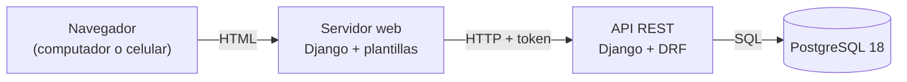

# AdMind — Informe de avance 2

| Dato               | Detalle                                             |
| ------------------ | --------------------------------------------------- |
| **Proyecto**       | AdMind — administración de conjuntos residenciales  |
| **Asignatura**     | Ingeniería de Software II                           |
| **Institución**    | Universidad de Cundinamarca, sede Facatativá        |
| **Integrantes**    | Manuel Alejandro Aldana Rincón · Camilo Remiso Niño |
| **Docente**        | OSCAR OCHOA                                         |
| **Fecha de corte** | 21 de septiembre de 2026                            |
| **Informe anterior** | 15 de septiembre de 2026                          |

---

## 1. Qué es AdMind

AdMind es una aplicación para administrar **conjuntos residenciales bajo régimen de propiedad horizontal en Colombia** (Ley 675 de 2001). Hoy muchos conjuntos se administran con grupos de WhatsApp y hojas de cálculo; AdMind reúne en un solo sistema la reserva de zonas comunes, los residentes y sus unidades, los anuncios y las solicitudes a la administración.

Se apoya en cuatro pilares:

- **Multiconjunto:** una sola plataforma para varios conjuntos, con los datos de cada uno aislados de los demás.
- **Reglas configurables:** cada conjunto configura sus reglas de reserva según su propio reglamento.
- **Reserva por orden de llegada:** bloqueo temporal de 3 minutos sobre una franja y aprobación humana.
- **El sistema registra, no decide:** en infracciones, dinero y lo que la ley reserva a la asamblea.

---

## 2. Tipo de aplicación

> [!IMPORTANT] AdMind es una aplicación **web**
> No es una aplicación móvil. Se usa desde el navegador, en computador o en celular, y las pantallas se adaptan al tamaño de la pantalla. No se desarrolla una app nativa para Android ni para iOS.

**Por qué web:** porque ofrece portabilidad y funciona en varios tipos de dispositivos sin limitaciones de arquitectura ni de sistema operativo.

### 2.1 Cómo está armada

El sistema son **dos servidores** que se comunican por una API:

- **API (backend):** Django con Django REST Framework. Es el único que habla con la base de datos y donde viven las reglas del negocio.
- **Servidor web (frontend):** Django con plantillas HTML. Arma las pantallas que ve el usuario y le pide todos los datos a la API.



![[Pasted image 20260915122021.png]]

> [!TODO] Capturas nuevas para esta sección
> Desde el informe anterior hay pantallas nuevas. Faltan capturas de: **selector de conjunto** (cada tarjeta con su color), **asistente de creación** (los tres pasos), **verificación en dos pasos** (QR, códigos de respaldo y verificar), **recuperar contraseña** y la **barra superior** con el nombre y el color del conjunto activo.

---

## 3. Entorno de trabajo y tecnologías

AdMind **no está desarrollado en .NET**: está hecho en **Python con el framework Django**. Aun así, respeta la organización por capas de la plantilla ASP.NET que se usó como referencia en clase.

![[Pasted image 20260915122403.png]]

### 3.1 Tecnologías

Desde el informe anterior entran `django-otp` y `qrcode`, para el segundo factor.

| Aspecto                         | Qué usamos                                                              | Versión    |
| ------------------------------- | ----------------------------------------------------------------------- | ---------- |
| Lenguaje                        | Python                                                                  | 3.14       |
| Framework del backend           | Django (versión LTS, con soporte extendido)                             | 5.2.17     |
| API REST                        | Django REST Framework                                                   | 3.18       |
| Frontend                        | Django con plantillas HTML y CSS propio del sistema de diseño de AdMind | 5.2.17     |
| Conexión del front con la API   | requests                                                                | 2.34       |
| Base de datos                   | PostgreSQL                                                              | 18         |
| Conector de Python a PostgreSQL | psycopg                                                                 | 3.3        |
| Pruebas automáticas             | pytest + pytest-django                                                  | 9.1 / 4.14 |
| Segundo factor (TOTP)           | django-otp, la librería que fija el maestro §7.1                        | 1.7        |
| Código QR del segundo factor    | qrcode, en SVG para no depender de librerías de imágenes                | 8.2        |

### 3.2 Herramientas

| Para qué                              | Herramienta                                                               |
| ------------------------------------- | ------------------------------------------------------------------------- |
| Editor de código                      | Visual Studio Code, con un espacio de trabajo que abre los tres proyectos |
| Terminal                              | Git Bash                                                                  |
| Control de versiones                  | Git + GitHub                                                              |
| Diseño y consulta de la base de datos | DBeaver                                                                   |
| Seguimiento Scrum                     | Notion (ver §6)                                                           |
| Documentación                         | Obsidian, con la bóveda versionada en GitHub                              |

### 3.3 Equivalencia con .NET

| En la plantilla ASP.NET | En AdMind (Django) | Ejemplo en el código |
|---|---|---|
| `Controllers/` | `views.py` + `urls.py` | `apps/cuentas/views.py` |
| `Dtos/` | `serializers.py` | `apps/cuentas/serializers.py` |
| `Services/` | `servicios.py` | `apps/cuentas/servicios.py` |
| `Repositories/` | Managers del ORM de Django | `TokenDeSesion.objects`, `apps/comun/aislamiento/managers.py` |
| `Utilities/` | `apps/comun/` | `apps/comun/aislamiento/` |
| Entidades / modelos | `models.py` | `apps/personas/models.py` |
| `appsettings.json` | `config/settings.py` + archivo `.env` | `config/settings.py` |
| Paquetes NuGet | `requirements.txt` (pip) | `requirements.txt` |
| Migraciones de Entity Framework | Migraciones de Django | `apps/*/migrations/` |
| xUnit / NUnit | pytest | `apps/*/tests.py`, `tests/` |

---

## 4. Repositorios

El código y la documentación están en **tres repositorios separados** en la cuenta de GitHub `ZeroFour-04`:

| Repositorio | Qué contiene | Enlace | Último commit al corte |
|---|---|---|---|
| `Admind_Backend` | API REST (Django + Django REST Framework) | https://github.com/ZeroFour-04/Admind_Backend | `a8e617e` en `desarrollo` (20/09) |
| `Admind_Front-End` | Servidor web con las pantallas | https://github.com/ZeroFour-04/Admind_Front-End | `19e52f9` en `desarrollo` (20/09) |
| `Admind_Documentacion` | Documentación del proyecto (bóveda de Obsidian) | https://github.com/ZeroFour-04/Admind_Documentacion | `306e5a6` en `main` (16/09) |

Encima de esos commits, los tres repositorios tienen el trabajo del 21/09 **sin commit todavía** (§7.1).

![[Pasted image 20260915121644.png|462]]

### 4.1 Modelo de ramas

Definido por el docente para los repositorios de código:

| Rama | Qué contiene |
|---|---|
| `main` | Lo entregado |
| `desarrollo` | Integración: los dos integrantes trabajan directamente aquí |
| `pruebas` | Lo terminado, listo para probar antes de pasar a `main` |

No se usan ramas por historia. Para no perder la trazabilidad, cada commit debe llevar el ID de la historia que avanza, por ejemplo `feat(reservas): bloqueo de 3 minutos [HU-11]`. El repositorio de documentación trabaja solo con `main`.

**Estado al corte:**
- Todo el trabajo está en `desarrollo`. `main` sigue con la versión inicial de cada repositorio: del 11/09 en el backend y del 07/09 en el front.
- En el backend la rama `pruebas` **ya no existe en GitHub**. En el front existe, pero está igual a `main`.
- Ninguna historia ha pasado todavía de `desarrollo` a `pruebas`.

> [!TODO] Capturas nuevas para esta sección
> Ramas de cada repositorio en GitHub y página principal de los tres repositorios.

### 4.2 Documentación

Desde este corte la bóveda de documentación está organizada en carpetas:

```
Admind_Documentacion/
├── Admin_Master.md                     Documento maestro: fuente de verdad del producto
├── Avance/
│   ├── Admind_Avance.md                  Estado técnico por historia, con el commit que lo respalda
│   └── Informes/
│       ├── 2026-09-15/                   Informe 1 y sus capturas
│       └── 2026-09-21/                   Este informe
├── Guias/
│   ├── Admind_Guia_Desarrollo.md         Cómo se construye dentro de la arquitectura
│   ├── Admind_Backend_Inicializacion.md  Cómo se creó el backend
│   └── Admind_Backend_Instalacion_Local.md  Cómo correr el backend en otra PC
├── Lab/                                Laboratorio de práctica y su seguimiento
├── Bitacora/                           Errores encontrados y lo que se aprendió
├── Notas/                              Notas de reuniones
└── Credenciales/
```

---

## 5. Estructura del proyecto

### 5.1 Espacio de trabajo

```
A D M I N D/
├── Backend/Admind_Backend/                repositorio de la API
├── Frontend/Admind_Front-End/             repositorio del servidor web
└── Documentacion/Admind_Documentacion/    repositorio de documentación (bóveda de Obsidian)
```

### 5.2 Backend

```
Admind_Backend/
├── config/                    Configuración del proyecto Django
│   ├── settings.py              Ajustes; la clave y la conexión a la base se leen de .env
│   ├── settings_pruebas.py      Ajustes para las pruebas automáticas
│   └── urls.py                  Rutas principales de la API (/auth/…)
├── apps/                      Una carpeta por módulo del sistema
│   ├── personas/                Persona única por documento
│   ├── cuentas/                 Usuario, sesión, recuperación de contraseña, segundo factor y usuarios
│   │   ├── models.py              Entidades
│   │   ├── serializers.py         Validación de entrada y salida (DTO)
│   │   ├── views.py               Controladores de la API
│   │   ├── servicios.py           Lógica de negocio: sesión, usuarios y recuperación
│   │   ├── dos_factores.py        Lógica de negocio del segundo factor
│   │   ├── autenticacion.py       Validación del token en cada petición
│   │   ├── permisos.py            Bloquea la API hasta verificar el segundo factor
│   │   └── tests.py, test_dos_factores.py   Pruebas
│   ├── conjuntos/               Conjunto residencial y asistente de creación
│   │   ├── servicios.py           Crear, editar, requisitos y activación
│   │   └── views.py, urls.py      /conjuntos/…
│   ├── permisos/                Catálogo de roles y permisos, y asignaciones
│   ├── comun/                   Piezas compartidas
│   │   ├── aislamiento/           Filtro de datos por conjunto
│   │   └── modelos_base/          Modelo base de toda tabla que pertenece a un conjunto
│   └── areas/, reservas/, …     Módulos siguientes, por ahora solo con su README
├── tests/                     Pruebas transversales (aislamiento y tablas globales)
├── manage.py
├── pytest.ini
└── requirements.txt
```

### 5.3 Frontend

```
Admind_Front-End/
├── config/                    Configuración; la dirección de la API se lee de .env
├── cliente_api/               Único punto que llama a la API
│   ├── http.py                  Envía cada petición con el token y traduce los errores
│   ├── cuentas.py               Sesión, usuarios, recuperación y segundo factor
│   └── conjuntos.py             Asistente de creación
├── apps/                      Una carpeta por módulo de pantallas
│   ├── cuentas/                 Ingreso, salida, recuperar contraseña y segundo factor
│   ├── conjuntos/               Selector con el color de cada conjunto y asistente de creación
│   ├── usuarios/                Lista, detalle y creación de usuarios (nuevo, conectado a la API)
│   ├── paneles/                 Inicio
│   ├── reservas/                Calendario de zonas comunes
│   └── reglas/, anuncios/, triage/, unidades/
├── templates/                 Plantillas base y componentes (barra superior, menú lateral, campo de formulario)
├── static/css/                Estilos propios
├── design-system/             Colores (con los 8 acentos por conjunto), tipografía y espaciado
├── manage.py
└── requirements.txt
```

### 5.4 Flujo por capas

Toda petición a la API debe seguir el mismo recorrido: **controlador → servicio → repositorio**. La vista no consulta la base directamente y el servicio no sabe nada de HTTP. Ejemplo real, el inicio de sesión:

```
POST /auth/login/
   │
   ▼
urls.py → views.py (IniciarSesionView)       Controlador: recibe la petición HTTP
             │ valida con serializers.py      DTO: revisa correo y contraseña
             ▼
          servicios.py (iniciar_sesion)       Servicio: comprueba la cuenta y crea la sesión
             │
             ▼
          TokenDeSesion.objects               Repositorio: guarda la sesión en PostgreSQL
```

Los endpoints para crear usuarios y conjuntos del 20/09 creaban los registros desde la vista. Desde el 21/09 pasan por `servicios.py` como el resto (`registrar_usuario`, `crear_conjunto`).

### 5.5 Base de datos

Las tablas se crean con las migraciones de Django sobre PostgreSQL:

| Tabla | Qué guarda | Cambio al 21/09 |
|---|---|---|
| `personas_persona` | Personas, únicas por tipo y número de documento | |
| `cuentas_usuario` | Cuentas de acceso: correo y contraseña cifrada | |
| `cuentas_tokendesesion` | Sesiones abiertas: token, conjunto activo, segundo factor verificado y vencimiento | |
| `conjuntos_conjunto` | Conjuntos residenciales | Nuevo campo `acento`, con un CHECK que solo admite los 8 del catálogo |
| `permisos_asignacion` | Rol de cada persona en cada conjunto, con fechas de vigencia | |
| `otp_totp_totpdevice` | Secreto del segundo factor de cada cuenta | Nueva, de `django-otp` |
| `otp_static_staticdevice`, `otp_static_statictoken` | Códigos de respaldo del segundo factor | Nuevas, de `django-otp` |

Las tres tablas de `django-otp` entraron a la **lista cerrada de tablas globales** (sin `conjunto_id`): el segundo factor es de la cuenta, y la cuenta es global. Al llevarlo al maestro, hay que agregarlas a su §5.4.

---

## 6. Herramienta de seguimiento

El seguimiento Scrum se lleva en **Notion**, en el espacio **Gestión Scrum — AdMind**:

| Base de datos | Qué contiene |
|---|---|
| Historias de Usuario | Las 38 historias del backlog (188 story points), cada una con prioridad, sprint previsto, estado, criterios de aceptación y tareas técnicas |
| Sprints | Los 7 sprints del proyecto, con las historias de cada uno |

Cada historia pasa por los estados *Sin empezar*, *En progreso*, *En revisión* y *Finalizado*. El archivo `Admind_Avance.md` del repositorio de documentación registra el avance técnico de cada historia con el commit que lo respalda.

**Cambios en Notion al corte (21/09):**
- **Sprint 1** pasa de *Planificado* a *En curso*. Su trabajo técnico quedó terminado este día, pero ninguna de sus 6 historias cumple todavía la Definición de Terminado (§7.5).
- **HU-06** vuelve de *Finalizado* a *En progreso*: no cumple la Definición de Terminado.
- Tareas marcadas con lo construido: HU-01 5/5, HU-02 5/5, HU-03 5/5 y HU-26 5/5. Cada historia del Sprint 1 tiene una nota "Revisión del 2026-09-21" con lo que se hizo y lo que falta.

> [!TODO] Captura nueva
> Tabla de Historias de Usuario y de Sprints en Notion, con los estados de este corte.

---

## 7. Avance a la fecha

### 7.1 Resumen

| Frente | Estado al 21 de septiembre |
|---|---|
| **Backend** | Personas, usuarios, conjuntos, asignaciones de rol y sesiones en PostgreSQL. Catálogo de roles y permisos. Aislamiento de datos entre conjuntos. **Nuevo:** recuperación de contraseña por correo, segundo factor TOTP obligatorio para permisos sensibles, asistente de creación de conjuntos, color por conjunto y usuarios limitados al conjunto activo |
| **Frontend** | Funcionan contra la API: ingreso y salida, recuperar contraseña, segundo factor, selector de conjunto con el color de cada uno, asistente de creación de conjuntos y usuarios. Inicio, zonas comunes, reglas, anuncios, solicitudes y unidades siguen siendo maquetas |
| **Pruebas** | 120 pruebas automáticas en el backend, **todas pasan**. El frontend aún no tiene pruebas automáticas |
| **Historias** | 7 de 38 en progreso, 0 terminadas (0 de 188 SP). Las 6 del Sprint 1 tienen todas sus tareas técnicas |
| **Sprint 1** | En curso. Trabajo técnico terminado; falta la revisión y la prueba manual que pide la Definición de Terminado |

> [!IMPORTANT] Lo construido el 21/09 todavía no tiene commit
> Por decisión del equipo, el trabajo de este día quedó en la rama `desarrollo` de las copias locales, sin commit, para revisarlo antes de subirlo. Lo marcado "sin commit" en el §7.3 todavía no está en GitHub.

> [!NOTE] Cómo se verificó este informe
> Las pruebas del backend se corrieron el 21/09 sobre el código sin commit: 120 de 120. El frontend no tiene pruebas automáticas, así que se probó a mano en el navegador contra la API real, sobre una base de datos de prueba aparte. Se probaron los flujos de una residente con dos conjuntos, un administrador con un conjunto y el Superusuario: segundo factor con código de la aplicación y con código de respaldo, código errado, recuperación de contraseña de punta a punta, enlace usado dos veces, asistente completo y la vista en celular.

### 7.2 Estado de las pruebas

| Grupo | Pruebas | Qué cubre |
|---|---|---|
| `apps/personas` | 10 | Persona única por documento (HU-04) |
| `apps/cuentas` | 31 | Sesión, selector, usuarios del conjunto activo y recuperación de contraseña (HU-01, HU-04, HU-26) |
| `apps/cuentas` (segundo factor) | 15 | Quién lo necesita, activarlo, verificarlo, código repetido, vencido y de respaldo, y espera tras un error (HU-02) |
| `apps/conjuntos` | 19 | Asistente, color, quién crea y quién activa, requisitos (HU-03, HU-26) |
| `apps/permisos` | 21 | Catálogo, asignaciones y permisos efectivos (HU-06) |
| `tests/aislamiento` | 21 | Filtro por conjunto, prueba del intruso por endpoint y revisión de todas las rutas (HU-05) |
| `tests/esquema` | 3 | Lista cerrada de tablas globales (HU-05) |
| **Total** | **120** | **Todas pasan** |

### 7.3 Qué cambió desde el 15 de septiembre

| Fecha | Repositorio | Commit | Qué trae |
|---|---|---|---|
| 15/09 | Front | `7f68d14` | Borra `index.html` (HTML de prueba) y la plantilla de variables de entorno `.env _ejemplo` |
| 16/09 | Documentación | `306e5a6` | Informe de avance 1 |
| 18/09 | Front | `388b07a` | Borra `apps/Administrador/Home.html` (HTML de prueba) |
| 18/09 | Front | `4155b53` | La marca "AdMind" de la barra superior lleva al selector de conjunto |
| 20/09 | Backend | `a8e617e` | Crear conjuntos y usuarios por la API, permiso `usuario.gestionar` y 4 pruebas nuevas |
| 20/09 | Front | `19e52f9` | Selector conectado a la API, pantalla Crear conjunto y módulo Usuarios |
| 21/09 | Backend | sin commit | Recuperación de contraseña, segundo factor, asistente de conjuntos, color por conjunto, usuarios limitados al conjunto activo, arreglo de los dos errores 500 y de la prueba del intruso. 47 pruebas nuevas |
| 21/09 | Front | sin commit | Pantallas de recuperación, segundo factor y asistente; selector con colores; entrada directa con un solo conjunto |
| 21/09 | Notion | — | Sprint 1 *En curso*, HU-06 de vuelta a *En progreso* y tareas del Sprint 1 marcadas |
| 21/09 | Documentación | sin commit | Bóveda organizada en carpetas (§4.2) y este informe |

**Decisiones del 21/09:**

| Decisión | Quién | Dónde quedó |
|---|---|---|
| **Administración también crea conjuntos**, para darle más autonomía. Quien crea un conjunto desde Administración queda como su Administración. Solo el Superusuario ve todos los conjuntos de la plataforma | Alejo y Camilo | Código; falta llevarlo al maestro §3.1 y §5.3, que dicen que `conjunto.crear` es solo del Superusuario |
| **Color por conjunto** con el catálogo de 8 acentos del maestro §6.3. Revierte el "un solo acento" del 11/09. El logo sigue fuera (Condicional, §3.3) | Alejo | Código; falta quitar el aviso de "aplazado" del maestro §6.3 |
| **HU-03 como asistente parcial**, sin partir la historia: los requisitos de módulos que no existen cuentan como no cumplidos | Alejo | Notion, HU-03 |
| HU-06 vuelve a *En progreso* | Alejo | Notion, HU-06 |

### 7.4 Endpoints disponibles en la API

| Método | Ruta | Qué hace | Desde |
|---|---|---|---|
| `POST` | `/auth/login/` | Inicia sesión; devuelve el token, el conjunto activo, los permisos y si falta el segundo factor | 15/09 |
| `POST` | `/auth/logout/` | Cierra la sesión | 15/09 |
| `GET` | `/auth/conjuntos/` | Conjuntos donde puede operar: los de sus roles; el Superusuario, todos | 15/09, cambió el 21/09 |
| `POST` | `/auth/conjunto-activo/` | Cambia el conjunto con el que se está trabajando | 15/09 |
| `GET` / `POST` | `/auth/usuarios/` | Lista o crea cuentas con un rol en el conjunto activo. Exige `usuario.gestionar` | 20/09, cambió el 21/09 |
| `GET` | `/auth/usuarios/<id>/` | Una cuenta del conjunto activo; 404 si es de otro | 20/09, cambió el 21/09 |
| `POST` | `/auth/recuperar/` | Envía el enlace de recuperación por correo | 21/09 |
| `POST` | `/auth/recuperar/confirmar/` | Cambia la contraseña con el enlace y cierra las sesiones abiertas | 21/09 |
| `POST` | `/auth/dos-factores/configurar/` | Genera el QR del segundo factor | 21/09 |
| `POST` | `/auth/dos-factores/activar/` | Lo activa con el primer código y entrega 10 códigos de respaldo | 21/09 |
| `POST` | `/auth/dos-factores/verificar/` | Verifica el código en cada ingreso | 21/09 |
| `POST` | `/conjuntos/` | Paso 1 del asistente: crea el conjunto y lo deja como activo. Exige `conjunto.crear` | 21/09 (reemplaza `POST /auth/conjuntos/` del 20/09) |
| `GET` / `PATCH` | `/conjuntos/actual/` | Resumen del asistente y edición de los datos del conjunto activo | 21/09 |
| `POST` | `/conjuntos/actual/activar/` | Lo deja operativo si cumple los requisitos. Exige `conjunto.activar` | 21/09 |

Cada ruta está documentada en el README de su app en el backend (`apps/cuentas/README.md`, `apps/conjuntos/README.md`).

### 7.5 Historias del Sprint 1 y HU-06

| HU | Historia | Tareas | Criterios | Qué falta |
|---|---|---|---|---|
| HU-01 | Inicio de sesión con correo y contraseña | 5 de 5 | 5 de 5 | Revisión y prueba manual |
| HU-02 | Segundo factor (TOTP) para permisos sensibles | 5 de 5 | 5 de 5 | Revisión y prueba manual |
| HU-03 | Asistente por pasos para crear un conjunto | 5 de 5 | 3 de 5 | Que con todo completo quede operativo (espera áreas, reglamento y reglas beta: HU-09, HU-33, HU-10) y la auditoría de quién lo creó |
| HU-04 | Persona global única por documento | 5 de 5 | 5 de 5 | Revisión y prueba manual |
| HU-05 | Aislamiento de datos entre conjuntos | 5 de 5 | 5 de 5 | Revisión y prueba manual |
| HU-26 | Selector de conjunto activo | 5 de 5 | 5 de 5 | Revisión y prueba manual. Muestra el color de cada conjunto; el logo queda fuera de v1 (maestro §3.3) |
| HU-06 | Asignación de roles del catálogo fijo (Sprint 2) | 3 de 5 | 4 de 5 | La pantalla para asignar y retirar roles a personas que ya existen, y la regla de "nunca cero Administración" |

> [!NOTE] Por qué siguen 0 historias terminadas
> Una historia cuenta como terminada solo cuando cumple la Definición de Terminado: además de sus tareas y criterios, necesita la revisión del otro integrante (pull request de `desarrollo` a `pruebas`) y una prueba manual de quien no la programó. Cinco historias del Sprint 1 ya solo esperan ese paso. En el backend, además, primero hay que volver a crear la rama `pruebas` (§4.1).

### 7.6 Pendientes

**Para cerrar el Sprint 1**

- [ ] Commit y subida del trabajo del 21/09 en los tres repositorios.
- [ ] Volver a crear la rama `pruebas` en el backend.
- [ ] Pull request `desarrollo → pruebas` revisado por el otro integrante, y prueba manual de quien no programó cada historia.
- [ ] En cada máquina: `pip install -r requirements.txt` (entran `django-otp` y `qrcode`) y `python manage.py migrate` (color del conjunto y tablas del segundo factor).

**Técnicos**

- [x] Registrar las rutas de usuarios en la prueba del intruso: la suite volvió a verde.
- [x] Crear un usuario con un documento que ya existe respondía error 500: ahora responde 400 con el mensaje en el campo del documento.
- [x] Crear un usuario sin conjunto activo respondía error 500: ahora responde 403.
- [x] `GET /auth/usuarios/` listaba las cuentas de toda la plataforma: ahora solo las del conjunto activo.
- [x] Pasar a `servicios.py` la creación de usuarios y de conjuntos.
- [x] En el front, entrar directo cuando la persona tiene un solo conjunto.
- [ ] Recuperar en el front la plantilla `.env _ejemplo`, que se borró el 15/09.
- [ ] Configurar el correo SMTP real en `.env` (`EMAIL_HOST` y los demás, con contraseña de aplicación). Sin eso, los correos se imprimen en la consola del servidor.
- [ ] Pruebas automáticas del front.
- [ ] Llevar al sistema de diseño en Claude Design los 8 acentos que se agregaron a `design-system/tokens/`: si se re-sincroniza sin eso, se pierden.
- [ ] El correo de recuperación sale directo; cuando exista el canal de notificaciones, debe pasar por él.

**Decisiones del equipo**

- [ ] Llevar al maestro las decisiones del 21/09 (§7.3) y las tablas nuevas de la lista cerrada (§5.5).
- [ ] ¿Administración también activa sus conjuntos? Hoy `conjunto.activar` es solo del Superusuario, así que el administrador que crea un conjunto no puede activarlo.
- [ ] Fecha exacta de entrega y qué historias entran en el mes (maestro §12.8).
