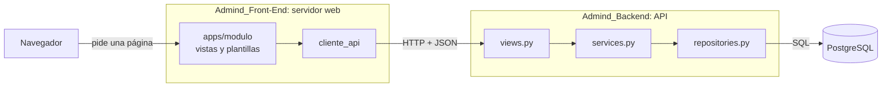
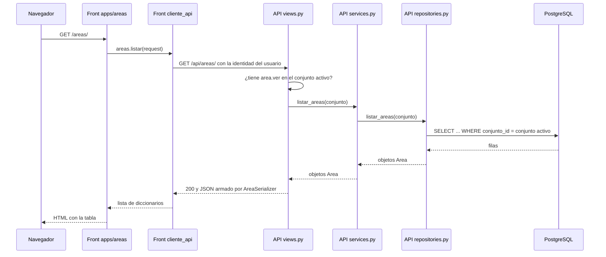
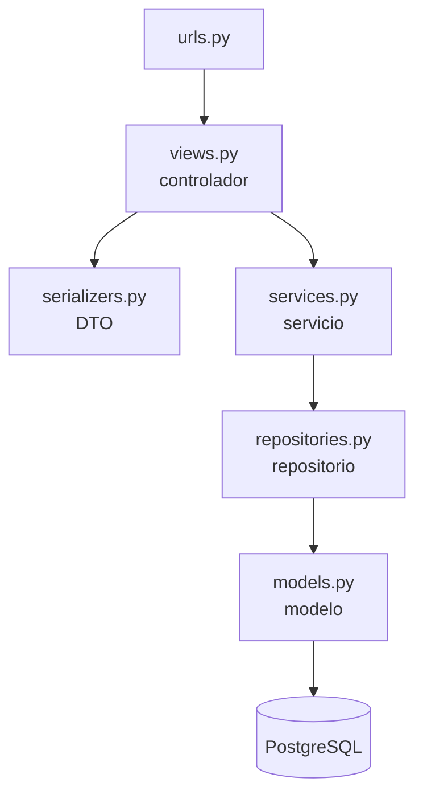
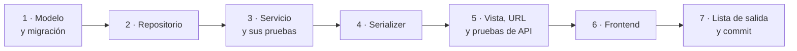
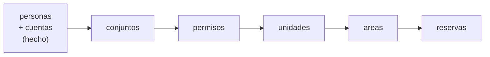

# AdMind — Guía para trabajar en el proyecto

> [!WARNING] Tutorial con fecha de corte
> Desde el 2026-09-30 la documentación vigente está en las carpetas numeradas de la bóveda (ver `README.md`). Esta guía se conserva como tutorial del 2026-09-15, con sus recetas y ejemplos de código. Sus reglas (§3.2, §3.3, §3.5, §4.1, §4.3, §5, §8.5 y §9 a §12) se copiaron a `03_Reglas/`, y es allá donde se mantienen. En el código real la capa de servicio es `servicios.py` y no hay `repositories.py`. Los nombres de archivo que cita (`Admin_Master.md`, `Admind_Avance.md`, `Admind_Lab.md`) se resuelven en la tabla de equivalencias de `Admin_Master.md`.

> [!NOTE]
> **Qué es este documento.** El manual de obra de AdMind: explica **cómo** se construye dentro de su arquitectura. **Qué** debe hacer el producto (reglas, estados, permisos, ley) está en `Admin_Master.md`, y **si esta guía lo contradice, manda el maestro**.
>
> - Lo leen Alejo, Camilo y cualquier agente de IA antes de construir algo.
> - Para correr el backend en tu PC: [Admind_Backend_Instalacion_Local](Admind_Backend_Instalacion_Local.md).
> - Para saber cómo se creó el backend: [Admind_Backend_Inicializacion](Admind_Backend_Inicializacion.md).
> - Para saber qué existe hoy y cómo va cada historia: [estado_actual](../08_Estado/estado_actual.md).

> [!WARNING]
> **Casi todo lo que describe esta guía todavía no existe en el código.** Al 2026-09-15 el backend tiene dos modelos (`Persona` y `Usuario`) y ningún endpoint, y el frontend tiene carpetas con README más el sistema de diseño. La guía describe **la forma que debe tener lo que se construya**; la §13 lista las piezas que faltan.
>
> Los fragmentos de código son **esqueletos para entender el patrón, no para copiar**: usan piezas de `apps/comun/` y `apps/permisos/` que aún no están escritas.

### Cómo leer las etiquetas

No todo lo que dice esta guía tiene el mismo peso. Donde importa, va marcado:

| Etiqueta | Significa |
|---|---|
| **Decidido** | Viene del maestro, del profesor o de una decisión registrada. No se rediscute al construir |
| **Propuesta** | Convención que sugiere esta guía para que los dos trabajen igual. No está confirmada por el equipo: si deciden otra cosa, se cambia aquí |
| **Abierto** | Decisión pendiente o contradicción del maestro (§12). Construir no la resuelve: se pregunta |

### Índice rápido: ¿qué quieres hacer?

| Quiero… | Ve a |
|---|---|
| Entender cómo encaja todo antes de tocar nada | §1 y §2 |
| Saber qué hace cada archivo del backend | §3 |
| Saber qué hace cada carpeta del frontend | §4 |
| Saber en qué archivo va una regla | §5 |
| Agregar una pantalla nueva, una pestaña o un panel | §6 |
| Agregar una funcionalidad a un módulo que ya existe | §7 |
| Crear una app (un módulo nuevo) | §8 |
| Saber si ya terminé | §9 |
| Saber si tengo que preguntar antes de construir | §11 |

---

## 1. La arquitectura en una imagen

### 1.1 La analogía: un restaurante

| En el restaurante | En AdMind | Dónde vive |
|---|---|---|
| El **comedor**, donde el cliente ve la carta y recibe el plato | Las pantallas que ve el usuario | `Admind_Front-End/apps/` y `templates/` |
| El **mesero**, que lleva el pedido a la cocina y trae el plato | `cliente_api/` | `Admind_Front-End/cliente_api/` |
| La **ventanilla** de la cocina, donde se recibe el pedido y se revisa que venga completo | Las vistas de la API: `urls.py`, `views.py`, `serializers.py` | `Admind_Backend/apps/<módulo>/` |
| El **chef**, que conoce las recetas y decide si un pedido se puede preparar | Los servicios: `services.py` | ídem |
| El **despensero**, el único que entra a la despensa | Los repositorios: `repositories.py` | ídem |
| La **despensa** | PostgreSQL | base `admind_db` |

De la analogía salen tres ideas, y son casi toda la arquitectura:

1. **El mesero nunca entra a la despensa.** El frontend no toca PostgreSQL: todo dato se lo pide a la API.
2. **El de la ventanilla no cocina.** La vista de la API recibe la petición, revisa que quien pide tenga permiso y entrega la respuesta. Las reglas las aplica el servicio.
3. **Solo el despensero entra a la despensa, y siempre con la lista del conjunto correcto.** Las consultas viven en el repositorio y siempre llevan el conjunto activo.

### 1.2 El diagrama



**Son dos servidores Python**, los dos hechos con Django, pero con trabajos distintos: el frontend arma HTML y el backend responde JSON. Entre los dos solo viaja JSON por HTTP. El frontend no tiene modelos de dominio ni conexión a la base.

### 1.3 Los tres repositorios

| Repositorio | Carpeta local | Rama de trabajo | Qué contiene |
|---|---|---|---|
| Backend | `Backend/Admind_Backend` | `desarrollo` | La API: Django 5.2 + Django REST Framework. El único que toca PostgreSQL |
| Frontend | `Frontend/Admind_Front-End` | `desarrollo` | El servidor web: plantillas de Django, Alpine.js y el sistema de diseño |
| Documentación | `Documentacion/Admind_Documentacion` | `main` | El maestro, el lab, el avance y guías como esta |

### 1.4 Una app por módulo, en pareja

Cada módulo del producto (`reservas`, `areas`, `unidades`…) es **una app de Django en el backend y otra con el mismo nombre en el frontend**. La del backend guarda datos y reglas; la del frontend, pantallas.

| Excepción | Por qué |
|---|---|
| `comun` existe solo en el backend | Son mecanismos compartidos (aislamiento, bloqueo, modelos base). No tiene pantalla |
| `permisos` existe solo en el backend | La asignación de roles se hace desde las pantallas de `personas` |
| `paneles` existe solo en el frontend | Los inicios por rol juntan datos de varios módulos |

**Cada carpeta tiene un `README.md`** que dice qué va ahí, qué no va y con qué se conecta. **Léelo antes de escribir en esa carpeta**: es la forma más rápida de no poner algo donde no va.

> [!IMPORTANT]
> **Abierto — el stack del frontend (maestro §12.1).** La estructura del frontend se armó el 2026-09-13 suponiendo **plantillas de Django + Alpine.js**, que es lo que eligió Alejo, pero el maestro todavía no lo registra como decisión cerrada. Si el equipo cambia de camino, se reescriben la §4 y la §6 de esta guía; la parte del backend no cambia.

---

## 2. El viaje de una petición

La mejor forma de entender la arquitectura es seguir **una sola petición** de punta a punta. El ejemplo: **un administrador abre la pantalla "Áreas comunes"** (HU-09).



Paso a paso, con el archivo que trabaja en cada salto:

| # | Dónde | Qué pasa |
|---|---|---|
| 1 | Navegador | El administrador hace clic en "Áreas comunes" del menú lateral. El navegador pide `/areas/` **al servidor del frontend**, no a la API |
| 2 | Front · `config/urls.py` → `apps/areas/urls.py` | Django busca qué vista atiende `/areas/` y encuentra `lista_areas` |
| 3 | Front · `apps/areas/views.py` | La vista no sabe dónde está la API. Le pide los datos a `cliente_api.areas.listar(request)` |
| 4 | Front · `cliente_api/areas.py` | Arma la petición `GET /api/areas/` con la dirección de la API y **la identidad del usuario**. Cómo viaja esa identidad está abierto (maestro §12.7 b) |
| 5 | API · middleware | Antes de llegar a la vista, Django identifica al usuario y el middleware de aislamiento **resuelve el conjunto activo desde la sesión**. Nadie lo manda en la URL |
| 6 | API · `config/urls.py` → `apps/areas/urls.py` | Django encuentra la vista `AreaListaVista` |
| 7 | API · `apps/areas/views.py` | Comprueba el permiso `area.ver`. Si no lo tiene, responde 403 y el viaje termina aquí. Si lo tiene, llama al servicio con el conjunto activo |
| 8 | API · `apps/areas/services.py` | Aplica las reglas de negocio. Para listar no hay ninguna todavía, así que solo le pide los datos al repositorio |
| 9 | API · `apps/areas/repositories.py` | Hace la consulta al ORM **siempre filtrada por el conjunto**. Es el único archivo que habla con la base |
| 10 | PostgreSQL | Devuelve solo las filas de ese conjunto |
| 11 | API · `apps/areas/serializers.py` | La vista convierte los objetos en JSON con `AreaSerializer`, que decide **qué campos salen** (el `conjunto` no sale) |
| 12 | Front · `apps/areas/views.py` | Recibe la lista y se la pasa a la plantilla |
| 13 | Front · `apps/areas/templates/areas/lista.html` | Extiende la página base, pinta la tabla con las clases del sistema de diseño y, si la lista está vacía, muestra el estado vacío |
| 14 | Navegador | Recibe HTML listo. Alpine.js solo interviene si hay algo que cambia sin recargar |

**Lo que hay que notar:**

- **El conjunto nunca viaja en la URL ni en el cuerpo.** Sale de la sesión del lado de la API (maestro §5.4). Si alguien lo manda, se rechaza.
- **Cada salto tiene un solo trabajo.** Si un archivo hace el trabajo de otro, la cadena se vuelve difícil de probar y de explicar.
- **El JSON del paso 11 es el contrato entre los dos repositorios.** Mientras no cambie, uno puede trabajar el backend y el otro el frontend sin pisarse.

---

## 3. Las capas del backend

### 3.1 El mapa

**Decidido (profesor, 2026-09-14):** el flujo de la API es **controlador → servicio → repositorio**, como en su plantilla de ASP.NET. Le dan igual los nombres y la ubicación de las carpetas.

**Propuesta:** en Django esas capas se llaman así, un archivo por capa dentro de cada app. Hoy `apps/README.md` todavía lista solo `models`, `serializers`, `views` y `urls`.

| Archivo | En la plantilla del profesor | Su trabajo | Lo que nunca hace |
|---|---|---|---|
| `urls.py` | Las rutas de `Controllers` | Decir qué vista atiende cada dirección | Tener lógica |
| `views.py` | `Controllers` | Recibir la petición, exigir sesión y permiso, validar la entrada con un serializer, llamar al servicio y traducir el resultado a un código HTTP | Consultar la base o aplicar reglas de negocio |
| `serializers.py` | `Dtos` | Definir la forma del JSON que entra y que sale, y validar ese formato | Consultar la base para decidir algo |
| `services.py` | `Services` | Las reglas de negocio, las transacciones, la auditoría y los avisos | Conocer HTTP: nada de `request`, `Response` ni códigos de estado |
| `repositories.py` | `Repositories` | Las consultas y los guardados, siempre con el conjunto | Decidir si algo se puede hacer |
| `models.py` | Las entidades | La forma de la tabla y sus restricciones en la base | Lógica de flujo (normalizar un dato al guardar sí vale, como en `Persona`) |
| `apps/comun/` | `Utilities` | Lo compartido: aislamiento, bloqueo, modelos base | Importar apps de negocio |

### 3.2 La regla de dirección: las flechas solo bajan



Cada capa conoce **solo a la de abajo**. En la práctica:

- Si en `views.py` aparece `Area.objects`, la vista se está saltando dos capas.
- Si en `services.py` aparece `request` o `Response`, el servicio sabe de HTTP y ya no se puede usar desde otra entrada.
- Si en `repositories.py` aparece un `if` que decide si una operación está permitida, esa regla se escondió donde nadie la va a buscar.

### 3.3 Por qué así — la respuesta para el jurado

- **Las reglas se prueban sin HTTP.** Un servicio se prueba llamando una función de Python: sin servidor, sin JSON, sin sesión. Las reglas del núcleo (bloqueo, estados, aislamiento) son justamente lo que más hay que probar.
- **Hay un solo lugar donde se filtra por conjunto.** Si las consultas quedan regadas por las vistas, cada vista tiene que acordarse de filtrar, y "acordarse" es lo que falla en un equipo de dos con prisa (maestro §5.4). Con repositorios, lo que hay que revisar es un archivo por app.
- **Una regla sirve a varias entradas.** La importación masiva (HU-36) crea personas desde un Excel, no desde una petición HTTP. Si la regla vive en el servicio, la importación la reutiliza; si vive en la vista, se copia, y un día las dos copias dicen cosas distintas.

### 3.4 Cada capa en código

El ejemplo es el listado de áreas del §2. **Es un esqueleto**: el modelo real de `Area` todavía no se ha escrito, y hay un choque pendiente con el esquema de referencia sobre `clasificacion` (Avance §6).

#### `models.py` — la forma de la tabla

```python
import uuid

from django.db import models


class Clasificacion(models.TextChoices):
    COMUN = "comun", "Común"
    COMUN_ESENCIAL = "comun_esencial", "Común esencial"
    COMUN_USO_EXCLUSIVO = "comun_uso_exclusivo", "Común de uso exclusivo"


class Area(models.Model):
    id = models.UUIDField(primary_key=True, default=uuid.uuid4, editable=False)
    conjunto = models.ForeignKey("conjuntos.Conjunto", on_delete=models.PROTECT)
    nombre = models.CharField(max_length=80)
    clasificacion = models.CharField(max_length=20, choices=Clasificacion.choices)

    class Meta:
        constraints = [
            models.UniqueConstraint(fields=["id", "conjunto"], name="area_id_conjunto"),
            models.UniqueConstraint(fields=["conjunto", "nombre"], name="area_nombre_por_conjunto"),
        ]
```

| Pieza | Por qué |
|---|---|
| `id` UUID | Lo que se expone en URLs es un UUID, nunca un número consecutivo (maestro §5.4, decisión 24) |
| `conjunto` obligatorio | Toda tabla lleva conjunto salvo la lista cerrada de globales (maestro §5.4) |
| `on_delete=PROTECT` | Nunca `CASCADE`: borrar un conjunto no puede arrastrar sus áreas (maestro §5.11) |
| `UNIQUE (id, conjunto)` | Es la clave contra la que apuntan las FK compuestas (maestro §7.1) |
| `UNIQUE (conjunto, nombre)` | Toda clave única incluye el conjunto: el "Salón comunal" de A y el de B deben poder existir a la vez |
| `"conjuntos.Conjunto"` entre comillas | Referenciar otra app por texto evita importaciones circulares. `Usuario` ya lo hace con `"personas.Persona"` |

Cuando exista `apps/comun/modelos_base/`, el `id`, el `conjunto` y la primera restricción se heredan de ahí y no se repiten en cada modelo.

#### `repositories.py` — el único que consulta

```python
from .models import Area


def listar_areas(conjunto):
    return Area.objects.filter(conjunto=conjunto).order_by("nombre")


def obtener_area(area_id, conjunto):
    return Area.objects.filter(id=area_id, conjunto=conjunto).first()
```

- **El conjunto es un parámetro obligatorio**, no opcional. Es el `findById(id, conjuntoId)` del maestro §5.4 escrito en Python.
- `.first()` devuelve `None` si no hay nada. El repositorio no decide qué hacer con eso: se lo deja al servicio.
- Cómo se impone el filtro de forma que no se pueda olvidar (un manager base, un contexto implícito) se decide al construir `apps/comun/aislamiento/`. En los ejemplos va explícito porque se lee mejor.

#### `services.py` — las reglas

```python
from apps.areas import repositories


def listar_areas(conjunto):
    return repositories.listar_areas(conjunto)
```

Sí, a veces el servicio solo pasa el mensaje. **Está bien que exista igual**: el día que aparezca una regla (por ejemplo, que un residente solo vea las áreas reservables), ya tiene dónde vivir y nadie la mete en la vista. El ejemplo de la §7 muestra un servicio con reglas de verdad.

#### `serializers.py` — la forma del JSON

```python
from rest_framework import serializers

from .models import Area


class AreaSerializer(serializers.ModelSerializer):
    clasificacion_nombre = serializers.CharField(source="get_clasificacion_display", read_only=True)

    class Meta:
        model = Area
        fields = ["id", "nombre", "clasificacion", "clasificacion_nombre"]
```

- **`conjunto` no está en `fields`.** La API ni lo muestra ni lo acepta.
- `clasificacion_nombre` le entrega al frontend "Común esencial" en vez de `comun_esencial`: el DTO da forma a la salida pensando en quien la consume.

#### `views.py` — el controlador

```python
from rest_framework.response import Response
from rest_framework.views import APIView

from apps.permisos.drf import TienePermiso  # no existe todavía: nombre de ejemplo

from . import services
from .serializers import AreaSerializer


class AreaListaVista(APIView):
    permission_classes = [TienePermiso]
    permiso_requerido = "area.ver"

    def get(self, request):
        areas = services.listar_areas(request.conjunto)  # request.conjunto lo pone el middleware
        return Response(AreaSerializer(areas, many=True).data)
```

Tres líneas de trabajo real: **permiso, servicio, respuesta**. Si una vista crece mucho más que eso, probablemente tiene reglas que le tocan al servicio.

#### `urls.py` de la app y de `config/`

```python
# apps/areas/urls.py
from django.urls import path

from . import views

urlpatterns = [
    path("", views.AreaListaVista.as_view(), name="area-lista"),
]
```

```python
# config/urls.py
from django.contrib import admin
from django.urls import include, path

urlpatterns = [
    path("admin/", admin.site.urls),
    path("api/areas/", include("apps.areas.urls")),
]
```

**Propuesta:** todas las rutas de la API bajo `api/<módulo>/`, para distinguirlas a simple vista del panel `admin/`.

### 3.5 Qué código de respuesta usar

| Situación | Código | Quién lo produce |
|---|---|---|
| Lectura correcta | `200` | La vista |
| Se creó algo | `201` | La vista |
| El JSON no tiene la forma correcta | `400` | El serializer, con `is_valid(raise_exception=True)` |
| La operación no existe para ese recurso (prioridad sobre un Evento, maestro §5.7) | `400` | La vista o el serializer |
| Quien pide no tiene el permiso de la operación | `403` | La clase de permiso |
| El recurso no existe **o es de otro conjunto** | `404`, **nunca** `403` | La vista, a partir de lo que diga el servicio |
| El estado actual no permite la operación (rechazar algo que ya está reservado) | `409` (**Propuesta**) | La vista, a partir de lo que diga el servicio |

**El 404 para lo que es de otro conjunto no es un detalle:** un 403 le confirma al intruso que el recurso existe, y esa confirmación ya es información filtrada (maestro §5.4). Por lo mismo, los mensajes de error no llevan datos de la fila: `"No encontrado"`, nunca `"La reserva pertenece al conjunto Mirador"`.

---

## 4. Las capas del frontend

### 4.1 El mapa

| Carpeta | Qué va | Lo que nunca hace |
|---|---|---|
| `config/` | El proyecto Django del servidor web. La dirección de la API sale de una variable de entorno | Conectarse a la base de AdMind |
| `apps/<módulo>/urls.py` y `views.py` | Una vista por pantalla: pide los datos a `cliente_api` y elige la plantilla | Armar URLs de la API por su cuenta |
| `apps/<módulo>/templates/<módulo>/` | Las plantillas de las pantallas de ese módulo | Escribir colores en hex |
| `cliente_api/` | El único lugar que sabe que la API existe. Una función por endpoint, agrupadas por módulo. Traduce los errores (un 404 se muestra como "No encontrado") | Enviar `conjunto_id` |
| `templates/base/` | La estructura de toda página: `<head>`, barra superior, lateral, zona de contenido y páginas de error | — |
| `templates/componentes/` | Los diez componentes del sistema de diseño como fragmentos de plantilla | Crecer: el inventario es cerrado |
| `static/css/` | Estilos propios de pantallas, **solo con variables** | Crear tokens o colores nuevos |
| `static/js/` | Alpine.js para lo que no se resuelve con HTML y una recarga. Alpine va autoalojado en `vendor/` | Decidir reglas: si una franja está libre o si un bloqueo venció lo decide la API |
| `design-system/` | Tokens, fuentes y CSS importados de Claude Design | Editarse a mano |

### 4.2 La misma idea que en el backend

| Backend | Frontend | Por qué se parecen |
|---|---|---|
| `views.py` (controlador) | `apps/<módulo>/views.py` | Reciben la petición, piden los datos y entregan la respuesta |
| `repositories.py` | `cliente_api/` | Son el único punto que habla con la fuente de datos. Para el backend la fuente es PostgreSQL; para el frontend, la API |
| `serializers.py` | La plantilla | Deciden cómo se presenta lo que sale |

### 4.3 Reglas del frontend

**Decidido.** Cada una con su fuente:

- **Ningún hex fuera de `design-system/tokens/paleta.css`**, y ningún token nuevo en `static/css/` (maestro §6.6).
- **Un solo acento por ahora**, sin `data-acento` (maestro §6.3).
- **El acento aparece en cuatro sitios y en ninguno más:** botón primario, ítem activo del lateral y pestaña seleccionada, anillo de foco y franja del conjunto activo (maestro §6.1). Un quinto sitio es un error, no una variante.
- **Acción y estado no comparten forma.** Botón: relleno sólido y verbo (`Confirmar reserva`). Pastilla: fondo suave y participio (`Confirmada`). Nunca al revés (maestro §6.1).
- **El inventario de componentes es cerrado:** `Boton`, `Campo`, `Pastilla`, `EstadoVacio`, `Modal`, `Tabla`, `Tesela`, `BarraSuperior`, `Lateral` y `Pestanas`. Un componente nuevo es decisión de equipo.
- **El bento solo va en tres paneles:** inicio de Administración, inicio de Residente y panel de Vigilancia (maestro §6.4).
- **Todo autoalojado**, fuentes y Alpine incluidos. Nada desde un CDN: le entregaría la IP de cada residente a un tercero (Ley 1581, maestro §6.2).
- **La voz de la interfaz:** verbo activo en botones, errores que dicen qué pasó y qué hacer, estados vacíos que invitan, fechas con el día de la semana en letras, sin emoji (maestro §6.5 y README de `design-system/`).

> [!IMPORTANT]
> **Abierto.**
> - **Sesión o token (maestro §12.7 b):** cómo le dice `cliente_api` a la API quién es el usuario. Es la decisión que más afecta a esa carpeta.
> - **`design-system/` o el §6 del maestro:** fuentes (Archivo + Inter o solo Inter), radios (4px o 6px) y ruta de los tokens. Mientras tanto se usa lo que ya está en `design-system/`.
> - **El proyecto Django del frontend todavía no existe.** Antes de la primera pantalla hay que crearlo (§13).

---

## 5. ¿Dónde va cada cosa?

Esta es la pregunta que más se repite al construir. Hazte estas preguntas **en orden** y quédate con la primera que responda que sí:

1. **¿Lo prohíbe la ley (maestro §4)?** → No va en ninguna parte. No se programa como permiso denegado: **la operación no existe**.
2. **¿Es sobre quién puede intentar la operación?** → Permiso declarado en la vista.
3. **¿Se puede comprobar mirando solo los datos que llegaron en la petición?** → Serializer.
4. **¿Necesita consultar la base o el estado actual del sistema?** → Servicio.
5. **¿Es buscar o guardar datos?** → Repositorio.
6. **¿Tiene que ser imposible aunque alguien se salte el código?** → Además, restricción en la base (en el modelo o en una migración).
7. **¿Es cómo se ve o cómo se dice?** → Plantilla, componente o CSS con variables, en el frontend.

Con ejemplos reales de AdMind:

| Lo que vas a escribir | Dónde va | Por qué |
|---|---|---|
| "Solo el administrador puede aprobar una reserva" | Permiso `reserva.aprobar` declarado en la vista; el catálogo vive en `apps/permisos/` | Es sobre quién puede intentarlo (maestro §5.3) |
| "La categoría de rechazo es obligatoria y de lista cerrada" | Serializer, y un `CHECK` en la base | Se ve en la petición y tiene que ser imposible saltárselo |
| "Con la categoría `OTRO`, el texto libre es obligatorio" | `validate()` del serializer | Depende solo de lo que llegó |
| "Solo se puede rechazar una solicitud `APARTADA`" | Servicio | Depende del estado guardado |
| "Solo reserva quien tiene un vínculo vigente con `reside = true`" | Servicio de `reservas`, que le pregunta al servicio de `unidades` | Depende de datos de otra app (maestro §5.5) |
| "No hay dos solicitudes bloqueantes sobre la misma franja" | Índice único parcial en la base **y** transacción en el servicio | Tiene que ser imposible aunque dos lleguen en el mismo milisegundo (maestro §5.1, R7) |
| "Filtrar por conjunto" | Repositorio, apoyado en `apps/comun/aislamiento/` | Un solo lugar (maestro §5.4) |
| "El número de documento se guarda sin puntos" | `save()` del modelo y `CHECK` en la base | Ya está así en `Persona` |
| "Registrar quién rechazó y cuándo" | Servicio, llamando a `apps/auditoria/` | Toda escritura deja registro |
| "Avisarle al residente que lo rechazaron" | Servicio, llamando a `apps/notificaciones/` cuando se confirma la transacción | A quién le llega lo resuelve `unidades`; por dónde, `notificaciones` |
| "Sábado 26 de diciembre de 2026" | Plantilla del frontend | Es presentación (maestro §5.1) |
| La palabra "Rechazada" en su pastilla | Plantilla, con `am-pastilla--error` | Un estado se muestra como pastilla (maestro §6.1) |
| La cuenta regresiva de 3 minutos | `static/js/` con Alpine | Solo muestra; el vencimiento lo decide la API |
| "Que el administrador pueda multar" | En ninguna parte | Operación inexistente (maestro §4.2) |
| "Borrar un vínculo de unidad" | En ninguna parte: se cierra `vigencia_hasta` | No hay borrado físico (maestro §5.11) |

---

## 6. Receta: una pantalla nueva, una pestaña o un panel

### 6.1 Primero, ¿qué es exactamente?

"Pestaña" se usa para cosas distintas, y cada una se construye diferente:

| Lo que dices | Qué es en AdMind | Receta |
|---|---|---|
| "Una pestaña nueva en el menú" | Una **pantalla**: tiene su propia dirección y su entrada en el `Lateral` | §6.2 |
| "Una pestaña dentro de una pantalla" | El componente `Pestanas`: filtra **la misma lista** por estado | §6.3 |
| "Un panel de inicio con tarjetas" | Un **bento**: solo en tres vistas | §6.4 |

### 6.2 Una pantalla nueva

Ejemplo: la pantalla **"Áreas comunes"** del administrador (HU-09).

#### Antes de escribir código

- [ ] **¿Qué historia la pide?** Lee sus criterios de aceptación en Notion. Si no hay historia, pregunta antes de construir.
- [ ] **¿De qué módulo es?** Eso define la carpeta `apps/<módulo>/` del frontend. Lee su README.
- [ ] **¿Qué rol la ve y con qué permiso?** Búscalo en el catálogo del maestro §5.3. Si el permiso no existe, no lo inventes.
- [ ] **¿Qué datos necesita y ya existe el endpoint?** Si no existe, primero va la §7 en el backend.
- [ ] **¿Está en el alcance?** Núcleo, Comprometido o Condicional (maestro §3). Lo condicional no tiene carpeta.

#### Los pasos

**1. Acordar el contrato.** Antes de programar, escribe cómo se ve el JSON y déjalo donde lo vea el otro (la historia en Notion). Con eso uno hace el endpoint y el otro la pantalla al mismo tiempo (maestro §8.4).

```json
[
  {
    "id": "7c9e6679-7425-40de-944b-e07fc1f90ae7",
    "nombre": "Salón comunal",
    "clasificacion": "comun",
    "clasificacion_nombre": "Común"
  }
]
```

**2. La función en `cliente_api/`.** Una por endpoint, en el archivo del módulo.

```python
# cliente_api/areas.py
from cliente_api.http import pedir  # ayudante que resuelve dirección e identidad: no existe todavía


def listar(request):
    return pedir(request, "GET", "areas/")
```

**3. La vista y su URL** en `apps/areas/`.

```python
# apps/areas/views.py
from django.shortcuts import render

from cliente_api import areas as api_areas


def lista_areas(request):
    areas = api_areas.listar(request)
    return render(request, "areas/lista.html", {"areas": areas})
```

```python
# apps/areas/urls.py
from django.urls import path

from . import views

urlpatterns = [
    path("", views.lista_areas, name="areas-lista"),
]
```

**4. La plantilla**, en `apps/areas/templates/areas/lista.html`. Extiende la base y usa las clases del sistema de diseño. Los nombres de las plantillas base y de los componentes son de ejemplo: todavía no existen.

```django


Áreas comunes


  
    <div class="am-tabla-caja">
      <table class="am-tabla">
        <thead>
          <tr>
            <th scope="col">Área</th>
            <th scope="col">Clasificación</th>
          </tr>
        </thead>
        <tbody>
          
            <tr>
              <td>{{ area.nombre }}</td>
              <td>{{ area.clasificacion_nombre }}</td>
            </tr>
          
        </tbody>
      </table>
    </div>
  
    
  

```

**5. La entrada en el `Lateral`.** Solo aparece si el usuario tiene el permiso de la pantalla. Esconder el enlace no reemplaza el permiso en la API: es comodidad, no seguridad.

**6. El estado vacío.** Una lista sin filas es una invitación, con la acción que corresponde debajo (maestro §6.5).

**7. CSS propio, solo si falta algo**, en `static/css/`, y solo con variables del sistema de diseño.

**8. Alpine, solo si algo cambia sin recargar.** Una tabla que se muestra no lo necesita.

**9. Las pruebas de la vista** (`tests/` del frontend): sin sesión redirige al ingreso, muestra lo que devuelve la API (simulada) y un 404 se ve como "No encontrado".

**10. La lista de salida (§9)** y el commit (§10).

### 6.3 Una pestaña dentro de una pantalla

`Pestanas` es un **filtro de una misma lista**, no una forma de meter varias pantallas en una. El caso documentado en el maestro es la bandeja de triage: Citas, Casos, Eventos y la vista combinada (§5.7).

**La prueba para saber si es pestaña:** si al cambiar de pestaña cambian las columnas, las acciones o la entidad que se lista, no es una pestaña: es otra pantalla (§6.2).

**Los pasos:**

1. **Que la API sepa filtrar.** Si no sabe, se agrega en el backend como funcionalidad (§7): el parámetro (`?estado=APARTADA`) lo valida un serializer y el filtro va en el repositorio. **El conjunto nunca es uno de esos filtros.**
2. **Cada pestaña es un enlace a la misma dirección con otro parámetro.** Funciona sin JavaScript, el botón Atrás del navegador funciona y el enlace se puede compartir.
3. **La vista del frontend lee el parámetro y se lo pasa a `cliente_api`.**
4. **La pestaña activa lleva el acento**, que es uno de sus cuatro sitios, y `aria-current` para que no dependa solo del color.

```django
<nav class="am-pestanas" aria-label="Filtrar por estado">
  
    <a class="am-pestana am-es-activa"
       href="?estado={{ pestana.valor }}"
       aria-current="page">
      {{ pestana.nombre }}
    </a>
  
</nav>
```

### 6.4 Un panel de inicio (bento)

- **Solo tres vistas:** inicio de Administración, inicio de Residente y panel de Vigilancia. Viven en la app `paneles` del frontend, que existe solo ahí.
- **Rejilla de 12 columnas y cuatro tamaños de tesela, ni uno más:** `4x1`, `6x1`, `6x2`, `12x1`. Máximo seis teselas.
- **Lo que no cabe en una tesela es una pantalla propia**, con enlace desde el panel.
- Cada tesela pide sus datos a la API del módulo dueño del dato, a través de `cliente_api`. El panel no calcula nada que la API no le dé.

---

## 7. Receta: una funcionalidad nueva en un módulo que ya existe

Ejemplo: **el administrador rechaza una solicitud de reserva con categoría** (maestro §5.1, parte de HU-14). Es un buen ejemplo porque toca todas las capas: permiso, validación, regla de estado, transacción, auditoría y aviso.

### 7.1 Antes de escribir código

- [ ] **Lee la historia y sus criterios de aceptación.** Cada criterio se va a volver una prueba.
- [ ] **Lee la sección del maestro** (aquí §5.1) y **el README de la app en los dos repositorios**.
- [ ] **¿Toca la ley (§4), una contradicción (§12) o un choque del esquema (Avance §6)?** Si sí, pregunta antes (§11).
- [ ] **¿Qué permiso exige?** Aquí, `reserva.rechazar`, que ya está en el catálogo.
- [ ] **Escribe el plan por capas en cinco líneas.** Si no te sale, lo que falta es entender el problema, no escribir código.

```
Vista:        POST /api/reservas/solicitudes/<id>/rechazar/ · permiso reserva.rechazar
Serializer:   categoria de lista cerrada · explicacion obligatoria si la categoría es OTRO
Servicio:     solo desde APARTADA · pasa a RECHAZADA · auditoría · aviso al confirmar
Repositorio:  traer la solicitud del conjunto activo bloqueando la fila · guardar
Base:         CHECK de categoría válida, declarado en el modelo
```

### 7.2 El orden: de adentro hacia afuera



**Por qué en ese orden:**

- **Cada capa se puede probar apenas existe la de abajo.** No hay que esperar a tener la pantalla para saber si la regla funciona.
- **La regla está lista antes de que alguien pueda llamarla desde afuera.** Al revés, hay un rato en que el endpoint existe y la regla no.
- **Con el contrato acordado, los dos avanzan a la vez:** uno baja por el backend y el otro arma la pantalla contra una respuesta simulada.

### 7.3 Cada paso en código

Otra vez: **esqueletos**. `SolicitudReserva`, las excepciones de `apps/comun/errores.py`, `auditoria` y `notificaciones` todavía no existen.

#### Paso 1 — Modelo y migración, si cambia la tabla

```python
# apps/reservas/models.py
class CategoriaRechazo(models.TextChoices):
    NO_DISPONIBLE = "NO_DISPONIBLE", "No disponible"
    CONDICIONES_NO_CUMPLIDAS = "CONDICIONES_NO_CUMPLIDAS", "Condiciones no cumplidas"
    DOCUMENTACION_INCOMPLETA = "DOCUMENTACION_INCOMPLETA", "Documentación incompleta"
    INCUMPLE_REGLAMENTO = "INCUMPLE_REGLAMENTO", "Incumple el reglamento"
    OTRO = "OTRO", "Otro"
```

Después de agregar los campos al modelo:

```bash
python manage.py makemigrations reservas
```

**Abre el archivo de migración que se generó y léelo** antes de aplicarlo. Es SQL escrito por Django: si hace algo que no esperabas, este es el momento de verlo.

```bash
python manage.py migrate
```

Y **avísale al otro integrante**: si los dos crean una migración en la misma app al mismo tiempo, chocan.

#### Paso 2 — Repositorio

```python
# apps/reservas/repositories.py
from .models import SolicitudReserva


def obtener_para_actualizar(solicitud_id, conjunto):
    return (
        SolicitudReserva.objects
        .select_for_update()
        .filter(id=solicitud_id, conjunto=conjunto)
        .first()
    )


def guardar(solicitud):
    solicitud.save()
```

`select_for_update()` bloquea **esa fila** hasta que termine la transacción. Si dos administradores deciden sobre la misma solicitud al mismo tiempo, el segundo espera y, cuando entra, ya ve el estado que dejó el primero.

#### Paso 3 — Servicio

**Propuesta:** las excepciones de dominio viven en `apps/comun/errores.py`. El servicio las lanza y la vista las traduce a un código HTTP; así el servicio no sabe nada de HTTP.

```python
# apps/comun/errores.py
class NoEncontrado(Exception):
    """No existe o es de otro conjunto. La vista responde 404."""


class OperacionNoPermitida(Exception):
    """El estado actual no permite la operación. La vista responde 409."""
```

```python
# apps/reservas/services.py
from django.db import transaction

from apps.auditoria import services as auditoria            # no existe todavía
from apps.comun.errores import NoEncontrado, OperacionNoPermitida
from apps.notificaciones import services as notificaciones  # no existe todavía

from . import repositories
from .models import EstadoSolicitud


def rechazar_solicitud(solicitud_id, conjunto, actor, categoria, explicacion=""):
    with transaction.atomic():
        solicitud = repositories.obtener_para_actualizar(solicitud_id, conjunto)
        if solicitud is None:
            raise NoEncontrado()
        if solicitud.estado != EstadoSolicitud.APARTADA:
            raise OperacionNoPermitida("Solo se puede rechazar una solicitud apartada.")

        solicitud.estado = EstadoSolicitud.RECHAZADA  # no bloqueante: la franja queda libre
        solicitud.categoria_rechazo = categoria
        solicitud.explicacion_rechazo = explicacion
        repositories.guardar(solicitud)

        auditoria.registrar(actor=actor, accion="reserva.rechazar", objeto=solicitud)
        transaction.on_commit(lambda: notificaciones.avisar_rechazo(solicitud))

    return solicitud
```

| Línea | Por qué |
|---|---|
| `transaction.atomic()` | El cambio de estado y la auditoría pasan juntos o no pasa ninguno |
| `if solicitud is None` | No existe **o es de otro conjunto**: para el servicio es lo mismo, y así debe ser |
| `if solicitud.estado != APARTADA` | La regla de negocio. No está en la vista ni en el serializer porque depende de lo que hay guardado |
| `auditoria.registrar(...)` dentro de la transacción | Si la auditoría falla, el rechazo se deshace. No queda un cambio sin registro |
| `transaction.on_commit(...)` | El aviso sale **solo si la transacción se confirmó**. Si algo falla después, al residente no le llega un correo sobre algo que no pasó |

#### Paso 4 — Serializer

```python
# apps/reservas/serializers.py
from rest_framework import serializers

from .models import CategoriaRechazo


class RechazoSerializer(serializers.Serializer):
    categoria = serializers.ChoiceField(choices=CategoriaRechazo.choices)
    explicacion = serializers.CharField(required=False, allow_blank=True)

    def validate(self, datos):
        if datos["categoria"] == CategoriaRechazo.OTRO and not datos.get("explicacion", "").strip():
            raise serializers.ValidationError("Con la categoría Otro, escribe el motivo del rechazo.")
        return datos
```

La regla de `OTRO` va aquí y no en el servicio porque **se puede comprobar mirando solo lo que llegó** (pregunta 3 de la §5). La de `APARTADA` no, porque hay que consultar la base.

#### Paso 5 — Vista, URL y pruebas de API

```python
# apps/reservas/views.py
from rest_framework.response import Response
from rest_framework.views import APIView

from apps.comun.errores import NoEncontrado, OperacionNoPermitida
from apps.permisos.drf import TienePermiso  # no existe todavía: nombre de ejemplo

from . import services
from .serializers import RechazoSerializer, SolicitudSerializer


class RechazarSolicitudVista(APIView):
    permission_classes = [TienePermiso]
    permiso_requerido = "reserva.rechazar"

    def post(self, request, solicitud_id):
        entrada = RechazoSerializer(data=request.data)
        entrada.is_valid(raise_exception=True)  # 400 si el formato está mal

        try:
            solicitud = services.rechazar_solicitud(
                solicitud_id=solicitud_id,
                conjunto=request.conjunto,
                actor=request.user,
                **entrada.validated_data,
            )
        except NoEncontrado:
            return Response({"detalle": "No encontrado"}, status=404)
        except OperacionNoPermitida as error:
            return Response({"detalle": str(error)}, status=409)

        return Response(SolicitudSerializer(solicitud).data)
```

```python
# apps/reservas/urls.py
urlpatterns = [
    path(
        "solicitudes/<uuid:solicitud_id>/rechazar/",
        views.RechazarSolicitudVista.as_view(),
        name="solicitud-rechazar",
    ),
]
```

`<uuid:solicitud_id>` hace que Django rechace de entrada cualquier cosa que no sea un UUID. En la ruta va el identificador de la solicitud y nada más: **ni el conjunto ni el documento de nadie**.

**Las pruebas.** Cada criterio de aceptación se vuelve una prueba con un nombre que se lee como el criterio. Las del servicio van sin HTTP; las de la API, con.

```python
# apps/reservas/tests/test_rechazo.py
import pytest

from apps.comun.errores import OperacionNoPermitida
from apps.reservas import services


@pytest.mark.django_db
def test_no_se_puede_rechazar_una_reserva_en_firme(solicitud_reservada, administrador):
    with pytest.raises(OperacionNoPermitida):
        services.rechazar_solicitud(
            solicitud_id=solicitud_reservada.id,
            conjunto=solicitud_reservada.conjunto,
            actor=administrador,
            categoria="NO_DISPONIBLE",
        )


@pytest.mark.django_db
def test_administrador_de_otro_conjunto_recibe_404(cliente_admin_conjunto_a, solicitud_conjunto_b):
    url = f"/api/reservas/solicitudes/{solicitud_conjunto_b.id}/rechazar/"
    respuesta = cliente_admin_conjunto_a.post(url, {"categoria": "NO_DISPONIBLE"})
    assert respuesta.status_code == 404
```

Los datos de prueba (`solicitud_reservada`, `cliente_admin_conjunto_a`…) se arman en un `conftest.py` con `factory-boy`. **Hoy no se pueden correr:** falta instalar `pytest-django` y `factory-boy` (§13).

**Propuesta:** las pruebas de cada app en una carpeta `apps/<app>/tests/`, con un archivo por funcionalidad, en vez del `tests.py` único que crea `startapp`. Las transversales (intruso, esquema, concurrencia) siguen en `tests/` de la raíz.

#### Paso 6 — Frontend

Es la receta de la §6: una función en `cliente_api/reservas.py`, la acción en la pantalla de detalle, y el `Modal` de confirmación con la categoría elegida. El resultado se nombra igual que la acción: el botón dice `Rechazar solicitud` y la pastilla dice `Rechazada`.

#### Paso 7 — Lista de salida y commit

§9 y §10.

---

## 8. Receta: una app nueva

### 8.1 ¿De verdad es una app nueva?

**Casi seguro la carpeta ya existe.** El backend tiene una carpeta con README por cada módulo del Núcleo y del Comprometido, más `comun`; el frontend, lo mismo más `paneles`. "Crear una app" normalmente significa **convertir esa carpeta en una app de Django**.

| Es una app nueva si… | Es una funcionalidad (§7) si… |
|---|---|
| Tiene entidades propias con su propio ciclo de vida | Agrega una operación o un campo a una entidad que ya tiene dueño |
| Tiene su grupo de permisos en el catálogo del maestro §5.3 | Usa permisos de un grupo que ya existe |
| Aparece como módulo en el alcance (maestro §3) | Es parte de lo que ya describe el README de otra app |

**Si el módulo no tiene carpeta**, es Condicional (maestro §3.3) o no está en el alcance. Eso es decisión de equipo (maestro §12.8): no se crea solo.

### 8.2 En qué orden van las apps

Cada app depende de las anteriores: una reserva necesita un área, un vínculo con una unidad, un permiso y un conjunto. Por eso, al arrancar el backend el 2026-09-14 se acordó este orden (no está escrito en el maestro):



Dos piezas que se meten en ese orden:

- **`apps/comun/modelos_base/` y `apps/comun/aislamiento/`** se construyen con el **primer modelo que lleve `conjunto_id`**. Sin ellas, cada app repite a mano el UUID, el conjunto y el filtro, que es justo lo que se quiere evitar.
- **`apps/notificaciones/` va antes que sus consumidores** (maestro §3.1): reservas, triage, citas, infracciones, anuncios.

### 8.3 Los pasos en el backend

Ejemplo: la app `areas`. Todo desde la carpeta del backend, con el entorno virtual activado.

**0. Lee antes de crear.** El README de `apps/areas/` en los dos repositorios, las secciones del maestro que citan, y los choques abiertos de esa app en Avance §6 (aquí: `area_comun` sin `clasificacion`).

**1. Decide si la tabla es global o por conjunto.** La lista cerrada de tablas globales es `Persona`, `Usuario` y los catálogos de roles y permisos (maestro §5.4). **Todo lo demás lleva conjunto.** Una tabla global nueva es decisión de equipo (R12).

**2. Convierte la carpeta en app.** `startapp` con ruta llena la carpeta existente sin tocar el README.

```bash
python manage.py startapp areas apps/areas
```

**3. Corrige el nombre** en `apps/areas/apps.py`: `startapp` escribe `name = 'areas'` y debe quedar `name = 'apps.areas'`.

**4. Regístrala** en `INSTALLED_APPS` de `config/settings.py`, debajo de las que ya están:

```python
INSTALLED_APPS = [
    # ...las de Django...
    "apps.personas",
    "apps.cuentas",
    "apps.areas",
]
```

```bash
python manage.py check
```

**5. Crea los archivos de las capas que `startapp` no crea:** `repositories.py`, `services.py`, `serializers.py` y `urls.py`. Van vacíos hasta que los necesites.

**6. Escribe el modelo** siguiendo la §3.4: UUID, conjunto, `PROTECT`, restricciones que incluyan el conjunto.

**7. Migra**, leyendo el archivo antes de aplicarlo:

```bash
python manage.py makemigrations areas
```
```bash
python manage.py migrate
```

**8. Si otra tabla apunta a esta, la FK compuesta va en una migración con `RunSQL`** (maestro §7.1). Va en la app de la tabla **que apunta** (la hija), no en la de la tabla apuntada. Por ejemplo, cuando exista `reservas`:

```bash
python manage.py makemigrations reservas --empty --name fk_compuesta_area
```

```python
from django.db import migrations


class Migration(migrations.Migration):
    dependencies = [
        ("areas", "0001_initial"),
        ("reservas", "0001_initial"),
    ]

    operations = [
        migrations.RunSQL(
            sql="""
                ALTER TABLE reservas_solicitudreserva
                ADD CONSTRAINT solicitud_area_mismo_conjunto
                FOREIGN KEY (area_id, conjunto_id)
                REFERENCES areas_area (id, conjunto_id);
            """,
            reverse_sql="""
                ALTER TABLE reservas_solicitudreserva
                DROP CONSTRAINT solicitud_area_mismo_conjunto;
            """,
        ),
    ]
```

Django no sabe que esa restricción existe; **PostgreSQL sí, y la impone**: una solicitud del conjunto A que apunte a un área del conjunto B se rechaza en la base.

**9. Las capas y la URL.** Repositorio, servicio, serializer y vista como en la §3.4, y la app montada en `config/urls.py` bajo `api/areas/`. Con el **primer** endpoint del proyecto hay que agregar además `"rest_framework"` a `INSTALLED_APPS`: DRF está instalado pero todavía no registrado.

**10. El panel `admin/` es opcional.** Registrar el modelo en `admin.py` sirve para cargar datos semilla (maestro §7.1). Ese panel es de Django y de los desarrolladores; **no es la pantalla del administrador del conjunto** ni respeta los roles de AdMind.

**11. Las pruebas.** Las de la app en `apps/areas/tests/`, un caso en `tests/aislamiento/` (la prueba del intruso) y la tabla revisada por la prueba de esquema en `tests/esquema/`.

**12. Cierra.** Actualiza la sección "Pendiente" del README de la app si algo se resolvió, y sigue la §9 y la §10.

### 8.4 Los pasos en el frontend

1. **Una sola vez para todo el proyecto:** crear el proyecto Django del frontend. **Todavía no existe** (§13).
2. `python manage.py startapp areas apps/areas`, corregir `name = 'apps.areas'` y registrarla en `INSTALLED_APPS`.
3. `cliente_api/areas.py` con una función por endpoint.
4. `apps/areas/urls.py`, `views.py` y la carpeta `apps/areas/templates/areas/`.
5. Montarla en `config/urls.py` del frontend: `path("areas/", include("apps.areas.urls"))`.
6. Su entrada en el `Lateral`.
7. Cada pantalla, con la §6.

### 8.5 Cómo se hablan las apps entre sí

- **Decidido:** `comun` y `auditoria` no importan ninguna app de negocio; todas las demás las usan a ellas (`apps/README.md`).
- **Decidido:** las FK a otra app se escriben con texto (`"personas.Persona"`), no importando la clase.
- **Propuesta:** cuando una app necesita **una regla** de otra, llama a su servicio en vez de repetir la consulta. `reservas` no revisa por su cuenta si hay un vínculo vigente con `reside = true`: le pregunta a `unidades.services`. Leer datos relacionados por una FK está bien; decidir por otra app, no.
- **Señal de alarma:** si dos apps se importan mutuamente, o una pieza pertenece a `comun`, o una de las dos dependencias está al revés.

---

## 9. La lista de salida

Antes de decir "terminé", repasa esto. Mezcla la Definition of Done (maestro §8.1), las dos pruebas obligatorias del aislamiento (maestro §5.4) y la DoD visual (maestro §6.6).

**El código**

- [ ] Cada capa hace solo su trabajo: la vista no consulta y el servicio no conoce HTTP (§3)
- [ ] Ninguna ruta ni cuerpo acepta `conjunto_id`
- [ ] Todo identificador expuesto es UUID
- [ ] Toda tabla nueva tiene conjunto, o está en la lista cerrada de globales
- [ ] Ninguna FK con `CASCADE` y ninguna operación de borrado sobre las entidades del maestro §5.11
- [ ] La vista declara el permiso que exige
- [ ] Toda escritura deja auditoría (cuando exista `apps/auditoria/`)
- [ ] Los errores no llevan datos de la fila: "No encontrado"

**Las pruebas**

- [ ] Cada criterio de aceptación tiene su prueba, y todas pasan
- [ ] Prueba del intruso: un recurso de otro conjunto responde 404
- [ ] `python manage.py makemigrations --check` responde `No changes detected`
- [ ] La probó a mano al menos una vez **quien no la programó**

**La pantalla**

- [ ] Todo texto pasa 4.5:1 contra su fondo; textos grandes, 3:1
- [ ] Ningún estado se comunica solo con color: siempre hay texto
- [ ] El foco se ve y la pantalla se recorre con `Tab`
- [ ] Toda área táctil mide al menos 44×44px
- [ ] Se usa bien a 200 % de zoom y a 360px de ancho
- [ ] No hay hex en plantillas ni en `static/css/`, y `--acento-*` no aparece en reglas de estado
- [ ] Todo campo tiene `label`; el `placeholder` no hace de etiqueta

**El proceso**

- [ ] Commits en `desarrollo` con el formato `tipo(app): descripción [HU-XX]`, y `git status` sin `.env` ni `.venv`
- [ ] `Admind_Avance.md` actualizado según su §7, y la historia movida en Notion
- [ ] **Puedes explicar en voz alta qué hace cada archivo que tocaste**

> [!WARNING]
> **Abierto — la DoD y las ramas no están alineadas (maestro §12.7 a).** La DoD pide PR aprobado y "desplegada en el ambiente de pruebas", pero todavía no se decidió qué PR cuenta como revisión ni qué es exactamente la rama `pruebas`. Mientras tanto, esa parte de la DoD queda pendiente y **una historia no se marca Terminada en el Avance** sin cumplirla completa.

---

## 10. Git y el día a día

El paso a paso de instalación y los problemas comunes están en [Admind_Backend_Instalacion_Local](Admind_Backend_Instalacion_Local.md), sección "Día a día". Aquí va lo que cambia al construir.

### 10.1 Al sentarte

```bash
source .venv/Scripts/activate
```
```bash
git switch desarrollo
```
```bash
git pull
```

Si el `pull` trajo cambios en `requirements.txt`, reinstala; si trajo migraciones nuevas, corre `migrate`.

### 10.2 Mientras trabajas

- **Commit apenas algo funcione.** Ya pasó que se sobrescribió `apps/personas/models.py` sin que estuviera en ningún commit, y Git no podía devolverlo.
- **Un commit, un paso con sentido.** Mejor cuatro pequeños (modelo, repositorio y servicio, vista, pantalla) que uno gigante que nadie puede revisar.
- **El modelo y su migración van en el mismo commit.**
- **Repártanse por módulo** para no tocar los mismos archivos a la vez, y coordínenlo en la Daily.
- **No hay ramas por historia** (requisito del curso, maestro §8.5). La trazabilidad va en el mensaje del commit.
- **La rama `lab` nunca sube.** Lo que funcione ahí se vuelve a construir en `desarrollo` (Lab §3).

### 10.3 Mensajes de commit

Formato: `tipo(app): qué hace, en presente [HU-XX]` (maestro §8.4).

| Tipo | Cuándo | Ejemplo |
|---|---|---|
| `feat` | Funcionalidad nueva | `feat(areas): listar áreas del conjunto activo [HU-09]` |
| `fix` | Corrige un error | `fix(areas): responder 404 cuando el área es de otro conjunto [HU-05]` |
| `test` | Solo pruebas | `test(personas): documento duplicado produce una sola persona [HU-04]` |
| `refactor` | Cambia la forma sin cambiar el comportamiento | `refactor(areas): mover la consulta de la vista al repositorio [HU-09]` |
| `docs` | README o documentación | `docs(areas): actualizar pendientes del README` |
| `chore` | Configuración o dependencias | `chore: instalar pytest-django` |

### 10.4 Antes de subir

1. Las pruebas en verde. **Nunca se sube `desarrollo` roto**: lo que uno rompe, se lo rompe al otro (maestro §8.5).
2. `git status`: que no aparezcan `.env` ni `.venv`.
3. `git pull` otra vez, y si hay conflicto, resolverlo en tu máquina.
4. `git push`.

---

## 11. Cuándo parar y preguntar

Construir no autoriza a decidir. Hay dos niveles:

**Preguntar antes de construir** (es decisión de equipo o del profesor):

- Todo lo que toque una **contradicción abierta del maestro §12**: el stack del frontend, sesión o token, "un solo bloqueo en todo el sistema" contra "toda clave única incluye el conjunto".
- Los **choques del esquema de referencia con el maestro** (Avance §6): `asignacion.conjunto_id`, roles y permisos como tablas, estados de `reserva`, `clasificacion` de áreas, columnas `*_por` sin destino claro.
- **Alcance:** algo Condicional o Fuera de alcance (maestro §3.3 y §3.4), o qué entra en el mes (§12.8).
- **La ley** (maestro §4): si hay duda, no se implementa hasta resolverla.
- **Un permiso o un rol nuevo**, o un cambio al catálogo (maestro §5.3).
- **Una tabla global nueva** (R12).
- **Un componente, un token o un color nuevo**, o el acento en un quinto sitio (maestro §6).
- **Cambiar `Persona` o `Usuario`**: las usa todo el sistema.
- **Cualquier cosa que borre datos.**

**Avisar al otro integrante** (no es decisión, pero tiene que enterarse):

- Una migración nueva, sobre todo si es en una app que el otro también toca.
- Un paquete nuevo en `requirements.txt`.
- Un cambio en `apps/comun/` o en `config/`, que afecta a todas las apps.
- Un cambio en el contrato JSON de un endpoint que el otro ya está consumiendo.

---

## 12. Trabajar con un agente de IA

**Decidido (maestro §8.4, Lab §2):** desde el 2026-09-14 la IA **construye lo que se le pide, con el alcance exacto**. Lo que haga falta fuera del pedido lo avisa y no lo hace.

**Cómo pedir bien:** historia, capa, archivo y criterio. Mientras más concreto, menos inventa.

| Pedido vago | Pedido concreto |
|---|---|
| "Hazme el módulo de reservas" | "Para HU-09, escribe en `apps/areas/repositories.py` y `services.py` el listado de áreas del conjunto activo, siguiendo la §3 de la Guía de desarrollo. Todavía sin vista" |
| "Arregla las pruebas" | "`pytest apps/personas` falla en `test_documento_con_puntos`. Este es el error completo: …" |
| "Haz la pantalla de áreas" | "Con el contrato JSON de la HU-09, crea la vista y la plantilla de `apps/areas/` en el frontend, usando `am-tabla` y el estado vacío" |

**Lo que conviene pedirle siempre:**

- Que lea el Lab, el maestro, esta guía y el README de la carpeta antes de empezar.
- Al terminar, un resumen: qué archivos tocó, qué hace cada pieza y qué decisión podría preguntar el jurado.
- "¿Por qué así y no de otra forma?" sobre lo que no entiendas. El jurado les va a preguntar a los dos.

**Lo que arruina el proyecto:** aceptar código que funciona sin abrirlo y seguir. Se siente como avanzar y llega a la sustentación sin poder explicarlo (maestro §8.4).

---

## 13. Lo que todavía no existe

Corte: **2026-09-15**. Verificado en el código de `desarrollo`. Cuando algo de esta tabla se construya, se tacha aquí y se registra en el Avance.

| Pieza | Estado | Qué significa para ti hoy |
|---|---|---|
| Endpoints de la API | Ninguno | Con el primero hay que registrar `"rest_framework"` en `INSTALLED_APPS` y montar `api/` en `config/urls.py` |
| `services.py` y `repositories.py` | Ninguno. `apps/README.md` todavía no declara esas capas | La convención de la §3 es **Propuesta**. Conviene declararla en `apps/README.md` al crear la primera |
| `apps/comun/modelos_base/` | Solo README | Se crea con el primer modelo con conjunto. Hasta entonces, `id` y `conjunto` van a mano como en la §3.4 |
| `apps/comun/aislamiento/` (middleware y filtro) | Solo README | Sin él no existe `request.conjunto`. Va antes del primer endpoint con datos por conjunto |
| `apps/conjuntos/` | Solo README | Ningún modelo con conjunto puede existir antes |
| `apps/permisos/` | Solo README | Las vistas todavía no pueden declarar permisos del catálogo |
| `apps/auditoria/` y `apps/notificaciones/` | Solo README | Los servicios ya tienen dónde llamarlas cuando existan |
| `apps/comun/errores.py` | No existe | Las excepciones de la §7.3 son **Propuesta** |
| `pytest-django` y `factory-boy` | No instalados; `requirements.txt` solo tiene `pytest` | No hay pruebas de Django en el repositorio (HU-04 espera las suyas) |
| Idioma y zona horaria | `LANGUAGE_CODE = "en-us"` y `TIME_ZONE = "UTC"`, los valores por defecto | Pesa en todo lo que tenga fechas y horas, empezando por las franjas de `reservas` |
| Proyecto Django del frontend | No existe: solo carpetas con README y `design-system/` | Ninguna receta de pantalla se puede seguir hasta crearlo |
| Sesión o token entre frontend y API | **Abierto** (maestro §12.7 b) | Define cómo `cliente_api` identifica al usuario |
| Stack del frontend | **Abierto** en el maestro (§12.1) | Plantillas de Django + Alpine es el supuesto con el que se armaron las carpetas |
| Ambiente de pruebas y DoD alineada con las ramas | **Abierto** (maestro §11.5, §12.7 a) | La parte de PR y despliegue de la DoD queda pendiente |
| Los dos usuarios de base (dueño y aplicación) | **Abierto** (maestro §11.5) | La auditoría de solo inserción depende de esto |

---

## 14. Glosario

| Término | Qué es, en una frase |
|---|---|
| **App** | Un módulo del producto dentro de un proyecto Django, con sus modelos, capas y rutas |
| **Endpoint** | Una dirección de la API que atiende un método HTTP: `POST /api/reservas/solicitudes/<id>/rechazar/` |
| **Controlador / vista** | La capa que recibe la petición HTTP y entrega la respuesta. En DRF, una clase `APIView` en `views.py` |
| **DTO / serializer** | La definición de la forma del JSON que entra y sale |
| **Servicio** | La capa con las reglas de negocio. No sabe que existe HTTP |
| **Repositorio** | La capa con las consultas a la base. Siempre recibe el conjunto |
| **Modelo** | Una clase de Python que describe una tabla y sus restricciones |
| **Manager** | El objeto `Modelo.objects` de Django, por donde salen las consultas. Se puede personalizar para filtrar siempre por conjunto |
| **Migración** | Un archivo con las instrucciones para crear o cambiar tablas. `makemigrations` lo escribe; `migrate` lo ejecuta |
| **Middleware** | Código que corre en toda petición antes de llegar a la vista. Ahí se resuelve el conjunto activo |
| **Conjunto activo** | El conjunto en el que está operando el usuario. Sale de la sesión, nunca de la URL |
| **Tabla global** | Tabla sin conjunto. Lista cerrada: `Persona`, `Usuario` y los catálogos de roles y permisos |
| **FK compuesta** | Llave foránea de dos columnas (`area_id`, `conjunto_id`) que hace imposible, en la base, apuntar a algo de otro conjunto |
| **Transacción** | Un grupo de cambios que se guardan todos o ninguno (`transaction.atomic`) |
| **`select_for_update`** | Bloquear filas dentro de una transacción para que nadie más las cambie hasta que termine |
| **Contrato** | El JSON acordado entre backend y frontend para un endpoint |
| **Operación inexistente** | Lo que la ley prohíbe no se programa como permiso denegado: no hay método, ni ruta, ni campo |

---

## 15. Preguntas que puede hacer el jurado sobre la arquitectura

Las respuestas están en esta guía. Conviene poder decirlas sin leerlas.

1. ¿Por qué la vista no consulta la base directamente, si en Django se puede?
2. ¿Qué diferencia hay entre validar en el serializer y validar en el servicio? Den un ejemplo de cada uno.
3. Si alguien olvida filtrar por conjunto en una consulta, ¿qué lo detiene?
4. ¿Por qué se responde 404 y no 403 cuando el recurso es de otro conjunto?
5. ¿Por qué el aviso de rechazo se envía con `transaction.on_commit` y no dentro de la transacción?
6. ¿Por qué el frontend no puede leer PostgreSQL si los dos servidores son Django?
7. ¿Por qué no existe un permiso "sancionar"?
8. ¿Por qué se construye de adentro hacia afuera y no empezando por la pantalla?
9. Si la importación masiva necesita crear personas, ¿qué código reutiliza y por qué no tiene que copiar reglas?
10. ¿Qué es una FK compuesta, por qué va en una migración con `RunSQL` y en qué app va?

---

## Control de cambios

| Versión | Fecha | Cambios |
|---|---|---|
| 1 | 2026-09-15 | Versión inicial |
