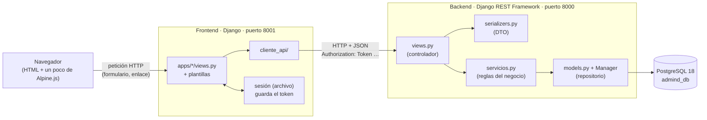
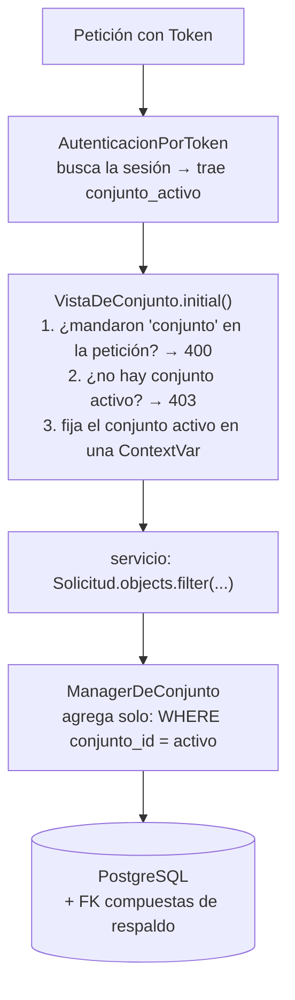
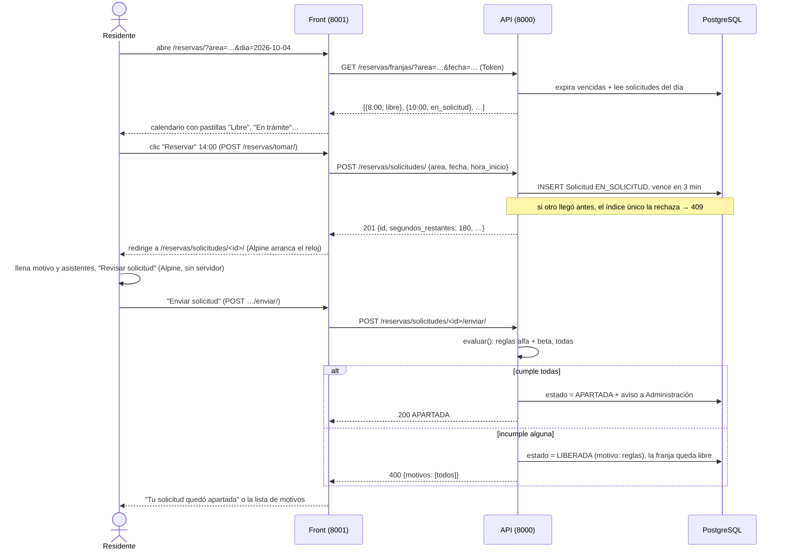
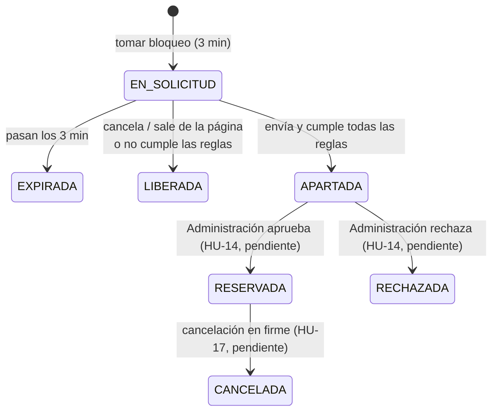

# AdMind — Cómo está hecho hoy

> [!NOTE] Qué es este documento
> Una foto explicada del proyecto **al 2026-09-29**, pensada para quien se perdió en el camino. Explica **qué hay, dónde está y cómo encaja**, con ejemplos del código real.
>
> **Qué cambió desde la versión del 28/09:** la identidad del conjunto (HU-21) ahora admite un **color propio** además de los 8 acentos, y el logo pasó a ser una **foto cuadrada 1:1** con recortador en el navegador. Eso sumó un segundo uso de Alpine. Está construido y con pruebas, pero **sin commit** (ver §4.6, §4.7, §5.7 y §10).
>
> - **Qué debe hacer el producto** (reglas, estados, ley): `Admin_Master.md`. Si esta guía lo contradice, manda el maestro.
> - **Avance historia por historia**: `Avance/Admind_Avance.md`.
> - `Guias/Admind_Guia_Desarrollo.md` es del 2026-09-15, cuando casi nada existía. Sus ideas de arquitectura siguen valiendo, pero sus avisos de "esto todavía no existe" ya no.

**Cómo leerla.** Si tienes 10 minutos: §1, §2 y §3. Si quieres entender de verdad cómo funciona: §7, que sigue una reserva desde el clic hasta la base de datos y de vuelta.

---

## 1. Resumen en una página

**AdMind** es una plataforma web para administrar conjuntos residenciales: usuarios y roles, apartamentos, áreas comunes, reservas, anuncios y notificaciones. Un mismo sistema atiende a **varios conjuntos** y los datos de uno nunca se ven desde otro.

| Qué | Estado al 2026-09-29 |
|---|---|
| **Backend** (la API) | Rama `desarrollo` en `66f8897`, **subida a GitHub**, más cambios **sin commit** en `apps/conjuntos/` (color propio y foto 1:1, con su migración `0004` ya aplicada en `admind_db`). 11 apps con código más `comun`. **320 pruebas, todas pasan** (verificado hoy, 16 s) |
| **Frontend** (las pantallas) | Rama `desarrollo` en `c1d8f6b`, **subida a GitHub**, más cambios **sin commit** en `apps/conjuntos/`, la base y la barra (los mismos de HU-21). 11 apps con pantallas. **127 pruebas, todas pasan** (verificado hoy, 2 s) |
| **Historias de usuario** | HU-01 a HU-13, HU-21, HU-25 y HU-26 tienen código. **Ninguna está "Terminada"**: a todas les falta la parte humana de la DoD (PR `desarrollo → pruebas` revisado y prueba manual de quien no la programó) |
| **Lo que sigue sin empezar** | HU-14 en adelante (bandeja del administrador, pagos, visitantes, casos, citas, documentos…), salvo HU-21 y HU-25 |
| **Plazo** | Entrega cerca del 2026-10-14 (fecha exacta sin confirmar). No hay que entregar las 38 historias |

**La idea central en tres frases:**

1. Hay **dos proyectos Django separados**: el backend es una API que habla JSON y es el único que toca PostgreSQL; el frontend arma las páginas HTML y le pide todo a la API.
2. Todo dato de un conjunto se filtra **automáticamente** por el "conjunto activo" de la sesión; nadie puede pedir datos de otro conjunto ni por error.
3. Las pantallas son **HTML generado en el servidor** (plantillas de Django). JavaScript solo aparece donde de verdad hace falta, y ahí se usa **Alpine.js**.

---

## 2. El mapa: qué hay en cada carpeta

```text
A D M I N D/
├── Backend/Admind_Backend/          ← repo GitHub ZeroFour-04/Admind_Backend   (la API, puerto 8000)
│   ├── config/                      ← ajustes del proyecto y rutas principales
│   ├── apps/                        ← un módulo por tema del negocio
│   │   ├── comun/                   ← piezas compartidas: aislamiento, modelo base, bloqueo
│   │   ├── personas/ cuentas/ conjuntos/ permisos/ unidades/
│   │   ├── areas/ reglas/ reservas/ anuncios/ notificaciones/ auditoria/
│   │   └── casos/ citas/ pagos/ …   ← solo README: módulos futuros, sin código
│   ├── tests/                       ← pruebas transversales (aislamiento, concurrencia, esquema)
│   ├── bd/                          ← notas sobre la base de datos
│   ├── manage.py  requirements.txt  pytest.ini  .env
│
├── Frontend/Admind_Front-End/       ← repo GitHub ZeroFour-04/Admind_Front-End (las pantallas, puerto 8001)
│   ├── config/                      ← ajustes (sin base de datos) y rutas principales
│   ├── cliente_api/                 ← el "mesero": funciones que llaman a la API
│   ├── apps/                        ← un módulo por sección de la interfaz: vistas, formularios, plantillas
│   ├── templates/base/              ← el esqueleto de toda página
│   ├── templates/componentes/       ← piezas reutilizables: barra, lateral, campo, confirmación
│   ├── static/css  static/js        ← estilos propios y el JavaScript: reservas.js, identidad.js y vendor/alpine.min.js
│   ├── design-system/               ← tokens de color, tipografía y componentes CSS (de Claude Design)
│   └── tests/                       ← pruebas de pantallas con la API simulada
│
├── Documentacion/Admind_Documentacion/  ← repo de documentación (esta bóveda de Obsidian)
├── Backend.zip                      ← la demo descartada de septiembre. No se usa
└── .claude/launch.json              ← cómo arranca Claude los dos servidores
```

Cada carpeta de `apps/` tiene un `README.md` que dice para qué existe. Las apps que **solo** tienen README (`casos`, `citas`, `pagos`, `visitantes`, `infracciones`, `documentos`, `parqueaderos`, `triage` en el back, `importacion_respaldo`) son el lugar reservado para historias futuras.

---

## 3. La arquitectura en una imagen



### 3.1 La analogía del restaurante

| En el restaurante | En AdMind | Dónde |
|---|---|---|
| El **comedor**, donde el cliente ve la carta | Las pantallas | `Frontend/…/apps/` y `templates/` |
| El **mesero**, que lleva pedidos y trae platos | `cliente_api/` | `Frontend/…/cliente_api/` |
| La **ventanilla** de la cocina, que revisa que el pedido venga completo | Vistas y serializers de la API | `Backend/…/apps/<app>/views.py`, `serializers.py` |
| El **chef**, que sabe las recetas y decide si se puede preparar | Los servicios | `Backend/…/apps/<app>/servicios.py` |
| El **despensero**, el único que entra a la despensa | Los modelos y su Manager | `models.py` + `apps/comun/aislamiento/managers.py` |
| La **despensa** | PostgreSQL | base `admind_db` |

Tres reglas salen de aquí, y son casi toda la arquitectura:

1. **El mesero nunca entra a la despensa.** El frontend tiene `DATABASES = {}`: literalmente no puede tocar la base.
2. **El de la ventanilla no cocina.** La vista de la API valida la entrada, revisa permisos y traduce el resultado a HTTP. Las reglas del negocio están en `servicios.py`, que **no sabe nada de HTTP**.
3. **El despensero siempre usa la lista del conjunto correcto.** Toda consulta sale filtrada por el conjunto activo sin que nadie lo escriba (§5.2).

> [!IMPORTANT] Lo que pide el profesor
> El flujo **controlador → servicio → repositorio** (su plantilla de ASP.NET). Los nombres y la ubicación de las carpetas le dan igual. En Django la equivalencia es: `views.py` = Controllers, `serializers.py` = Dtos, `servicios.py` = Services, Manager/`models.py` = Repositories, `apps/comun/` = Utilities. En la sustentación lo que se evalúa es **la dirección de las llamadas**: la vista no hace consultas al ORM por su cuenta y el servicio no devuelve respuestas HTTP.

### 3.2 ¿Por qué dos servidores y no uno?

Porque el objetivo del proyecto es que **back y front estén separados y se comuniquen por una API**. Mañana otra interfaz (una app móvil, por ejemplo) podría usar la misma API sin tocar el backend. El precio es que el front tiene que "traducir" cada pantalla en llamadas HTTP, y eso es exactamente lo que hace `cliente_api/`.

---

## 4. Las tecnologías, una por una

### 4.1 Tabla rápida

| Tecnología | Versión | Dónde | Para qué |
|---|---|---|---|
| **Python** | 3.14 | back y front | El lenguaje de todo el proyecto |
| **Django** | 5.2.17 (LTS) | back y front | Framework web: rutas, vistas, modelos, plantillas, sesiones, formularios |
| **Django REST Framework (DRF)** | 3.18 | back | Convierte Django en una API JSON: vistas `APIView`, serializers, autenticación, permisos |
| **PostgreSQL** | 18, nativo en Windows | back | La base de datos. Su motor hace cumplir reglas (restricciones, índices únicos parciales, FK compuestas) |
| **psycopg** | 3.3 | back | El "cable" entre Django y PostgreSQL |
| **python-dotenv** | 1.2 | back y front | Lee `.env` para no escribir contraseñas en el código |
| **django-otp** + **qrcode** | 1.7 / 8.2 | back | Segundo factor (códigos de 6 dígitos tipo Google Authenticator) y su QR |
| **requests** | 2.34 | front | Hace las peticiones HTTP del front a la API |
| **Plantillas de Django** | — | front | Generan el HTML en el servidor |
| **Alpine.js** | 3.17.4 | front | Interactividad pequeña dentro del HTML (hoy, en la solicitud de reserva y en el color y la foto del conjunto) |
| **CSS propio** (design system) | — | front | Colores, tipografías (Archivo e Inter) y componentes `am-*`. Sin Tailwind ni Bootstrap |
| **pytest** + **pytest-django** | 9.1 / 4.14 | back y front | Pruebas automáticas |
| **Git + GitHub** | — | los tres repos | Ramas `main`, `desarrollo`, `pruebas` (las fijó el profesor) |

### 4.2 Django en cinco conceptos

Django es el framework sobre el que están **los dos** proyectos. Casi todo lo que verás en el código es una de estas piezas:

| Pieza | Archivo | Qué hace | Ejemplo en AdMind |
|---|---|---|---|
| **Proyecto** | `config/` | Ajustes globales y la tabla de rutas principal | `config/settings.py`, `config/urls.py` |
| **App** | `apps/<nombre>/` | Un módulo con su propio tema | `apps/reservas/` |
| **Modelo** | `models.py` | Una clase de Python = una tabla de la base | `Solicitud` → tabla `reservas_solicitud` |
| **Migración** | `migrations/0001_….py` | El guion que crea o cambia las tablas. Se genera con `makemigrations` y se aplica con `migrate` | Hay 15 en el back; la última es `conjuntos/0004_color_personalizado` (29/09) |
| **Vista** | `views.py` | Recibe una petición y devuelve una respuesta | `FranjasView` |
| **URL** | `urls.py` | Qué dirección llama a qué vista | `path("franjas/", FranjasView.as_view())` |

Un **Manager** (`Modelo.objects`) es el objeto por el que se hacen las consultas: `Solicitud.objects.filter(...)`. AdMind lo reemplaza para que filtre solo por conjunto (§5.2).

### 4.3 Django REST Framework (DRF)

Django solo sabe devolver páginas; **DRF** le enseña a hablar JSON. En el backend se usan cuatro cosas:

- **`APIView`**: una vista con métodos `get`, `post`, etc. que devuelve `Response({...})` y DRF lo convierte a JSON.
- **Serializers**: validan lo que llega y dan forma a lo que sale. Son el "DTO" del profesor. `TomarBloqueoSerializer` exige `area`, `fecha` y `hora_inicio`; si falta algo, responde 400 con el campo que falló.
- **Autenticación** (`apps/cuentas/autenticacion.py`): lee la cabecera `Authorization: Token abc…` en **cada** petición y busca esa sesión en la tabla `TokenDeSesion`. Si no existe o venció → 401.
- **Permisos por defecto** (en `settings.py`): toda vista exige estar autenticado (`IsAuthenticated`) y tener el segundo factor al día (`DosFactoresAlDia`) salvo que diga lo contrario.

### 4.4 PostgreSQL como "guardián"

AdMind no confía solo en Python para las reglas importantes: las repite como **restricciones en la base**, porque la base es la única que ve todas las peticiones a la vez. Tres ejemplos reales:

| Restricción | Dónde | Qué impide |
|---|---|---|
| Índice único parcial `solicitud_franja_bloqueante_unica` | `reservas/models.py` | Que dos personas tengan la misma franja en trámite, apartada o reservada, **aunque hagan clic en el mismo milisegundo** |
| Índice único parcial `solicitud_un_bloqueo_por_persona` | ídem | Que una persona tenga dos bloqueos a la vez |
| FK compuesta `(x_id, conjunto_id)` | `apps/comun/aislamiento/migraciones.py` → `fk_compuesta()` | Que una fila apunte a algo de **otro conjunto** |

"Índice único **parcial**" significa: "único, pero solo entre las filas que cumplen una condición" (por ejemplo, solo las solicitudes en estado `EN_SOLICITUD`, `APARTADA` o `RESERVADA`). Las solicitudes expiradas o liberadas no cuentan, y por eso la franja vuelve a quedar libre.

### 4.5 Plantillas de Django (el HTML del front)

Una plantilla es HTML con huecos que Django llena en el servidor antes de mandarlo al navegador:

- `{{ variable }}` imprime un dato: `{{ solicitud.area.nombre }}`.
- ``, `` deciden qué se muestra.
- `` + `` es **herencia**: cada página rellena los bloques del esqueleto común.
- `` reutiliza una pieza.
- `` arma una dirección a partir del nombre de la ruta.
- `` protege los formularios contra envíos falsificados desde otros sitios.

La cadena de herencia es: `base/base.html` (el `<html>`, los CSS, el `data-acento` del conjunto) → `base/aplicacion.html` (barra superior + lateral + zona principal) → la página concreta. Las pantallas sin sesión (ingreso, recuperar contraseña) heredan de `base/sin_sesion.html`.

**¿Por qué así y no React o Vue?** Lo eligió Alejo el 2026-09-13: con el plazo corto, una sola forma de trabajar (Python + HTML) es más fácil de aprender y de defender que dos. El navegador recibe páginas completas; cambiar de mes en el calendario o de área es **un enlace**, no una llamada de JavaScript. (En el maestro, §12.1, esta decisión todavía figura como abierta.)

### 4.6 Alpine.js, explicado con calma

#### Qué es

Alpine.js es una librería de JavaScript **pequeña** (un solo archivo de unos 55 KB) que agrega comportamiento a HTML que ya existe, escribiendo **atributos** en las etiquetas. No arma la página ni reemplaza a Django: Django manda el HTML completo y Alpine le "da vida" a un pedazo.

Piensa en ella como un Vue en miniatura que vive dentro del HTML. Donde React necesitaría un proyecto aparte con `npm`, compilación y componentes, Alpine se usa así:

```html
<script src="alpine.min.js" defer></script>

<div x-data="{ abierto: false }">
  <button @click="abierto = !abierto">Mostrar detalles</button>
  <p x-show="abierto">Aquí están los detalles.</p>
</div>
```

`x-data` crea un pequeño estado (`abierto`); el botón lo cambia; el párrafo aparece o desaparece solo. Nada más.

#### Las directivas que usa AdMind

| Directiva | Qué hace | Ejemplo en `reservas/solicitud.html` |
|---|---|---|
| `x-data="…"` | Declara un componente y su estado. Todo lo de adentro puede usar ese estado | `x-data="solicitudDeReserva(180, '/reservas/…/liberar/')"` |
| `x-text="expr"` | Reemplaza el texto del elemento por el valor, y lo actualiza cuando cambia | `<span x-text="reloj">3:00</span>` → la cuenta regresiva |
| `x-show="expr"` | Muestra u oculta el elemento (con `display: none`) | `x-show="vencido"` → "Se venció el tiempo" |
| `x-cloak` | Oculta el elemento hasta que Alpine arranca, para que no "parpadee" | en el aviso de vencido y en el panel de confirmación |
| `@click="…"` | Atajo de `x-on:click`: corre código al hacer clic | `@click="revisar($el.form)"` |
| `@submit="…"` | Igual, al enviar un formulario | `@submit="enviando = true"` |
| `:disabled="expr"` | Atajo de `x-bind:disabled`: pone o quita un atributo según el estado | `:disabled="vencido"` → el botón se apaga a los 0:00 |
| `Alpine.data("nombre", …)` | Define un componente reutilizable en un `.js` aparte, en vez de escribirlo en el HTML | `static/js/reservas.js` |
| `init()` | Se ejecuta una vez cuando el componente arranca | arranca el reloj y escucha la salida de la página |
| `get nombre()` | Un valor calculado que se recalcula solo | `get vencido()`, `get reloj()` |
| `$root`, `$el` | El elemento raíz del componente y el elemento actual | `this.$root.querySelector(...)` |

La pantalla de color y foto (`conjuntos/identidad.html` y `_selector_acento.html`) usa además:

| Directiva | Qué hace | Ejemplo |
|---|---|---|
| `x-ref="nombre"` + `this.$refs.nombre` | Le pone nombre a un elemento para usarlo desde el código sin buscarlo | `x-ref="color"` → `this.$refs.color.value` |
| `@input`, `@change` | Reaccionan al cambiar un campo | `@input="elegir($event.target.value)"` en el `<input type="color">` |
| `:style="…"` | Pone estilos según el estado | `:style="{ background: color }"` pinta la muestra del color propio |
| `<template x-if="…">` | Crea o quita el elemento (no solo lo oculta) | la imagen del recortador existe solo con una foto cargada |
| `@pointerdown`, `@pointermove`, `@pointerup` | Arrastrar con mouse, dedo o lápiz | mover la foto dentro del cuadro |
| `@keydown.arrow-left.prevent` | Tecla con modificador: `.prevent` evita que la página se desplace | mover la foto con las flechas (accesible sin mouse) |
| `this.$nextTick(…)` | Espera a que Alpine termine de pintar antes de medir | leer el ancho del cuadro recién mostrado |

#### Dónde y por qué se usa en AdMind

**Hoy, en dos lugares.** En los dos, la regla es la misma: **Alpine solo donde el servidor no alcanza**. El resto de pantallas funciona sin una línea de JavaScript.

**1. La solicitud de reserva en trámite** (HU-11 y HU-12), `static/js/reservas.js`. Ahí hacen falta tres cosas que el HTML del servidor no puede hacer solo:

1. **La cuenta regresiva de 3 minutos** que baja cada segundo.
2. **Mostrar el panel de confirmación** ("Vas a solicitar el Salón social para el sábado 4 de octubre…") **sin recargar la página** y sin perder lo escrito si el usuario pulsa "Corregir".
3. **Soltar la franja si la persona se va** de la página sin enviar (con `navigator.sendBeacon`, que alcanza a mandar una petición aunque la pestaña se esté cerrando).

**2. El color y la foto del conjunto** (HU-21, 29/09, sin commit), `static/js/identidad.js`. Se carga en la pantalla *Color y foto* y en el paso 1 del asistente. Tiene dos componentes:

- **`selectorDeColor`**: al mover el selector de color del navegador marca solo la opción "Personalizado", y calcula en vivo el contraste del texto blanco de los botones sobre ese color. Si baja de 4.5:1 **solo advierte**; se puede guardar igual.
- **`recortadorDeFoto`**: al elegir una imagen la muestra dentro de un cuadro; la persona la arrastra (o usa las flechas) y la acerca con un deslizador. Al enviar, dibuja lo que quedó dentro del cuadro en un `<canvas>` de 512 × 512, lo convierte a WebP (o JPG si pesa más de 512 KB) y **reemplaza el archivo del formulario** por ese recorte antes de mandarlo.

Las dos pantallas **funcionan sin JavaScript**: sin Alpine, se marca "Personalizado" a mano y la foto sube tal cual; si no es cuadrada, la API la rechaza con un mensaje claro (§5.7). Como en la reserva, el navegador ayuda pero **no decide**.

#### El componente real, comentado

`Frontend/…/static/js/reservas.js` (resumido):

```js
document.addEventListener("alpine:init", () => {            // "cuando Alpine esté por arrancar…"
  Alpine.data("solicitudDeReserva", (segundos, urlLiberar) => ({
    restantes: segundos,   // lo calculó el SERVIDOR: el navegador no decide si venció
    enviando: false,       // si se está enviando un formulario, salir no suelta la franja
    revisando: false,      // ¿está abierto el panel de confirmación?

    init() {
      const vence = Date.now() + segundos * 1000;
      const reloj = setInterval(() => {                      // cada segundo…
        this.restantes = Math.max(0, Math.round((vence - Date.now()) / 1000));
        if (this.restantes === 0) clearInterval(reloj);
      }, 1000);
      window.addEventListener("pagehide", () => this.soltar(urlLiberar));  // al salir
    },

    get vencido() { return this.restantes === 0; },
    get reloj()   { /* 125 → "2:05" */ },

    revisar(formulario) {                                   // botón "Revisar solicitud"
      if (formulario.reportValidity()) this.revisando = true;
    },
    soltar(url) { /* manda POST a /liberar/ con sendBeacon, salvo si ya se envió o venció */ },
  }));
});
```

Tres detalles que un jurado podría preguntar:

- **¿El reloj del navegador decide si venció?** No. Es solo un indicador. Quien decide es la API, con `bloqueo_vence_en` guardado en la base. Si alguien manipula el JavaScript, la API igual rechaza el envío tarde con un 409.
- **¿Por qué `reservas.js` se carga antes que `alpine.min.js`?** Los dos llevan `defer`, que respeta el orden. `reservas.js` registra el componente en el evento `alpine:init`, que Alpine dispara al arrancar; si Alpine cargara primero, el componente no existiría cuando lo busca.
- **¿Por qué está "autoalojado"** (`static/js/vendor/alpine.min.js`) y no se carga de internet? Para que funcione sin conexión externa y porque la versión queda fija (3.17.4) y revisable. El README de `vendor/` guarda su huella SHA-256.

### 4.7 El sistema de diseño (CSS)

Vive en `Frontend/…/design-system/` y se importó del proyecto de Claude Design "AdMind Design System".

- **Tokens** (`tokens/*.css`): variables CSS con nombre de significado, no de color. Por ejemplo `--texto-fuerte`, `--superficie-tarjeta`, `--acento-600`. Cada par de colores trae anotado su contraste.
- **Componentes** (`tokens/componentes.css`): clases con prefijo `am-`: `am-btn`, `am-btn--primario`, `am-tarjeta`, `am-pastilla`, `am-campo`, `am-alerta`, `am-lateral`…
- **Acento por conjunto** (HU-21/HU-26): cada conjunto elige uno de **8 acentos** o, desde el 29/09, un **color propio**. El acento solo toca cuatro sitios: botón primario, ítem activo del lateral, anillo de foco y franja del conjunto.
  - Con uno de los 8, `base.html` pone `data-acento="azul"` en `<html>` y `colores.css` reapunta las variables `--acento-*` a esa rampa.
  - Con el propio no hay rampa hecha: `apps/conjuntos/colores.py` → `rampa(hex)` saca del color elegido los mismos cinco tonos (`--acento-50`, `-600`, `-700`, `-900` y el anillo) mezclándolo con blanco o negro, y la etiqueta `` (`apps/conjuntos/templatetags/conjuntos.py`) los escribe en el `style` de `<html>`, donde ganan sobre los de `:root`. El color **no se corrige** aunque sea poco legible: solo se advierte.
- **Foto del conjunto** (HU-21): `conjuntos/_foto.html` pinta la foto cuadrada en cuatro tamaños (barra, tarjeta, resumen, grande). Sin foto muestra un **marcador con las iniciales** (filtro `iniciales`: "Torres del Río" → "TR") en colores neutros.
- **Estilos propios** de la estructura y de pantallas concretas en `static/css/` (`estructura.css`, `reservas.css`).

> [!WARNING]
> Los acentos se agregaron a la copia local de `design-system/`. Si alguien re-sincroniza desde Claude Design sin llevarlos allá primero, se borran.

### 4.8 pytest

Las pruebas se escriben como funciones `def test_…():` con `assert`. `pytest-django` les da una base de datos de prueba que se crea y se borra sola.

- **Back**: usa `config/settings_pruebas.py` (lo fija `pytest.ini`), que agrega una app de apoyo (`tests.aislamiento`) y un cifrado de contraseñas rápido (provisional, decisión de Alejo).
- **Front**: no tiene base de datos ni API de verdad; las pruebas **simulan la API** con `mock.patch("cliente_api.reservas.franjas", return_value=…)` y revisan el HTML que sale.

---

## 5. El backend a fondo

### 5.1 Anatomía de una app

Todas las apps con código siguen la misma forma. Con `reservas` como ejemplo:

| Archivo | Capa (profesor) | Qué contiene en `reservas` |
|---|---|---|
| `urls.py` | Controller (rutas) | 5 rutas: franjas, solicitudes, detalle, liberar, enviar |
| `views.py` | Controller | Una clase por ruta. Exige el permiso, valida con un serializer, llama al servicio y traduce cada excepción a un código HTTP (400, 404, 409) |
| `serializers.py` | DTO | Forma de la entrada (`TomarBloqueoSerializer`) y de la salida (`DetalleDeSolicitudSerializer`) |
| `servicios.py` | Service | Las reglas: `franjas()`, `tomar_bloqueo()`, `liberar()`, `enviar()`. Lanza excepciones con nombre (`FranjaOcupada`, `BloqueoVencido`, `IncumpleReglas`…) |
| `models.py` | Repository (con el Manager) | `Solicitud`, sus estados y sus restricciones |
| `migrations/` | — | Cómo se crea la tabla |
| `tests.py` | — | Pruebas de la app |
| `README.md` | — | Para qué existe |

Fíjate en el patrón de errores: el **servicio** dice *qué* pasó con una excepción con nombre de negocio (`FranjaOcupada`); la **vista** decide *cómo* se dice por HTTP (`409 "Otra persona está tramitando esta franja"`). Así el servicio no sabe nada de HTTP.

### 5.2 `apps/comun/`: las tres piezas que usan todas las demás

#### a) El aislamiento entre conjuntos (HU-05)

Es la pieza más importante del backend. Resuelve: *"un administrador del conjunto A nunca puede ver ni tocar datos del conjunto B"*.



| Archivo | Qué hace |
|---|---|
| `aislamiento/contexto.py` | Guarda el conjunto activo en una **ContextVar** (una variable "por petición": cada petición ve la suya). `usar_conjunto(id)` la fija a mano en pruebas y scripts |
| `aislamiento/vistas.py` → `VistaDeConjunto` | Clase base de **toda** vista con datos de un conjunto. Lee el conjunto de la sesión del token, **nunca** de la petición |
| `aislamiento/managers.py` → `ManagerDeConjunto` | Reemplaza `Modelo.objects`: toda consulta sale ya filtrada. Sin conjunto activo, falla a propósito |
| `aislamiento/migraciones.py` → `fk_compuesta()` | Segunda línea de defensa en la base: una fila no puede apuntar a otra de otro conjunto |
| `modelos_base/modelos.py` → `ModeloDeConjunto` | Clase base de todo modelo de conjunto: id UUID, `conjunto`, el Manager filtrado y un `save()` que rechaza escribir en otro conjunto |

> [!TIP] Por qué no es un "middleware"
> El maestro habla de middleware, pero los middleware de Django corren **antes** de que DRF lea el token. Por eso el trabajo lo hace `VistaDeConjunto`, que corre justo después de autenticar.

La prueba estrella es `tests/aislamiento/test_intruso.py`: recorre **todas** las rutas de la API con un usuario de otro conjunto y verifica que no ve nada. Si mañana alguien agrega una vista que no hereda de `VistaDeConjunto`, esa prueba falla.

#### b) El bloqueo (`apps/comun/bloqueo/`, HU-11)

Resuelve: *"si 50 residentes pulsan «Reservar» en la misma franja a la vez, solo uno la obtiene"*.

- `tomar(crear)`: intenta el `INSERT` dentro de una transacción. **No pregunta antes si está libre** (entre la pregunta y el INSERT otro podría ganar). Si el índice único parcial lo rechaza, lanza `RecursoOcupado`. La base decide, y decide una sola vez.
- `expirar_vencidos(...)`: pasa a `EXPIRADA` todo lo vencido con un solo `UPDATE`. No hay proceso en segundo plano: se llama **al principio de cada consulta o acción** de reservas.

`tests/concurrencia/test_bloqueo_de_franjas.py` lanza N hilos contra la misma franja y comprueba que queda un solo bloqueo.

#### c) La auditoría (`apps/auditoria/`)

Un registro de **solo inserción**: `Registro` prohíbe `update()` y `delete()`. `auditoria.servicios.registrar(actor, accion, entidad, …)` se llama, por ejemplo, al asignar o retirar un rol.

### 5.3 Sesión, token y segundo factor (`apps/cuentas/`)

1. `POST /auth/login/` con correo y contraseña → el servicio crea un **`TokenDeSesion`** y devuelve el token (una cadena aleatoria). En la base se guarda solo su **huella** SHA-256, nunca el token en claro.
2. La sesión dura **1 hora** (`DURACION_TOKEN_DE_SESION`) y guarda: usuario, **conjunto activo** y si el **segundo factor** ya se verificó.
3. Si la persona tiene un solo conjunto, se elige solo; si tiene varios, pasa por el selector (`POST /auth/conjunto-activo/`, HU-26).
4. Quien tiene algún **permiso sensible** (gestionar usuarios, asignar roles, ver auditoría…) debe configurar y verificar el **segundo factor** (código de 6 dígitos con django-otp, HU-02). Mientras no lo haga, `DosFactoresAlDia` responde 403 en todo lo demás.
5. Recuperar contraseña (HU-01): `POST /auth/recuperar/` manda un enlace por correo (en local, el correo sale en la consola).

Se eligió **token opaco guardado en la base** y no JWT: se puede revocar al instante (logout) y guarda estado (conjunto activo, 2FA).

### 5.4 Roles y permisos (`apps/permisos/`)

- **Catálogo fijo en código** (`catalogo.py`): 5 roles (Superusuario, Administración, Secretaría, Vigilancia, Residente) y la lista de permisos de cada uno (`"reserva.solicitar"`, `"area.gestionar"`…). No se editan desde la interfaz: un cambio se hace en el código. El reparto es provisional hasta validarlo con un administrador real.
- **`Asignacion`**: "la persona X tiene el rol Y en el conjunto Z desde tal fecha hasta tal fecha". El Superusuario tiene `conjunto` nulo (es de plataforma).
- **`exigir_permiso(request, "reserva.solicitar")`** (`permisos/views.py`): la primera línea de cada vista. Si falta el permiso → 403.
- **"Nunca cero Administración"**: el servicio impide retirar el último rol de Administración de un conjunto (`UltimaAdministracion`).

### 5.5 Todas las apps del backend

| App | Qué guarda / hace | Endpoints principales | HU |
|---|---|---|---|
| `personas` | `Persona` global, única por tipo y número de documento (normalizado) | `GET /personas/buscar/`, `POST /personas/vincular/` | HU-04, HU-07 |
| `cuentas` | `Usuario` (entra con correo), `TokenDeSesion`, 2FA, recuperación, usuarios del conjunto | `/auth/login/`, `/auth/logout/`, `/auth/conjuntos/`, `/auth/conjunto-activo/`, `/auth/usuarios/…`, `/auth/recuperar/…`, `/auth/dos-factores/…` | HU-01, HU-02, HU-06, HU-26 |
| `conjuntos` | `Conjunto` (acento y `color_personalizado`), `LogoDeConjunto` (la foto 1:1), asistente de creación | `POST /conjuntos/`, `/conjuntos/actual/…` (activar, identidad, logo), `/conjuntos/logos/<huella>/` | HU-03, HU-21 |
| `permisos` | Catálogo de roles, `Asignacion`, permisos efectivos | (se usan desde `cuentas`: `/auth/usuarios/<id>/roles/`) | HU-06 |
| `unidades` | `Unidad` (apartamento) y `VinculoUnidad` (propietario, reside…) con histórico; a quién avisar de qué | `/unidades/`, `/unidades/<id>/vinculos/…` | HU-08 |
| `areas` | `Area` común: clasificación cerrada, horario por bloques, mantenimiento | `/areas/`, `/areas/<id>/`, `/areas/<id>/desactivar/` | HU-09 |
| `reglas` | Reglas **beta** configurables y versionadas; reglas **alfa** fijas; el evaluador | `/reglas/`, `/reglas/<id>/`, `/reglas/<id>/retirar/` | HU-10, HU-13 |
| `reservas` | `Solicitud`: franjas, bloqueo de 3 min, envío y evaluación | `/reservas/franjas/`, `/reservas/solicitudes/…` | HU-11, HU-12, HU-13 |
| `anuncios` | Anuncios del conjunto o de una vivienda | `/anuncios/`, `/anuncios/<id>/` | HU-25 |
| `notificaciones` | Bandeja en la app + correo; `canal.notificar(aviso, personas)` | `GET /notificaciones/` | HU-25, HU-08 |
| `auditoria` | Registro de solo inserción | (sin endpoints: lo usan los servicios) | transversal |
| `comun` | Aislamiento, modelo base, bloqueo | — | HU-05, HU-11 |

### 5.6 El motor de reglas (HU-10 y HU-13)

Cuando un residente envía una solicitud, `reglas/evaluador.py` → `evaluar(solicitud)` revisa **todas** las reglas y devuelve un resultado por cada una (no se detiene en la primera que falla, para poder decirle a la persona **todos** los motivos).

- **Reglas alfa** (`alfa.py`): están en el código, siempre activas, el administrador no las apaga. Ejemplo: "quien solicita debe residir en la unidad".
- **Reglas beta** (`catalogo.py` + modelo `Regla`): las configura el administrador por área, con 7 tipos cerrados: anticipación mínima, anticipación máxima, cupo por apartamento, aforo, franja horaria, días no reservables y paz y salvo. Son **versionadas**: cambiar una crea una versión nueva y la vieja queda para explicar decisiones pasadas.
- Todas **restringen**, ninguna permite, así que se combinan con **Y** sin conflictos.
- El resultado se **copia** en `Solicitud.evaluacion` (JSON), para que la explicación siga siendo cierta aunque la regla cambie mañana.

### 5.7 La identidad del conjunto: color propio y foto 1:1 (HU-21, 29/09, sin commit)

**El color.** `Acento` suma una novena opción, `personalizado`, y `Conjunto` un campo `color_personalizado` (hex `#rrggbb` en minúsculas). La regla se cumple en tres capas:

| Capa | Dónde | Qué hace |
|---|---|---|
| Serializer | `serializers.py` → `validar_color()` | Personalizado sin color → 400 "Elige el color del conjunto". Color con un acento del catálogo → 400. Al volver a uno del catálogo, **borra** el color viejo |
| Vista | `ConjuntoActualView.patch()` | Mandar `color` exige el mismo permiso que el acento (`conjunto.branding` o `conjunto.activar`) |
| Base | `CHECK conjunto_color_personalizado_valido` | Personalizado ⇔ hay un hex válido. Nadie guarda un estado a medias ni por fuera de la API |

El backend **no calcula** la paleta ni el contraste: guarda el hex y ya. Pintarlo es trabajo del front (§4.7).

**La foto.** Sigue guardándose como el "logo" (`LogoDeConjunto`, con su huella SHA-256 en `Conjunto.logo_huella`), pero ahora **debe ser cuadrada**. `servicios.guardar_logo()` revisa, en orden: que no esté vacía, que pese hasta 512 KB, que sea de verdad PNG, JPG o WebP (por su firma, no por la extensión) y que ancho = alto. Si no → `LogoInvalido` → 400 "La foto debe ser cuadrada (1:1). Esta mide 800 × 600 px".

¿Cómo sabe el tamaño sin instalar una librería de imágenes? `apps/conjuntos/imagenes.py` → `dimensiones()` **lee solo la cabecera** del archivo: cada formato guarda el ancho y el alto en bytes conocidos (el bloque `IHDR` del PNG, el marcador de inicio de cuadro del JPG, el fragmento `VP8`/`VP8L`/`VP8X` del WebP). No se decodifica ningún píxel.

> [!WARNING] Choca con lo decidido antes
> El 22/09 HU-21 se construyó con "solo los 8 acentos, sin hex libre" (maestro §6.3). El color propio lo pidió Alejo el 29/09 y **revierte** esa decisión. El maestro todavía no lo dice.

---

## 6. El frontend a fondo

### 6.1 `config/`

- `DATABASES = {}`: no hay base de datos.
- Las sesiones se guardan **en archivos** (`SESSION_ENGINE = …file`), con cookie `HttpOnly` (el JavaScript del navegador no la puede leer).
- `ADMIND_API_URL` sale del `.env` (`http://127.0.0.1:8000` en local).
- `STATICFILES_DIRS` sirve `static/` y `design-system/`.

### 6.2 `cliente_api/`: el mesero

Un archivo por app del backend (`reservas.py`, `areas.py`, `cuentas.py`…), con una función por endpoint. Todas usan `http.py` → `pedir(request, metodo, ruta, datos)`, que:

1. Saca el token de la sesión y lo pone en `Authorization: Token …`.
2. Llama a la API con `requests` (máximo 10 segundos).
3. Si la API no responde → `ApiNoDisponible` ("No hay conexión con el servidor de AdMind…").
4. Si responde con error → `ErrorDeApi`, que ya trae el mensaje en español para mostrar y los errores por campo (`error.campos`).

Así ninguna vista del front repite la lógica HTTP: solo hace `try: api_reservas.tomar(...) except ErrorDeApi as error: …`.

### 6.3 `apps/cuentas/sesion.py`: la sesión del front

- `abrir_sesion()`: al entrar, guarda en la sesión el **token**, el **conjunto activo**, los **permisos** y el estado del **segundo factor**, y hace que la sesión venza a la misma hora que el token.
- `tiene_permiso(request, "area.gestionar")`: lo usan las plantillas para **mostrar u ocultar** botones y secciones del lateral. Ojo: es solo para decidir qué se ve. **Quien decide de verdad es la API** en cada petición.
- `SesionRequeridaMiddleware`: toda pantalla exige sesión salvo las marcadas con `@publica` (ingreso, recuperar contraseña). Con el segundo factor pendiente, solo deja abrir las pantallas para completarlo.

### 6.4 Las pantallas

Cada app del front tiene `views.py` (funciones), `urls.py`, a veces `forms.py` (formularios de Django para validar antes de llamar a la API) y `templates/<app>/`.

| Sección del lateral | App del front | Estado |
|---|---|---|
| Ingreso, recuperar contraseña, segundo factor | `cuentas` | Real, contra la API |
| Selector de conjunto, asistente de creación, *Color y foto* (8 acentos o color propio, foto 1:1 con recortador) | `conjuntos` | Real. El asistente es parcial (HU-03). **Aquí también está Alpine** (29/09, sin commit) |
| Inicio | `paneles` | **Maqueta** con datos de ejemplo |
| Zonas comunes (calendario, solicitud) | `reservas` | Real. **Aquí está Alpine** |
| Áreas comunes | `areas` | Real (solo con `area.gestionar`) |
| Reglas | `reglas` | Real |
| Anuncios | `anuncios` | Real |
| Notificaciones | `notificaciones` | Real |
| Solicitudes | `triage` | **Maqueta** vacía (HU-22, futuro) |
| Conjunto | `conjuntos` | Real (resumen del asistente) |
| Usuarios (lista, detalle con roles, registrar persona) | `usuarios` | Real. `usuarios/nuevo.html` aún muestra la etiqueta "Maqueta" |
| Apartamentos y parqueaderos | `unidades` | Real (apartamentos y vínculos; parqueaderos no) |

`templates/componentes/` guarda lo reutilizable: `barra_superior.html` (nombre y foto del conjunto activo, o sus iniciales), `lateral.html` (marca solo el ítem activo leyendo la URL), `campo.html`, `errores_formulario.html` y `confirmacion_de_contenido.html` (el panel de HU-12).

Cuando una app necesita piezas propias las guarda dentro de ella: `conjuntos/_foto.html` y `conjuntos/_selector_acento.html` (el guion bajo indica "pedazo para incluir, no página"), y las **etiquetas de plantilla** en `apps/conjuntos/templatetags/conjuntos.py` (`atributos_de_acento`, `iniciales`, `color_seguro`, `poco_legible`, `contraste_con_blanco`), que se cargan con ``.

---

## 7. Recorrido completo: un residente reserva el salón social

Este es el mejor ejercicio para entender AdMind: seguir **una** acción por todas las capas.



### Paso 1 — Ver las franjas

- **Front** `apps/reservas/views.py` → `calendario()` → `pantalla_del_calendario()`: arma el mes con el módulo `calendar` de Python y, si hay área y día elegidos, llama `cliente_api.reservas.franjas()`.
- **API** `FranjasView.get()`: `exigir_permiso(request, "reserva.solicitar", "reserva.ver_todas")` → valida con `ConsultarFranjasSerializer` → `servicios.franjas(persona, area, fecha)`.
- **Servicio** `franjas()`: primero `expirar_vencidas()`; luego calcula los bloques del horario del área y, para cada uno, dice `libre`, `en_solicitud`, `apartada`, `reservada`, `pasada`, `propia` o `no_disponible`. **Nunca dice quién la tiene.**
- **Front** traduce cada estado a una pastilla con texto (`PASTILLA_POR_ESTADO`): nunca solo con color, por accesibilidad.

### Paso 2 — Tomar el bloqueo

- **Front** `tomar()` (un `POST` del botón "Reservar") → `cliente_api.reservas.tomar()`.
- **API** `SolicitudesView.post()` → `servicios.tomar_bloqueo()`, que revisa: ¿la persona reside en alguna unidad?, ¿el área está activa y sin mantenimiento?, ¿la franja existe y no ha empezado? Después **intenta el INSERT** con `bloqueo.tomar()`.
- **PostgreSQL** decide: si ya hay una solicitud bloqueante en esa franja, el índice `solicitud_franja_bloqueante_unica` la rechaza → `FranjaOcupada` → **409**. Si la persona ya tiene otro bloqueo, `solicitud_un_bloqueo_por_persona` → `YaTienesUnBloqueo` → 409 con el id de la otra solicitud.
- Si todo va bien: `Solicitud` en `EN_SOLICITUD` con `bloqueo_vence_en = ahora + 3 minutos` → **201**. El front redirige a la pantalla de la solicitud.

### Paso 3 — Llenar y confirmar (aquí entra Alpine)

- La plantilla `reservas/solicitud.html` sale del servidor con los segundos restantes ya calculados: `x-data="solicitudDeReserva(180, '…/liberar/')"`.
- Alpine baja el reloj cada segundo (`x-text="reloj"`), apaga el botón al llegar a 0:00 (`:disabled="vencido"`) y muestra el aviso de vencido (`x-show="vencido"`).
- "Revisar solicitud" (`@click="revisar($el.form)"`) oculta el formulario y muestra el **panel de confirmación** (HU-12) con el día de la semana en letras, el horario y los avisos que no bloquean (por ejemplo, "Empieza en menos de 24 horas"). No se llama al servidor ni se reinicia el reloj.
- Si la persona cierra la pestaña o navega a otro lado sin enviar, `pagehide` → `sendBeacon` a `/liberar/` y la franja queda libre al instante para otro (estado `LIBERADA`, motivo "voluntaria").

### Paso 4 — Enviar

- **Front** `enviar()`: valida primero con `SolicitudForm` (Django forms); si está bien, `cliente_api.reservas.enviar()`.
- **API** `EnviarSolicitudView.post()` → `servicios.enviar()`: comprueba que siga en trámite y que no haya vencido (si venció → `BloqueoVencido` → 409 "Se venció el tiempo"). Luego `evaluar(solicitud)` con **todas** las reglas.
- **Cumple todas** → `APARTADA`, se guarda la evaluación y se notifica a Administración por el canal de notificaciones.
- **Incumple alguna** → `LIBERADA` con motivo "reglas", la franja queda libre y la API responde **400 con todos los motivos**. El front los muestra en lista.

Lo que sigue, **aprobar o rechazar** la solicitud apartada (pasar a `RESERVADA` o `RECHAZADA`), es la HU-14 y todavía no existe.

### Los estados de una solicitud



`LIBERADA` y `EXPIRADA` se distinguen a propósito: según el maestro (R9), solo **dejar vencer** el bloqueo gasta una "oportunidad" sobre la franja; soltarlo a tiempo no.

---

## 8. Las pruebas

| Dónde | Cuántas | Qué cubren |
|---|---|---|
| `Backend/…/apps/*/tests.py` y `test_*.py` | la mayoría de las 320 | Cada app: modelos, servicios, endpoints, códigos de error. `conjuntos/test_identidad.py` cubre el color propio y la foto 1:1 (PNG, JPG y WebP no cuadrados) |
| `Backend/…/tests/aislamiento/` | — | Filtro por conjunto y la **prueba del intruso** sobre todas las rutas |
| `Backend/…/tests/concurrencia/` | — | N personas contra la misma franja → un solo bloqueo |
| `Backend/…/tests/esquema/` | — | La **lista cerrada de tablas globales**: si aparece una tabla sin `conjunto_id` que no esté en la lista, falla |
| `Frontend/…/tests/` | 127 | Cada pantalla con la API simulada: qué muestra, qué oculta sin permiso, cómo presenta los errores. `test_acentos.py` y `test_identidad.py` cubren la rampa del color propio, la advertencia de contraste y el marcador con iniciales |

Las pruebas automáticas **no reemplazan** la prueba manual de la DoD: nadie ha recorrido HU-06 a HU-13 en el navegador todavía. El recortador de foto es JavaScript y **no tiene prueba automática**: solo se prueba a mano.

---

## 9. Cómo correr todo en tu PC

Con PostgreSQL encendido (servicio `postgresql-x64-18`) y cada proyecto con su `.venv` y su `.env`. En Git Bash, **una terminal por servidor**:

```bash
cd "/c/Users/Alejandro/Documents/A D M I N D/Backend/Admind_Backend" && source .venv/Scripts/activate && python manage.py migrate && python manage.py runserver 8000
```

```bash
cd "/c/Users/Alejandro/Documents/A D M I N D/Frontend/Admind_Front-End" && source .venv/Scripts/activate && python manage.py runserver 8001
```

Luego abre `http://127.0.0.1:8001`.

Para tener con quién entrar, el comando `crear_usuarios_prueba` crea un "Conjunto de prueba" y un usuario por rol (`administracion@example.com`, `residente@example.com`, …), todos con la contraseña que le escribas. Solo funciona con `DEBUG` activo:

```bash
cd "/c/Users/Alejandro/Documents/A D M I N D/Backend/Admind_Backend" && source .venv/Scripts/activate && python manage.py crear_usuarios_prueba
```

> [!NOTE]
> Para probar una reserva de punta a punta, el residente necesita estar vinculado a una **unidad** con "reside" y debe existir un **área** activa. Eso se hace desde las pantallas de Apartamentos y Áreas entrando como Administración.

Para correr las pruebas, dentro de cada proyecto con su `.venv` activo:

```bash
python -m pytest -q
```

---

## 10. Estado de las historias al 2026-09-29

Ninguna historia está **Terminada**: la DoD del maestro (§8.1) pide, además del código y las pruebas, un PR `desarrollo → pruebas` revisado por quien no programó y una prueba manual de otra persona. Eso aún no ha pasado con ninguna.

| Grupo | Historias | Qué hay |
|---|---|---|
| **Sprint 1** | HU-01 login y recuperación · HU-02 segundo factor · HU-03 asistente de conjunto · HU-04 persona única · HU-05 aislamiento · HU-26 selector | Todo construido y commiteado ("sprint 1 terminado", 21–22/09). HU-03 quedó **parcial** (sin reglamento). `Admind_Avance.md` §5.2 todavía muestra fracciones viejas para HU-01, 02, 03 y 26 |
| **Sprints 2 y 3** | HU-06 roles · HU-07 vincular persona · HU-08 unidades · HU-09 áreas · HU-10 reglas beta · HU-11 bloqueo · HU-12 confirmación · HU-13 envío y reglas | Todos sus criterios en código y con prueba (27/09). En Notion, "En revisión" |
| **Adelantadas del Sprint 5** | HU-21 color y foto · HU-25 anuncios | Construidas el 22/09 (HU-25 con lo mínimo de notificaciones). HU-21 se amplió el 29/09 con el color propio y la foto 1:1, **sin commit** |
| **Sin empezar** | HU-14 a HU-20, HU-22 a HU-24, HU-27 a HU-38 | Solo el README de su app |

### Lo que frena para cerrar historias

- [ ] **Commitear y subir** el cambio de HU-21 del 29/09 en los dos repos (back: `apps/conjuntos/` con `imagenes.py` y la migración `0004`; front: `apps/conjuntos/`, `colores.py`, `templatetags/`, `identidad.js`, la base, la barra y `estructura.css`).
- [ ] El backend **no tiene rama `pruebas` en GitHub** (existe solo en local). Hay que subirla para abrir los PR `desarrollo → pruebas`.
- [ ] **Prueba manual** de HU-06 a HU-13 por quien no las programó, con el guion de `Guias/Admind_Plan_Sprints_2_3.md` §6.
- [ ] **Decidir el alcance** que entra antes de la entrega (maestro §12.8). El siguiente paso natural del núcleo es HU-14 (aprobar o rechazar), que cierra el ciclo de la reserva.
- [ ] Llevar al maestro las decisiones tomadas al construir: estado `LIBERADA`, un bloqueo por persona por conjunto, catálogo de reglas beta y versionado, token con registro en la base, stack del front (§12.1), y el **color propio y la foto 1:1** de HU-21 (§6.3 todavía dice que el acento está aplazado y sin hex libre).
- [ ] `Admind_Avance.md` tiene filas del 15/09 sin actualizar (su propio aviso lo dice).

---

## 11. Glosario

| Término | Significa |
|---|---|
| **Conjunto** | Un conjunto residencial. Es la unidad de aislamiento: todo dato pertenece a uno |
| **Conjunto activo** | El conjunto con el que estás trabajando en esta sesión. Sale del token, nunca de la petición |
| **Tabla global** | Tabla sin `conjunto_id` (Persona, Usuario, Conjunto, tokens…). Están en una lista cerrada que una prueba vigila |
| **Persona / Usuario** | Persona = el ser humano, único por documento, puede estar en varios conjuntos. Usuario = su cuenta para entrar (correo + contraseña) |
| **Asignación** | Un rol de una persona en un conjunto, con vigencia |
| **Unidad / Vínculo** | Unidad = apartamento. Vínculo = relación de una persona con la unidad (propietario, reside…), con histórico |
| **Franja** | Un bloque de horario de un área en una fecha: (área, fecha, hora de inicio, hora de fin) |
| **Bloqueo** | Los 3 minutos exclusivos para llenar y enviar una solicitud sobre una franja |
| **Regla alfa / beta** | Alfa: en el código, siempre activa. Beta: la configura el administrador, versionada |
| **Token** | La "llave" que el front manda a la API en cada petición. Vence en 1 hora |
| **Segundo factor (2FA, TOTP)** | El código de 6 dígitos de una app autenticadora, obligatorio con permisos sensibles |
| **Serializer** | Valida lo que entra a la API y da forma a lo que sale (el "DTO") |
| **Servicio** | Donde viven las reglas del negocio. No sabe de HTTP |
| **Manager** | El objeto `Modelo.objects` por el que se consulta. El de AdMind filtra por conjunto |
| **Migración** | Archivo que crea o cambia tablas. `makemigrations` lo genera, `migrate` lo aplica |
| **Índice único parcial** | "Único, pero solo entre las filas que cumplen X". Es lo que resuelve la concurrencia de reservas |
| **Acento / color propio** | El color con que se pinta la interfaz de un conjunto: uno de los 8 del catálogo o un hex que elige la Administración |
| **Foto del conjunto** | Imagen cuadrada (1:1) que lo identifica en la barra y el selector. En el código se sigue llamando "logo". Sin foto, se muestran sus iniciales |
| **Maqueta** | Pantalla con datos de ejemplo, todavía sin conectar a la API |
| **DoD** | *Definition of Done*: lo que debe cumplir una historia para contarse como Terminada (maestro §8.1) |

---

## 12. Dónde seguir leyendo

| Quiero… | Leer |
|---|---|
| Saber qué debe hacer el producto | `Admin_Master.md` |
| Ver el avance historia por historia y las decisiones tomadas | `Avance/Admind_Avance.md` |
| Entender el plan y las decisiones D1–D12 de los Sprints 2 y 3 | `Guias/Admind_Plan_Sprints_2_3.md` |
| Instalar el backend en otro PC | `Guias/Admind_Backend_Instalacion_Local.md` |
| Saber cómo se creó el backend | `Guias/Admind_Backend_Inicializacion.md` |
| Agregar una pantalla o una app siguiendo el patrón | `Guias/Admind_Guia_Desarrollo.md` (del 15/09: el patrón vale, el estado no) |
| Entender una carpeta concreta | El `README.md` de esa carpeta |
| Aprender Alpine en serio | La documentación oficial en alpinejs.dev (la sección "Start Here" se lee en 20 minutos) |
